# Art direction

The owner wants the look to match the visual references as closely as possible: graphics, details, textures, aesthetics, fidelity and the HUD. This document says how, in words, because the reference images are third-party screenshots and stay out of this repository. From the look spike onward, our own in-engine screenshots become the references that pull requests compare against.

Two limits from the spec still apply (section 1): a stable 60 FPS at 1080p on mid-range laptops, read as laptops with a dedicated GPU (integrated-only graphics is not a target, see [decisions](decisions.md#hardware-target-2026-10-20)), and only CC0, generated or clearly licensed assets. The look is bought with budget. The Balanced preset is tuned to hold the frame rate; Ultra goes closest to the references.

## What each reference teaches

| #   | Subject                                   | Take from it                                                                                                                                                                                           | Leave behind                                                         |
| --- | ----------------------------------------- | ------------------------------------------------------------------------------------------------------------------------------------------------------------------------------------------------------ | -------------------------------------------------------------------- |
| 01  | Shader-pack village at sunset             | A low warm sun, soft shadows, a sky from deep blue overhead to orange and pink at the horizon, puffy sunlit clouds, a lake with sun glitter and mirrored reflections, lantern glow, backlit tall grass | Pixel-cube textures, the pack's caption                              |
| 02  | Spruce forest on still water              | Conifers in silhouette against a lavender-peach sky, light shafts through the trees, near-mirror reflections                                                                                           | Blocky clouds                                                        |
| 03  | Aerial view of a dense forest             | Depth in layers: saturated greens close, orange haze far away, a sun glow with flare, bright clouds against deep blue                                                                                  | Blocky foliage; tree count is the main budget risk                   |
| 04  | Enshrouded construction (named "Valheim") | Thick, chunky pieces with visible courses, layered floors, ladders, cobbled ground, and the HUD                                                                                                        | Stone and thatch materials; our tiers are metal, composite and alloy |
| 05  | Valheim timber base                       | Layered roofs, trusses, round towers, curved walls, strong silhouettes, a hazy blue-green atmosphere                                                                                                   | Free-form snapping; we snap to the grid                              |
| 06  | Marching-cubes thumbnail                  | Organic, smooth landforms                                                                                                                                                                              | Flat-shaded facets; ours is smooth-shaded and textured               |
| 07  | Enshrouded landscape                      | A lush valley, pines and rock outcrops, snow peaks far away, cyan mist pools in hollows, one red mist pocket, grass blades with flowers up close, and the HUD                                          | Fantasy ruins                                                        |
| 08  | Cherry grove at sunset                    | A strong color grade, magenta-orange haze, layered silhouettes                                                                                                                                         | Pixel cubes                                                          |

References 01, 02, 03 and 08 are Minecraft-style and use pixel-cube textures, which spec section 4 bans. They inform lighting and atmosphere only. Textures follow the detailed references (04, 05, 07).

## The world

- A lush golden-hour valley, bounded at about 192 by 192 blocks (spec section 12 asks for 8 to 12 chunks of view). Hills and forest close the horizon.
- A lake on one side. The crash site sits in the middle: wreckage, the Outpost Core, and a scorched ash patch around them with a faint amber-red mist, echoing the red mist pocket in reference 07.
- Day is a long golden afternoon. The sun stays between about 12 and 45 degrees, always warm, so shadows stay long and readable. Night is cool blue with cyan tech accents. Dusk and dawn blend over about 40 seconds.
- Terrain is static in version 1. Players place and break structure blocks, not ground.

### Starting palette

| Use                      | Color                           |
| ------------------------ | ------------------------------- |
| Sky, zenith to horizon   | `#2f5d9e`, `#6d7fb8`, `#f2a65a` |
| Sun and warm light       | `#ffd9a0` to `#fff1c9`          |
| Night sky and moonlight  | `#070b1a`, `#1a2a4a`, `#8ab4ff` |
| Grass, lit and shaded    | `#7fa648`, `#4a7030`            |
| Dirt, rock, ash          | `#6b4a2f`, `#7d7468`, `#3b3835` |
| Structures: metal, plate | `#20262d`, `#38414b`            |
| Accents: amber, cyan     | `#f2a43a`, `#3ad1e0`            |

The look spike tuned these against screenshots. The palette stops in `src/shared/daycycle.ts` are now the source of truth; this table only names the intent.

## Light and atmosphere

1. **Sun.** One warm directional light with soft shadows from a shadow map that follows the player. The sun has a visible disc and glow.
2. **Fill.** A hemisphere light: sky color above, warm ground bounce below. Ambient occlusion is baked into vertex colors for terrain and structures, so no screen-space AO is needed on Balanced.
3. **Sky.** A gradient dome with procedural clouds that catch the sun on their undersides.
4. **Haze.** Height fog and distance haze tinted toward the sun, with colored mist pockets in hollows and over the crash site.
5. **Shafts, bloom and grade.** Half-resolution light shafts and bloom, then a final color grade with a light vignette. Strong grading (reference 08) is the cheapest way to look rich on modest hardware.

## Terrain, foliage and water

- **Terrain.** A smooth surface-nets mesh from the seeded density field, with collision from the same field, shaded with triplanar textures that blend by slope and height: grass on flats, rock on steep faces, dirt on worn paths, ash at the crash site. The look spike measured it against the smoothed-heightfield fallback and kept surface nets, because a heightfield smears rock faces (see `decisions.md`).
- **Foliage.** Instanced trees (pines and a broadleaf) with two levels of detail and distant impostors, grass cards and flowers that sway in the wind, and scattered boulders. Density scales with the preset.
- **Water.** One lake with a sky-colored fresnel, ripples and sun glitter. Ultra adds a half-resolution planar reflection for the still-water look of references 01 and 02.

## Structures and materials

Structures keep the spec's dark metal with amber and cyan accents, built with the construction language of references 04 and 05.

- **Geometry.** Thick pieces: walls read as deep, with inset panels and frame trim. Every face is inset and chamfered by 0.05 to 0.12 units, and faces are not merged, so seams stay visible. Phase 2c draws cubes with a 0.08 chamfer, a darker groove wherever two blocks meet and ambient occlusion in the corners. Slabs (half a cell high) and wedges (a 45 degree half-cube) give sloped roofs, eaves and strong silhouettes; since Phase 2e they take the same chamfer, groove and tiles as the cubes, and `?demo=hall` shows them as a gabled roof.
- **Tiers.** Scrap is patchwork salvaged plates with rust and rivets. Composite is layered grey-green panels with cyan edge strips. Alloy is brushed dark steel with amber inlays. Energy-Infused is dark with pulsing cyan veins. An upgrade must change the look, not only the stats: a block's material id picks its tile, so the Phase 5 upgrade changes one number and the block re-meshes.
- **Modules.** Turrets, generator, node, storage, terminal, bed and light are generated glTF models that feel engineered and modular. They glow cyan when powered and amber when active.
- **Materials.** Procedural, with detail bump from Balanced up. The tiles are baked on the GPU at load, four layouts for each tier, and each face of each block picks one by chance and turns it one of eight ways, so a wall never reads as one stamp repeated. Weathering, wear and exposed wiring come from the shared noise helpers, not per-piece textures, and no image file is involved.

## HUD

Reference images 04 and 07 are the model. The look spike built it (`src/ui/player-hud/`, with original icons) and the game page now shows it, fed by real numbers where the game has them (the compass follows the view, the Health and Energy bars are the player's own meters, the hotbar selection, the crosshair and the caption above the hotbar follow the player's building hands, and the day and night clock, the Core's gauge and the objective follow the run) and made-up ones where it does not yet (the hotbar's tools). The layout is drawn for 1280 by 720 and scales with the window. Type is a humanist serif system stack (Merriweather when installed, otherwise Georgia or the nearest serif).

- **Top left.** One torn, dark slate frame holds a wide health bar in three pale mint segments over a slim blue Energy bar that ends in a white cap. Under it, a column of round status icons, each with a short caption after a small triangle: green for a good one ("Charging", while the player stands in the Core's field) and amber for a bad one ("Low energy", "Out of energy"). The bars say how they stand without a number: Health empties from the right and turns red and breathes below a quarter; Energy turns amber below a quarter, where it starts to slow the player, and with none left its frame breathes. A wound flashes the Health bar and reddens the edges of the screen for a moment.
- **Top center.** A compass: a brush-stroke line about 320 px wide that shows 222 degrees, a small tick every 45 degrees, "N" inside a larger triangle with E, S and W as plain letters, and an orange diamond with an exclamation mark and a distance ("48M") for a waypoint.
- **Top right.** An objective banner: a slate bar that fades out to the left, a small letter-spaced place name over a bold objective line, and a mint diamond emblem straddling the end; under it, "Journal" with a white J key cap on a frosted pill.
- **Bottom center.** The hotbar: eight frosted slots with a numbered key cap at the top left, a status glyph at the top right, a green durability bar along the bottom, a stack count at the lower right, a cyan grid on blueprint items, and a white outline with a violet tint on the selected slot (a selected block keeps its cyan grid and gains a white ring and a soft glow). An "ALT" key cap sits to its left, and a "B Build" hint to its right that turns cyan while Build Mode is on. Slots 1 to 4 hold the four block materials as original icons, each a beveled cube in its tier's paint: scrap in rust with teal patches and rivets, composite in grey-green with cyan trim, alloy in steel with an amber hazard band, energy in graphite with cyan veins. Q turns the four into slabs and then wedges, drawn from the same paint, so the hotbar always shows the piece a click would place.
- **Above the hotbar.** A caption: the name of the piece in hand in bold with "Cost 1 Scrap" under it in soft white, shown in Build Mode and for a moment after a new choice. When a click would do nothing, the second line turns coral red and says why.
- **Center.** A small dot for a crosshair. Over a surface a block can go on it gets a thin cyan ring; in Build Mode a faint white ring is always there, and it turns red where a click would be refused.
- **Build Mode.** A translucent copy of the piece in hand, a block, a slab or a wedge, turned the way a click would place it, on the cell a click would fill (cyan when it works, red when it does not, with a bright rim and a slow breath) and a white outline, in the shape of the piece, on the block a click would break. The status panel at the bottom right lists the keys of the mode while it is on, Q for the kind of piece and R to turn it among them.
- **The day and night clock.** A small dark pill under the compass: the sun or the moon as a flat painted icon, the day or night with its number in letter-spaced capitals ("DAY 2", "NIGHT 2"), the time left until the light changes ("5:12"), and a thin bar along its bottom edge for how far through the day or night it is. It is amber by day and pale blue by night, and for the last 30 seconds before the light changes it breathes in its own colour. It is the spec's "subtle day/night or wave indicator", so it stays small. The waves join it when they exist.
- **The Outpost Core's gauge.** A second, slimmer pill under the clock: a small crystal icon, "CORE" in letter-spaced capitals, a thin bar and the points left. It is cyan while the Core is sound, amber below half, red below a quarter (and then it breathes) and flat grey at 0 once the Core has fallen; a hit flashes it. By night it is always up, even for a whole Core; by day it comes up only once the Core is hurt, so a morning with nothing wrong has nothing extra on the screen.
- **Still to come.** The wave count by the clock, the held item's name for tools above the hotbar, a powered-area panel at the bottom right, and the inventory and research overlays (spec section 10) arrive with their phases and reuse the same frames and type.

## Quality presets

| Element             | Low                             | Balanced                                    | Ultra                            |
| ------------------- | ------------------------------- | ------------------------------------------- | -------------------------------- |
| Internal resolution | 75 percent, floor 60, 1.0 MP    | 100 percent, floor 70, up to 2.1 MP         | 100 percent, fixed, up to 3.7 MP |
| Anti-aliasing       | None                            | FXAA                                        | 4x MSAA                          |
| Shadows             | None (blob shadows still to do) | One 2048 filtered map, 90 m                 | Two cascades, 160 m              |
| Haze and light      | Fog only                        | Adds mist pockets and a lit sky             | Adds light shafts                |
| Bloom and grade     | Grade only                      | Half-resolution bloom and grade             | Full-resolution bloom and grade  |
| Water               | Flat tint                       | Ripples, glitter and a 0.3 scale reflection | A 0.5 scale planar reflection    |
| Terrain view        | 8 chunks, plain textures        | 10 chunks, detail normals                   | 12 chunks, detail normals        |
| Foliage             | 25 percent, grass to 22 m       | 60 percent, grass to 34 m                   | 100 percent, grass to 52 m       |

The numbers live in `src/shared/quality.ts`. Balanced is the default and is tuned for 60 FPS at 1080p on a mid-range laptop; its governor lowers the internal resolution a step at a time when frames run long. The owner confirms it on real hardware with the benchmark switch (`?bench=1` on the game page). Presets change with the P key, the Graphics choice on the pause panel (both remembered in the browser) and a `?quality=` URL switch (for one visit); the full menu comes with Phase 6.

## Rules of thumb

- Match lighting and atmosphere first; they carry most of the reference look and cost the least.
- Pick the cheaper effect when two look alike, and measure before adding the next one.
- Never ship an asset that is not generated in code, CC0 or clearly licensed, and list every external asset in `CREDITS.md`.
- Do not commit reference images, screenshots of other games or anything traced from them.

## Look spike results

The look spike, a throwaway page that Phase 2b folded into the game page, built the target look end to end: seeded surface-nets terrain, a day cycle with a shadowed sun, an analytic sky, haze with mist pockets, a lake, trees, grass, the Enshrouded-style HUD and the three presets. It also settled terrain meshing and collision (see [decisions](decisions.md#look-spike-2026-10-20)). The reference images stay out of this repository, so the side-by-side sheets sit in the project files instead; the screenshots here are ours.

### Screenshots

Headless Chromium on software GL at 1280 by 720, with `freeze=1` so every run draws the same frame. Each reproduces from its URL on the game page, for example `/?shot=lake&quality=balanced&hud=0&stats=0&freeze=1` (the switches are in [the app README](../src/app/README.md)). The screenshots below were taken on the look page, which drew the same valley.

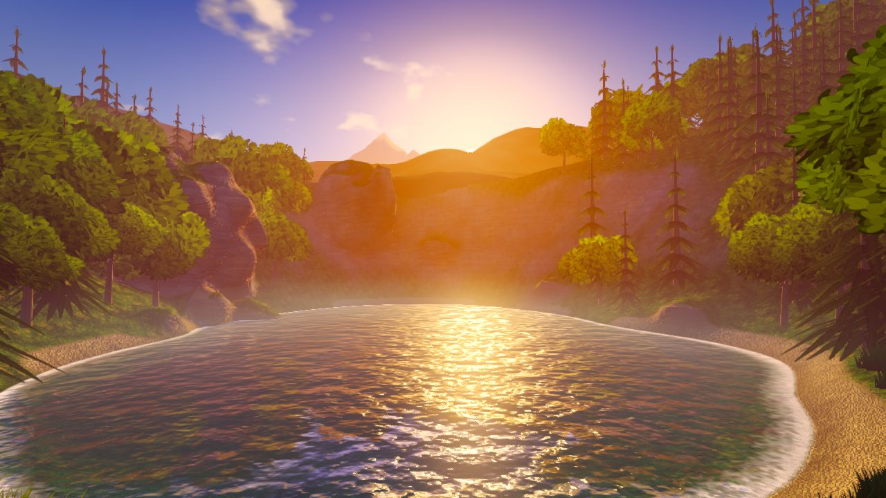

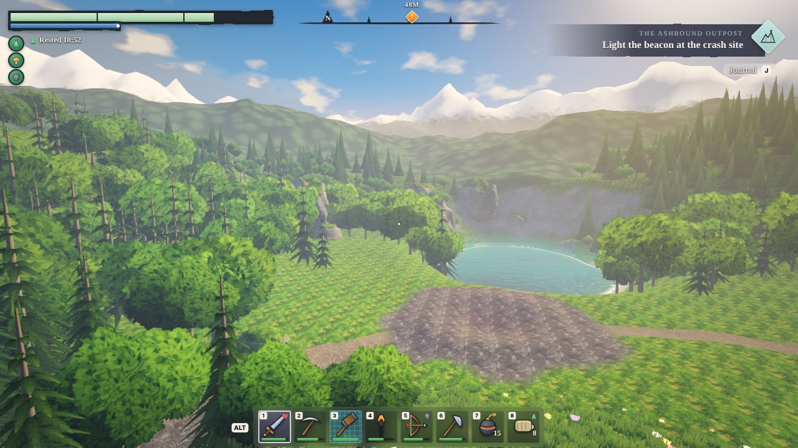

| Image                                                                                                   | Preset     | Compare with                                                             |
| ------------------------------------------------------------------------------------------------------- | ---------- | ------------------------------------------------------------------------ |
| [bal-lake](look/bal-lake.jpg)                                                                           | Balanced   | 01 and 02: a low warm sun, glitter and mist on the water, backlit pines  |
| [bal-valley](look/bal-valley.jpg)                                                                       | Balanced   | 07: pines and rock, cyan mist pools, snow peaks far away                 |
| [bal-canopy](look/bal-canopy.jpg)                                                                       | Balanced   | 03: layered forest, orange haze, a sun glow                              |
| [bal-sunset](look/bal-sunset.jpg)                                                                       | Balanced   | 08: a violet sky, orange haze, a strong grade                            |
| [bal-trail](look/bal-trail.jpg)                                                                         | Balanced   | 01 and 07: backlit grass and flowers up close                            |
| [bal-crash](look/bal-crash.jpg), [bal-noon](look/bal-noon.jpg)                                          | Balanced   | The crash clearing and high sun (no wreck until Phase 2)                 |
| [bal-outcrop](look/bal-outcrop.jpg), [terr-heightfield](look/terr-heightfield.jpg)                      | Balanced   | 06: a rock outcrop from surface nets, and the same view as a heightfield |
| [bal-dusk](look/bal-dusk.jpg), [bal-night](look/bal-night.jpg)                                          | Balanced   | Moon, stars, cool blue                                                   |
| [hud-valley](look/hud-valley.jpg), [hud-lake](look/hud-lake.jpg)                                        | Balanced   | 04 and 07: the player HUD at 1280 by 720                                 |
| [low-lake](look/low-lake.jpg), [ultra-lake](look/ultra-lake.jpg), [ultra-valley](look/ultra-valley.jpg) | Low, Ultra | The presets beside Balanced                                              |

Phase 2b put the valley in the game page, and its captures are in `phase-2/` (Balanced, 1280 by 720): [game-play](phase-2/game-play.jpg) (first person at the lake shore with the player HUD and the key hints), [game-third](phase-2/game-third.jpg) (third person), [game-pause](phase-2/game-pause.jpg) (the click-to-play card with the Graphics and Time of day choices) and [game-bench](phase-2/game-bench.jpg) (the benchmark's results card; software rendering, so its numbers mean nothing). Later Phase 2 pull requests add their build screenshots to the same folder.

### Frame budgets

Draw calls and triangles per frame at 1280 by 720, every pass counted (shadows, reflection, main view, post). The sandbox has no GPU, so these are the static budget; the milliseconds come from the benchmark below. The game page draws exactly these counts in the same views (checked after Phase 2b moved the valley into it, with `?shot=lake`, `valley` and `canopy`), so moving the valley into the game added no draw calls or triangles.

| View   | Low                 | Balanced             | Ultra                 |
| ------ | ------------------- | -------------------- | --------------------- |
| Lake   | 25 draws, 151k tris | 86 draws, 722k tris  | 91 draws, 1.52M tris  |
| Valley | 37 draws, 200k tris | 111 draws, 855k tris | 149 draws, 1.85M tris |
| Canopy | 35 draws, 218k tris | 103 draws, 892k tris | 131 draws, 1.91M tris |

Low draws at 0.75 scale. The terrain alone is 123k triangles per pass with surface nets. Ultra roughly doubles the triangle count because two shadow cascades redraw the scene.

Software rendering (SwiftShader, a 640 by 360 canvas) puts Balanced at about 12 times the cost of Low and Ultra at about 18 times. Only the ratios mean anything there, and a real GPU will not scale the same way, so they say which preset is heavier and nothing about frame rate.

Building the valley in headless Chromium takes about half a second: textures 20 to 30 ms, density field 3 to 6 ms, ground grid 150 to 380 ms, terrain mesh 150 to 180 ms (60 to 85 ms for the heightfield), scatter 60 to 80 ms.

### First real measurement

Austin ran the look page's `?bench=1` on 2026-10-20 (build 16034c2) on an RTX 4090 Laptop GPU (ANGLE, Direct3D 11) in Chrome 155 on Windows: a 2550 by 1273 canvas at device pixel ratio 1.25, a display of about 200 Hz, 30 seconds per preset with adaptive resolution off. Building the valley took 261 ms (field 2, ground grid 84, terrain mesh 70, scatter 29).

| Preset   | Internal size | Avg FPS | p95 ms | Slowest 1% FPS | CPU ms | GPU ms avg / p95 | Draws | Triangles |
| -------- | ------------- | ------: | -----: | -------------: | -----: | ---------------: | ----: | --------: |
| Low      | 1415 by 707   |   200.0 |    5.1 |            190 |    0.2 |        3.8 / 5.1 |    33 |      191k |
| Balanced | 2051 by 1024  |   200.0 |    5.1 |            187 |    0.3 |        1.7 / 4.0 |   102 |      816k |
| Ultra    | 2550 by 1273  |   200.0 |    5.1 |            191 |    0.4 |        2.9 / 4.3 |   131 |     1767k |

All three presets pass the game page's mark (at least 57 FPS on average, 95th percentile at most 18.5 ms) and no frame took longer than 33 ms. The internal sizes are the presets' pixel caps at work: 1.0 million pixels for Low, 2.1 million for Balanced and 3.7 million for Ultra, so Ultra drew the whole canvas.

**What this run shows.** It is the look spike's real-hardware result. On a machine this fast it confirms that nothing is broken: the preset switching, the benchmark route and the report work, and the draw and triangle counts match the static budget above. It does not show how much headroom there is. Every preset sat at the display's 200 FPS cap, so frame rate cannot tell them apart, and the GPU times are not monotonic across presets (Low 3.8 ms against Balanced 1.7 ms), which looks like power-state noise at the cap rather than real cost. Treat the GPU column as indicative only and do not scale it to slower hardware.

**What it does not show.** No mid-range dedicated GPU has been measured, so Balanced holding 60 FPS at 1080p on a mid-range laptop is still unproven. That is the target in SPEC sections 1 and 12, read as laptops with a dedicated GPU since [Austin's hardware decision](decisions.md#hardware-target-2026-10-20). To measure one, run the game page with `?bench=1` on it at 1080p, plugged in, with the tab in front (about 100 seconds), and check the report's graphics adapter line: on a laptop with two GPUs the browser has to run on the dedicated one (Windows Settings, System, Display, Graphics, High performance for the browser). See [the app README](../src/app/README.md#benchmark).

### Known gaps

- No mid-range dedicated GPU has been measured: the only real run so far was on a high-end laptop at its display's frame-rate cap.
- The crash site is an ash clearing with the Outpost Core in the middle of it (since Phase 4b, see [below](#phase-4b-the-outpost-core)); the wreck and the lanterns are still to come. Blocks are drawn since Phase 2c, and references 01, 04 and 05 are mostly about buildings (see [the blocks](#phase-2c-the-blocks)).
- Textures are detailed and smooth. References 01, 02, 03 and 08 use pixel cubes, and Austin chose smooth, detailed textures over them on 2026-10-20 (see [decisions](decisions.md#look-spike-2026-10-20)).
- Low has no shadows yet; blob shadows under trees are the planned stand-in.
- Balanced reflects the far shore faintly (0.3 scale); the near-mirror water of references 01 and 02 needs Ultra.
- The broadleaf canopies are brighter and simpler than the pines and oaks in reference 07. A second leaf texture and more colour variation are the next pass.
- Clouds are soft and procedural, not the sculpted volumes of references 01 and 03.
- Shaded grass at golden hour is dark, as it is in reference 01; reference 07's brighter mid-greens belong to a high-key daylight look that the morning and noon views already show.

## Phase 2c: the blocks

Phase 2c draws the voxel world: beveled blocks with ambient occlusion in four material tiers, and a time budget for re-meshing (how it works is in [decisions](decisions.md#phase-2c-block-meshing-and-materials)). Nothing placed a block yet, so the screenshots show the demo structures that `?demo=outpost` and `?demo=swatch` raise. They are taken the same way as the look spike's: headless Chromium on software GL, 1280 by 720, Balanced, `freeze=1`. Phase 2e's lighting pass retook them (the same views as before it are in [the lighting pass](#lighting-pass-against-references-04-and-05)).

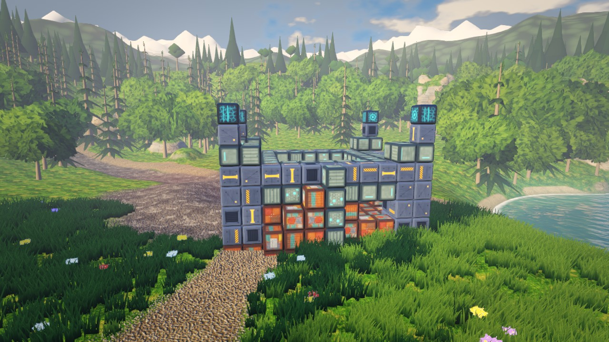

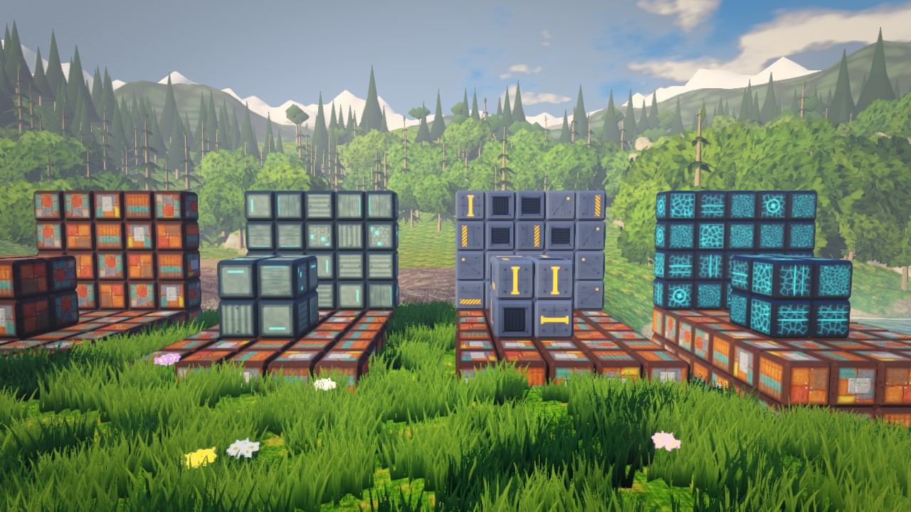

| Image                                        | URL on the game page                                                  | What to look at                                                                                                                                                                                                         |
| -------------------------------------------- | --------------------------------------------------------------------- | ----------------------------------------------------------------------------------------------------------------------------------------------------------------------------------------------------------------------- |
| [blocks-outpost](phase-2/blocks-outpost.jpg) | `/?demo=outpost&shot=outpost&quality=balanced&hud=0&stats=0&freeze=1` | A walled outpost with a gate, a courtyard roof, four towers and lamps, standing in the valley. The grass and trees give way around its foundation. Compare with 04: thick pieces with visible courses.                  |
| [blocks-gate](phase-2/blocks-gate.jpg)       | the same with `shot=gate`                                             | The outpost at golden hour, the game's default light: warm sun on the metal, cool shade in the corners. The steel stays steel instead of turning tan.                                                                   |
| [blocks-swatch](phase-2/blocks-swatch.jpg)   | `/?demo=swatch&shot=swatch&...`                                       | One wall per tier with a few blocks in front, left to right: Scrap (rust, teal paint, grey primer), Composite (grey-green laminate with cyan trim), Alloy (brushed steel, amber markings), Energy-Infused (cyan veins). |
| [blocks-closeup](phase-2/blocks-closeup.jpg) | the same with `shot=closeup`                                          | A few steps from the Alloy wall: the chamfers catching light, the dark groove where two blocks meet, ambient occlusion in the corners, and faces that differ from one another.                                          |

### Frame budgets with blocks

Counted like the table above (every pass, 1280 by 720). The outpost is four chunks and 10 thousand triangles. A chunk that holds a block is one draw call in every pass that draws it, and the shadow pass counts, so Balanced pays twice for each.

| View                                     | Low                 | Balanced             | Ultra                 |
| ---------------------------------------- | ------------------- | -------------------- | --------------------- |
| Outpost (`demo=outpost`, `shot=outpost`) | 37 draws, 200k tris | 114 draws, 879k tris | 153 draws, 1.87M tris |

The other Balanced views: gate 108 draws and 768k triangles, closeup 118 and 813k, swatch 127 and 866k (nine chunks, four walls spread across the lawn). Beside the valley's own 111 draws and 855k triangles, a base this size costs a handful of draws and about 1 percent of the triangles. The sandbox has no GPU, so what a bigger base does to the frame rate is not measured yet. `/?bench=1&demo=outpost` flies the benchmark route with the outpost in view part of the way round; run it on a real machine once a heavier base exists (players can build one since Phase 2d).

The block tiles take about 43 MB of video memory at Balanced and Ultra (16 layers of 512 by 512, albedo and data, with mipmaps) and 11 MB on Low. They are baked the first time a block is meshed, so a world with no blocks pays nothing; under software rendering the bake takes about 9 seconds at Balanced and 3 at Low, a real GPU a few milliseconds.

Meshing a chunk on the sandbox CPU takes 0.3 to 1.3 ms for the demo's chunks and about 7 ms for a very dense one (a hollow room of 28 thousand triangles). The remesh queue spends 3 ms of a frame and always meshes at least one chunk, so one dense chunk can cost a frame; the mesher is pure and can move into a Worker if Phase 6 needs it.

### Known gaps in the blocks

- Slabs and wedges are drawn, can be walked on (a player steps up a slab or a ramp of wedges) and are placed by hand with Q and R. A slab's side shows a whole tile squeezed to half its height and a roof slope shows it stretched, The lighting pass looked at both in the Balanced shots and left them: they read as long panels on a roof and thin plates on a sill.
- One piece to a cell: a block put on a lower slab goes in the cell above, half a block over the slab, and two stacked slabs leave a gap a block cannot fill. A stair is a row of slabs one cell apart. The decisions page says why, and what would change it.
- The lighting pass against references 04 and 05 is done ([below](#lighting-pass-against-references-04-and-05)). A lit Scrap wall still reads orange at golden hour: its tiles are rust, and the low sun warms them.
- The tiles are small sci-fi panels. Reference 04's pieces are thicker and rougher (stone courses, timber); ours show the grid more. The lighting pass compared and left the tile art alone: how busy the tiles are is a decision about the art, and it is Austin's.
- A player standing in the grass sees blocks low in the frame through blades up to a meter tall (see the gate); that is the grass, not a gap in the blocks.

## Phase 2d: building by hand

Phase 2d lets a player place and break blocks (the rules and the reasons are in [decisions](decisions.md#phase-2d-building-by-hand)). The screenshots stand on a gate wall of the four tiers, placed through the `?debug` hook (`window.__ashbound.mp.placeNear`) so the aim repeats, with Build Mode on (B) and the cursor on the ground in the gateway. Headless Chromium on software GL, 1280 by 720, Balanced, golden hour, the HUD on.

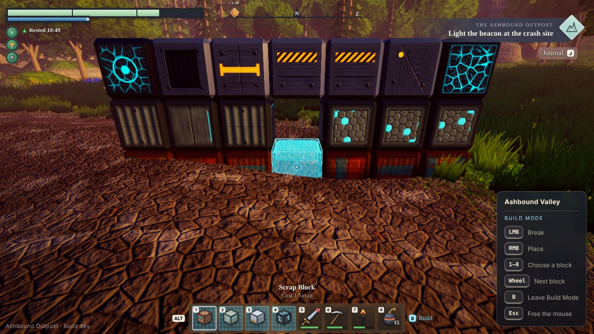

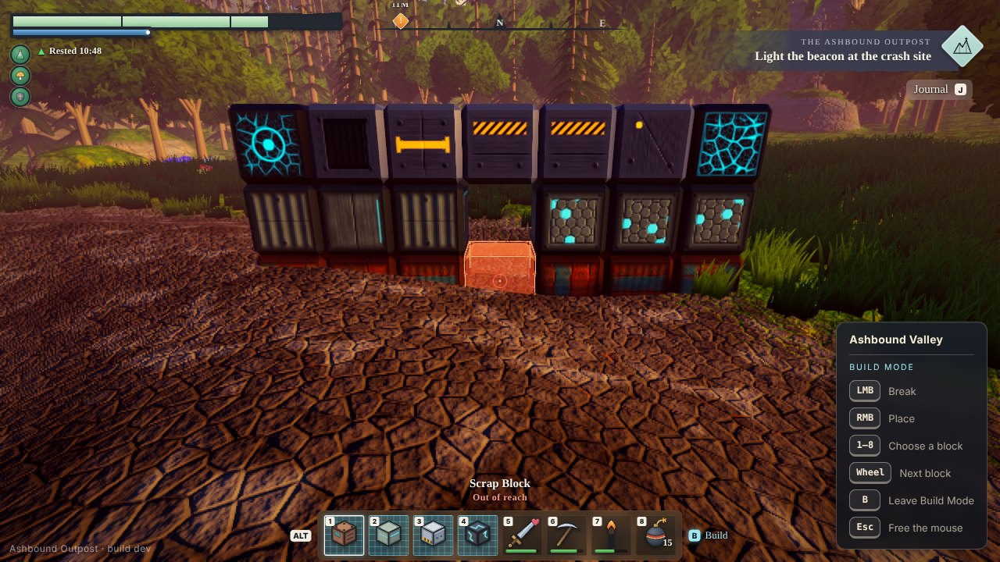

| Image                                                | What to look at                                                                                                                                                                                                                                                                     |
| ---------------------------------------------------- | ----------------------------------------------------------------------------------------------------------------------------------------------------------------------------------------------------------------------------------------------------------------------------------- |
| [build-gate](phase-2/build-gate.jpg)                 | The ghost is the beveled block itself, translucent with a bright rim, snapped to the grid cell a click would fill. The caption above the hotbar names the piece and its cost, slot 1 is selected, the crosshair has its cyan ring, and the status panel lists the keys of the mode. |
| [build-out-of-reach](phase-2/build-out-of-reach.jpg) | A step back: the cursor still sees the gateway but a click would not reach it, so the ghost and the ring turn red and the caption says "Out of reach".                                                                                                                              |
| [build-third](phase-2/build-third.jpg)               | The same from over the shoulder (V). The aim starts at the player's eyes, not at the camera, so the player's own body is never what the cursor hits.                                                                                                                                |
| [build-hotbar](phase-2/build-hotbar.jpg)             | The hotbar close up, after reference 07: four block icons on the cyan grid of placeable items, the selected slot in a white ring, the tools after them, ALT on the left and the B Build hint on the right.                                                                          |
| [game-pause](phase-2/game-pause.jpg)                 | The start card, retaken: the controls now list the mouse buttons, the hotbar keys, B, and (since slabs and wedges) Q and R, and the card still fits at 1280 by 720.                                                                                                                 |

### Frame cost of Build Mode

The ghost and the outline are four objects (the block, its edges, the wash over the target and its outline), and none of them casts or receives a shadow. With both shown the Balanced view costs 8 more draws (99 against 91) and 176 more triangles, because each object is drawn in two passes; with Build Mode off they are hidden and cost nothing. Counted like the tables above, on software GL: the real frame cost of eight transparent draws is not measured, but it is a very small fraction of the budget.

## Phase 2e: slabs and wedges

Phase 2e adds the two pieces that make roofs (how they are built and drawn is in [decisions](decisions.md#phase-2e-slabs-and-wedges)). They can be walked on and placed by hand (Q chooses the kind of piece, R turns it). The first screenshots show the gabled hall that `?demo=hall` raises: a platform with a ramp of wedges, composite walls with an arched door and slab sills, two lamp posts, and a roof of alloy wedges four rows deep with eaves and gable overhangs. Headless Chromium on software GL, 1280 by 720, Balanced, golden hour, `freeze=1`; retaken after the lighting pass at the end of this section.

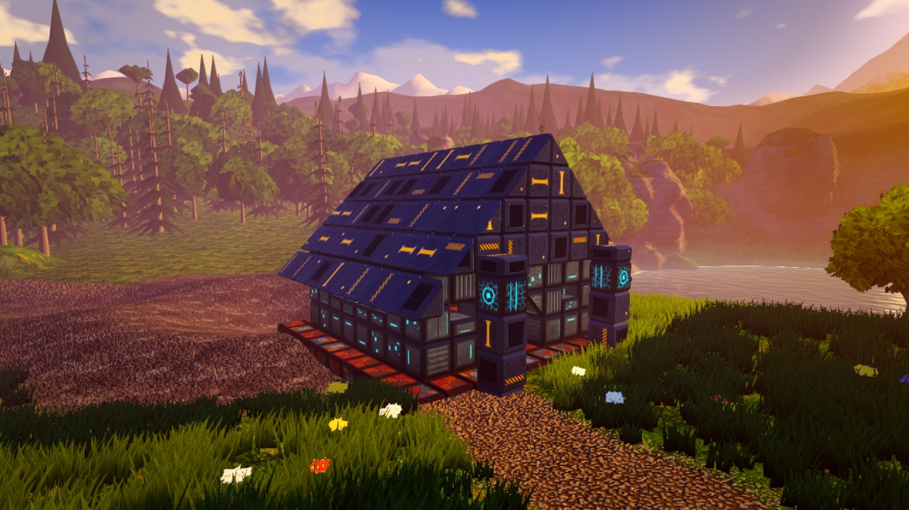

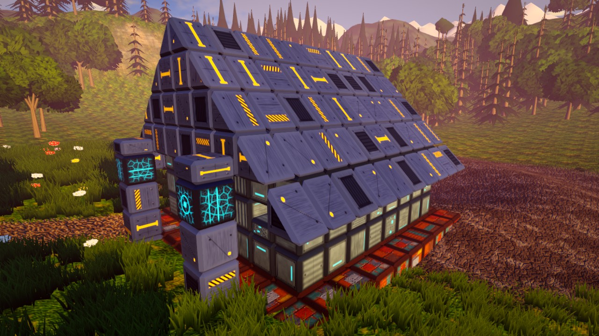

| Image                                          | URL on the game page                                            | What to look at                                                                                                                                                                                                                                                                                               |
| ---------------------------------------------- | --------------------------------------------------------------- | ------------------------------------------------------------------------------------------------------------------------------------------------------------------------------------------------------------------------------------------------------------------------------------------------------------- |
| [shapes-hall](phase-2/shapes-hall.jpg)         | `/?demo=hall&shot=hall&quality=balanced&hud=0&stats=0&freeze=1` | The gable end: the roof is a stair of wedges whose slope is 45 degrees, the arched door has its top corners cut by upside-down wedges, and the eaves hang one block past the wall. Compare with the sloped roofs of 05.                                                                                       |
| [shapes-hallside](phase-2/shapes-hallside.jpg) | the same with `shot=hallside`                                   | The whole hall: wedge rows read as shingle courses with the same dark groove as the cubes, the slab sills sit half-way up the windows, and the ramp climbs to the platform.                                                                                                                                   |
| [shapes-eaves](phase-2/shapes-eaves.jpg)       | the same with `shot=eaves`                                      | The corner of the roof close up: chamfers on slopes and on the slanted ends of wedges, the groove between rows, and the closed surface where a wedge meets a cube. The tile on a slope is stretched along it by the diagonal (1.41 times); the lighting pass judged that it reads as long panels and left it. |

### Building with them

The next screenshots are taken in Build Mode with a slab or a wedge in hand. The player stands on the hall's front apron or on the grass in front of it (placed with the `?debug` hook so the aim repeats), and everything else is the game's own input.

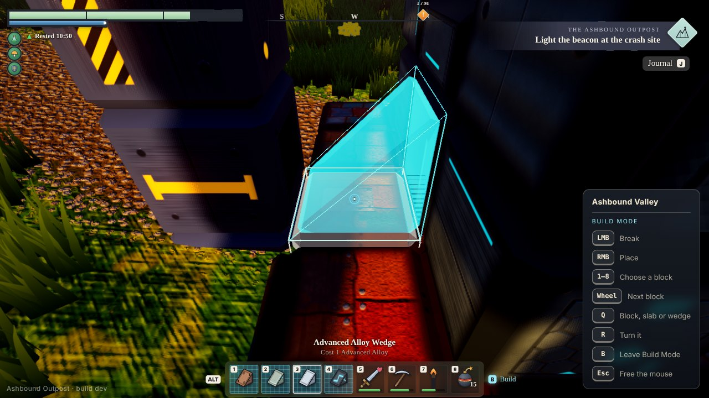

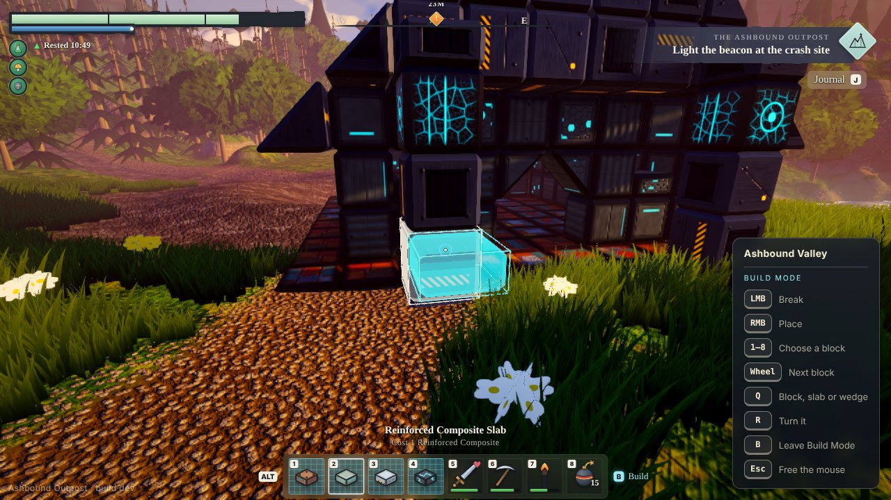

| Image                                                      | What to look at                                                                                                                                                                                                                                                                                                                        |
| ---------------------------------------------------------- | -------------------------------------------------------------------------------------------------------------------------------------------------------------------------------------------------------------------------------------------------------------------------------------------------------------------------------------- |
| [shapes-build-wedge](phase-2/shapes-build-wedge.jpg)       | A wedge ghost on the apron deck. The player looks along the apron, where the aim alone would have the wedge rise away along it; one press of R turned it a quarter, so it rises toward the wall and its slope shows in profile. The ghost is the real shape, with its chamfers and a bright edge, and the caption and slots say wedge. |
| [shapes-build-slab](phase-2/shapes-build-slab.jpg)         | A slab ghost against the south face of a lamp post. The cursor is on the upper part of the cell, so the slab goes in the upper half. The four block slots show slabs in each tier's paint, and the status panel lists Q (block, slab or wedge) and R (turn it).                                                                        |
| [shapes-build-slab-low](phase-2/shapes-build-slab-low.jpg) | The same view with the cursor a little lower on the post: the slab drops to the lower half of the cell.                                                                                                                                                                                                                                |
| [shapes-build-hotbar](phase-2/shapes-build-hotbar.jpg)     | The hotbar after one press of Q: the four block slots are slabs drawn in each tier's own paint (rust, grey-green with cyan trim, steel, graphite with veins), and the caption names the piece, here "Reinforced Composite Slab" with its cost. Compare the cubes of [build-hotbar](phase-2/build-hotbar.jpg).                          |

### Frame cost of the shapes

The hall is four chunks and 12 thousand triangles (the outpost's 338 blocks make 10 thousand). Counted like the tables above, Balanced, every pass, on software GL: `shot=hall` 109 draws and 860k triangles, `hallside` 102 and 828k, `eaves` 104 and 795k, against the valley's own 111 draws and 855k. Alone, a cube and a slab are 44 triangles each and a wedge 32 (its slope and ends are panels, strips and corners like any face), so a roof is no heavier to draw than a wall. Build Mode costs the same with a slab or a wedge in hand as with a block: the ghost and the outline swap their geometry for the shape's own, made once and kept, and stay four objects.

### Lighting pass against references 04 and 05

Phase 2e-4 compares our structures with the construction references and adjusts the light that falls on them. It leaves the terrain, the sky and the tile art alone: the look spike's light was approved, and how busy the tiles are is Austin's decision.

**Measured first.** The crops are structure only (no sky, no grass). The numbers are on the displayed values: the median and the darkest 5 percent of the brightness (Rec. 709 luma, 0 to 1) and the mean saturation (largest channel minus smallest, over the largest). The references are not in the repository, so their rows can be reproduced only with the images; ours are the screenshots in this folder (golden hour, Balanced), and each pair is before then after.

| Crop                              | Median      | Darkest 5 % | Saturation  |
| --------------------------------- | ----------- | ----------- | ----------- |
| Reference 04, roofs and walls     | 0.16        | 0.08        | 0.40        |
| Reference 04, stone wall in shade | 0.17        | 0.12        | 0.20        |
| Reference 05, stone wall          | 0.28        | 0.12        | 0.39        |
| Reference 05, sloped roof         | 0.45        | 0.21        | 0.34        |
| Ours, the hall from the gable     | 0.23 → 0.24 | 0.06 → 0.07 | 0.49 → 0.44 |
| Ours, the hall from the side      | 0.14 → 0.17 | 0.06 → 0.08 | 0.57 → 0.52 |
| Ours, the roof and eaves          | 0.30 → 0.32 | 0.08 → 0.09 | 0.45 → 0.43 |
| Ours, the gate                    | 0.34 → 0.36 | 0.09 → 0.11 | 0.46 → 0.40 |

The references are single frames in their own light, so this is a check of range and not a match test. It showed that the brightness of a structure was already inside the references' range (a median of 0.14 to 0.34 against 0.16 to 0.45), so the pass does not brighten structures. Two things were outside it. Our shade was darker (the darkest 5 percent at 0.06 to 0.09 against 0.08 to 0.21) and violet, because the fill in shade is the golden-hour sky and it turned dark steel to plum, where the stone and timber of the references stay neutral. And Composite went yellow-olive in the low sun. Ours stays more saturated than the references' stone (0.40 to 0.52 against 0.20 to 0.40) on purpose: the amber marks, the cyan trim and the rust of Scrap are the spec's accents, and what the pass takes out is the tint the light adds, not the colour of the paint.

**What changed.** Three things in the structure shader and one in the mesher (the values and the reasons are in [decisions](decisions.md#phase-2e-slabs-and-wedges)):

- The sky's fill on a structure is cooler and a little stronger, so shade is a blue-grey and not a violet.
- The low sun's orange is pulled part of the way toward grey on every surface (it already was on metal), so Composite stays grey-green.
- A polished surface shows more of the sky face on, so a steel roof reads as steel and not as a dark slab.
- Where a wall meets the ground the corner shading now knows the terrain: each vertex is darkened by how high it is above the ground under it, half as bright on the ground and easing to nothing at a meter, so a wall sits in the ground and not on a table.

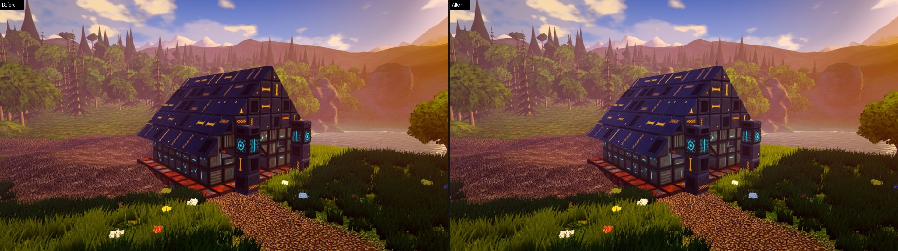

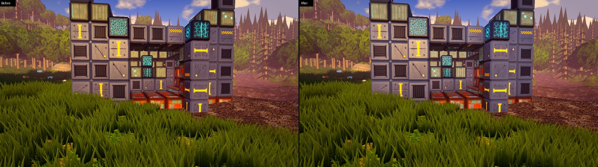

| Image                                              | What to look at                                                                                                                                                                                                                             |
| -------------------------------------------------- | ------------------------------------------------------------------------------------------------------------------------------------------------------------------------------------------------------------------------------------------- |
| [lighting-hallside](phase-2/lighting-hallside.jpg) | The roof in shade is a little lighter and less purple; the amber marks keep their colour. The deepest shade, under the eaves and at the foot of the platform, is still dark and no longer plum.                                             |
| [lighting-eaves](phase-2/lighting-eaves.jpg)       | The same on the eaves, close up: the slopes keep their groove between rows and the shade between them has depth without going black.                                                                                                        |
| [lighting-gate](phase-2/lighting-gate.jpg)         | The Composite blocks along the top: yellow-olive before, grey-green after. The rows at the foot of the walls are darker where they meet the ground and the shade fades up the wall within a block; the Scrap floor blocks are less glaring. |
| [lighting-swatch](phase-2/lighting-swatch.jpg)     | Noon. It barely changes, as intended: the pass is about the low sun and the shade, and the mean brightness of the swatch goes from 0.504 to 0.510.                                                                                          |

**Cost.** Nothing is added to the scene and the geometry is the same, so the draw and triangle counts above stand. The shader has a handful more arithmetic operations per pixel. The contact shade is made when a chunk is meshed (the terrain never changes, so nothing is meshed again for it) and costs meshing time: a chunk of 29 thousand triangles (a hollow room) took 13.5 ms without it and 15.1 ms with it, and a checkerboard of 90 thousand triangles 46.7 and 50.2 ms, about 7 to 12 percent, in a Vitest run on the idle sandbox CPU (compare the pair: the 7 ms quoted above for a dense chunk was measured in the browser). The demo's chunks take 0.3 to 1.3 ms, so for them it is a tenth of a millisecond. The remesh queue still spends 3 ms of a frame and always meshes one chunk.

**Not checked.** Low and Ultra draw structures with the same shader and rendered the hall and the gate with no console error, but only Balanced's pictures were retaken. Nothing here has been seen on a real GPU: the light is judged on software-rendered screenshots, so the first look on Austin's machine is the one that counts.

## Phase 4b: the Outpost Core

The Core is the station's reactor, standing in the crater at the middle of the crash site, and the whole run is about it: the nights are about holding it, and the run ends when it falls. It is drawn to be found from across the valley and read at a glance, in the palette of the rest of the game: dark steel, amber trim and the cyan of the accents. The choices are in [decisions](decisions.md#phase-4b-the-outpost-core-2026-10-21).

### The reactor

- **Shape.** A foundation the width of its 3 by 3 footprint, a body with three vents of light in each face under a line of amber trim, a deck, four pylons with amber bands and cyan caps, and a frame joining their tops. In the cage a six-sided cyan crystal turns and bobs over a plate of light, with a thin ring tilted about it. It is 4 blocks high, about two blocks above the rim of the crater, so it is the first thing in the clearing the eye finds. The foundation reaches a block into the ground, because the crater floor slopes under it.
- **Steel.** Dark blue-grey and fairly metallic, so the golden sun gives it warm edge light instead of turning it to clay (a first version in lighter steel did exactly that, a tan like wood) and the night makes it navy.
- **The crystal is the gauge.** Cyan while the Core is sound, amber once it is worn and red near the end, with the turns at about the marks of the gauge on the HUD (half and a quarter). The beat quickens as it weakens, it flickers below 40 percent, a hit flashes it white, and when the Core has fallen it sits dark, grey and tilted. The vents and the caps take the crystal's colour, so the whole plinth shows it from the other side of the clearing. The glow dims on the faces turned away, so it reads as cut facets.
- **Cost.** Six meshes: four merged by material (the steel, the lighter plates, the amber, the lights), the crystal and the ring. Counted like the tables above (Balanced, every pass, software GL), in view it adds 11 draws and about 24 thousand triangles: `shot=core` 105 draws and 747 thousand triangles against 94 and 724 thousand with the Core hidden, `shot=reactor` 106 and 752 thousand against 95 and 729 thousand. From `shot=lake`, where it is out of the main view, it still adds 5 draws and 11 thousand triangles, in the passes that are not the main view. Most of the triangles are the rounded corners of the small boxes (300 each); fewer segments on the thinnest trims would take about a third off if the frame ever needs it.

### Screenshots

Headless Chromium on software GL at 1280 by 720, Balanced, `freeze=1`, taken with the page's `?debug` hooks (`__ashbound.mp.warp` to nightfall, `__ashbound.mp.hurtCore` to wound it). Each reproduces from its URL, for example `/?shot=core&time=night&debug&quality=balanced&freeze=1&stats=0`.

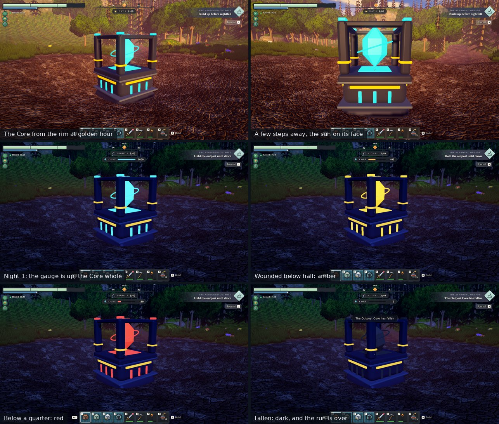

| Image                                        | What to look at                                                                                                                                                                                         |
| -------------------------------------------- | ------------------------------------------------------------------------------------------------------------------------------------------------------------------------------------------------------- |
| [core-day](phase-4/core-day.jpg)             | `shot=core`: the Core from the south-east rim at golden hour. The low sun gives the steel warm edges; the amber bands and the cyan vents are the only saturated colour on the dark floor of the crater. |
| [reactor-day](phase-4/reactor-day.jpg)       | `shot=reactor`: from a few steps away with the sun behind the camera. The crystal's facets, the ring, the vents, and a plinth that is whole on this side.                                               |
| [core-night](phase-4/core-night.jpg)         | The first night: the moon on the steel, the cyan crystal the brightest thing in the clearing, and the Core's gauge under the clock, whole.                                                              |
| [core-fallen](phase-4/core-fallen.jpg)       | The Core has fallen: the crystal is dark and tilted, the lights are out, the gauge reads 0 in grey, the banner and a toast say so.                                                                      |
| [core-pause](phase-4/core-pause.jpg)         | Esc after the fall: the pause card names the end of the run and the nights survived.                                                                                                                    |
| [reactor-states](phase-4/reactor-states.jpg) | The reactor close up at night, whole, worn (amber), failing (red) and fallen.                                                                                                                           |
| [core-gauge](phase-4/core-gauge.jpg)         | The gauge under the clock, enlarged, in its four states.                                                                                                                                                |

### Known gaps in the Core

- The wreckage and the scorched patch round it, and the faint amber-red mist of the crash site, are not drawn: the Core stands alone in the crater.
- The crystal casts no light on the ground or the steel. The scene has no point lights (the atmosphere carries the sun and the sky), so the glow only blooms. A fake, a light patch on the ground, is the likely answer if it is missed.
- Seen only on software-rendered pictures. How it reads on a real display, and how the bloom treats the crystal there, is for the first look on a real GPU.

## Phase 4c: Health and Energy

The two meters in the top-left corner are the player's own now, and each of them has a way to say it is running low without a number (reference 07 has none either). The choices are in [decisions](decisions.md#phase-4c-health-and-energy-2026-10-23); the colours are the HUD's own palette, so nothing here is new paint.

- **Health.** Three pale mint segments that empty from the right. Below a quarter the fill turns coral red and breathes slowly, close to the red of the Core's gauge when it is critical, until the player mends.
- **Energy.** The slim blue bar with the white cap. Below a quarter it turns amber (close to the Core gauge's worn tone), which is also where it starts to slow the player, so the colour never says "fine" while the legs are already heavy. With none left the frame of the bar breathes dark red.
- **Statuses.** Round icons under the bars with a short caption after a small triangle. A good one is green with an arrow up ("Charging", with the Core's crystal as its icon, while the player stands in the Core's field) and a bad one is amber with an arrow down ("Low energy", "Out of energy", with a bolt). They come and go with the state and are never made up: the flask, mushroom and shield icons and the "Rested" buff of the look spike are gone.
- **A wound.** The Health bar flashes coral for half a second and the edges of the screen redden for a little longer, in a soft vignette that leaves the middle of the view clear, so the player can still see what hit them. `prefers-reduced-motion` turns the breathing and the flashes off and leaves the colours.

### Screenshots

Headless Chromium on software GL at 1280 by 720, Balanced, `freeze=1`, taken with the page's `?debug` hooks (`__ashbound.mp.hurtPlayer`, `__ashbound.mp.setVitals`). The flash of a wound lasts under a second, so its picture holds the animation a little way in. The Charging picture is taken beside the Core at the first night, with the mouse taken so the run is on.

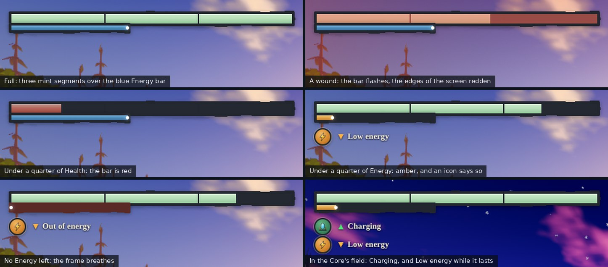

| Image                                              | What to look at                                                                                                                                                                      |
| -------------------------------------------------- | ------------------------------------------------------------------------------------------------------------------------------------------------------------------------------------ |
| [vitals-full](phase-4/vitals-full.jpg)             | The lake at golden hour with full bars and no icons: the corner looks as it did before the numbers were real.                                                                        |
| [vitals-hit](phase-4/vitals-hit.jpg)               | A wound of 38 points a moment after it lands: two and a bit segments, the bar flashing and the edges of the screen red.                                                              |
| [vitals-low-health](phase-4/vitals-low-health.jpg) | Under a quarter of Health: one short segment in red.                                                                                                                                 |
| [vitals-low-energy](phase-4/vitals-low-energy.jpg) | 14 Energy: the bar is amber and the "Low energy" icon is up. Walking and sprinting are already about 15 percent slower and a held click repeats at about three quarters of its rate. |
| [vitals-empty](phase-4/vitals-empty.jpg)           | No Energy: "Out of energy", the frame of the bar breathing dark red. Walking is at 65 percent and a held click at half the rate.                                                     |
| [vitals-charging](phase-4/vitals-charging.jpg)     | Beside the Core at night with 17 Energy: "Charging" above "Low energy", the one lifting as the other lasts.                                                                          |
| [vitals-states](phase-4/vitals-states.jpg)         | The corner cut out of each of the six and enlarged.                                                                                                                                  |
