# Art direction

The owner wants the look to match the visual references as closely as possible: graphics, details, textures, aesthetics, fidelity and the HUD. This document says how, in words, because the reference images are third-party screenshots and stay out of this repository. From the look spike onward, our own in-engine screenshots become the references that pull requests compare against.

Two limits from the spec still apply (section 1): a stable 60 FPS at 1080p on mid-range laptops, read as laptops with a dedicated GPU (integrated-only graphics is not a target, see [decisions](decisions.md#hardware-target-2026-10-20)), and only CC0, generated or clearly licensed assets. The look is bought with budget. The Balanced preset is tuned to hold the frame rate; Ultra goes closest to the references.

## What each reference teaches

| #   | Subject                                   | Take from it                                                                                                                                                                                           | Leave behind                                                         |
| --- | ----------------------------------------- | ------------------------------------------------------------------------------------------------------------------------------------------------------------------------------------------------------ | -------------------------------------------------------------------- |
| 01  | Shader-pack village at sunset             | A low warm sun, soft shadows, a sky from deep blue overhead to orange and pink at the horizon, puffy sunlit clouds, a lake with sun glitter and mirrored reflections, lantern glow, backlit tall grass | Pixel-cube textures, the pack's caption                              |
| 02  | Spruce forest on still water              | Conifers in silhouette against a lavender-peach sky, light shafts through the trees, near-mirror reflections                                                                                           | Blocky clouds                                                        |
| 03  | Aerial view of a dense forest             | Depth in layers: saturated greens close, orange haze far away, a sun glow with flare, bright clouds against deep blue                                                                                  | Blocky foliage; tree count is the main budget risk                   |
| 04  | Enshrouded construction (named "Valheim") | Thick, chunky pieces with visible courses, layered floors, ladders, cobbled ground, and the HUD                                                                                                        | Stone and thatch materials; our tiers are metal, composite and alloy |
| 05  | Valheim timber base                       | Layered roofs, trusses, round towers, curved walls, strong silhouettes, a hazy blue-green atmosphere                                                                                                   | Free-form snapping; we snap to the grid                              |
| 06  | Marching-cubes thumbnail                  | Organic, smooth landforms                                                                                                                                                                              | Flat-shaded facets; ours is smooth-shaded and textured               |
| 07  | Enshrouded landscape                      | A lush valley, pines and rock outcrops, snow peaks far away, cyan mist pools in hollows, one red mist pocket, grass blades with flowers up close, and the HUD                                          | Fantasy ruins                                                        |
| 08  | Cherry grove at sunset                    | A strong color grade, magenta-orange haze, layered silhouettes                                                                                                                                         | Pixel cubes                                                          |

References 01, 02, 03 and 08 are Minecraft-style and use pixel-cube textures, which spec section 4 bans. They inform lighting and atmosphere only. Textures follow the detailed references (04, 05, 07).

## The world

- A lush golden-hour valley, bounded at about 192 by 192 blocks (spec section 12 asks for 8 to 12 chunks of view). Hills and forest close the horizon.
- A lake on one side. The crash site sits in the middle: wreckage, the Outpost Core, and a scorched ash patch around them with a faint amber-red mist, echoing the red mist pocket in reference 07.
- Day is a long golden afternoon. The sun stays between about 12 and 45 degrees, always warm, so shadows stay long and readable. Night is cool blue with cyan tech accents. Dusk and dawn blend over about 40 seconds.
- Terrain is static in version 1. Players place and break structure blocks, not ground.

### Starting palette

| Use                      | Color                           |
| ------------------------ | ------------------------------- |
| Sky, zenith to horizon   | `#2f5d9e`, `#6d7fb8`, `#f2a65a` |
| Sun and warm light       | `#ffd9a0` to `#fff1c9`          |
| Night sky and moonlight  | `#070b1a`, `#1a2a4a`, `#8ab4ff` |
| Grass, lit and shaded    | `#7fa648`, `#4a7030`            |
| Dirt, rock, ash          | `#6b4a2f`, `#7d7468`, `#3b3835` |
| Structures: metal, plate | `#20262d`, `#38414b`            |
| Accents: amber, cyan     | `#f2a43a`, `#3ad1e0`            |

The look spike tuned these against screenshots. The palette stops in `src/shared/daycycle.ts` are now the source of truth; this table only names the intent.

## Light and atmosphere

1. **Sun.** One warm directional light with soft shadows from a shadow map that follows the player. The sun has a visible disc and glow.
2. **Fill.** A hemisphere light: sky color above, warm ground bounce below. Ambient occlusion is baked into vertex colors for terrain and structures, so no screen-space AO is needed on Balanced.
3. **Sky.** A gradient dome with procedural clouds that catch the sun on their undersides.
4. **Haze.** Height fog and distance haze tinted toward the sun, with colored mist pockets in hollows and over the crash site.
5. **Shafts, bloom and grade.** Half-resolution light shafts and bloom, then a final color grade with a light vignette. Strong grading (reference 08) is the cheapest way to look rich on modest hardware.

## Terrain, foliage and water

- **Terrain.** A smooth surface-nets mesh from the seeded density field, with collision from the same field, shaded with triplanar textures that blend by slope and height: grass on flats, rock on steep faces, dirt on worn paths, ash at the crash site. The look spike measured it against the smoothed-heightfield fallback and kept surface nets, because a heightfield smears rock faces (see `decisions.md`).
- **Foliage.** Instanced trees (pines and a broadleaf) with two levels of detail and distant impostors, grass cards and flowers that sway in the wind, and scattered boulders. Density scales with the preset.
- **Water.** One lake with a sky-colored fresnel, ripples and sun glitter. Ultra adds a half-resolution planar reflection for the still-water look of references 01 and 02.

## Structures and materials

Structures keep the spec's dark metal with amber and cyan accents, built with the construction language of references 04 and 05.

- **Geometry.** Thick pieces: walls read as deep, with inset panels and frame trim. Every face is inset and chamfered by 0.05 to 0.12 units, and faces are not merged, so seams stay visible. Phase 2c draws cubes with a 0.08 chamfer, a darker groove wherever two blocks meet and ambient occlusion in the corners. Slabs (half a cell high) and wedges (a 45 degree half-cube) give sloped roofs, eaves and strong silhouettes; since Phase 2e they take the same chamfer, groove and tiles as the cubes, and `?demo=hall` shows them as a gabled roof.
- **Tiers.** Scrap is patchwork salvaged plates with rust and rivets. Composite is layered grey-green panels with cyan edge strips. Alloy is brushed dark steel with amber inlays. Energy-Infused is dark with pulsing cyan veins. An upgrade must change the look, not only the stats: a block's material id picks its tile, so the Phase 5 upgrade changes one number and the block re-meshes.
- **Modules.** Turrets, generator, node, storage, terminal, bed and light are generated glTF models that feel engineered and modular. They glow cyan when powered and amber when active.
- **Materials.** Procedural, with detail bump from Balanced up. The tiles are baked on the GPU at load, four layouts for each tier, and each face of each block picks one by chance and turns it one of eight ways, so a wall never reads as one stamp repeated. Weathering, wear and exposed wiring come from the shared noise helpers, not per-piece textures, and no image file is involved.

## HUD

Reference images 04 and 07 are the model. The look spike built it (`src/ui/player-hud/`, with original icons) and the game page now shows it, fed by real numbers where the game has them (the compass follows the view, the Health and Energy bars are the player's own meters, the hotbar selection, the crosshair and the caption above the hotbar follow the player's building hands, and the day and night clock, the Core's gauge and the objective follow the run) and made-up ones where it does not yet (the hotbar's tools). The layout is drawn for 1280 by 720 and scales with the window. Type is a humanist serif system stack (Merriweather when installed, otherwise Georgia or the nearest serif).

- **Top left.** One torn, dark slate frame holds a wide health bar in three pale mint segments over a slim blue Energy bar that ends in a white cap. Under it, a column of round status icons, each with a short caption after a small triangle: green for a good one ("Charging", while the player stands in the Core's field) and amber for a bad one ("Low energy", "Out of energy"). The bars say how they stand without a number: Health empties from the right and turns red and breathes below a quarter; Energy turns amber below a quarter, where it starts to slow the player, and with none left its frame breathes. A wound flashes the Health bar and reddens the edges of the screen for a moment.
- **Top center.** A compass: a brush-stroke line about 320 px wide that shows 222 degrees, a small tick every 45 degrees, "N" inside a larger triangle with E, S and W as plain letters, and an orange diamond with an exclamation mark and a distance ("48M") for a waypoint.
- **Top right.** An objective banner: a slate bar that fades out to the left, a small letter-spaced place name over a bold objective line, and a mint diamond emblem straddling the end; under it, "Journal" with a white J key cap on a frosted pill.
- **Bottom center.** The hotbar: eight frosted slots with a numbered key cap at the top left, a status glyph at the top right, a green durability bar along the bottom, a stack count at the lower right, a cyan grid on blueprint items, and a white outline with a violet tint on the selected slot (a selected block keeps its cyan grid and gains a white ring and a soft glow). An "ALT" key cap sits to its left, and a "B Build" hint to its right that turns cyan while Build Mode is on. Slots 1 to 4 hold the four block materials as original icons, each a beveled cube in its tier's paint: scrap in rust with teal patches and rivets, composite in grey-green with cyan trim, alloy in steel with an amber hazard band, energy in graphite with cyan veins. Q turns the four into slabs and then wedges, drawn from the same paint, so the hotbar always shows the piece a click would place. A slot whose material has not been researched is dim and has a small padlock where its count would be ([Phase 5c](#phase-5c-research)).
- **Above the hotbar.** A caption: the name of the piece in hand in bold with "Cost 1 Scrap" under it in soft white, shown in Build Mode and for a moment after a new choice. When a click would do nothing, the second line turns coral red and says why ("Not enough Scrap", "Needs research · 12 of 20").
- **Center.** A small dot for a crosshair. Over a surface a block can go on it gets a thin cyan ring; in Build Mode a faint white ring is always there, and it turns red where a click would be refused.
- **Build Mode.** A translucent copy of the piece in hand, a block, a slab or a wedge, turned the way a click would place it, on the cell a click would fill (cyan when it works, red when it does not, with a bright rim and a slow breath) and a white outline, in the shape of the piece, on the block a click would break. The status panel at the bottom right lists the keys of the mode while it is on, Q for the kind of piece and R to turn it among them.
- **The day and night clock.** A small dark pill under the compass: the sun or the moon as a flat painted icon, the day or night with its number in letter-spaced capitals ("DAY 2", "NIGHT 2"), the time left until the light changes ("5:12"), and a thin bar along its bottom edge for how far through the day or night it is. It is amber by day and pale blue by night, and for the last 30 seconds before the light changes it breathes in its own colour. It is the spec's "subtle day/night or wave indicator", so it stays small. The waves join it when they exist.
- **The Outpost Core's gauge.** A second, slimmer pill under the clock: a small crystal icon, "CORE" in letter-spaced capitals, a thin bar and the points left. It is cyan while the Core is sound, amber below half, red below a quarter (and then it breathes) and flat grey at 0 once the Core has fallen; a hit flashes it. By night it is always up, even for a whole Core; by day it comes up only once the Core is hurt, so a morning with nothing wrong has nothing extra on the screen.
- **The research pill.** A third pill in the same column, under the Core's gauge and the respawn charges: a small atom, "RESEARCH" in letter-spaced capitals, a lavender bar towards the next row of the ladder and the points over it ("12/20", or the plain number at the top). It is up in Build Mode and for ten seconds after the points change, and it flashes when they rise ([Phase 5c](#phase-5c-research)).
- **Still to come.** The wave count by the clock, the held item's name for tools above the hotbar, a powered-area panel at the bottom right, and the inventory and research overlays (spec section 10) arrive with their phases and reuse the same frames and type.

## Quality presets

| Element             | Low                             | Balanced                                    | Ultra                            |
| ------------------- | ------------------------------- | ------------------------------------------- | -------------------------------- |
| Internal resolution | 75 percent, floor 60, 1.0 MP    | 100 percent, floor 70, up to 2.1 MP         | 100 percent, fixed, up to 3.7 MP |
| Anti-aliasing       | None                            | FXAA                                        | 4x MSAA                          |
| Shadows             | None (blob shadows still to do) | One 2048 filtered map, 90 m                 | Two cascades, 160 m              |
| Haze and light      | Fog only                        | Adds mist pockets and a lit sky             | Adds light shafts                |
| Bloom and grade     | Grade only                      | Half-resolution bloom and grade             | Full-resolution bloom and grade  |
| Water               | Flat tint                       | Ripples, glitter and a 0.3 scale reflection | A 0.5 scale planar reflection    |
| Terrain view        | 8 chunks, plain textures        | 10 chunks, detail normals                   | 12 chunks, detail normals        |
| Foliage             | 25 percent, grass to 22 m       | 60 percent, grass to 34 m                   | 100 percent, grass to 52 m       |
| Lamps               | The 2 nearest Lights light it   | The 6 nearest                               | The 8 nearest                    |

The numbers live in `src/shared/quality.ts`. Balanced is the default and is tuned for 60 FPS at 1080p on a mid-range laptop; its governor lowers the internal resolution a step at a time when frames run long. The owner confirms it on real hardware with the benchmark switch (`?bench=1` on the game page). Presets change with the P key, the Graphics choice on the pause panel (both remembered in the browser) and a `?quality=` URL switch (for one visit); the full menu comes with Phase 6.

## Rules of thumb

- Match lighting and atmosphere first; they carry most of the reference look and cost the least.
- Pick the cheaper effect when two look alike, and measure before adding the next one.
- Never ship an asset that is not generated in code, CC0 or clearly licensed, and list every external asset in `CREDITS.md`.
- Do not commit reference images, screenshots of other games or anything traced from them.

## Look spike results

The look spike, a throwaway page that Phase 2b folded into the game page, built the target look end to end: seeded surface-nets terrain, a day cycle with a shadowed sun, an analytic sky, haze with mist pockets, a lake, trees, grass, the Enshrouded-style HUD and the three presets. It also settled terrain meshing and collision (see [decisions](decisions.md#look-spike-2026-10-20)). The reference images stay out of this repository, so the side-by-side sheets sit in the project files instead; the screenshots here are ours.

### Screenshots

Headless Chromium on software GL at 1280 by 720, with `freeze=1` so every run draws the same frame. Each reproduces from its URL on the game page, for example `/?shot=lake&quality=balanced&hud=0&stats=0&freeze=1` (the switches are in [the app README](../src/app/README.md)). The screenshots below were taken on the look page, which drew the same valley.

| Image                                                                                                   | Preset     | Compare with                                                             |
| ------------------------------------------------------------------------------------------------------- | ---------- | ------------------------------------------------------------------------ |
| [bal-lake](look/bal-lake.jpg)                                                                           | Balanced   | 01 and 02: a low warm sun, glitter and mist on the water, backlit pines  |
| [bal-valley](look/bal-valley.jpg)                                                                       | Balanced   | 07: pines and rock, cyan mist pools, snow peaks far away                 |
| [bal-canopy](look/bal-canopy.jpg)                                                                       | Balanced   | 03: layered forest, orange haze, a sun glow                              |
| [bal-sunset](look/bal-sunset.jpg)                                                                       | Balanced   | 08: a violet sky, orange haze, a strong grade                            |
| [bal-trail](look/bal-trail.jpg)                                                                         | Balanced   | 01 and 07: backlit grass and flowers up close                            |
| [bal-crash](look/bal-crash.jpg), [bal-noon](look/bal-noon.jpg)                                          | Balanced   | The crash clearing and high sun (no wreck until Phase 2)                 |
| [bal-outcrop](look/bal-outcrop.jpg), [terr-heightfield](look/terr-heightfield.jpg)                      | Balanced   | 06: a rock outcrop from surface nets, and the same view as a heightfield |
| [bal-dusk](look/bal-dusk.jpg), [bal-night](look/bal-night.jpg)                                          | Balanced   | Moon, stars, cool blue                                                   |
| [hud-valley](look/hud-valley.jpg), [hud-lake](look/hud-lake.jpg)                                        | Balanced   | 04 and 07: the player HUD at 1280 by 720                                 |
| [low-lake](look/low-lake.jpg), [ultra-lake](look/ultra-lake.jpg), [ultra-valley](look/ultra-valley.jpg) | Low, Ultra | The presets beside Balanced                                              |

Phase 2b put the valley in the game page, and its captures are in `phase-2/` (Balanced, 1280 by 720): [game-play](phase-2/game-play.jpg) (first person at the lake shore with the player HUD and the key hints), [game-third](phase-2/game-third.jpg) (third person), [game-pause](phase-2/game-pause.jpg) (the click-to-play card with the Graphics and Time of day choices) and [game-bench](phase-2/game-bench.jpg) (the benchmark's results card; software rendering, so its numbers mean nothing). Later Phase 2 pull requests add their build screenshots to the same folder.

### Frame budgets

Draw calls and triangles per frame at 1280 by 720, every pass counted (shadows, reflection, main view, post). The sandbox has no GPU, so these are the static budget; the milliseconds come from the benchmark below. The game page draws exactly these counts in the same views (checked after Phase 2b moved the valley into it, with `?shot=lake`, `valley` and `canopy`), so moving the valley into the game added no draw calls or triangles.

| View   | Low                 | Balanced             | Ultra                 |
| ------ | ------------------- | -------------------- | --------------------- |
| Lake   | 25 draws, 151k tris | 86 draws, 722k tris  | 91 draws, 1.52M tris  |
| Valley | 37 draws, 200k tris | 111 draws, 855k tris | 149 draws, 1.85M tris |
| Canopy | 35 draws, 218k tris | 103 draws, 892k tris | 131 draws, 1.91M tris |

Low draws at 0.75 scale. The terrain alone is 123k triangles per pass with surface nets. Ultra roughly doubles the triangle count because two shadow cascades redraw the scene.

Software rendering (SwiftShader, a 640 by 360 canvas) puts Balanced at about 12 times the cost of Low and Ultra at about 18 times. Only the ratios mean anything there, and a real GPU will not scale the same way, so they say which preset is heavier and nothing about frame rate.

Building the valley in headless Chromium takes about half a second: textures 20 to 30 ms, density field 3 to 6 ms, ground grid 150 to 380 ms, terrain mesh 150 to 180 ms (60 to 85 ms for the heightfield), scatter 60 to 80 ms.

### First real measurement

Austin ran the look page's `?bench=1` on 2026-10-20 (build 16034c2) on an RTX 4090 Laptop GPU (ANGLE, Direct3D 11) in Chrome 155 on Windows: a 2550 by 1273 canvas at device pixel ratio 1.25, a display of about 200 Hz, 30 seconds per preset with adaptive resolution off. Building the valley took 261 ms (field 2, ground grid 84, terrain mesh 70, scatter 29).

| Preset   | Internal size | Avg FPS | p95 ms | Slowest 1% FPS | CPU ms | GPU ms avg / p95 | Draws | Triangles |
| -------- | ------------- | ------: | -----: | -------------: | -----: | ---------------: | ----: | --------: |
| Low      | 1415 by 707   |   200.0 |    5.1 |            190 |    0.2 |        3.8 / 5.1 |    33 |      191k |
| Balanced | 2051 by 1024  |   200.0 |    5.1 |            187 |    0.3 |        1.7 / 4.0 |   102 |      816k |
| Ultra    | 2550 by 1273  |   200.0 |    5.1 |            191 |    0.4 |        2.9 / 4.3 |   131 |     1767k |

All three presets pass the game page's mark (at least 57 FPS on average, 95th percentile at most 18.5 ms) and no frame took longer than 33 ms. The internal sizes are the presets' pixel caps at work: 1.0 million pixels for Low, 2.1 million for Balanced and 3.7 million for Ultra, so Ultra drew the whole canvas.

**What this run shows.** It is the look spike's real-hardware result. On a machine this fast it confirms that nothing is broken: the preset switching, the benchmark route and the report work, and the draw and triangle counts match the static budget above. It does not show how much headroom there is. Every preset sat at the display's 200 FPS cap, so frame rate cannot tell them apart, and the GPU times are not monotonic across presets (Low 3.8 ms against Balanced 1.7 ms), which looks like power-state noise at the cap rather than real cost. Treat the GPU column as indicative only and do not scale it to slower hardware.

**What it does not show.** No mid-range dedicated GPU has been measured, so Balanced holding 60 FPS at 1080p on a mid-range laptop is still unproven. That is the target in SPEC sections 1 and 12, read as laptops with a dedicated GPU since [Austin's hardware decision](decisions.md#hardware-target-2026-10-20). To measure one, run the game page with `?bench=1` on it at 1080p, plugged in, with the tab in front (about 100 seconds), and check the report's graphics adapter line: on a laptop with two GPUs the browser has to run on the dedicated one (Windows Settings, System, Display, Graphics, High performance for the browser). See [the app README](../src/app/README.md#benchmark).

### Known gaps

- No mid-range dedicated GPU has been measured: the only real run so far was on a high-end laptop at its display's frame-rate cap.
- The crash site is an ash clearing with the Outpost Core in the middle of it (since Phase 4b, see [below](#phase-4b-the-outpost-core)); the wreck and the lanterns are still to come. Blocks are drawn since Phase 2c, and references 01, 04 and 05 are mostly about buildings (see [the blocks](#phase-2c-the-blocks)).
- Textures are detailed and smooth. References 01, 02, 03 and 08 use pixel cubes, and Austin chose smooth, detailed textures over them on 2026-10-20 (see [decisions](decisions.md#look-spike-2026-10-20)).
- Low has no shadows yet; blob shadows under trees are the planned stand-in.
- Balanced reflects the far shore faintly (0.3 scale); the near-mirror water of references 01 and 02 needs Ultra.
- The broadleaf canopies are brighter and simpler than the pines and oaks in reference 07. A second leaf texture and more colour variation are the next pass.
- Clouds are soft and procedural, not the sculpted volumes of references 01 and 03.
- Shaded grass at golden hour is dark, as it is in reference 01; reference 07's brighter mid-greens belong to a high-key daylight look that the morning and noon views already show.

## Phase 2c: the blocks

Phase 2c draws the voxel world: beveled blocks with ambient occlusion in four material tiers, and a time budget for re-meshing (how it works is in [decisions](decisions.md#phase-2c-block-meshing-and-materials)). Nothing placed a block yet, so the screenshots show the demo structures that `?demo=outpost` and `?demo=swatch` raise. They are taken the same way as the look spike's: headless Chromium on software GL, 1280 by 720, Balanced, `freeze=1`. Phase 2e's lighting pass retook them (the same views as before it are in [the lighting pass](#lighting-pass-against-references-04-and-05)).

| Image                                        | URL on the game page                                                  | What to look at                                                                                                                                                                                                         |
| -------------------------------------------- | --------------------------------------------------------------------- | ----------------------------------------------------------------------------------------------------------------------------------------------------------------------------------------------------------------------- |
| [blocks-outpost](phase-2/blocks-outpost.jpg) | `/?demo=outpost&shot=outpost&quality=balanced&hud=0&stats=0&freeze=1` | A walled outpost with a gate, a courtyard roof, four towers and lamps, standing in the valley. The grass and trees give way around its foundation. Compare with 04: thick pieces with visible courses.                  |
| [blocks-gate](phase-2/blocks-gate.jpg)       | the same with `shot=gate`                                             | The outpost at golden hour, the game's default light: warm sun on the metal, cool shade in the corners. The steel stays steel instead of turning tan.                                                                   |
| [blocks-swatch](phase-2/blocks-swatch.jpg)   | `/?demo=swatch&shot=swatch&...`                                       | One wall per tier with a few blocks in front, left to right: Scrap (rust, teal paint, grey primer), Composite (grey-green laminate with cyan trim), Alloy (brushed steel, amber markings), Energy-Infused (cyan veins). |
| [blocks-closeup](phase-2/blocks-closeup.jpg) | the same with `shot=closeup`                                          | A few steps from the Alloy wall: the chamfers catching light, the dark groove where two blocks meet, ambient occlusion in the corners, and faces that differ from one another.                                          |

### Frame budgets with blocks

Counted like the table above (every pass, 1280 by 720). The outpost is four chunks and 10 thousand triangles. A chunk that holds a block is one draw call in every pass that draws it, and the shadow pass counts, so Balanced pays twice for each.

| View                                     | Low                 | Balanced             | Ultra                 |
| ---------------------------------------- | ------------------- | -------------------- | --------------------- |
| Outpost (`demo=outpost`, `shot=outpost`) | 37 draws, 200k tris | 114 draws, 879k tris | 153 draws, 1.87M tris |

The other Balanced views: gate 108 draws and 768k triangles, closeup 118 and 813k, swatch 127 and 866k (nine chunks, four walls spread across the lawn). Beside the valley's own 111 draws and 855k triangles, a base this size costs a handful of draws and about 1 percent of the triangles. The sandbox has no GPU, so what a bigger base does to the frame rate is not measured yet. `/?bench=1&demo=outpost` flies the benchmark route with the outpost in view part of the way round; run it on a real machine once a heavier base exists (players can build one since Phase 2d).

The block tiles take about 43 MB of video memory at Balanced and Ultra (16 layers of 512 by 512, albedo and data, with mipmaps) and 11 MB on Low. They are baked the first time a block is meshed, so a world with no blocks pays nothing; under software rendering the bake takes about 9 seconds at Balanced and 3 at Low, a real GPU a few milliseconds.

Meshing a chunk on the sandbox CPU takes 0.3 to 1.3 ms for the demo's chunks and about 7 ms for a very dense one (a hollow room of 28 thousand triangles). The remesh queue spends 3 ms of a frame and always meshes at least one chunk, so one dense chunk can cost a frame; the mesher is pure and can move into a Worker if Phase 6 needs it.

### Known gaps in the blocks

- Slabs and wedges are drawn, can be walked on (a player steps up a slab or a ramp of wedges) and are placed by hand with Q and R. A slab's side shows a whole tile squeezed to half its height and a roof slope shows it stretched, The lighting pass looked at both in the Balanced shots and left them: they read as long panels on a roof and thin plates on a sill.
- One piece to a cell: a block put on a lower slab goes in the cell above, half a block over the slab, and two stacked slabs leave a gap a block cannot fill. A stair is a row of slabs one cell apart. The decisions page says why, and what would change it.
- The lighting pass against references 04 and 05 is done ([below](#lighting-pass-against-references-04-and-05)). A lit Scrap wall still reads orange at golden hour: its tiles are rust, and the low sun warms them.
- The tiles are small sci-fi panels. Reference 04's pieces are thicker and rougher (stone courses, timber); ours show the grid more. The lighting pass compared and left the tile art alone: how busy the tiles are is a decision about the art, and it is Austin's.
- A player standing in the grass sees blocks low in the frame through blades up to a meter tall (see the gate); that is the grass, not a gap in the blocks.

## Phase 2d: building by hand

Phase 2d lets a player place and break blocks (the rules and the reasons are in [decisions](decisions.md#phase-2d-building-by-hand)). The screenshots stand on a gate wall of the four tiers, placed through the `?debug` hook (`window.__ashbound.mp.placeNear`) so the aim repeats, with Build Mode on (B) and the cursor on the ground in the gateway. Headless Chromium on software GL, 1280 by 720, Balanced, golden hour, the HUD on.

| Image                                                | What to look at                                                                                                                                                                                                                                                                     |
| ---------------------------------------------------- | ----------------------------------------------------------------------------------------------------------------------------------------------------------------------------------------------------------------------------------------------------------------------------------- |
| [build-gate](phase-2/build-gate.jpg)                 | The ghost is the beveled block itself, translucent with a bright rim, snapped to the grid cell a click would fill. The caption above the hotbar names the piece and its cost, slot 1 is selected, the crosshair has its cyan ring, and the status panel lists the keys of the mode. |
| [build-out-of-reach](phase-2/build-out-of-reach.jpg) | A step back: the cursor still sees the gateway but a click would not reach it, so the ghost and the ring turn red and the caption says "Out of reach".                                                                                                                              |
| [build-third](phase-2/build-third.jpg)               | The same from over the shoulder (V). The aim starts at the player's eyes, not at the camera, so the player's own body is never what the cursor hits.                                                                                                                                |
| [build-hotbar](phase-2/build-hotbar.jpg)             | The hotbar close up, after reference 07: four block icons on the cyan grid of placeable items, the selected slot in a white ring, the tools after them, ALT on the left and the B Build hint on the right.                                                                          |
| [game-pause](phase-2/game-pause.jpg)                 | The start card, retaken: the controls now list the mouse buttons, the hotbar keys, B, and (since slabs and wedges) Q and R, and the card still fits at 1280 by 720.                                                                                                                 |

### Frame cost of Build Mode

The ghost and the outline are four objects (the block, its edges, the wash over the target and its outline), and none of them casts or receives a shadow. With both shown the Balanced view costs 8 more draws (99 against 91) and 176 more triangles, because each object is drawn in two passes; with Build Mode off they are hidden and cost nothing. Counted like the tables above, on software GL: the real frame cost of eight transparent draws is not measured, but it is a very small fraction of the budget.

## Phase 2e: slabs and wedges

Phase 2e adds the two pieces that make roofs (how they are built and drawn is in [decisions](decisions.md#phase-2e-slabs-and-wedges)). They can be walked on and placed by hand (Q chooses the kind of piece, R turns it). The first screenshots show the gabled hall that `?demo=hall` raises: a platform with a ramp of wedges, composite walls with an arched door and slab sills, two lamp posts, and a roof of alloy wedges four rows deep with eaves and gable overhangs. Headless Chromium on software GL, 1280 by 720, Balanced, golden hour, `freeze=1`; retaken after the lighting pass at the end of this section.

| Image                                          | URL on the game page                                            | What to look at                                                                                                                                                                                                                                                                                               |
| ---------------------------------------------- | --------------------------------------------------------------- | ------------------------------------------------------------------------------------------------------------------------------------------------------------------------------------------------------------------------------------------------------------------------------------------------------------- |
| [shapes-hall](phase-2/shapes-hall.jpg)         | `/?demo=hall&shot=hall&quality=balanced&hud=0&stats=0&freeze=1` | The gable end: the roof is a stair of wedges whose slope is 45 degrees, the arched door has its top corners cut by upside-down wedges, and the eaves hang one block past the wall. Compare with the sloped roofs of 05.                                                                                       |
| [shapes-hallside](phase-2/shapes-hallside.jpg) | the same with `shot=hallside`                                   | The whole hall: wedge rows read as shingle courses with the same dark groove as the cubes, the slab sills sit half-way up the windows, and the ramp climbs to the platform.                                                                                                                                   |
| [shapes-eaves](phase-2/shapes-eaves.jpg)       | the same with `shot=eaves`                                      | The corner of the roof close up: chamfers on slopes and on the slanted ends of wedges, the groove between rows, and the closed surface where a wedge meets a cube. The tile on a slope is stretched along it by the diagonal (1.41 times); the lighting pass judged that it reads as long panels and left it. |

### Building with them

The next screenshots are taken in Build Mode with a slab or a wedge in hand. The player stands on the hall's front apron or on the grass in front of it (placed with the `?debug` hook so the aim repeats), and everything else is the game's own input.

| Image                                                      | What to look at                                                                                                                                                                                                                                                                                                                        |
| ---------------------------------------------------------- | -------------------------------------------------------------------------------------------------------------------------------------------------------------------------------------------------------------------------------------------------------------------------------------------------------------------------------------- |
| [shapes-build-wedge](phase-2/shapes-build-wedge.jpg)       | A wedge ghost on the apron deck. The player looks along the apron, where the aim alone would have the wedge rise away along it; one press of R turned it a quarter, so it rises toward the wall and its slope shows in profile. The ghost is the real shape, with its chamfers and a bright edge, and the caption and slots say wedge. |
| [shapes-build-slab](phase-2/shapes-build-slab.jpg)         | A slab ghost against the south face of a lamp post. The cursor is on the upper part of the cell, so the slab goes in the upper half. The four block slots show slabs in each tier's paint, and the status panel lists Q (block, slab or wedge) and R (turn it).                                                                        |
| [shapes-build-slab-low](phase-2/shapes-build-slab-low.jpg) | The same view with the cursor a little lower on the post: the slab drops to the lower half of the cell.                                                                                                                                                                                                                                |
| [shapes-build-hotbar](phase-2/shapes-build-hotbar.jpg)     | The hotbar after one press of Q: the four block slots are slabs drawn in each tier's own paint (rust, grey-green with cyan trim, steel, graphite with veins), and the caption names the piece, here "Reinforced Composite Slab" with its cost. Compare the cubes of [build-hotbar](phase-2/build-hotbar.jpg).                          |

### Frame cost of the shapes

The hall is four chunks and 12 thousand triangles (the outpost's 338 blocks make 10 thousand). Counted like the tables above, Balanced, every pass, on software GL: `shot=hall` 109 draws and 860k triangles, `hallside` 102 and 828k, `eaves` 104 and 795k, against the valley's own 111 draws and 855k. Alone, a cube and a slab are 44 triangles each and a wedge 32 (its slope and ends are panels, strips and corners like any face), so a roof is no heavier to draw than a wall. Build Mode costs the same with a slab or a wedge in hand as with a block: the ghost and the outline swap their geometry for the shape's own, made once and kept, and stay four objects.

### Lighting pass against references 04 and 05

Phase 2e-4 compares our structures with the construction references and adjusts the light that falls on them. It leaves the terrain, the sky and the tile art alone: the look spike's light was approved, and how busy the tiles are is Austin's decision.

**Measured first.** The crops are structure only (no sky, no grass). The numbers are on the displayed values: the median and the darkest 5 percent of the brightness (Rec. 709 luma, 0 to 1) and the mean saturation (largest channel minus smallest, over the largest). The references are not in the repository, so their rows can be reproduced only with the images; ours are the screenshots in this folder (golden hour, Balanced), and each pair is before then after.

| Crop                              | Median      | Darkest 5 % | Saturation  |
| --------------------------------- | ----------- | ----------- | ----------- |
| Reference 04, roofs and walls     | 0.16        | 0.08        | 0.40        |
| Reference 04, stone wall in shade | 0.17        | 0.12        | 0.20        |
| Reference 05, stone wall          | 0.28        | 0.12        | 0.39        |
| Reference 05, sloped roof         | 0.45        | 0.21        | 0.34        |
| Ours, the hall from the gable     | 0.23 → 0.24 | 0.06 → 0.07 | 0.49 → 0.44 |
| Ours, the hall from the side      | 0.14 → 0.17 | 0.06 → 0.08 | 0.57 → 0.52 |
| Ours, the roof and eaves          | 0.30 → 0.32 | 0.08 → 0.09 | 0.45 → 0.43 |
| Ours, the gate                    | 0.34 → 0.36 | 0.09 → 0.11 | 0.46 → 0.40 |

The references are single frames in their own light, so this is a check of range and not a match test. It showed that the brightness of a structure was already inside the references' range (a median of 0.14 to 0.34 against 0.16 to 0.45), so the pass does not brighten structures. Two things were outside it. Our shade was darker (the darkest 5 percent at 0.06 to 0.09 against 0.08 to 0.21) and violet, because the fill in shade is the golden-hour sky and it turned dark steel to plum, where the stone and timber of the references stay neutral. And Composite went yellow-olive in the low sun. Ours stays more saturated than the references' stone (0.40 to 0.52 against 0.20 to 0.40) on purpose: the amber marks, the cyan trim and the rust of Scrap are the spec's accents, and what the pass takes out is the tint the light adds, not the colour of the paint.

**What changed.** Three things in the structure shader and one in the mesher (the values and the reasons are in [decisions](decisions.md#phase-2e-slabs-and-wedges)):

- The sky's fill on a structure is cooler and a little stronger, so shade is a blue-grey and not a violet.
- The low sun's orange is pulled part of the way toward grey on every surface (it already was on metal), so Composite stays grey-green.
- A polished surface shows more of the sky face on, so a steel roof reads as steel and not as a dark slab.
- Where a wall meets the ground the corner shading now knows the terrain: each vertex is darkened by how high it is above the ground under it, half as bright on the ground and easing to nothing at a meter, so a wall sits in the ground and not on a table.

| Image                                              | What to look at                                                                                                                                                                                                                             |
| -------------------------------------------------- | ------------------------------------------------------------------------------------------------------------------------------------------------------------------------------------------------------------------------------------------- |
| [lighting-hallside](phase-2/lighting-hallside.jpg) | The roof in shade is a little lighter and less purple; the amber marks keep their colour. The deepest shade, under the eaves and at the foot of the platform, is still dark and no longer plum.                                             |
| [lighting-eaves](phase-2/lighting-eaves.jpg)       | The same on the eaves, close up: the slopes keep their groove between rows and the shade between them has depth without going black.                                                                                                        |
| [lighting-gate](phase-2/lighting-gate.jpg)         | The Composite blocks along the top: yellow-olive before, grey-green after. The rows at the foot of the walls are darker where they meet the ground and the shade fades up the wall within a block; the Scrap floor blocks are less glaring. |
| [lighting-swatch](phase-2/lighting-swatch.jpg)     | Noon. It barely changes, as intended: the pass is about the low sun and the shade, and the mean brightness of the swatch goes from 0.504 to 0.510.                                                                                          |

**Cost.** Nothing is added to the scene and the geometry is the same, so the draw and triangle counts above stand. The shader has a handful more arithmetic operations per pixel. The contact shade is made when a chunk is meshed (the terrain never changes, so nothing is meshed again for it) and costs meshing time: a chunk of 29 thousand triangles (a hollow room) took 13.5 ms without it and 15.1 ms with it, and a checkerboard of 90 thousand triangles 46.7 and 50.2 ms, about 7 to 12 percent, in a Vitest run on the idle sandbox CPU (compare the pair: the 7 ms quoted above for a dense chunk was measured in the browser). The demo's chunks take 0.3 to 1.3 ms, so for them it is a tenth of a millisecond. The remesh queue still spends 3 ms of a frame and always meshes one chunk.

**Not checked.** Low and Ultra draw structures with the same shader and rendered the hall and the gate with no console error, but only Balanced's pictures were retaken. Nothing here has been seen on a real GPU: the light is judged on software-rendered screenshots, so the first look on Austin's machine is the one that counts.

## Phase 4b: the Outpost Core

The Core is the station's reactor, standing in the crater at the middle of the crash site, and the whole run is about it: the nights are about holding it, and the run ends when it falls. It is drawn to be found from across the valley and read at a glance, in the palette of the rest of the game: dark steel, amber trim and the cyan of the accents. The choices are in [decisions](decisions.md#phase-4b-the-outpost-core-2026-10-21).

### The reactor

- **Shape.** A foundation the width of its 3 by 3 footprint, a body with three vents of light in each face under a line of amber trim, a deck, four pylons with amber bands and cyan caps, and a frame joining their tops. In the cage a six-sided cyan crystal turns and bobs over a plate of light, with a thin ring tilted about it. It is 4 blocks high, about two blocks above the rim of the crater, so it is the first thing in the clearing the eye finds. The foundation reaches a block into the ground, because the crater floor slopes under it.
- **Steel.** Dark blue-grey and fairly metallic, so the golden sun gives it warm edge light instead of turning it to clay (a first version in lighter steel did exactly that, a tan like wood) and the night makes it navy.
- **The crystal is the gauge.** Cyan while the Core is sound, amber once it is worn and red near the end, with the turns at about the marks of the gauge on the HUD (half and a quarter). The beat quickens as it weakens, it flickers below 40 percent, a hit flashes it white, and when the Core has fallen it sits dark, grey and tilted. The vents and the caps take the crystal's colour, so the whole plinth shows it from the other side of the clearing. The glow dims on the faces turned away, so it reads as cut facets.
- **Cost.** Six meshes: four merged by material (the steel, the lighter plates, the amber, the lights), the crystal and the ring. Counted like the tables above (Balanced, every pass, software GL), in view it adds 11 draws and about 24 thousand triangles: `shot=core` 105 draws and 747 thousand triangles against 94 and 724 thousand with the Core hidden, `shot=reactor` 106 and 752 thousand against 95 and 729 thousand. From `shot=lake`, where it is out of the main view, it still adds 5 draws and 11 thousand triangles, in the passes that are not the main view. Most of the triangles are the rounded corners of the small boxes (300 each); fewer segments on the thinnest trims would take about a third off if the frame ever needs it.

### Screenshots

Headless Chromium on software GL at 1280 by 720, Balanced, `freeze=1`, taken with the page's `?debug` hooks (`__ashbound.mp.warp` to nightfall, `__ashbound.mp.hurtCore` to wound it). Each reproduces from its URL, for example `/?shot=core&time=night&debug&quality=balanced&freeze=1&stats=0`.

| Image                                        | What to look at                                                                                                                                                                                         |
| -------------------------------------------- | ------------------------------------------------------------------------------------------------------------------------------------------------------------------------------------------------------- |
| [core-day](phase-4/core-day.jpg)             | `shot=core`: the Core from the south-east rim at golden hour. The low sun gives the steel warm edges; the amber bands and the cyan vents are the only saturated colour on the dark floor of the crater. |
| [reactor-day](phase-4/reactor-day.jpg)       | `shot=reactor`: from a few steps away with the sun behind the camera. The crystal's facets, the ring, the vents, and a plinth that is whole on this side.                                               |
| [core-night](phase-4/core-night.jpg)         | The first night: the moon on the steel, the cyan crystal the brightest thing in the clearing, and the Core's gauge under the clock, whole.                                                              |
| [core-fallen](phase-4/core-fallen.jpg)       | The Core has fallen: the crystal is dark and tilted, the lights are out, the gauge reads 0 in grey, the banner and a toast say so.                                                                      |
| [core-pause](phase-4/core-pause.jpg)         | Esc after the fall: the pause card names the end of the run and the nights survived (until 4h, which put the Overrun card in its place).                                                                |
| [reactor-states](phase-4/reactor-states.jpg) | The reactor close up at night, whole, worn (amber), failing (red) and fallen.                                                                                                                           |
| [core-gauge](phase-4/core-gauge.jpg)         | The gauge under the clock, enlarged, in its four states.                                                                                                                                                |

### Known gaps in the Core

- The wreckage and the scorched patch round it, and the faint amber-red mist of the crash site, are not drawn: the Core stands alone in the crater.
- The crystal casts no light on the ground or the steel. The scene has no point lights (the atmosphere carries the sun and the sky), so the glow only blooms. A fake, a light patch on the ground, is the likely answer if it is missed.
- Seen only on software-rendered pictures. How it reads on a real display, and how the bloom treats the crystal there, is for the first look on a real GPU.

## Phase 4c: Health and Energy

The two meters in the top-left corner are the player's own now, and each of them has a way to say it is running low without a number (reference 07 has none either). The choices are in [decisions](decisions.md#phase-4c-health-and-energy-2026-10-23); the colours are the HUD's own palette, so nothing here is new paint.

- **Health.** Three pale mint segments that empty from the right. Below a quarter the fill turns coral red and breathes slowly, close to the red of the Core's gauge when it is critical, until the player mends.
- **Energy.** The slim blue bar with the white cap. Below a quarter it turns amber (close to the Core gauge's worn tone), which is also where it starts to slow the player, so the colour never says "fine" while the legs are already heavy. With none left the frame of the bar breathes dark red.
- **Statuses.** Round icons under the bars with a short caption after a small triangle. A good one is green with an arrow up ("Charging", with the Core's crystal as its icon, while the player stands in the Core's field) and a bad one is amber with an arrow down ("Low energy", "Out of energy", with a bolt). They come and go with the state and are never made up: the flask, mushroom and shield icons and the "Rested" buff of the look spike are gone.
- **A wound.** The Health bar flashes coral for half a second and the edges of the screen redden for a little longer, in a soft vignette that leaves the middle of the view clear, so the player can still see what hit them. `prefers-reduced-motion` turns the breathing and the flashes off and leaves the colours.

### Screenshots

Headless Chromium on software GL at 1280 by 720, Balanced, `freeze=1`, taken with the page's `?debug` hooks (`__ashbound.mp.hurtPlayer`, `__ashbound.mp.setVitals`). The flash of a wound lasts under a second, so its picture holds the animation a little way in. The Charging picture is taken beside the Core at the first night, with the mouse taken so the run is on.

| Image                                              | What to look at                                                                                                                                                                      |
| -------------------------------------------------- | ------------------------------------------------------------------------------------------------------------------------------------------------------------------------------------ |
| [vitals-full](phase-4/vitals-full.jpg)             | The lake at golden hour with full bars and no icons: the corner looks as it did before the numbers were real.                                                                        |
| [vitals-hit](phase-4/vitals-hit.jpg)               | A wound of 38 points a moment after it lands: two and a bit segments, the bar flashing and the edges of the screen red.                                                              |
| [vitals-low-health](phase-4/vitals-low-health.jpg) | Under a quarter of Health: one short segment in red.                                                                                                                                 |
| [vitals-low-energy](phase-4/vitals-low-energy.jpg) | 14 Energy: the bar is amber and the "Low energy" icon is up. Walking and sprinting are already about 15 percent slower and a held click repeats at about three quarters of its rate. |
| [vitals-empty](phase-4/vitals-empty.jpg)           | No Energy: "Out of energy", the frame of the bar breathing dark red. Walking is at 65 percent and a held click at half the rate.                                                     |
| [vitals-charging](phase-4/vitals-charging.jpg)     | Beside the Core at night with 17 Energy: "Charging" above "Low energy", the one lifting as the other lasts.                                                                          |
| [vitals-states](phase-4/vitals-states.jpg)         | The corner cut out of each of the six and enlarged.                                                                                                                                  |

## Phase 4d: the crawler

The first machine sets how the rest of them will look: low and dark against the lit ground, so that at a distance it is a silhouette with a few lights on it, and close up a small walker you can read at a glance. It is drawn from code like the Core (no assets, so `CREDITS.md` is unchanged) and in the Core's palette: dark steel, amber trim, and a hot light where the sensors are. The choices are in [decisions](decisions.md#phase-4d-the-crawler-2026-10-23).

### The crawler

- **Shape.** A hull of dark blue-grey steel 0.9 blocks long with a plate and a thin amber spine on its back, the engine behind it, a head in front with a red strip for an eye and a pair of pale jaws, and six legs of bars with amber joints that spread to 1.7 blocks across. It stands 0.7 blocks high: below a player's waist, so a crowd of them reads as something on the ground, not as people.
- **Steel and lights.** The steel is the Core's steel, fairly metallic, so the low sun puts warm edges on it and the night makes it navy. The joints and the spine glow a little and breathe; the eye is the brightest point on the machine, so a crowd at night reads as a field of red points before it reads as shapes. A hit lights the whole machine white-hot for a moment, and the lights flicker as its health fails.
- **Movement.** The legs step in two tripods (front-left, middle-right and back-left, then the others). The stride follows how far the machine has walked and the swing follows its speed, so one that is slowing shuffles and one that has stopped stands. A bite is a lunge of the body with the jaws snapping, and a machine arrives by rising out of the ground over 0.6 seconds, so a spawn does not pop. Each differs in size by up to 5 percent from its id.
- **Cost.** One instanced mesh of 720 triangles a machine: one draw call in each of the three passes that draw it, as the heaps are counted in [Phase 5a](#phase-5a-salvage), however many there are. (This first said two, the main view and the sun's shadow map; Phase 5i1 counted three.) The field is not culled (one bounding sphere would have to cover the whole valley), so a full field of 100 costs the same wherever the camera looks: 72 thousand triangles in each pass, about 216 thousand on top of a Balanced frame of about 750 thousand (every pass counted, as in the tables above), more than a quarter at the worst. The vertex work is a handful of arithmetic operations a vertex. No real GPU has timed it yet.

### Screenshots

Headless Chromium on software GL at 1280 by 720, Balanced, `freeze=1`, taken with the page's `?debug` hooks (`__ashbound.mp.spawnCrawlerAt`, `spawnCrawlers`, `warp`, `hurtCore`). The machines are put where they stand while the run is held, so each picture is exact. A software frame takes seconds and a crawler walks a long way in that time, so the pack on the road is walked in hops of the clock (`mp.warp`) and photographed on the first frame after a hop, while the legs are mid-stride; the night pictures hold the camera with `game.setPhoto`, off the player, so the machines are not drawn to it.

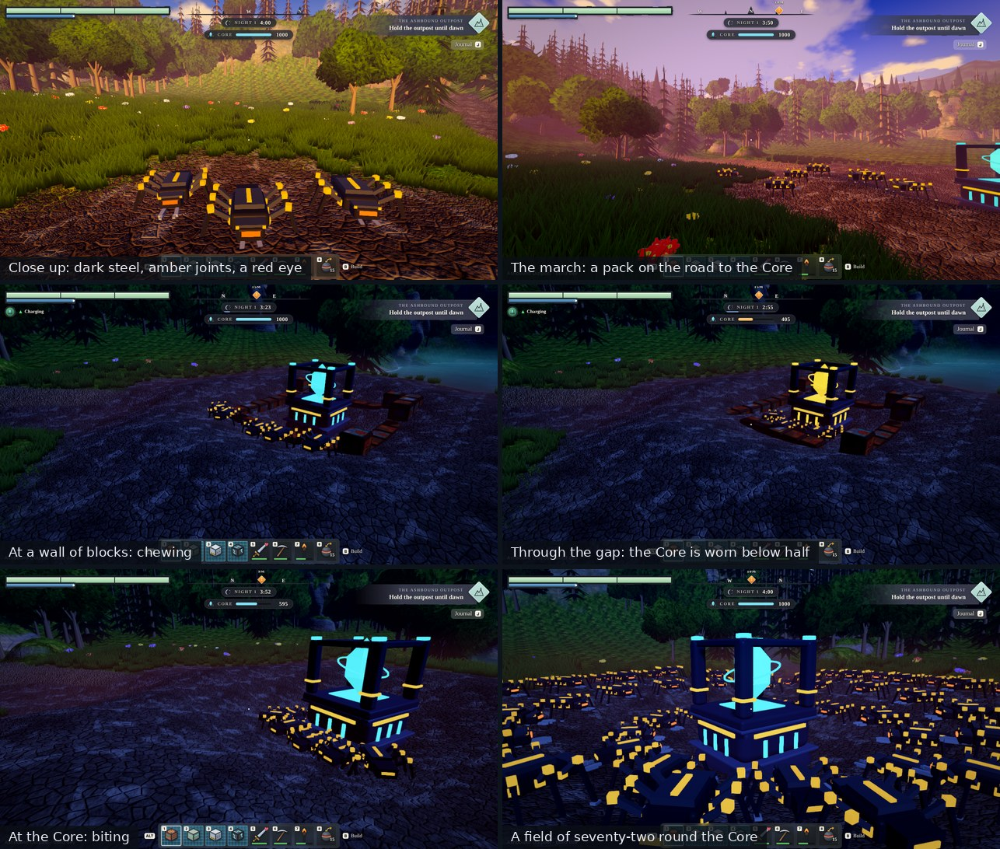

| Image                                            | What to look at                                                                                                                                                                                                                        |
| ------------------------------------------------ | -------------------------------------------------------------------------------------------------------------------------------------------------------------------------------------------------------------------------------------- |
| [crawlers-closeup](phase-4/crawlers-closeup.jpg) | Three of them at golden hour from a few steps away, facing the camera: the hull, the amber spine and joints, the red strip of the eye, the legs spread to either side. The amber is the Core's amber, and it reads yellow in this sun. |
| [crawlers-march](phase-4/crawlers-march.jpg)     | The first night's dusk: a pack of six on the road to the Core, the reactor at the right edge. The legs are mid-stride, and the amber is what finds them in the grass.                                                                  |
| [crawlers-wall](phase-4/crawlers-wall.jpg)       | A ring of scrap blocks round the Core and five crawlers at its western side, chewing. The Core is whole (1000) and nothing has broken through yet.                                                                                     |
| [crawlers-breach](phase-4/crawlers-breach.jpg)   | Some seconds later: two blocks are gone, the machines are through the gap and at the Core's foot, and the crystal has turned amber at 405.                                                                                             |
| [crawlers-bite](phase-4/crawlers-bite.jpg)       | At the Core's west face, a row of them against its foot, the crystal cyan at 595 on its way down.                                                                                                                                      |
| [crawlers-crowd](phase-4/crawlers-crowd.jpg)     | Seventy-two round the Core from the south-east rim, near the full field of a hundred: the eyes and the amber read as a swarm of lights before they read as shapes.                                                                     |
| [crawlers-states](phase-4/crawlers-states.jpg)   | The six together.                                                                                                                                                                                                                      |

### Known gaps in the crawler

- The body stays level on a slope, so the feet can sink into the ground or hover over it by a few tenths of a block on the steepest ground a crawler climbs. A ground height for each foot would fix it; nothing in the picture says it matters yet.
- There is no sound (Phase 6) and no health bar: a hit shows as the flash, and failing health as the flicker of the lights. What hurts one is the pulse blaster, drawn in [Phase 4e](#phase-4e-the-blasters-light).
- There is only one kind. The armored, flying and breacher machines of the spec come with Phase 5, and stand in as crawlers until then.
- Seen only in software-rendered pictures. How the glow of the joints and the eye sits with the bloom on a real display is for the first look on a real GPU.

## Phase 4e: the blaster's light

The pulse blaster is the first thing in the game that is drawn only as light: the bolt, the sparks where it lands and the burst of a machine that falls are added on top of the picture and glow, and nothing in the scene is lit by them. The palette is the game's own: a white-hot core with a breath of colour round it, the amber of the Core's trim and the crawler's joints where a machine is hit, and the shooter's seat colour wherever else a bolt ends, so that in a game of four every bolt says whose it is. Nothing here is an asset, so `CREDITS.md` is unchanged. The choices are in [decisions](decisions.md#phase-4e-the-pulse-blaster-2026-10-23).

### The light

- **The bolt.** A streak that leaves the gun with its tail behind it: the head flies at 170 blocks a second and the tail trails 8 blocks, tapering to nothing, a white core in a halo of the shooter's colour. It is drawn the same few pixels wide wherever it is, with a core of three or four and a halo of about ten at 720p (wider with distance, so a far bolt still shows and a near one never fills the screen), and it fades in over its first four blocks, so that it does not begin as a smear in front of the player. A bolt shows for at least a tenth of a second, however near its mark. A shot at the longest range, 40 blocks, takes a quarter of a second to arrive, and what happens where it lands waits for it.
- **The muzzle.** A four-pointed flash for 0.08 seconds and four sparks, where the gun is held: 0.55 blocks ahead of the eyes, a quarter of a block to the right and a fifth below, which is the lower right of the view in first person and the avatar's right hand in third.
- **The strike.** Where a bolt ends: a flash that swells to a block and a quarter across in 0.14 seconds and ten sparks thrown back off the mark, which leap, fall and go out in about half a second. Amber on a machine, the shooter's colour on a block, the ground or the Core.
- **The kill.** When a machine falls, the burst: a hot core and a flash that swells to over three blocks across in 0.22 seconds, and thirty sparks flung every way at once, in a deep orange. It plays where the machine stood, and the machine is gone at that moment. Far flashes and sparks are drawn larger (up to two and a half times) so that they still read, and none is larger on the screen than a few dozen pixels, so one at the camera does not fill it.
- **Cost.** Two instanced meshes, one for the bolts and one for the sparks and flashes, so a firefight is two draw calls whatever it holds, added into the HDR target above the bloom's threshold. Nothing is lit by them and nothing casts a shadow. Everything an effect does while it plays (the streak flying, the flash swelling, a spark's flight and fall) is worked out in the vertex shader from the moment it was born, so the CPU writes a few numbers when something happens and nothing while it plays out. The buffers are rings of 64 bolts and 768 sparks, each one quad, so 832 quads (1,664 triangles) at the very most, and the meshes are in the scene from the start, drawing nothing, so the first shot of a session builds no programs.

### In the hands

- **Slot 5.** The blaster's icon, a pale pistol with a cyan-lit barrel, takes the fifth place of the hotbar on the plain dark slot the tools use (the blocks sit on the cyan blueprint grid), and is picked like any slot. Slots 6 to 8 stay the placeholders they were.
- **The sight.** A thin white ring with a dot at the middle and a tick at each quarter, so that it reads as a weapon and not as the build cursor, and the caption above the hotbar says "Pulse Blaster" and "Uses 0.6 Energy a shot" for a moment after the choice.
- **The hit marker.** Four ticks cross the ring of the sight for a quarter of a second when a shot hits a machine: white and small for a hit, larger and amber for the kill. It is a fade and not a movement, so it stays when the player asks for less motion.
- **The start card.** The keys list gains the blaster without a new row, so the card still fits a 1280 by 720 window without scrolling: the labels of the click and choose rows now read "Break or place; LMB fires the pulse blaster" and "Choose a block, or 5 for the pulse blaster", on two lines each. (A line of its own made the card 25 px too tall.)

### Screenshots

Headless Chromium on software GL at 1280 by 720, Balanced, `freeze=1`, at the first night's dusk (the day picture and the HUD ones by day), taken with the page's `?debug` hooks (`__ashbound.mp.fire`, `fireAtMachine`, `spawnCrawlerAt`, `warp`). A bolt's light lives a fifth of a second and a software frame takes several seconds, so the page's animation clock was replaced for the pictures: each frame advances it by a sixtieth of a second, and the clock is stopped for the photograph, so every picture holds an effect at an exact age. The hit marker is held a little way into its flash for the same reason.

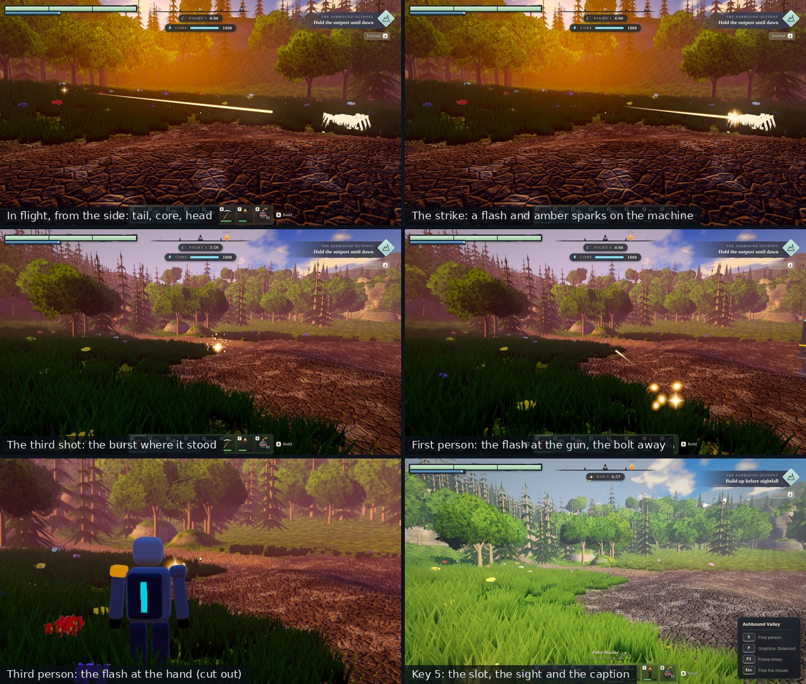

| Image                                          | What to look at                                                                                                                                                                                                |
| ---------------------------------------------- | -------------------------------------------------------------------------------------------------------------------------------------------------------------------------------------------------------------- |
| [blaster-bolt](phase-4/blaster-bolt.jpg)       | A shot seen from the side, three frames after the click: the flash at the muzzle on the left, the streak with its white core and a bright head, and the crawler on the right already lit white-hot by the hit. |
| [blaster-strike](phase-4/blaster-strike.jpg)   | Two frames later the head has reached the machine: the flash on it, the tail still behind.                                                                                                                     |
| [blaster-kill](phase-4/blaster-kill.jpg)       | The third shot: the burst where the machine stood, a bright core with sparks flung every way. It is a tenth of a second old, so the sparks are still close.                                                    |
| [blaster-first](phase-4/blaster-first.jpg)     | First person, the frame after the click: the flash and four sparks at the lower right where the gun is held, and the bolt leaving along the line of sight to the ring of the sight.                            |
| [blaster-third](phase-4/blaster-third.jpg)     | Third person, the same moment: the flash at the avatar's right hand.                                                                                                                                           |
| [blaster-day](phase-4/blaster-day.jpg)         | The side view by day (Day 1, 8:00): a pale yellow line over the green of the grass, less punch than at dusk and still easy to follow.                                                                          |
| [blaster-hud](phase-4/blaster-hud.jpg)         | Key 5 by day: slot 5 lit, the sight with its four ticks, and "Pulse Blaster, Uses 0.6 Energy a shot" above the hotbar.                                                                                         |
| [blaster-hitmark](phase-4/blaster-hitmark.jpg) | The sight enlarged: the white ticks of a hit, and the larger amber ticks of the kill.                                                                                                                          |
| [blaster-card](phase-4/blaster-card.jpg)       | The start card at 1280 by 720 with the two relabelled rows, and nothing cut off at the foot.                                                                                                                   |
| [blaster-states](phase-4/blaster-states.jpg)   | Six of them together.                                                                                                                                                                                          |

### Known gaps in the blaster's light

- There is no gun in the hands or on the avatar. First person shows only the flash at the lower right, and third person the flash at the hand; there is no recoil, and the avatars do not raise an arm. A model, with its own flash and a reload, belongs with the other tools of Phase 5.
- A shot lights nothing: the scene has no point lights, so the ground under a strike and the machine it hits do not brighten, and the glow is the bloom's alone (as with the Core's crystal). A fake, a patch of light that fades, is the likely answer if it is missed.
- A bolt in first person is a short streak along the line of sight, not a long beam: it leaves a hand at the edge of the view and flies away from the camera, so most of it is foreshortened. That is how it looks to the shooter; to everyone else it crosses their view.
- No sound (Phase 6) and no damage numbers.
- Seen only in software-rendered pictures. How wide the bolt reads and how the bloom takes the flashes on a real display is for the first look on a real GPU.

## Phase 4f: the waves

The waves add no art of their own: the machines are the crawlers of 4d, and the only new thing on the screen is a line of text. What 4f changes is when they come and from where, which a chart shows better than a photograph. The choices are in [decisions](decisions.md#phase-4f-the-waves-2026-10-23).

### What the crew sees

- **The warning.** A toast above the hotbar, in the style of the others (a dark rounded bar with light text), ten seconds before each wave: "Wave 1 of 3: 4 machines in ten seconds". It is one element that lives 1.6 seconds and is shared with the other messages (nightfall, dawn, the Core falling), so a second message replaces the first.
- **The wave.** Four to seven crawlers, a few more later in the game, come out of the ground one after another at the edge of the valley, 46 blocks from the Core, all on one side of it, and walk the cheapest way to it. They are the instanced mesh of 4d, so a bigger night costs the same draw call.

### Screenshots

Headless Chromium on software GL at 1280 by 720, Balanced, `freeze=1`, `?debug&night=4`, driven with the page's debug hooks (`__ashbound.mp.warp` to reach the warning and the machines, `enemies()` to read where they are). The march picture is held in golden light (`time=golden`) because the sky would otherwise follow the clock into the night over the jumps of the clock that walk the machines, and the camera is held above the grass, which hides a crawler from the ground. The chart is drawn from the positions of every machine of each wave, read off the running game right after the last of the wave came out of the ground, not from the plan.

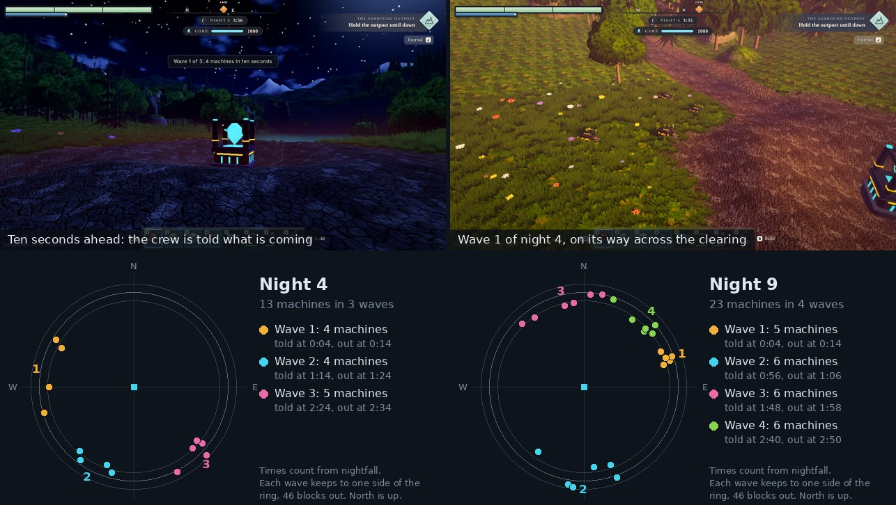

| Image                                      | What to look at                                                                                                                                                                                   |
| ------------------------------------------ | ------------------------------------------------------------------------------------------------------------------------------------------------------------------------------------------------- |
| [waves-warning](phase-4/waves-warning.jpg) | Night 4, four seconds in: the toast "Wave 1 of 3: 4 machines in ten seconds" above the hotbar, the Core whole and the clock at 3:56.                                                              |
| [waves-march](phase-4/waves-march.jpg)     | The first wave of night 4, nine seconds after it came out of the ground: four crawlers crossing the clearing from the west toward the Core (the reactor at the right edge), seen from above.      |
| [waves-sides](phase-4/waves-sides.jpg)     | Where each wave of night 4 (three waves) and night 9 (four) came in: the Core in the middle, the ring 46 blocks out, each wave a colour. Each keeps to one side, and the next comes from another. |
| [waves-states](phase-4/waves-states.jpg)   | The four together.                                                                                                                                                                                |

### Known gaps in the waves

- The warning is one line that is gone in 1.6 seconds. A wave indicator that stays on the HUD and the rising stinger the spec asks for ten seconds ahead are Phase 6.
- A machine appears at the edge of the valley with no effect, usually out of sight in the forest. A flash or a plume of dust where it comes up is polish for Phase 6; for now the warning is the only sign of a wave coming.
- The armored, flying and base-targeting kinds are drawn and fight as crawlers until Phase 5.
- Seen only in software-rendered pictures, and the crowd of a late night (six waves of seven or more) has not been looked at.

## Phase 4g: going down and coming back

Going down adds a pill under the Core's gauge and a screen, and both are made of parts the HUD already has (the gauge's pill, the status icons, the toast, the wound's red), so nothing here is new paint. The choices are in [decisions](decisions.md#phase-4g-going-down-and-coming-back-2026-10-23).

### What the crew sees

- **The respawns.** A pill under the Core's gauge: a heart, "Respawns", a pip for each place in the crew's pool (three for each player in the room) and the number. The filled pips are the pale mint of the Health bar while there are two or more; at the last one the pip and the number turn amber, and with none the number turns coral red and the three empty pips are ringed in red (a pip that is not there cannot carry a colour). The pill flashes red for a moment each time the Core spends one. By day, while the pool is full and the run goes on, it is hidden; at night, and once one has been spent, it stays.
- **Down.** The edges of the screen go dark red in the soft vignette of a wound, with the middle left clear (the player can still see the fight), and a plain dim over all of it. In the middle: "You are down" in capitals, a line that says what is going to happen ("The Core brings you back in") and the seconds in large figures. With nothing in the pool the figures give way to "The crew is out of respawns. The dawn brings more". The crosshair and the caption over the hotbar go, and the hotbar dims, because the hands are stopped.
- **Back.** The screen clears and the Health and Energy bars are where the Core left them (full and half), with a new status under them: a steel shield and, after the small amber triangle of a bad status, "Shaken 0:45" counting down. A toast says it ("The Core brought you back, shaken · 1 respawn left"); on the others' screens another names the player.
- **Lost.** When every player is down and the pool is empty the same screen says "Outpost overrun" and why, the banner at the top right says "The whole crew is down", and the pause card on Esc said how the run ended, as it did when the Core fell (until 4h, when the Overrun card took its place). The Core is left as it stood.

### Screenshots

Headless Chromium on software GL at 1280 by 720, Balanced, `freeze=1`, `?debug&night=1&waves=0`, driven with the page's debug hooks (`__ashbound.mp.setRespawns`, `hurtPlayer`, `warp`). The run is held while the mouse is free, so each picture is the state that was set up, and the toast is held on screen because it would fade in less time than a frame takes here. The pause card is the last picture; the others have it hidden.

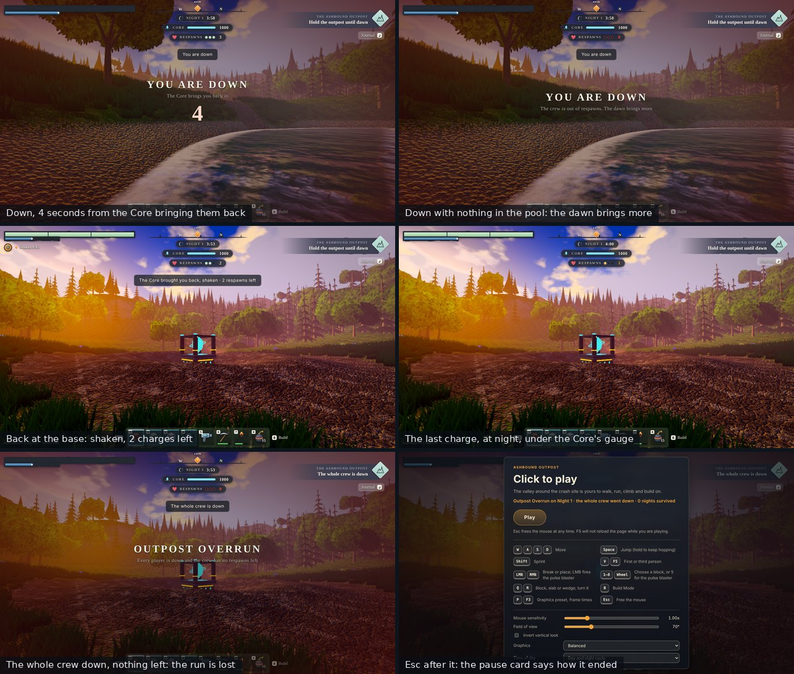

| Image                                            | What to look at                                                                                                                                                 |
| ------------------------------------------------ | --------------------------------------------------------------------------------------------------------------------------------------------------------------- |
| [respawn-pill-low](phase-4/respawn-pill-low.jpg) | Night, the last respawn: the pill under the Core's gauge with one amber pip of three.                                                                           |
| [respawn-down](phase-4/respawn-down.jpg)         | Down some way from the base with four seconds to go: the dark red edges, the countdown in the middle, the Health bar empty, the hotbar dimmed and no crosshair. |
| [respawn-wait](phase-4/respawn-wait.jpg)         | The same with nothing in the pool: the line says the dawn brings more, and the pill reads 0 in red over three ringed pips.                                      |
| [respawn-back](phase-4/respawn-back.jpg)         | Back at the base, looking at the Core: Health full, Energy half, "Shaken 0:45" under the bars, the pill down to two, and the toast.                             |
| [respawn-overrun](phase-4/respawn-overrun.jpg)   | The whole crew down with nothing left: "Outpost overrun", the cause under it, the banner and the Core untouched.                                                |
| [respawn-pause](phase-4/respawn-pause.jpg)       | Esc after it, before 4h: the pause card said "Outpost Overrun on Night 1 · the whole crew went down · 0 nights survived".                                       |
| [respawn-pills](phase-4/respawn-pills.jpg)       | The pill cut out and enlarged in its three tones: two of three, the last one (amber), none (red).                                                               |
| [respawn-states](phase-4/respawn-states.jpg)     | Six of the pictures together.                                                                                                                                   |

### Known gaps in going down

- A downed player's avatar still stands where they fell on the other screens. A body lying down, or a marker over it so the crew knows whom to cover, is polish for Phase 6, and so are the sounds (a low hum as they fall, a chime as the Core brings them back).
- Being brought back is a cut: the view jumps to the seat. A short fade or the Core's light drawing the player in is Phase 6. Nothing protects the player the moment they are back either: a crowd at the seat can put them down again at once, and that spends another charge. A breath of safety (and a light on the seat to say so) is for play-testing to ask for.
- Seen only in software-rendered pictures; the vignette is the one place the HUD asks the GPU for a large soft gradient, and how it reads on a real display is for the first look there.

## Phase 4h: the Outpost Overrun card

A lost run ends in one card, and the card starts the next run. It is made of the HUD's own parts (the pause card's dark slate frame, the coral red of the Core's fallen gauge for the title, the amber outline of the Play button for Retry), so nothing here is new paint. The choices are in [decisions](decisions.md#phase-4h-the-outpost-overrun-card-with-retry-and-new-run-2026-10-24).

### What the crew sees

- **The card.** In the middle of the dimmed world, in the pause card's frame: the small amber kicker "Ashbound Outpost", the title "Outpost Overrun" in coral red, one sentence on how it ended ("The Outpost Core fell on Night 3." or "Every player was down on Night 2 and the crew had no respawns left."), then the number the run is judged by in a wide, warm-tinted tile of its own (the nights survived in large figures over a small capitals label, "2 NIGHTS SURVIVED"), and a row of smaller tiles under it: Time held, Machines destroyed, Blocks placed, Materials gathered and Respawns used (Materials gathered came with [Phase 5a](#phase-5a-salvage), so the pictures below, which are 4h's, show four). Research earned joined that row in [Phase 5c](#phase-5c-research), and the spec's upgrades join it in 5e. The HUD behind the card goes on telling the same story: the Core's gauge is empty, the banner says "The Outpost Core has fallen" (or "The whole crew is down") and the respawn pill shows what the crew had left.
- **Retry and New Run.** Two buttons under the tiles: Retry in the amber outline of the Play button, New Run quiet beside it, and a line that says what each does. Pressing one dims both and the line says "Starting the next run…" until the run is up (the buttons come back after eight seconds if it never is).
- **A guest.** The same card with no buttons: the line under the tiles says "Waiting for Host to start the next run." with the host's name. The room card at the top right stays above it, so a guest can still leave.
- **After Retry or New Run.** The card is gone and the screen is at the start of a run: the clock at Day 1 7:59 (it starts at 8:00 and has run a moment), the Core's gauge hidden again, the respawn pill showing the charges the crew brings and the player at their seat. Retry is the same valley, with the same land, road and trees, the Core where it was and nothing built. New Run is another valley.

### Screenshots

Headless Chromium on software GL at 1280 by 720, Balanced, `freeze=1`, `?debug&waves=0&time=golden` (the sky is held at golden hour, or it would follow the clock into the night the run is warped to), driven with the page's debug hooks (`__ashbound.mp.warp`, `hurtPlayer`, `hurtCore`, `placeNear`, `spawnCrawlerAt`, `fireAtMachine`). The run is held while the mouse is free, so each picture is the state that was set up: four machines shot down, a hut of 24 blocks built by the seat, the player felled once and brought back, and then the Core falling on night 3 (the second card is a second run, lost to the whole crew at night 2). Retry and New Run were clicked for real. The three world views are taken from one camera, six blocks to the side of the seat and three and a half up, looking between the hut's place and the Core. The guest's card is a second page in a room, through a local PeerServer.

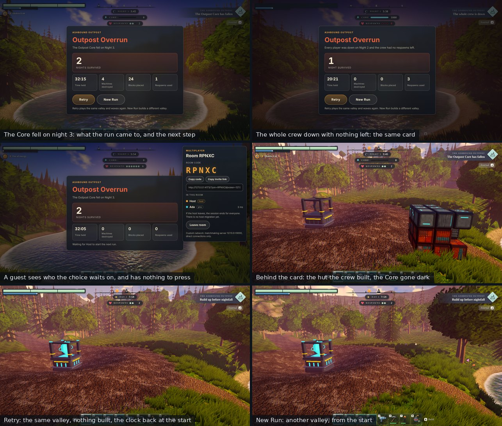

| Image                                        | What to look at                                                                                                                                                                                                                                  |
| -------------------------------------------- | ------------------------------------------------------------------------------------------------------------------------------------------------------------------------------------------------------------------------------------------------ |
| [overrun-core](phase-4/overrun-core.jpg)     | The Core fell on night 3: two nights survived, 32:15 held, four machines destroyed, 24 blocks placed, one respawn used, Retry in amber and New Run beside it, and the line that says what each does.                                             |
| [overrun-card](phase-4/overrun-card.jpg)     | The same card cut out and enlarged.                                                                                                                                                                                                              |
| [overrun-crew](phase-4/overrun-crew.jpg)     | A second run lost on night 2 with the pool empty (three respawns used, one night survived): the same card with another sentence, the respawn pill red at 0 and the banner "The whole crew is down".                                              |
| [overrun-guest](phase-4/overrun-guest.jpg)   | A guest's screen when the host's Core falls on night 3 (two nights survived, nothing else counted here): the same card with no buttons, "Waiting for Host to start the next run." where they would be, and the room card still at the top right. |
| [overrun-built](phase-4/overrun-built.jpg)   | Behind the first card: the hut the crew built (scrap walls, a composite roof) at the right, the Core's cage at the left with its crystal dark, "CORE 0" in the gauge.                                                                            |
| [overrun-retry](phase-4/overrun-retry.jpg)   | After Retry, the same camera: the same land, the same road and trees, the Core lit and whole, the hut gone, Day 1 7:59.                                                                                                                          |
| [overrun-new](phase-4/overrun-new.jpg)       | After New Run, the same camera in another valley: rock outcrops and the lake at the right, the Core where the new crash site is, Day 1 7:59.                                                                                                     |
| [overrun-states](phase-4/overrun-states.jpg) | Six of the pictures together.                                                                                                                                                                                                                    |

### Known gaps in the Overrun card

- Only what the run already knows is counted: nights, time held, machines destroyed, blocks placed, materials gathered (since 5a) and respawns used. Research earned arrived with 5c ([Phase 5c](#phase-5c-research)); upgrades completed (SPEC section 9) arrive with 5e.
- The card appears at once, with no fade and no sound, and the world behind it is dimmed but not stopped from being looked at for a moment first (the mouse is freed a second and a half after the loss, so a playing crew sees the wreck first). A slower reveal and the loss's stinger are Phase 6.
- The room card is always open in a room, 330 pixels wide at the top right, and sits above the Overrun card so that a guest can still leave: in a window under about 1,300 pixels wide it covers the right edge of the card, and in one under about 660 it covers the buttons too (there is nothing to fold in a room). A usual window is clear of it.
- A guest cannot ask for Retry or New Run; the host chooses. A vote is not in the spec.
- There is no way out to a title screen yet: the room panel and closing the tab are it.
- Seen only in software-rendered pictures. The tiles and the type are the HUD's, so how they read on a real display is for the first look there.

## The intro film

A fresh run opens with a film of about 43 seconds: the station's reactor falls out of a dusk sky, burns a furrow through the valley and comes to rest in a crater; the Core wakes in the wreck, the machines of the wreck wake in the dark, and the sun comes up over the lake behind the title card. The last shot comes down to the shore where the player stands and becomes the player's own view. SPEC section 14 puts cutscenes out of scope, and this single film is the one exception, made at Austin's request; it is skippable at any moment. The choices, and the rules for when it plays, are in [decisions](decisions.md#the-intro-film-2026-10-27). Nothing in it is a model, a texture or a sound file: it is the game's own valley, sky and light seen by a camera on rails, with a wreck that is a lathe, fire made of instanced quads and machines that are the game's own crawlers.

### What the film shows

Six scenes, each opened by a cut that hides a change of place: a dip to black, or a white flash. The sky is the game's own day-night cycle run through in a few seconds, from the dusk of the day the reactor fell, through the night, to the morning the run opens on.

- **The fall (0 to 8 s).** The dusk sky, violet over a ridge of black pines with the last orange of the sun on the western hills. The camera stands at the edge of the clearing where the player will stand and looks up. A burning reactor comes in from far off as a comet with a curved tail, a white-hot head with four points of light and a long wake of fire and smoke, and the camera follows it down over the hills. The first caption fades in, "Station Vesper lost her reactor over an unnamed world."
- **The skid (8 to 14.5 s).** A white flash as it touches down at 8.0 s, and the cut is to a camera low beside the clearing's edge. The wreck, a drum nine meters long with its nose stove in and its back torn open, bursts out of the trees tumbling, drags its fire across the grass and ploughs the furrow the valley already carries into the crater. At 12.4 s it stops in a fountain of fire and sparks with a second, softer flash, and the hull opens on the Core.
- **The crater (14.5 to 22.5 s).** After a dip to black, the night. The camera, first above the grass of the rim with the Core a small white light on the horizon, drifts down toward the Core standing in the settling dust, embers lifting off the crater into the dark and the fires burning on among the wreckage. Twice the Core sends a ring of cyan light across the ground. "What the fall left standing, the night came to take."
- **The eyes (22.5 to 29.5 s).** Low on the crater floor, with the Core large at the left of the frame and the mountains beyond the fog. Five crawlers, the real ones, climb out of the ground at the edge of the dark one after another, each with a red glint at its eye and a little gold on its back, and start toward the Core as the camera drifts past it. "The wreck was not empty. Its machines woke in the dark."
- **The dawn (29.5 to 38 s).** The camera climbs out of the crater over the lamps and heaps of wreckage and swings out over the valley as the sun comes up across the lake. The title card arrives over the sunrise at 31.9 s: "Ashbound Outpost" in wide-set capitals and, under it in amber, "Scavenge by day. Hold the line by night."
- **The wake (38 to 43.5 s).** The picture is shut, and opens like an eye: two slow openings with a blink between them. The camera comes down out of the sky straight over the clearing to the height of the player's eyes at the spawn, looking across the lake at the sunrise, and the film ends there: the sky is exactly the run's opening sky, the camera blends into the player's own over the last 1.6 seconds, and the mouse, which was in hand from the click on Play, is the player's.

**Over the picture.** Letterbox bars to the cinema's shape (2.39 to 1) wherever the window is narrower than that, which slide in over the first 1.1 seconds and out over the last; the captions in the lower bar; the title card; the two white flashes and the dips to black at the cuts; the eyelids of the wake; and a prompt, "Any key to skip", that shows from 1.6 seconds in and dims after six more. The HUD is gone while the film runs. Any key or click ends it after the first 0.8 seconds with a dip to black and the run is there; Esc lets go of the mouse and leaves the pause card, whose "Watch the intro" button plays it again.

### How it is made

- **The wreck.** A reactor module 9.2 meters long and 2.5 across, turned on a lathe from a hand-written profile (a torn mouth at the back, a stove-in nose) with five ribs, swept fins, a few spars and a crumple from a cheap sine noise, so it has no model file. Its surface is one shader: steel plating in rings and panels with rivets and soot, seams that glow only where the hull is still hot, and the white-hot dome it flew in on, which the film lets die away once it has stopped. At the film's distances the ribs, the panels and the glowing seams read; the rivets and the soot are small. It tumbles in the air and the ground drags the spin to a stop.
- **Fire, smoke, sparks and embers.** Instanced quads whose whole life is a closed form of their age, written once when the film opens and moved by the GPU from the film's clock, so the CPU writes nothing while it plays and any moment can be drawn without having played the ones before. A ground fire is a flame, a tongue that narrows toward its tip and sways, not a round puff. The glows (the fireball's head, the flashes, the Core's breath and the machines' eyes) are squares that face the camera, bright in the middle with a halo and four points of light, added to the picture.
- **The camera.** Each scene is a track of keys in the crash site's own terms: so many meters forward along the wreck's last run, to its right and above the ground there. The same keys fit whatever the valley is, because the crater is the origin and the furrow the terrain already carries is the axis. The camera never goes nearer the ground than 45 centimeters, shakes while the wreck skids, and blends into the player's view at the end.
- **The sky.** The stage is told where the sun and the sky stand at each moment by the game's own day cycle (`Stage.setSkyOverride`), and gets its own back when the film stops.
- **The machines.** The game's own crawler renderer, at poses the film scripts: a held film settles them in a few steps. What the film shows is what the first night will bring.

### Pictures of the film

Headless Chromium on software GL at 1280 by 720, Balanced, `freeze=1`, `?debug&intro=on&introAt=T&waves=0`, the film held at each second `T` named below (`playback.seek`) and the page's animation clock replaced by one that moves a set step a frame, so every picture is the same on every run. The bars, captions and prompt are in the pictures as a player sees them. The hull sheet is taken with the overlay and the effects hidden and the camera set by hand at 12 meters round the wreck.

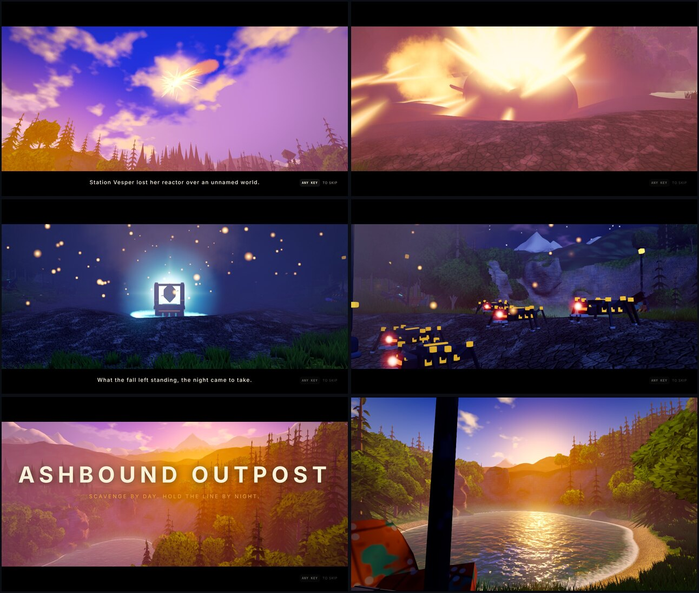

| Image                                               | What to look at                                                                                                                                                                                                                                                                                            |
| --------------------------------------------------- | ---------------------------------------------------------------------------------------------------------------------------------------------------------------------------------------------------------------------------------------------------------------------------------------------------------- |
| [fall-far](intro/fall-far.jpg) (2.5 s)              | The first caption over a violet and blue dusk: the reactor far off as a bright comet with a short tail among banks of gold-lit cloud, the pines of the clearing in silhouette and warm light on the bushes at the edge.                                                                                    |
| [fall](intro/fall.jpg) (5.5 s)                      | Nearer: the head white-hot with its four points of light and the tail curving back across the clouds.                                                                                                                                                                                                      |
| [fall-close](intro/fall-close.jpg) (7.4 s)          | Just before it comes down: the hull shows through the glare at the head of a wake that fills the top of the frame, and the camera has swung to follow it.                                                                                                                                                  |
| [touchdown](intro/touchdown.jpg) (8.4 s)            | After the flash and the cut, low in the grass: the burst of the first contact behind a tree, shafts of light through the foliage and the dusk-pink forest beyond.                                                                                                                                          |
| [skid](intro/skid.jpg) (9.8 s)                      | The hull on the ground, rolling and ploughing: its ribs and a swept fin against a wall of fire and sparks, the dark grass in front.                                                                                                                                                                        |
| [skid-crater](intro/skid-crater.jpg) (11.2 s)       | At the lip of the crater: the hull with the fire behind it and the cracked ground of the crater floor in the foreground.                                                                                                                                                                                   |
| [stop](intro/stop.jpg) (12.7 s)                     | The stop: a fountain of fire and sparks over the wreck as it settles, and the second flash at its softest.                                                                                                                                                                                                 |
| [core-uncovered](intro/core-uncovered.jpg) (13.5 s) | The Core standing in the hull's torn mouth, a dark silhouette against its own light, with sparks still falling in streaks around it.                                                                                                                                                                       |
| [crater-pulse](intro/crater-pulse.jpg) (18.0 s)     | The crater by night: the Core in the settling dust with its ring of cyan light crossing the ground, embers in the air and the second caption.                                                                                                                                                              |
| [crater](intro/crater.jpg) (20.4 s)                 | Nearer: the Core's frame and crystal, and the bowl of the crater around it.                                                                                                                                                                                                                                |
| [eyes](intro/eyes.jpg) (26.0 s)                     | The Core large at the left; in the fog beyond it machines with red eyes are up and walking, the lamps of the clearing behind them and the third caption below.                                                                                                                                             |
| [eyes-march](intro/eyes-march.jpg) (28.8 s)         | The camera has drifted past the Core: five machines walking at it across the cracked floor, gold marks on their backs and their eyes burning, the mountain and the first stars behind.                                                                                                                     |
| [dawn](intro/dawn.jpg) (31.6 s)                     | Up over the crater at the start of the dawn: the lamps and heaps of wreckage in the grass at the rim, the lake with the sun's first light on it and the last embers drifting.                                                                                                                              |
| [title](intro/title.jpg) (34.0 s)                   | The title card over the sunrise: "Ashbound Outpost" and its line, with the mountains behind and the lake below.                                                                                                                                                                                            |
| [sunrise](intro/sunrise.jpg) (36.6 s)               | The same card a little later: the sun is higher, the sky has gone blue, and the camera is over the shore.                                                                                                                                                                                                  |
| [wake-lids](intro/wake-lids.jpg) (40.8 s)           | The survivor's eyes opening: the valley seen through the slit of the lids, the lake and the glow of the sun.                                                                                                                                                                                               |
| [wake](intro/wake.jpg) (42.2 s)                     | The eyes open, the camera coming down over the clearing with the lake ahead and the morning on the water.                                                                                                                                                                                                  |
| [handoff](intro/handoff.jpg) (43.4 s)               | The last frame: the player's own view at the spawn, with no bars and no HUD yet, the mast of a heap's lamp at the left and the lake ahead. It is the first frame of the run.                                                                                                                               |
| [hull](intro/hull.jpg)                              | The wreck by itself a moment before it stops, from the side, the front, the rear and above, with the effects hidden: the ribs and the swept fin on its back, seams glowing where the plating has cracked, the hot dented nose, and the torn mouth at the back white-hot with the spars standing out of it. |
| [overview](intro/overview.jpg)                      | Six pictures together: the fall, the stop, the crater, the eyes, the title and the hand-over.                                                                                                                                                                                                              |

### What the film costs

The film is ten fields of particles (7,180 instanced quads between them, one draw call each), ten glows, the wreck's hull and, from the eyes scene, the game's five crawlers. Counted like the tables above (Balanced, every pass, software GL) with the film's layers shown and then hidden at the same second, it adds 26 draws and 36.1 thousand triangles to a frame at 5.5 and at 9.8 seconds, when the hull is on the screen, 24 and 21.5 thousand at the stop, 22 and 21.5 thousand in the crater, 35 and 32.3 thousand in the eyes and the dawn, and 33 and 32.3 thousand in the wake. Underneath it is the valley as the camera sees it, so the film's frames run from 109 to 144 draws and 0.74 to 0.97 million triangles in all (the dawn, looking out over the whole valley, has the most triangles). Nothing is built or paid for while it plays. Its code is a chunk of its own, loaded when a page opens plain and only then (or when the pause card's "Watch the intro" is pressed); its particles are written once; and its shaders are compiled as it opens out of black. When it ends every buffer and material of the film is freed and the stage gets its own sky back.

### Known gaps in the film

- **The words are placeholders.** The spec gives no story, so the station's name ("Vesper"), the three captions and the title card's line are mine: `STATION_NAME`, `CAPTIONS` and `INTRO_TITLE` in `src/shared/intro.ts`, one constant and two tables to change.
- **Its sound has its own gaps.** The film has music and sound effects ([the film's sound](#the-films-sound)), none of which has been heard by a person yet.
- **The fall begins in the sky.** There is no station: no hull above breaking up, no space. An opening in orbit needs a model of the station and is left for a later pull request if it is wanted.
- **The wreck is a drum.** Its shape and plating are a profile and a shader, and it is seen at its closest, from about ten meters, at the skid. It would not bear a close look, and the film never gives it one.
- **The camera is on rails.** Every scene is one track, so nothing is aimed at by what is on the screen: if a valley's trees or rocks stand in a shot (the clearing's trees at the touchdown, the pines in the first scene) they are simply there. The camera clears the ground by 45 centimeters and nothing else.
- **Frame rate is unmeasured.** The pictures are software-rendered, which gives no frame rate. The film's cost in draws and triangles is above; how it runs on a real GPU, and how long its first second takes while the shaders compile, are for the first look on a real machine.
- **Seen only in software-rendered pictures.** The flashes, the bloom on the fireball and the Core, the glow of the eyes and the title's glow, which the bloom and the tone mapper shape, are judged there.
- **Two white flashes.** At the touchdown (0.85 of the screen, over half a second) and at the stop (0.3 over nine tenths of a second), and nothing flickers faster than that. A player whose system asks for reduced motion gets the film with the flashes at a third of their strength and the camera held steady.
- **English only, and one length.** The captions are not translated, and the film is 43 seconds for every new game; the skip is always there.

## The title screen

The page opens on a home page: the game's own valley in the morning sun with a camera drifting slowly over it, the name of the game across the picture, the film's line under it and one large Play button, and nothing else. Play fades the picture to black and [the intro film](#the-intro-film) opens out of the black; when the film ends, or a key skips it, the player is in the run with the mouse in hand. Austin asked for it on 2026-10-27, after the film: "a home page with a scenic background, the name of the game, and just a large PLAY button". When it shows, what Play does and what happens when the mouse does not come are in [decisions](decisions.md#the-title-screen-2026-10-27). Nothing in it is a model, a texture or a sound file: the scenery is the live game, the words are the film's own and the typeface is the system's.

### What the title shows

- **The picture.** The valley at the hour the run opens on, drawn live with everything the game has: the low sun and its glare in the haze, shadows, the pines and the broad-leaved trees moving in the wind, the Core in its crater and the heaps of wreckage with their lamps. The camera starts low over the crash site, looking east-north-east down at the Core, the lake and the sun, and over 48 seconds it drifts up and back to a view high over the western forest that takes in the lake, the valley and the mountains; then it comes back, and so on. It slows to a stop at each end (a raised cosine), so it reads as a drift and never a swing.
- **The words.** The name in wide-set bold capitals, cream with a warm glow behind it; under it a thin amber rule with a small cyan diamond in its middle (the shape of the Core's crystal) and the film's line in amber capitals; then Play. The group sits a little above the middle of the window, over a soft darkening that lets the words read on any picture and keeps to the middle of the words and the foot of the window. Sizes follow the window: the name is 28 pixels at the least and 100 at the most.
- **Play.** One pill of amber glass with a light inner edge and a slow breathing glow, "PLAY" in wide-set capitals, a fifth of the window wide (220 to 380 pixels); it is the only thing on the page that takes a click, and Enter and Space press it too.
- **Arriving.** The name rises into place over a second and a half, the rule and the line fade in after it and Play comes last, at 1.2 seconds, so the first look is the valley and the name.
- **Leaving.** The words go at once and the picture fades to black over 0.7 seconds; the film's first frame is black, so it opens out of it, and the title leaves the page one frame after the film has the camera, so nothing of the valley shows in between. When there is no film the picture does not go black: the camera glides from its view into the player's own over 1.8 seconds and the HUD fades in.
- **When the browser will not hand over the mouse.** The screen stays, with the browser's reason under Play in amber ("The browser did not hand over the mouse. Wait a moment, then click Play again."), and Play works again.
- **Narrow and wide windows.** The name is one line on any desktop window and two, balanced, on a phone-width one, where nothing is clipped; a tall window shows the same view cropped to the lake and the Core.
- **Less motion.** For a system that asks for less, the camera holds the first view, none of the words animate and Play is there at once. Play still starts the film, turned down by the film's own rule.

### How it is made

- **The camera.** A `Cinematic` (`engine/title-drift.ts`), the hook the film uses: the avatar is hidden, the mouse's look is ignored and the player's own view is still worked out underneath, which is what the glide flies to. Its path is `createTitleRoute`: the two views in `TITLE_VIEWS` (the first at x -26, z 30 and 15 meters up, bearing 66 degrees, 7 degrees down; the second at x -34, z 52 and 26 meters up, bearing 60 degrees, 11 down) blended by `driftShare`, and lifted by a smooth maximum to stay 6 meters above the ground. The views were chosen on the default seed from candidate cameras photographed at the run's opening hour.
- **The words.** Plain DOM over the canvas (`ui/title-screen.*`), above the HUD and the room card and below the film, so the fade to black runs straight into the film's black first frame: the picture goes black under a veil and the game's own light is not touched. There are no images: the diamond is a turned square with a glow and the rule is a gradient.
- **The type.** The system's own sans-serif in bold capitals with wide tracking, as the film's title card has it, with a warm shadow so the name reads on bright sky and on dark forest alike.
- **What Play does.** `app/title.ts`: the click asks for the mouse and holds the input deaf, the veil goes to black and the film's controller starts the film (`play()`), or, if the film is off or its code has not come within five seconds, the camera glides into the run. If the mouse does not come, or is let go of before the film starts, the screen is back to waiting, with the reason when the browser said no.

### Pictures of the title

Headless Chromium on software GL, Balanced (Low for the widest window), `?title=on&intro=on&debug&stats=0`. Each picture is taken when the drift's own clock reaches the second named; software rendering draws a frame in about three seconds, so the clock is moved on to the middle and the far end by calling the drift's own `update`, and the camera is where it would be.

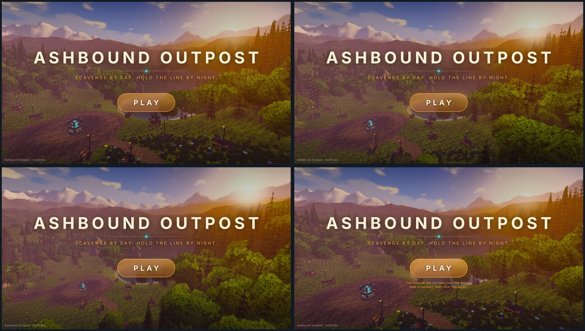

| Image                                     | What to look at                                                                                                                                                                                                                                                            |
| ----------------------------------------- | -------------------------------------------------------------------------------------------------------------------------------------------------------------------------------------------------------------------------------------------------------------------------- |
| [title](title/title.jpg) (4 s)            | The first view, 1280 by 720: low over the crash site, the Core in its crater at the lower left with the heaps and their lamps around it, the lake ahead, the sun in the haze over the eastern ridge at the right, the name across the forest, its rule and line, and Play. |
| [title-mid](title/title-mid.jpg) (24.8 s) | Half way: the camera has risen and drawn back, the crater is smaller at the lower left and a crown of trees fills the lower right as foreground.                                                                                                                           |
| [title-far](title/title-far.jpg) (48.8 s) | The far end, 26 meters up: the whole valley under the words, the lake, the crash site, the forest to the east in the sun and the mountains.                                                                                                                                |
| [title-narrow](title/title-narrow.jpg)    | An 800 by 900 window: the same view cropped to the lake and the Core, the name still one line and Play at its smallest.                                                                                                                                                    |
| [title-wide](title/title-wide.jpg)        | A 1920 by 1080 window (Low): the name at its largest, 100 pixels, and Play 380 wide.                                                                                                                                                                                       |
| [title-phone](title/title-phone.jpg)      | A phone-width window, 390 by 800: the name on two lines, balanced, the line under it on two and Play unchanged.                                                                                                                                                            |
| [title-hint](title/title-hint.jpg)        | After the browser refused the mouse: the reason in amber under Play, which has not moved, and Play lit by the pointer that pressed it.                                                                                                                                     |
| [overview](title/overview.jpg)            | Four pictures together: the first view, half way, the far end and the refused mouse.                                                                                                                                                                                       |

### What the title costs

Ten elements over the canvas (the screen, its darkening, the card, the name, the rule and its diamond, the line, Play, the hint and the veil) and no draw call of its own. What the camera sees under it costs what the valley costs: 126 draws and 0.95 million triangles at the first view, 128 and 0.97 million half way and 130 and 1.0 million at the far end (Balanced, every pass, software GL, 960 by 540), inside the range of the film's own frames above (109 to 144 draws, 0.74 to 0.97 million triangles). The blur behind Play and the pulse of its glow are the browser's, composited on its own layer. While the title is up the run's clock is stopped, so nothing is simulated but the camera; the film's code is fetched as the page opens, so Play does not wait for it.

### Known gaps in the title

- **No sound of its own.** The title is silent: a page can only make sound after a click, so the film's sound ([the film's sound](#the-films-sound)) starts with the click on Play and the fade to black.
- **The words are placeholders.** They are the film's: `INTRO_TITLE` in `src/shared/intro.ts`, read by `TITLE` in `src/shared/title.ts`.
- **Only Play.** No Continue and New game (Phase 6b's saved runs will want them), no settings, no list of controls and no "Play together": a host who wants a room presses Play and then Esc, which brings up the pause card with the room card on it. The card is hidden on the title to keep the page to the name and Play, as asked; a quiet "Play together" under Play is a few lines.
- **The camera is on a route, not a named shot.** It keeps 6 meters above the ground and clears nothing else, so a tree can stand in the lens (half way, a crown fills the lower right and reads as foreground). Another seed's valley may put a hill or a thicker wood at one of the two ends; the views were chosen on the default seed.
- **Seen only in software-rendered pictures.** The sun's glare, the glass of Play and its glow are judged there; how the blur and the breathing glow look on a real display, and whether Play is large enough at the player's distance from the screen, are for the first look.
- **No gamepad.** The game has none yet, and the title does not either.

## The film's sound

The intro film has music and sound effects, and the click on Play that starts it starts them. Austin asked for it on 2026-10-27 with the home page ("make sure the trailer has music and sound effects"). The soundtrack runs under the film's 43.5 seconds and rings on for 3.6 more into the first moments of play. Every sound in it is made in code with Web Audio (oscillators, filtered noise and a generated reverb), so there is no audio file to license or ship and `CREDITS.md` does not change. The choices, and the rules for when it starts, are in [decisions](decisions.md#the-films-sound-2026-10-27). **None of it has been heard**: the sandbox the game is built in has no sound device, so what follows is measured from the soundtrack drawn to samples by the page's own code, and how it sounds as music is for Austin's first listen.

### What the film sounds like

The music is in D: a low D minor while the night lasts and D major from the dawn. A sound that goes with the picture (the touchdown, the stop, each ring of the Core's light, each machine's rise, the title card, the eyelids) takes its time from the picture's script, so the two keep step when either is retimed.

- **The fall (0 to 8 s).** The wind comes up from nothing and under it a low D, felt more than heard, swells over the first four seconds. The hull groans three times, sinking in pitch, and sheds plates with high ticks and two clangs. A dark D chord swells from 3.2 s; from 3 s the air screams past in a band of noise that climbs from a rumble to a hiss; a thin A and then a B-flat float above. A low heartbeat starts at 5.8 s and quickens over five beats, and a riser sweeps up toward the touchdown. For the last fifth of a second the whole mix falls away by 26 decibels: a held breath.
- **The skid (8 to 14.5 s).** At 8.0 s the great hit: a sub-bass drop from 92 Hz to 33 that the ear feels, a thump, a crash of noise that darkens over three seconds and a crack, with three clangs of metal and a burst of crackle. The wreck grinds through the valley, metal dragged over rock fluttering fourteen times a second and slowing to three with it, with thuds and clangs and ticks scattered over the hull's tearing. At the stop (12.4 s) there is one last great clang, a thud, a groan sinking from 82 Hz to 54 and steam venting twice. The Core is uncovered at 12.75 s: its hum comes up, a D chord of pure tones whose third is the one that moves, and with each of its four rings of light a low swell and a glass ping.
- **The crater (14.5 to 22.5 s).** The quietest scene. A held chord of five low notes, seven bell notes (A, F, D, E, F, A, G) with a long room around them, breaths of steam, the tick of cooling metal now and then, the fires crackling and something stirring far off at 21 s. The drone and the hum are the only weight.
- **The eyes (22.5 to 29.5 s).** A B-flat chord, then G minor, and a pulse under them from 24.1 s that comes faster each time and turns from a heartbeat into drums. Each of the five machines has the ground give way under it, a plate scraping, a servo winding up and a blip as its eye lights, and then walks toward the Core with footfalls that get nearer and louder; the machines are panned apart. A riser climbs to the cut and, at the cut, the drone drops out.
- **The dawn (29.5 to 38 s).** G and then A as the title card comes, with drums, and at 31.9 s, as the card arrives, the key turns to D major on a boom, a drum and a bell flourish (D, F sharp, A, D), over D, A and B minor chords at 2.2 seconds each. The Core's hum glides its third from F to F sharp and goes out with the night. Bells in eighth notes begin and grow over a bar, and the fires thin out.
- **The wake (38 to 43.5 s).** The picture is shut and so is the sound: the whole mix is heard through a lowpass at 450 Hz, a wall, while the survivor's own heartbeat and two breaths come through it, and the wall opens with the eyelids, two slow openings with a blink between. G, then a D chord of nine notes (D, A, D, A, D, F sharp, A, D, E) that swells over the last bar as the bells thin out, and the wind comes up.
- **The tail (43.5 to 47.1 s).** The picture has handed over the run. The chord rings out into play with the wind still blowing, and the last 0.4 seconds are faded. A player who watches the film again while it rings (from the pause card, within a few seconds of the end) cuts it off over a quarter of a second, so that two scores never play at once.

### How it is made

- **A score as data.** `src/shared/intro-sound.ts` is a list of about four hundred **cues** (a sound, a second, a level, and a pitch, a length or a pan where the sound has them) and five **beds** (long sounds with their loudness and tone drawn as curves). Where the score scatters sounds (the fires, the thuds, the ticks) it draws them from a seeded generator, so every play is the same film. It touches nothing of the browser.
- **Twenty voices.** Each is a short recipe of oscillators, shaped noise and filters that is started at a moment and left to run out: `boom`, `thud`, `clang` (five partials that are not whole multiples, which is what makes metal sound like metal), `groan` (a saw sliding down through a narrow band with a wobble), `steam`, `tick`, `crackle`, `ping`, `whoom`, `servo`, `blip`, `rumble`, `step`, `pluck` (a bell: a sine, a sour high partner and an octave), `pad` (two detuned saws and a sine through a lowpass that opens as the note swells), `timp`, `heart`, `riser`, `breath`, and `duck`, which dips the whole mix. `src/engine/audio/voices.ts`.
- **Five beds.** The air `roar` of the fall, the `grind` of the skid, the `wind`, the `drone` and the Core's `hum`. A bed is built when it first falls due and steered along its curves in steps of 0.05 s (`engine/audio/beds.ts`, `INTRO_BEDS`). The hum follows the same `coreGlowAt` the picture's glow does.
- **One mixing board.** A fader in decibels for each kind of sound (`FADERS`) and one for each bed, so the numbers in the score are about the music and the picture, and the balance between the kinds is set in one place.
- **Noise and a room made, not loaded.** White, pink and brown noise come from a seeded generator (four seconds each, looped without a seam), and the reverb is a convolver whose impulse response is generated: 3.2 seconds of noise that falls 60 decibels and darkens as it ages, with its own noise in each ear, and a pre-delay of 18 ms so that a hit stays clear of its room.
- **The way out.** Everything goes into a bus, then the lowpass of the eyelids, then a limiter (a compressor set to catch only the loudest moments: threshold -14 dB, ratio 6, attack 3 ms) and the master volume the player set, then the speakers. The volume comes after the limiter, so turning it down never changes the mix.
- **Placed by the film's clock.** The director tells the sound where the film is every frame, and what starts in the next fifth of a second is handed to the audio thread for exactly its moment. A stalled picture holds the sound back with it.

### The mix, measured

Drawn by the page's own `audio.render()` (`?debug`) in step with a clock, the way a film plays, at full volume and 44.1 kHz, and measured with ffmpeg's loudness meter and a few lines of numpy.

| Scene      | Film seconds | Level (RMS, dBFS) | Loudest (peak, dBFS) | What carries it                                                                                                                           |
| ---------- | ------------ | ----------------- | -------------------- | ----------------------------------------------------------------------------------------------------------------------------------------- |
| The fall   | 0 to 8       | -24               | -6                   | wind, a low drone, the roar of the air, hull groans, a pulse that quickens and a riser; the mix falls away for the last fifth of a second |
| The skid   | 8 to 14.5    | -17               | -2                   | the touchdown boom, the grinding wreck with its clangs and thuds, the stop, then the Core's hum with a ping for each ring                 |
| The crater | 14.5 to 22.5 | -26               | -9                   | a held chord, seven bells with a long room around them, steam and the tick of cooling metal                                               |
| The eyes   | 22.5 to 29.5 | -24               | -6                   | a pulse that turns into drums, the machines' footsteps, a riser to the cut                                                                |
| The dawn   | 29.5 to 38   | -24               | -5                   | the title's boom and drum, bells in eighth notes, chords in D major                                                                       |
| The wake   | 38 to 43.5   | -23               | -8                   | chords through the lowpass of the closed eyes, the survivor's heartbeat and breaths, then the open chord                                  |
| The tail   | 43.5 to 47.1 | -35               | -17                  | the last chord and the wind ringing out into play                                                                                         |

- **Whole film.** The loudest sample is -1.7 dBFS and the true peak -1.7 dBTP, so the mix has about 2 dB of room at full volume; the loudest 50 milliseconds are at 8.01 s, the touchdown. Integrated loudness is -20.8 LUFS with a loudness range of 11.2 LU.
- **The held breath.** Just before the touchdown the mix falls away: -18 dB RMS in the 0.3 s before the dip, -44 dB in the dip (from 7.86 s, when its 0.07 s ramp is down: 26 dB lower) and -11 dB in the first 0.1 s of the boom, 34 dB up in a fifth of a second.
- **Closed eyes.** The mix's high-frequency content (the sample-to-sample change over the level; higher is brighter) is 0.13 in the dawn with the eyes open, 0.04 just after the cut, behind the lids, and 0.14 once they are open again.
- **Both ends are silent.** The first quarter second is digital silence (-140 dB) and the last 0.05 s -88 dB, so the sound starts and stops without a click.
- **Stereo.** The two ears have a correlation of 0.62 (the machines are panned apart, the reverb has its own noise in each ear); every sample is a number, and the offset from zero is 0.00062.

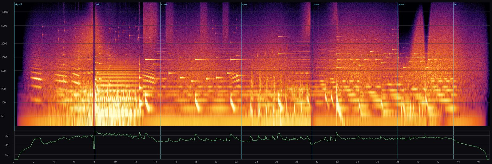

### What the sound costs

On the page's first load the sound adds 2.5 kB of JavaScript (1.4 kB gzipped): the hub, the volume setting and the unlock. The synthesizer and the score come with the film's chunk, 21.4 kB (7.8 kB gzipped), and the renderer that draws them to a file (0.65 kB) loads only on a `?debug` page. No audio file is fetched, and no audio context is made until the click on Play.

Played in real time in the sandbox's headless Chromium (44.1 kHz, a four-core machine with no sound device, the page idle): setting the sound up, which makes the noise banks and the reverb's impulse response, takes 140 ms on the main thread, once, as the film begins; telling it where the film is, once a frame at 60 a second, takes 0.07 ms on average (0.7 ms at the 99th percentile and 3.3 ms at the worst of 2,653 calls, 0.2 seconds in all), which is where cues and beds are handed to the audio thread. The browser as a whole used 0.24 of a core while the film's sound played, against 0.02 with an empty audio context running, so the synthesis costs about a fifth of one core (the offline render that draws the soundtrack to samples takes 10.8 seconds for its 47.1, about the same). This browser does not report the audio thread's own load, so the figure is the whole browser's, with the page idle: the picture, which the film draws on top of that, is not in it.

The noise banks (three four-second buffers) and the reverb (3.2 seconds in each ear) are about 3.3 MB of samples, made when the sound is set up and freed with it; the audio context stays for the game's later sounds. A tab that is hidden puts it to sleep.

### Known gaps in the sound

- **It has not been heard.** The sandbox has no sound device. The mix is measured and the score is checked against the picture's script, but whether the music is good, the touchdown too loud or the crater too quiet is for Austin's first listen, which is why the slider is on the pause card and why a listening copy came with the pull request.
- **The music is mine.** The spec gives no music direction, so the key, the bell motif, the chords and the drums are my reading of the film. It is a second small score if it should change: `buildIntroCues` and `INTRO_BEDS`.
- **The title is silent.** A browser allows no sound before a click, so the screen the page opens on has none, and the sound begins with the click on Play and the fade to black.
- **Only the film, the valley's air and building have sound.** The valley's wind, the Core's hum, the low note of the night, a sparse music and the stinger before a wave came with Phase 6c1 ([the sound of the valley](#phase-6c1-the-sound-of-the-valley)), and the sounds of building with Phase 6c2a ([the sound of building](#phase-6c2a-the-sound-of-building)). Steps, shots, hits, the machines and the loss are Phase 6c2b, and can be built from the voices and beds written here.
- **One volume.** No separate music and effects, no mute key, and everything is heard in stereo from inside the head, not placed in the world.
- **The synthesis is judged only by its figures.** The voices are checked for what a browser's audio rejects (a stand-in context refuses a negative time, a ramp to zero and the like) and the soundtrack for its loudness, silence and shape, not for how the notes sit with one another.

## Phase 5a: salvage

Salvage puts one new thing in the valley, the heap, and three on the screen: a card under the crosshair, a line of toast and a number in the hotbar. The screen parts are made of the HUD's own pieces and the heap is painted in the Scrap blocks' palette, so nothing here is new paint. The choices are in [decisions](decisions.md#phase-5a-salvage-2026-10-24).

### What the crew sees

- **The heap.** Wreckage from the crash, built from boxes in code (no assets): about 2.9 blocks across and 1.7 tall at its usual size, and each heap is 0.85 to 1.25 times that. A buckled hull plate of patchwork Scrap with rust, teal paint and grey primer, an arc of the station's frame, a bent steel beam, and scorched rubble with a few embers still lit. One of three dressings sits on top, by the heap's number: hazard-striped crates with a cyan beacon, two barrels and a bent pipe, or a broken console whose cracked screen still flickers. The paint is the Scrap block's own, so a player who has stripped a heap knows what they were given.
- **The lamp.** A thin dark mast leans out of every heap to 4.4 blocks, with a short cross-arm and a small amber lamp that breathes. The valley's grass stands up to a block and a third and swallows a pile (the first model, a block tall, was lost in it), so the lamps are how a heap is found from across the valley.
- **A strip.** The heap flashes white-hot for about a third of a second and throws a spray of scrap sparks, and a layer of it comes away with each strip (on a heap of four: the dressing on top first, then the crates and rubble under it, then the beam, and the plate, the arc and the mast with the last, which shrinks them away as the heap sinks into the ground). The picture says how much is left, so a heap with two of its four strips taken is half of itself.
- **A dawn.** The heaps a new day uncovers come up out of the ground in about a second, the mast and the lamp first.
- **The card.** With the cursor on a heap in reach its edges glow warm amber, and a small dark card sits a little under the crosshair: a pale key cap "E", "Strip debris" in bold and "3 strips left" in soft type ("last strip" for the last one). A heap out of reach has no glow and no card. When the pool has no room, the caption above the hotbar says "The pool is full" in coral.
- **The toast.** "+9 Scrap" in the toast's usual dark bar, followed by " · the pool is full" when the pool took only part of the strip and " · that heap is stripped bare" for the last. Only the player who stripped sees it.
- **The count.** The first four hotbar slots carry the pool's count in the corner (30 Scrap to begin with, shared by the crew); a count of none is dimmed.
- **The tile.** The Outpost Overrun card's row has a fifth tile, "Materials gathered". The key list on the pause card has a row for E.

### Screenshots

Headless Chromium on software GL at 1280 by 720, Balanced, `freeze=1`, `?debug&waves=0&time=golden`, driven with the page's debug hooks (`__ashbound.mp.harvest` to strip without aiming, `heaps` and `heapsShown` to find and read them, `warp` to the dawn, `hurtCore` to end the run). The page's animation clock is replaced by one that moves a set step a frame, which holds a short effect at the age it was run to: the strip's flash is shown 0.18 s in, the last strip 0.08 s in, a dawn heap about three quarters of the way up. The run is held while the mouse is free, so each picture is the state that was set up. The pictures of the heap alone have the HUD hidden, and the layers and the dawn are taken from a camera hung 2.7 blocks above the grass, because the grass hides the foot of a heap from a player's eye (the other pictures are from a player's eye). The aim card and the strip are a player pressing the real E key with the mouse taken.

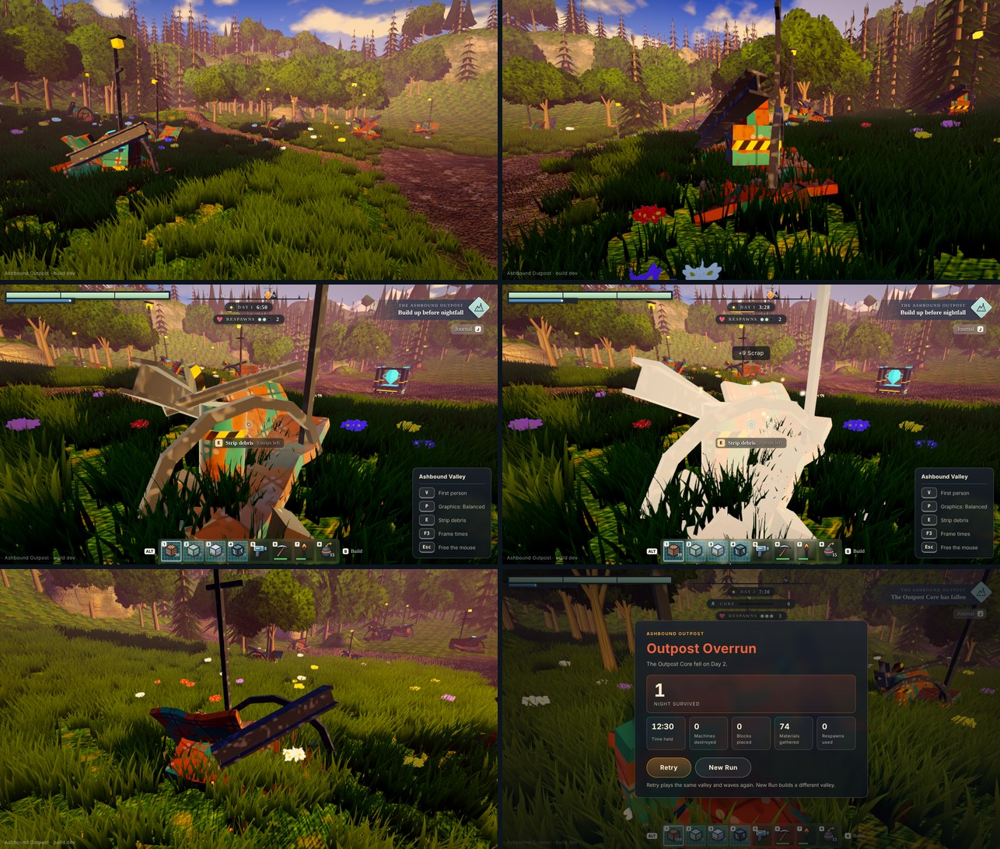

| Image                                          | What to look at                                                                                                                                                                                                                                                                          |
| ---------------------------------------------- | ---------------------------------------------------------------------------------------------------------------------------------------------------------------------------------------------------------------------------------------------------------------------------------------- |
| [salvage-crates](phase-5/salvage-crates.jpg)   | The crates dressing from a player's eye, 4.4 blocks away at golden hour: hazard-striped crates, the beam across the top, and the mast leaning out with its lamp. Other heaps' lamps show on their masts behind it.                                                                       |
| [salvage-barrels](phase-5/salvage-barrels.jpg) | The barrels dressing: two painted barrels and a bent pipe over the hull plate, the mast against the sun, and the Core's cage at the right edge.                                                                                                                                          |
| [salvage-console](phase-5/salvage-console.jpg) | The console dressing seen into the light: the cabinet in Scrap paint and its screen's cyan glow behind the beam.                                                                                                                                                                         |
| [salvage-layers](phase-5/salvage-layers.jpg)   | One heap of four strips, from above the grass. Whole; one strip (the crate and its beacon are gone); two (the hazard-striped crates under it); three (the beam, leaving the plate, the arc and the mast); the last strip 0.08 s in, white-hot and shrinking with sparks; and bare grass. |
| [salvage-prompt](phase-5/salvage-prompt.jpg)   | Aiming at a heap three blocks away: its edges lit amber, "E Strip debris · 3 strips left" under the crosshair, the first hotbar slot showing the pool's 30 Scrap, and the pause card's key list with its new E row at the lower right.                                                   |
| [salvage-strip](phase-5/salvage-strip.jpg)     | 0.18 s after pressing E: the heap still white-hot with sparks round it, the toast "+9 Scrap" above the hotbar, "2 strips left" on the card, and the count at 39.                                                                                                                         |
| [salvage-far](phase-5/salvage-far.jpg)         | From above the grass looking across the valley: several heaps in view, and the lamps on their masts are what show them among the trees and the grass.                                                                                                                                    |
| [salvage-dawn](phase-5/salvage-dawn.jpg)       | A heap a dawn uncovered, 0.7 s into its rise (the mast and the lamp are up and the body is coming out of the ground), and a moment later when it is up.                                                                                                                                  |
| [salvage-results](phase-5/salvage-results.jpg) | The Outpost Overrun card after a run that stripped three heaps: the fifth tile, "Materials gathered", reads 74, and the hotbar behind it shows the pool at 104.                                                                                                                          |
| [salvage-states](phase-5/salvage-states.jpg)   | Six of the pictures together.                                                                                                                                                                                                                                                            |

### Cost

One instanced mesh of 828 triangles a heap, drawn whole in every pass that draws the world, whatever is in view. Counted like the tables above (Balanced, every pass, software GL), from the far view: 22 heaps add 3 draw calls and 54.6 thousand triangles to a frame (97 draws and 781 thousand, against 94 and 726 thousand with the field hidden), about 7.5 percent. That is 2,484 triangles a heap, because three passes draw it. Each dawn adds four heaps, 10 thousand triangles; the 70 of the last dawn would add 174 thousand, about 24 percent, which is a number to watch rather than one to worry about on a dedicated GPU. Leaving out the heaps behind the camera or beyond the fog is the first thing to try if a real machine needs the triangles back. Nothing here is measured on a real GPU.

### Known gaps in salvage

- A block built in a heap's cell used to bury the heap, because nothing reserved the cell. That is closed in [5b](#phase-5b-costs): the ground round a heap with strips left refuses a block, and a dawn leaves a built-over heap down until the ground is free.
- Nothing was charged in 5a, so the pool only went up and the hotbar's counts had no use. That is closed in [5b](#phase-5b-costs) too: every block takes its price from the pool.
- A player walks through a heap, as through a machine. Collision for an odd shape is not worth it for a pile that is gone in a few strips.
- There is one look of the wreck in three dressings. A wider range is for later; heaps that give anything other than Scrap came with 5c ([Phase 5c](#phase-5c-research)).
- A strip has no sound, and neither has a lamp's hum; both are Phase 6 with the rest of the audio.
- The aim glow, the white-hot flash and the lamps' bloom are judged on software-rendered pictures. How they read on a real display is for the first look on a real GPU.

## Phase 5b: costs

Costs give the pool something to do: every block the crew places takes its price from it, and every block they break puts the price back. Nothing new is drawn. The ghost block, the line under the block's name and the hotbar's counts were all there already, and 5b gives them something to say, in the HUD's own colours. The choices are in [decisions](decisions.md#phase-5b-costs-2026-10-24).

### What the crew sees

- **A block the pool can pay for** looks as it always has: the ghost in cyan, the crosshair's ring cyan, and under the block's name the small line "Cost 1 Scrap".
- **A block it cannot pay for** is the ghost in the warm red of any refused placement, the ring red, and the line under the block's name turned coral and naming what is short: "Not enough Scrap", and "Not enough Advanced Alloy" for the dearer blocks, whose counts start at none (a count of none is dimmed; research opens them in 5c). A right click on a red ghost sends nothing and shows the same words for a moment, and if the host turns a click down (someone else spent the last Scrap a moment before) it sends the same words back.
- **A heap's ground.** A block cannot go close to a heap that still has strips left, about one and three-quarter blocks from its middle at the usual size (the pile's size scales it): the ghost is red and the line says "Debris is in the way". Stripping the heap bare with E clears the ground, and the same cursor spot goes cyan again.
- **The count.** The first four hotbar slots (30 Scrap to begin with, shared by the crew) go down by one for each block placed and up by one for each block broken, whoever placed it.
- **A guest's screen** reads its copy of the pool, at most 200 milliseconds old, so its ghost goes red and clears as the crew's pool changes, with nothing for the guest to do.

### Screenshots

Headless Chromium on software GL at 1280 by 720, Balanced, `freeze=1`, `?debug&waves=0&time=golden`, driven with the page's debug hooks (`__ashbound.mp.setPool` to set what the pool holds, `placeNear` and `breakBlock` to build and break, `harvest` to strip a heap, `build.aim` to read what the cursor would be refused for). The page's animation clock is replaced by one that moves a set step a frame, which holds the light still for a picture, and the mouse is taken and Build Mode is on, so each picture is a state that was set up. The ghost pictures stand in front of a wall of fourteen Scrap blocks, two rows, with a gap at the crosshair. The heap pair is one camera, 4.2 blocks from the pile and three above the grass, with the player's cursor on the ground beside it (the grass hides the foot of a pile from a player's own eye, and a block in grass is partly hidden too); the second picture is the same camera after the heap was stripped bare, and its clock reads later because stripping took a few seconds. The wide pictures have the hotbar and the line over it enlarged underneath, so the counts and the words can be read.

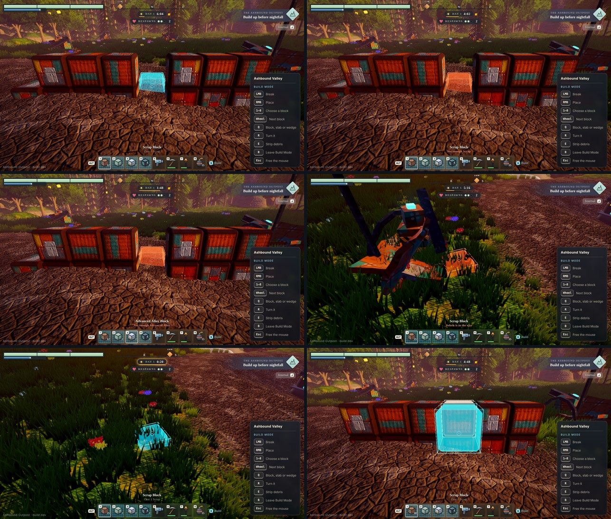

| Image                                                | What to look at                                                                                                                                                                                                                                                                                                      |
| ---------------------------------------------------- | -------------------------------------------------------------------------------------------------------------------------------------------------------------------------------------------------------------------------------------------------------------------------------------------------------------------- |
| [costs-ghost](phase-5/costs-ghost.jpg)               | Left to right, one cursor spot in the gap of the wall. The pool holds 12 Scrap: a cyan ghost and "Cost 1 Scrap". The Scrap is gone: the ghost is red and the line says "Not enough Scrap", with the first slot at a dimmed 0. Scrap back to 12 and the Advanced Alloy slot chosen: red, "Not enough Advanced Alloy". |
| [costs-ghost-short](phase-5/costs-ghost-short.jpg)   | The middle picture at full size: the red ghost in the gap, the red ring at the crosshair, "Not enough Scrap" under "Scrap Block", and the four block counts dimmed to 0.                                                                                                                                             |
| [costs-heap](phase-5/costs-heap.jpg)                 | Left, the cursor on the ground beside a heap that has three strips left: the ghost is red and the line says "Debris is in the way". Right, the same camera after the heap was stripped bare: grass where it stood and the same spot cyan, "Cost 1 Scrap".                                                            |
| [costs-heap-refused](phase-5/costs-heap-refused.jpg) | The refused picture at full size: the whole pile (a crate with its beacon, the beam, the hull plate), the dirt road at the right, the red ghost at the pile's foot and the line over the hotbar.                                                                                                                     |
| [costs-pool](phase-5/costs-pool.jpg)                 | The pool counting along: 30 Scrap and nothing built; 18 after twelve blocks (two rows of six) went up; 24 after the top row was broken, which gave six back.                                                                                                                                                         |
| [costs-states](phase-5/costs-states.jpg)             | Six of the pictures together.                                                                                                                                                                                                                                                                                        |

### Known gaps in costs

- A red ghost is the same red whatever refused it (the pool, a heap, a player in the way, reach), and only the line over the hotbar says which. A price chip on the ghost, or a colour of its own for a pool that is short, is for play-testing to ask for.
- A heap's column cannot be seen: a player learns how much ground a pile keeps by being refused. A faint ring on the ground while a block is aimed near a heap would show it.
- The dearer slots (Composite, Alloy, Energy-Infused) showed a dimmed 0 and refused every block until the crew had a way to get them, so they looked broken. 5c gave them a padlock and a "needs research" line ([Phase 5c](#phase-5c-research)).
- The counts jump when the pool changes: no tick, no small plus or minus beside the number and no sound for a block bought or given back. Those are Phase 6.
- Every shape of a material costs the same, so a slab and a wedge (half a block each) cost a whole block's price. A price for each is a number for play and for 5j.
- Seen only in software-rendered pictures. The ghost's colours and the red ring are judged there; how they read on a real display is for the first look on a real GPU.

## Phase 5c: research

Research puts three new things on the screen, a pill, a padlock and two lines of words, and repaints the one thing the valley has to show for it, the heap. Nothing is a new asset: the screen parts are the HUD's own pieces, and the heap's grades are colours in the same shader. The choices are in [decisions](decisions.md#phase-5c-research-2026-10-24).

### What the crew sees

- **The pill.** A third pill joins the column under the day and night clock, below the Core's gauge (at night) and the respawn charges: a small atom, "RESEARCH" in spaced capitals, a lavender bar and the points over the next row's, `12/20`. It is up while Build Mode is on, where the materials are chosen, and for ten seconds after the points change, so a player who does not build still sees what a dawn paid; it flashes lavender when the points rise. At the top of the ladder the bar is full and paler, and the words are the plain number, `100`.
- **A padlock.** A hotbar slot whose material has not been researched is dim and flat, with a small bronze padlock where its count would be (a count would only say none) and its block faint behind the lock, so a player can still tell the slots apart. Slots 2 to 4 start that way. The key still picks the slot: the ghost is the red of any refused placement and a right click sends nothing.
- **The words under the piece in hand.** Under the block's name, where the line says "Cost 1 Scrap" for a block the crew can pay for and "Not enough Scrap" for one it cannot, a block of a material not researched yet says "Needs research · 12 of 20": the points the crew has and the points that open it. When the points reach the row, the same slot says "Cost 1 Reinforced Composite" (or "Not enough Reinforced Composite" while the pool has none). The host sends the same news, "Reinforced Composite needs research", if a click gets to it anyway.
- **The toasts.** At a dawn that pays, a small dark bar under the clock's pills says "Research +12" and, 1.6 seconds later, "Reinforced Composite unlocked" when the points reached a row. The toast has a queue now (the Core falling and a wave coming use it too), so the second message waits for the first instead of replacing it; at most three wait.
- **The card under the crosshair.** A heap of anything but Scrap says what it gives: "Strip debris · Reinforced Composite · 2 strips left".
- **The tile.** The Outpost Overrun card has a sixth tile, "Research earned", between "Materials gathered" and "Respawns used". Six tiles lay out as two rows of three, not one row of six narrow ones.
- **The heaps.** A heap is dressed by what its strips give. Scrap is as 5a made it. Reinforced Composite is layered grey-green panels, dark where the layers part, with a cyan strip down the side of most of them and a cyan lamp on its mast. Advanced Alloy is dark steel brushed in one direction, with an amber inlay running round each panel just inside its edge and a white lamp. The frame of a better heap takes some of its tint, and the low orange sun is taken less warm by a better heap, as the blocks of the same materials are, so that Composite does not go olive in it and the steel does not go to wood. The model is the same, so a better heap is the same size, has the same layers that come away with a strip and costs the same to draw; only the dress and the lamp differ. The lamp is the cue from across the valley: amber for Scrap, cyan for Composite, white for Alloy.

### Screenshots

Headless Chromium on software GL at 1280 by 720, Balanced, `freeze=1`, `?debug&waves=0&time=golden`, driven with the page's debug hooks (`__ashbound.mp.setResearch` and `setPool` to set what the crew holds, `warp` to a dawn, `hurtCore` to end the run, `heaps` and `heapsShown` to find and read the heaps). The page's animation clock is replaced by one that moves a set step a frame, which holds a toast or a flash still for a picture; the toast's 1.6 seconds are held by the script so that each message can be taken in turn. The hotbar pictures stand in front of the wall of Scrap blocks of the costs pictures, with the same gap at the crosshair, and have the hotbar and the line over it enlarged underneath, so the padlocks and the words can be read. The pill pictures are the clock's column and the hotbar, enlarged, at 0, 20, 55 and 100 points. The pictures of heaps stand the camera on the side of the pile away from its mast: 4.4 blocks out and 2.7 above the grass for the near ones, 6.5 out and looking up at the lamp for the lamp ones, and 18 out and 9 above the grass for the far ones (the grass swallows a heap seen from a player's own eye). Each grade is a different heap in a different part of the valley, so the light on each differs: the Scrap one lies on the dirt road, the Composite one by the hill, and the Alloy ones in the forest's shade (the lamp picture is of one heap and the far pictures of another, where the trees leave the lamp clear). The far pictures at night are taken with the clock set to night (`stage.setMoment`). They are taken in a run that starts at the tenth night with the points to open every tier (`?night=10&research=9999`), so that all three grades lie in the valley.

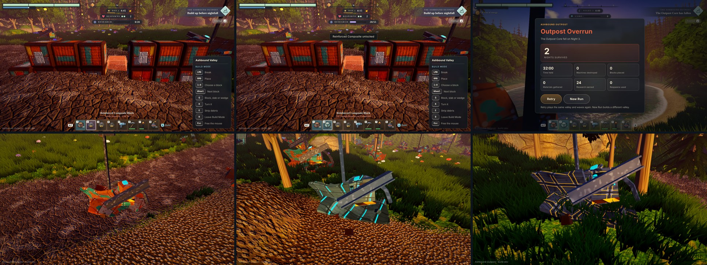

| Image                                            | What to look at                                                                                                                                                                                                                                                                                                                                                                                                                                                                                                       |
| ------------------------------------------------ | --------------------------------------------------------------------------------------------------------------------------------------------------------------------------------------------------------------------------------------------------------------------------------------------------------------------------------------------------------------------------------------------------------------------------------------------------------------------------------------------------------------------- |
| [research-locked](phase-5/research-locked.jpg)   | Three pictures from one spot with no points, each with the hotbar and the line over it enlarged underneath. Scrap Block in hand: the cyan ghost and "Cost 1 Scrap". Reinforced Composite Block: the ghost in the red of a refused placement and "Needs research · 0 of 20". Advanced Alloy Block: "Needs research · 0 of 55". Slots 2 to 4 are dim with a padlock each, and the chosen one has the white ring.                                                                                                        |
| [research-opened](phase-5/research-opened.jpg)   | Left: at night with 20 of 55 points, the pill reads `20/55`, slot 2 is open and shows its 12 Composite, the line says "Cost 1 Reinforced Composite", and the cyan ghost is a block the host will take. Right: the next day with 32 points, the pill reads `32/55` and Advanced Alloy still says "Needs research · 32 of 55".                                                                                                                                                                                          |
| [research-pill](phase-5/research-pill.jpg)       | The clock's column and the hotbar, enlarged, at 0, 20, 55 and 100 points: an empty bar and `0/20`; about a third full and `20/55` with Composite open; more than half full and `55/100` with Alloy open (its slot reads 0); and at the top a full, paler bar and the plain `100`, with the fourth slot open too.                                                                                                                                                                                                      |
| [research-toasts](phase-5/research-toasts.jpg)   | Left: "Research +20" under the clock's pills as the points rise to 20, the pill at `20/55`. Right: 1.6 seconds later, "Reinforced Composite unlocked", the second of the two bars of a dawn that pays, waiting its turn in the queue.                                                                                                                                                                                                                                                                                 |
| [research-results](phase-5/research-results.jpg) | The Outpost Overrun card after a run that held two nights with the Core untouched in both: the sixth tile, "Research earned", reads 24 (two nights of 12) between "Materials gathered" and "Respawns used", and the six tiles lie as two rows of three.                                                                                                                                                                                                                                                               |
| [research-heaps](phase-5/research-heaps.jpg)     | One heap of each grade from 4.4 blocks away, from the side away from its mast. Left, Scrap on the dirt road: patchwork rust, teal paint and primer, the crates' cyan beacon. Middle, Reinforced Composite by the hill: layered grey-green panels with a cyan strip down most of them and a dark, blue-tinted beam. Right, Advanced Alloy in the forest's shade: dark steel brushed one way with an amber inlay round each panel. All three are the one model, so the layers come away with a strip in the same order. |
| [research-lamps](phase-5/research-lamps.jpg)     | The lamp on each mast from 6.5 blocks: amber on Scrap, cyan on Composite, warm white on Alloy. Other heaps' lamps stand in the background: amber on the Scrap ones and, right of the pine in the left picture, a cyan one.                                                                                                                                                                                                                                                                                            |
| [research-far](phase-5/research-far.jpg)         | The valley from 18 blocks out and 9 above the grass, at golden hour. Left: a Composite heap at the middle with its cyan lamp and strips, among Scrap heaps with amber lamps. Right: an Alloy heap in the shade at the middle (its own lamp is behind a tree), a Composite heap's strips at the right edge, and at the top left, far off, an Alloy lamp, cream white next to the amber ones near the camera.                                                                                                           |
| [research-night](phase-5/research-night.jpg)     | The same two views with the clock set to night. The lamps and the Composite strips are what is lit: amber, cyan and white lamps, and the strips down the Composite panels glowing cyan. The Alloy inlay is barely lit, so across the valley it is the lamp that shows an Alloy heap.                                                                                                                                                                                                                                  |
| [research-states](phase-5/research-states.jpg)   | Six of the pictures together: a padlocked slot with its words, the unlock toast, the card's sixth tile, and a heap of each grade.                                                                                                                                                                                                                                                                                                                                                                                     |

### Cost

Nothing is added to the draw. A heap is still one instanced mesh of 828 triangles, drawn once in every pass that draws the world; the grade is one more float for each instance (128 at most, 512 bytes), uploaded with the others when the list changes, and the surface shader reads it to choose the dress, so the counts in [Phase 5a](#phase-5a-salvage) stand: 22 heaps add 3 draw calls and 54.6 thousand triangles to a frame, and each dawn adds four heaps. A better dress is a few more operations for each fragment than Scrap's, on the small part of the screen that a heap covers. Nothing here is measured on a real GPU; the shader's own cost is for the first look on one, with `?bench=1`.

### Known gaps in research

- The padlock is the same for every locked material and does not say how far off the unlock is. The line over the hotbar says it for the piece in hand and the pill for the next row; the whole ladder and what each row opens are on the Terminal's panel ([Phase 5d2](#phase-5d2-the-terminal-reads-the-points)).
- A heap of a grade the crew has not researched is not uncovered at its dawn, and nothing says one is waiting, so a crew a night short of Alloy meets a valley with fewer new heaps and no reason why.
- A better heap is told by colour (the grey-green and the steel, the strips and the inlay, above all the lamp) and not by its outline, which is the model's. A Scrap heap's crates carry a cyan beacon of their own, low on the pile, which is the cyan of a Composite lamp at the head of its mast. Within reach the card names the grade.
- A lamp shows only over open ground. Alloy lies where the trees are, so from the valley an Alloy lamp is often behind a canopy, and the pictures needed some looking for to find one in the clear.
- Energy-Infused opens at 100 points and has nothing to fill it until the special machines of 5i, so the fourth slot reads a plain 0 once its padlock is gone.
- An unlock is two toasts: no sound, no flash on the slot, no screen. The sound is Phase 6.
- The pill's lavender is a new accent on the HUD. The references show no research readout to take a colour from, so it is a guess set beside the Core's cyan and the clock's amber, to be judged on a real display.
- Seen only in software-rendered pictures. The steel's brushing, the strips' glow and the lamps' colours (which the bloom and the tone mapper change) are judged there; how they read on a real display is for the first look on a real GPU.

## Phase 5d1: the Research Terminal

The Research Terminal is the first functional module: a model drawn in code that stands in one cell, and the first thing the crew builds that is not a block. Nothing else on the screen is new. The hotbar slot, the line over it, the ghost and the outline are the ones building already draws; what is new is the thing they point at. The choices are in [decisions](decisions.md#phase-5d1-modules-and-the-research-terminal-2026-10-26).

### The Terminal

- **Shape.** A field console on a steel pad, a little under a cell wide (0.8 of it) and about a cell tall with its masts. A foundation block and a rounded base carry a lighter cap and a cabinet at the back that stands to about 0.85 of a cell, with a lit screen on its front. A desk slopes away from the cabinet toward the player with a second screen laid in it and a row of five amber keys, and two thin masts stand on the cabinet's top, one with a steady amber cap and the other with a beacon that blinks. Each side of the cabinet has two amber bands and its back four upright cyan light bars, so the Terminal reads from every side: from the front it is a screen and keys, from behind four bars of light.
- **Steel and light.** The Core's palette: dark blue-grey, fairly metallic steel with a lighter trim, amber on what is worked (the keys, the bands, the beacon) and cyan on what is powered (the strip round the pad, the one along the desk's edge, the bars on the back and the lines of text). The golden sun gives the steel warm edges and the night makes it navy, as with the Core. The screens are dark teal glass with bright cyan lines on them: a first version with flat bright cyan screens read as blank panels, and the text is what makes them read as screens from across a clearing. There is no power in the game yet, so a Terminal is always on; the lights are the look the other modules take when they are.
- **It moves a little.** The screens shimmer, the strips and the readout breathe, and the beacon blinks every 2.2 seconds, all from the stage's animation clock, so a frozen picture shows the same Terminal at the same moment and a running page shows a console that is on.
- **It faces the player.** Placing it turns its front toward the player (screens and keys, so the first thing a player sees of their own Terminal is the front) and R turns it a quarter turn at a time, through four facings. The ghost is the model in the same turn, so what the player aims is what stands.
- **It stands in the ground.** The valley's ground is smooth and cuts a cell at any height, and a model on a cell's floor would hover over a slope or sink into a rise: the first picture of a Terminal in the cell the ground cut at 82 percent was a thin rod over the grass. The pad stands on a foundation block that reaches almost a cell below the floor, so where the Terminal's cell floats over the ground, the foundation is the plinth it stands on (up to three-quarters of a cell tall on a steep slope), and where the ground reaches a little into the cell, the foundation is buried and the pad sits on the grass. Where the ground would cover more than a quarter of the cell, the cursor puts the Terminal in the cell above. On a block, or on the upper half of a slab, the foundation is inside it and the pad sits on its top.
- **A Terminal that is aimed at** is outlined by its body box (0.8 by 0.9 by 0.8 of a cell), which is also what movement stands against; the masts and the beacon rise a little above the box.

### Screenshots

Headless Chromium on software GL at 1280 by 720, Balanced, `freeze=1`, `?debug&waves=0&time=golden&stock=200`, with the Terminals built through the page's debug hooks (`__ashbound.mp.place` and `placeNear`: the host's own command path) and the camera put where it can see them (`game.setPhoto`: 2.3 blocks out and 2.3 above the cell's floor, because the grass stands taller than a block and hides a low camera), the page's animation clock replaced by one that moves a set step a frame. The night pictures are the same view with the clock set to night (`stage.setMoment`). The ghost pictures are a player's own view with Build Mode on, the module slot chosen and the hotbar and the line over it enlarged underneath; the first has 100 Scrap in the pool, the second 39 (one short of the price), and in the third a Scrap block stands in the cell under the cursor and the pool holds 99.

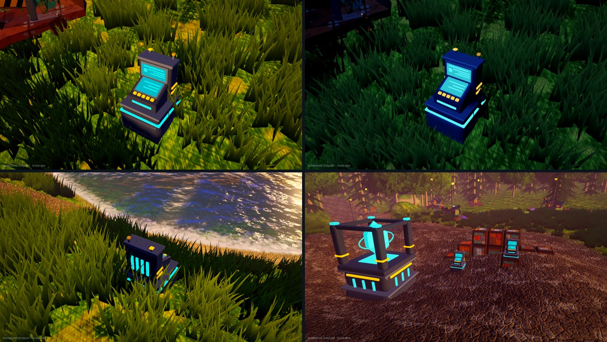

| Image                                            | What to look at                                                                                                                                                                                                                                                                                                                                                   |
| ------------------------------------------------ | ----------------------------------------------------------------------------------------------------------------------------------------------------------------------------------------------------------------------------------------------------------------------------------------------------------------------------------------------------------------- |
| [terminal-front](phase-5/terminal-front.jpg)     | The Terminal from its front at golden hour, standing in the grass at the edge of the clearing with a heap behind it: the cabinet and its screen with lines of text, the sloped desk with the second screen and the five amber keys, the cyan strip round the pad, the beacon on a mast.                                                                           |
| [terminal-night](phase-5/terminal-night.jpg)     | The same view at night. The steel is navy and the lit parts are what is seen: both screens, the strips, the amber keys and bands.                                                                                                                                                                                                                                 |
| [terminal-back](phase-5/terminal-back.jpg)       | From behind, on the slope above the lake: the four cyan bars on the cabinet's back, the two masts with their amber lights, and the pad standing on the hill with its foot in the slope.                                                                                                                                                                           |
| [terminal-facings](phase-5/terminal-facings.jpg) | Four Terminals side by side, each turned a quarter turn further than the one before: its front, one side, its back and the other side, so every face of the model is seen. The ground differs from cell to cell, so the foundation shows as a plinth of a different height under each pad.                                                                        |
| [terminal-base](phase-5/terminal-base.jpg)       | Beside the Core at golden hour: two Terminals in the crater, one on the ground and one on a Scrap block, next to the Core's plinth, to show them at the scale of the rest of the base. The Core is about four times as tall.                                                                                                                                      |
| [terminal-ghost](phase-5/terminal-ghost.jpg)     | Three pictures from a player's eyes, with the hotbar and the line over it enlarged underneath. Left: the cyan ghost with its outline, "Research Terminal" and "Cost 40 Scrap", slot 6 chosen. Middle: the pool is one short and the ghost is the red of a refused placement, "Not enough Scrap". Right: the cell holds a block and the ghost stands on top of it. |
| [terminal-states](phase-5/terminal-states.jpg)   | Four of the pictures together: the front by day, the front at night, the back on the slope and the pair beside the Core.                                                                                                                                                                                                                                          |

### Cost

A Terminal is six meshes (steel, trim, amber, cyan lights, screen glass and beacon), 1,544 triangles in all, built once and shared by every Terminal. Counted like the tables above (Balanced, every pass, software GL), from the crash clearing looking at open ground, a frame is 97 draws and 776.7 thousand triangles with nothing built. One Terminal in view takes it to 109 and 779.8 thousand, two to 121 and 782.9 thousand and three to 133 and 785.9 thousand: each adds 12 draws and 3,088 triangles, because it is drawn twice, once in the main view and once in the shadow pass. With the three behind the camera, the shadow pass still draws them: 18 more draws and 4.6 thousand triangles, 6 draws and 1,544 triangles each. The triangles are a small part of a frame (0.4 percent for each Terminal), but the draws are the number to watch: a dozen Terminals in view would add 144, more than the rest of that frame has. The lit material reads the model matrix, so a module cannot be instanced the way the heaps are. The first things to try if a real machine needs the draws back are letting the thin lit parts (the light strips, screens, keys and beacon) skip the shadow pass, which takes 4 of the 12 draws away, and instancing a module kind once the turret (5f) is built many times. Nothing here is measured on a real GPU.

### Known gaps in the Terminal

- **The plinth.** On a slope the foundation shows as a plinth under the pad, up to three-quarters of a cell tall where the ground cuts the cell's floor just under the cursor's threshold (a quarter of a cell: `MODULE_SINK`). A raised threshold (0.4 to 0.5) would put more Terminals in the ground and fewer on a tall plinth, and is a number to change if play prefers it. An upper slab carrying a Terminal shows a stub of foundation under the slab's half.
- **No power state.** The Terminal is always lit. A module that is off, or that is working, is for the generator and the node (5g), and amber for "working" is waiting for the turret.
- **Twelve draws a module in view.** Every Terminal is a group of six meshes sharing one model and one set of materials, drawn in the main view and in the shadow pass, and the lit material reads the model matrix, so it cannot be instanced. A base with a dozen of them adds 144 draws to a frame ([Cost](#cost-2)), which is the point where the turret (5f) will want a cheaper kind of its own.
- **No sound.** Placing it, the keys and the screens are silent. Sound is Phase 6.
- **One model, one level.** An upgraded Terminal (5e) is the same model until the upgrade's own look comes with it.
- Seen only in software-rendered pictures. The screens' glow and the cyan strips (which the bloom and the tone mapper change) are judged there; how they read on a real display is for the first look on a real GPU.

## Phase 5d2: the Terminal reads the points

Research now waits for a Terminal, and the Terminal gets a face. Three lines of the screen change their words (the pill, the line over the hotbar and the toast) and one panel is new, the ladder a Terminal opens. Nothing is a new asset: the panel is DOM drawn with the HUD's own parts (the torn dark frame, the lavender bar of the research pill, the block icons of the hotbar, the mint of the health bar), and the amber is the Terminal's own. The choices are in [decisions](decisions.md#phase-5d2-an-unlock-needs-a-terminal-2026-10-26).

### What the crew sees

- **Points that wait.** When the points the crew has earned reach a row of the ladder that no Terminal has read, the research pill turns amber and says "NEEDS TERMINAL" where it said "RESEARCH". The bar and the count are the same (`20/55`: the points over the next row's), only the label and the bar are amber, the amber of the Terminal's keys and beacon, so the pill reads as something waiting to be done. A crew with 12 points and no Terminal has nothing to be told and keeps the lavender pill.
- **The padlocks stay.** Slots 2 to 4 are as dim and flat as in 5c, with the same bronze padlock, and the ghost is the red of a refused placement. What changes is the line under the piece in hand: for a material the points already reach it says "Needs a Research Terminal", in the place of "Needs research · 20 of 20", and for one they do not reach it still says "Needs research · 12 of 55".
- **The toast.** At a dawn that pays, after "Research +12", a second bar says "Needs a Research Terminal" when the points reach a row no Terminal has read. When one does, the bar that follows is the 5c one, "Reinforced Composite unlocked", the padlock goes and the pill turns back to lavender.
- **The card under the crosshair.** With the cursor on a Terminal in reach, and no heap in front of it, the card says "E Research ladder" and, in the card's lighter type, the points the crew has ("20 points").
- **The ladder.** E opens a panel just left of the crosshair and as tall as its contents, so the Terminal stays in view beside it (the right of the screen is where Build Mode keeps its key list). It is the HUD's torn dark frame, 318 wide at 1280 by 720: the small spaced capitals "RESEARCH TERMINAL"; the points earned in large figures with "points earned" beside them; a lavender bar with the way to the next row ("35 to Advanced Alloy") and, once the ladder is climbed, "Ladder climbed"; a row for each material, with its block icon, its name, what opens it ("From the start", "20 points", "55 points", "100 points") and on the right where the crew stands; a line on how a night earns points ("Each night survived earns 10, and 2 more if the Core takes no damage"); and the key that shuts it. A row the Terminal has read is "Open" in the health bar's mint. A row still out of reach is dim and grey like a padlocked slot, and says how far it is ("35 to go"). A row the crew has earned and no Terminal has read has an amber outline and says "Not read yet".
- **It is not a window.** The mouse stays locked and the run goes on, because in a room nothing pauses. E shuts it, and so do Esc, going down, walking more than a block past the reach that opened it, and the Terminal going.

### Screenshots

Headless Chromium on software GL at 1280 by 720, Balanced, `freeze=1`, `?debug&waves=0&time=golden`, in a player's own view with Build Mode on, driven with the page's debug hooks (`__ashbound.mp.setResearch(points, false)` to give the crew points no Terminal has read, `setPool`, and a Terminal built the way a player builds one: the module slot and a right click). The page's animation clock is replaced by one that moves a set step a frame, which holds a toast or the pill still for a picture; the toast's 1.6 seconds are held by the script so that each message can be taken in turn. The two columns of the first picture are the clock's column over the hotbar, enlarged. The panel pictures are the same panel at four moments, cropped and enlarged.

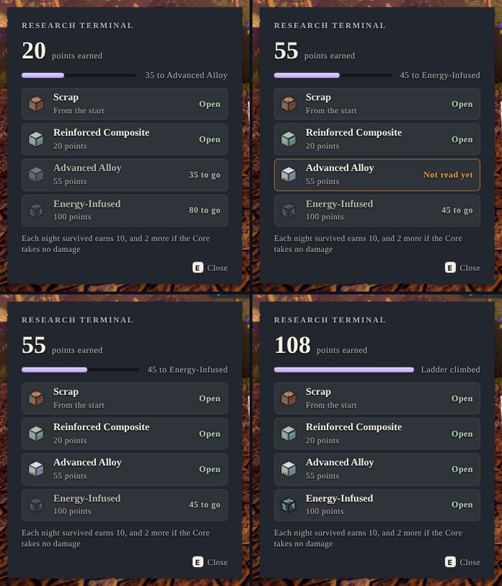

| Image                                                        | What to look at                                                                                                                                                                                                                                                                                                                                                                                                                                                                                                                                                                                              |
| ------------------------------------------------------------ | ------------------------------------------------------------------------------------------------------------------------------------------------------------------------------------------------------------------------------------------------------------------------------------------------------------------------------------------------------------------------------------------------------------------------------------------------------------------------------------------------------------------------------------------------------------------------------------------------------------ |
| [terminal-needed](phase-5/terminal-needed.jpg)               | Two columns, each the clock's column over the hotbar, enlarged. Left: the crew has 20 points and no Terminal has read them. The pill is amber, "NEEDS TERMINAL" with an amber bar at `20/55`, slot 2 (Reinforced Composite) is behind its padlock with the white ring of the chosen slot, and the line under its name says "Needs a Research Terminal". Right: a Terminal has read them. The pill is back to "RESEARCH" with the lavender bar at the same `20/55` (the Terminal's own cabinet stands behind it), slot 2 is open and shows its 12 Composite, and the line says "Cost 1 Reinforced Composite". |
| [terminal-toasts](phase-5/terminal-toasts.jpg)               | Left: "Needs a Research Terminal" in the toast bar under the clock's pills, the second message of a dawn that reaches a row no Terminal has read (the pill is amber and the ghost red, as in the first picture). Right: the Terminal is built and the bar says "Reinforced Composite unlocked", the pill is lavender again, and the card under the crosshair offers the ladder.                                                                                                                                                                                                                              |
| [terminal-ladder](phase-5/terminal-ladder.jpg)               | Left: the cursor on a Terminal in the valley, its white outline round it and the card "E Research ladder · 20 points" under the crosshair; the blaster is in hand, so no ghost stands in front of it. Right: E pressed. The panel opens just left of the crosshair, clear of the Build Mode key list on the right of the screen, the card is gone and the Terminal is still in view.                                                                                                                                                                                                                         |
| [terminal-ladder-states](phase-5/terminal-ladder-states.jpg) | The panel enlarged, at four moments. Top left: 20 points, read: Scrap and Composite are "Open" in mint, Alloy and Energy-Infused are dim at "35 to go" and "80 to go", and the lavender bar is a third of the way to Alloy ("35 to Advanced Alloy"). Top right: 55 points earned and no Terminal has read them: the Alloy row has an amber outline and says "Not read yet", and the bar has moved on to Energy-Infused ("45 to Energy-Infused"). Bottom left: the Terminal has read the 55 and Alloy is open. Bottom right: 108 points, all four rows open, the bar full and "Ladder climbed".               |

### Cost

Nothing is added to the draw, and the pill costs what it did. The panel is DOM: while it is shut the HUD hands it nothing and it does nothing; while it is open, each frame the HUD builds the small object the panel is drawn from (four rows) and compares it, as a string, with the last frame's, so the markup is rewritten only when the points or the tier change. The host's side is a scan of the world's edit list for a Terminal, at a placement and at a dawn (`moduleStands`), which stops at the first one it finds; nothing runs in a frame. On the wire the pool's frame gains one number and is sent when the pool, its ceiling or either count of points changes, as before.

### Known gaps in the ladder

- **Reading is automatic.** A standing Terminal reads the points; a player never uses it. The notes say points are "spent at Research Terminal", which would be a button and a choice, and there is nothing to choose yet ([decisions](decisions.md#phase-5d2-an-unlock-needs-a-terminal-2026-10-26)).
- **The amber "Not read yet" row cannot happen in play yet.** A standing Terminal reads in the same frame that carries the points, and the panel opens only at a standing Terminal. The state is drawn for a Terminal that needs power (5g) and for the debug page (`mp.setResearch(55, false)`).
- **The panel lists materials only.** The 10-point Power row and the module rows join with their modules (5g and later); 5e added no row, because an upgrade is opened by the material it makes ([Phase 5e](#phase-5e-upgrade-in-place)). A row is an icon, a name, a need, a state and a note, so a row for a module fits when it exists.
- **E does two things.** With a heap of debris in front of the cursor, E strips the heap, and a Terminal behind it cannot be opened until the heap is gone. The status list in Build Mode still says "E Strip debris" and does not mention the Terminal (the card under the crosshair and the pause screen do); from [5e](#phase-5e-upgrade-in-place) the lists say "Strip debris, upgrade", and E does a third thing.
- **No sound and no flash.** Opening the ladder and a Terminal reading its points are silent, and the Terminal's own screen does not change when it reads. Sound is Phase 6.
- Seen only in software-rendered pictures. The amber, the mint and the panel's frame over the bright sky are judged there; how they read on a real display is for the first look on a real GPU.

## Phase 5e: upgrade in place

A block the crew has built can now be made better where it stands. Nothing is a new asset: the card is the one a heap and a Terminal already use (a pale key cap, a bold line, a softer caption under the crosshair), a refusal is the warm red of a refused placement, and an upgrade is the better material's own tile on the same shape, drawn by the meshing every block already goes through. The choices are in [decisions](decisions.md#phase-5e-upgrade-in-place-2026-10-26).

### What the crew sees

- **The card.** With the cursor on a block the crew has built, in reach, and no heap of debris in front of it, the card under the crosshair says "E Upgrade to Reinforced Composite" in bold and, in its softer type, the price: "Cost 1 Reinforced Composite". The material is the one after the block's own (Scrap, Reinforced Composite, Advanced Alloy, Energy-Infused), and the shape is kept: a wedge offers a wedge.
- **When the answer is no.** In Build Mode the card also shows an upgrade the host would turn away, with its caption in the warm red of a refused placement: "Needs research · 0 of 20" (the points the crew has and how many open the material), "Needs a Research Terminal" (the points are earned and no standing Terminal has read them) or "Not enough Reinforced Composite" (the pool is short). Outside Build Mode the card is there only while the upgrade would go, so a crew with nothing to spend is not nagged by every wall it looks at; a press still says why it did nothing.
- **Nothing better.** A block of Energy-Infused has no better self, so there is no card, and E on it says "Already fully upgraded". A Terminal opens its ladder, as before.
- **The press.** E swaps the block for the better one in the same cell, with the same shape, facing and half of the cell, and the pool pays the better material's price. The old block is used up and nothing is paid back for it. The card moves on to the next material up at once, so the next press goes one tier further if the crew has researched it and can pay.
- **A press that did nothing** says why on the line over the hotbar, in the words above, or "Out of reach", "Nothing to upgrade there", "Already fully upgraded".
- **The lists.** The Build Mode key list and the status list say "E Strip debris, upgrade", and the pause card says what E does: "Strip the heap of debris you are looking at, read the ladder of a Research Terminal, or upgrade a block to the next material and a turret to its next level" (the last words came with [5f2](#phase-5f2-turret-levels)).
- **The results card.** "Upgrades completed" follows "Blocks placed", and with the research tile there are seven tiles, laid out four above and three below.

### Screenshots

Headless Chromium on software GL at 1280 by 720, Balanced, `freeze=1`, `?debug&waves=0&time=golden`, in a player's own view with Build Mode on and the blaster in hand (so that no ghost stands in front of the wall), driven with the page's debug hooks: `__ashbound.mp.placeNear` puts a wall of Scrap up through the host, `setPool` and `setResearch` give the crew the material and the points, and the presses in the card pictures are the real key. The tiers picture is taken from a floating camera (`game.setPhoto`) with the HUD hidden, over a wall and a row of ramps climbed with `mp.upgrade`, which sends the command the key does. The page's animation clock is replaced by one that moves a set step a frame, which holds the card still for a picture. The card pictures are the middle of the screen at the pixels it was drawn in, or, for the four answers, the card alone, enlarged 1.6 times.

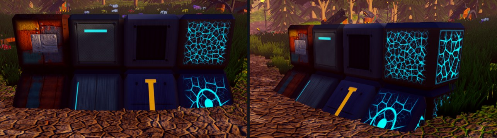

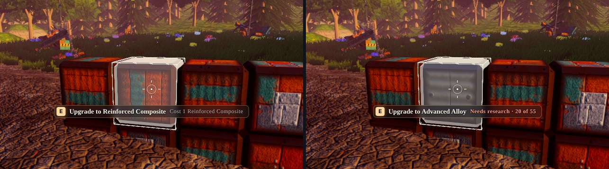

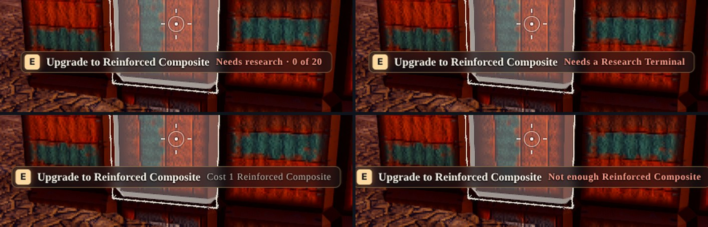

| Image                                          | What to look at                                                                                                                                                                                                                                                                                                                                                                                                                                                                                                                                                                                                                                                                                           |
| ---------------------------------------------- | --------------------------------------------------------------------------------------------------------------------------------------------------------------------------------------------------------------------------------------------------------------------------------------------------------------------------------------------------------------------------------------------------------------------------------------------------------------------------------------------------------------------------------------------------------------------------------------------------------------------------------------------------------------------------------------------------------- |
| [upgrade-card](phase-5/upgrade-card.jpg)       | Left: the cursor on the upper block of the second column of a Scrap wall, its white outline round it, and the card under the crosshair: "E Upgrade to Reinforced Composite" in bold and, in the softer type, "Cost 1 Reinforced Composite". Right: E pressed. The same cell is now a Reinforced Composite cube, a cooler grey plate with a seam and rivets (still inside the aim's white outline), and the card has moved on to the next row up, "Upgrade to Advanced Alloy", with its caption in red: "Needs research · 20 of 55". The clock reads the first night by the second picture, which is only the capture's own stepping (`waves=0`, and the light is held at golden).                         |
| [upgrade-states](phase-5/upgrade-states.jpg)   | The card alone, enlarged, with its four answers for the same block. Top left: no research yet, "Needs research · 0 of 20" (the points the crew has over the points the material needs) in the warm red of a refused placement. Top right: the crew has the 20 and no Terminal has read them, "Needs a Research Terminal". Bottom left: the material is open and the pool can pay, "Cost 1 Reinforced Composite" in the card's ordinary softer type. Bottom right: open, but the pool holds none, "Not enough Reinforced Composite", red again.                                                                                                                                                            |
| [upgrade-tiers](phase-5/upgrade-tiers.jpg)     | A wall two blocks high with a row of ramps leaning against it, from a floating camera at golden hour with the HUD hidden. Each column is one material better than the one before: Scrap (rust and teal paint over a riveted plate), Reinforced Composite (a dark slate plate with its cyan indicator bar), Advanced Alloy (blue-black steel with a dark window, and the amber bar on its ramp) and Energy-Infused (glowing cyan cells, the brightest of the four). Left: straight on. Right: from the right-hand side, where the ramps carry the same four tiles on their slopes. Every piece was placed as Scrap and climbed with `mp.upgrade`, so each is the better material's tile on the same shape. |
| [upgrade-play](phase-5/upgrade-play.jpg)       | Outside Build Mode (the key list at the lower right is the play list, which also says "E Strip debris, upgrade"). Left: the cursor on a Reinforced Composite block whose next row, Advanced Alloy, is not open yet: there is no card, because the press would be turned away, and a press would say why on the line over the hotbar. Right: the cursor on a Scrap cube the crew can pay to improve: "E Upgrade to Reinforced Composite", "Cost 1 Reinforced Composite".                                                                                                                                                                                                                                   |
| [upgrade-results](phase-5/upgrade-results.jpg) | The Outpost Overrun card after a run that placed 12 blocks and upgraded 18 of them, up the tiers of the first picture's wall and ramps: the seven tiles are four above ("Time held", "Machines destroyed", "Blocks placed" and "Upgrades completed", which reads 18) and three below ("Materials gathered", "Research earned" and "Respawns used").                                                                                                                                                                                                                                                                                                                                                       |

### Cost

Nothing is added to the draw. An upgrade is a block changing state, so the chunk that holds it is meshed again as it is for any edit, and the better material is another tile on the same shape. On the screen the hands ask two small questions a frame while a block is aimed at (the better piece, a table lookup, and the reason it would be refused, which reads the economy's counts), and the card is rewritten only when its words change, as the heap's and the Terminal's are. On the host an upgrade is one edit and one payment, the same as a placement, and the wire carries a command of the size of a placement's and, in the results card's frame, one more number.

### Known gaps in upgrading

- **No flash and no sound.** The block changes tile and nothing else happens at the cell. A flash at the block is a small effect (the shot fx already draw sparks), but a screen only learns that a cell now holds the better piece, not what it held, so each screen would have to compare against its own world before it applies the event; it waits for the polish of Phase 6 with the sound.
- **The old block is not paid back,** and every material costs 1, so an upgrade costs one of the next material whatever the block was. The spec's "costs rise with tier" is as true as the table; the balance pass (5j) is where the numbers move. A refund of the old piece is the other fair rule and is one call on the host.
- **One press, one block, one material.** A press does not climb as far as the crew can afford, and a wall is raised a block at a time.
- **E does three things.** A heap in front of the cursor is stripped first, then a Terminal opens its ladder, and only then does the key upgrade, so a wall behind a heap cannot be upgraded until the heap is gone.
- **A module is not upgraded here.** E on a Terminal opens its ladder, and the levels of a module came with the first module that has more than one: [5f2](#phase-5f2-turret-levels) raises a turret with the same press.
- **A damaged block is not repaired,** because a block has no health to repair: a machine breaks it outright after its gnawing time, so an upgrade restarts the gnawing on a block that holds longer, which is all the repair there is.
- Seen only in software-rendered pictures. The card's warm red over the grass and the better materials' tiles in sunlight are judged there; how they read on a real display is for the first look on a real GPU.

## Phase 5f1: the Basic Turret

The Basic Turret is the first module that acts: a gun drawn in code that stands in one cell, turns its head to what it shoots and fires on its own. Little else on the screen is new. The hotbar slot, the line over it, the ghost and the outline are the ones the Terminal already uses, and the bolt is the blaster's streak drawn in amber; what is new is the thing they point at. The choices are in [decisions](decisions.md#phase-5f1-the-basic-turret-2026-10-26).

### The turret

- **Shape.** A gun on a steel pad, a little under a cell wide (0.72 of it) and about 0.9 of a cell tall. A foundation block and a flat pad with a raised corner at each corner carry a short column with a lighter cap, and on the column sits the head: a boxy housing with a round sleeve at its front and a thin barrel that runs out of the sleeve for 0.4 of a cell. The barrel ends in an amber ring, the housing has a small amber lamp on its top and a grey vent on each flank, and the whole head turns.
- **Steel and light.** The Terminal's palette: dark blue-grey steel with a lighter trim, cyan on what is powered (the strip round the pad, a plate on the front of the column, the visor across the front of the head and a panel on its back) and amber on what is worked (the ring on the barrel and the lamp). The golden sun gives the steel warm edges and the night makes it navy; at night what is seen of a turret is its cyan strip, its visor and the amber ring. There is no power in the game yet, so the lights are always on: they are the look the turret keeps when it has power (5g).
- **A head that turns.** The pad and the column stand still. The head turns about a pivot at 0.6 of the cell's height, first about the vertical and then a lift about its own side, so that a machine below the turret is shot from above and one up a wall from below. It snaps to the end of each shot and holds there until the next; it does not sweep. A turret that has not fired points the way it was placed.
- **It faces outward.** Placing a turret turns its barrel the way the player is looking, so that it points where they were aiming; a Terminal is turned the other way, so that its screens are what they see. R turns it a quarter turn at a time, through four facings, and the ghost is the model in the same turn, so what the player aims is what stands.
- **It stands in the ground.** The pad stands on a foundation block under it, with the Terminal's rule ([Phase 5d1](#phase-5d1-the-research-terminal)): where the cell floats over the ground the foundation is the plinth it stands on, where the ground reaches a little into the cell the foundation is buried, and where the ground would cover more than a quarter of the cell the cursor puts the turret in the cell above.
- **A turret that is aimed at** is outlined by its body box (0.72 by 0.78 by 0.72 of a cell), which is also what movement stands against.
- **The shot.** The blaster's streak (a bright head with a short trail) in amber, from the tip of the barrel to the machine, with a flash at the muzzle and sparks and a flash where it lands. It is drawn on every screen from the host's report, the host's own included, so a turret's bolt looks the same to the whole crew. Nobody fired it, so it has no hit marker; a kill bursts as a player's does.

### Screenshots

Headless Chromium on software GL at 1280 by 720, Balanced, `freeze=1`, `?debug&waves=0&time=golden&stock=400`, with the turrets built through the page's debug hooks (`__ashbound.mp.place`: the host's own command path) and the camera put where it can see them (`game.setPhoto`: 1.5 blocks above the head's pivot and about 2 out, because the grass stands taller than a block and hides a low camera), the page's animation clock replaced by one that moves a set step a frame. The night pictures are the same view with the clock set to night (`stage.setMoment`). The turned heads are `ModuleRenderer.aim`, the call a shot makes, given four marks to look at. The firing pictures are taken at a turret's first shot: a crawler is put in reach (`mp.spawnCrawlerAt`), the page stops drawing frames until the host reports the shot, the run is held there by freeing the pointer, and the clock is then stepped in whole frames of 1/60 s, so a picture is of a bolt 2, 3 or 4 frames old (a bolt lives about a tenth of a second, so a later frame would find it gone). The ghost pictures are a player's own view with Build Mode on, the module slot chosen (key 6, then Q for the second module) and the hotbar and the line over it enlarged underneath; the first has 100 Scrap in the pool, the second 24 (one short of the 25 it costs), and in the third a Scrap block stands in the cell under the cursor and the pool holds 99.

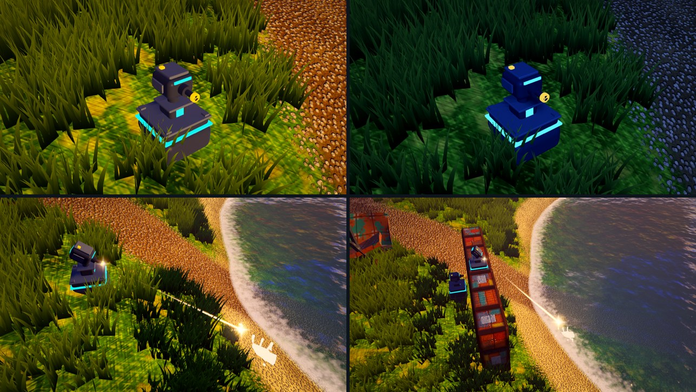

| Image                                              | What to look at                                                                                                                                                                                                                                                                                                                                                                                                                                                                                                                                                                 |
| -------------------------------------------------- | ------------------------------------------------------------------------------------------------------------------------------------------------------------------------------------------------------------------------------------------------------------------------------------------------------------------------------------------------------------------------------------------------------------------------------------------------------------------------------------------------------------------------------------------------------------------------------- |
| [turret-front](phase-5/turret-front.jpg)           | The turret from the front at golden hour, standing in the grass at the edge of the clearing with its barrel turned toward the camera's side: the head with its sleeve and barrel and the amber ring at the tip, the amber lamp on the housing's top, the cyan visor across the front of the head, the cyan plate on the front of the column and the cyan strip round the pad.                                                                                                                                                                                                   |
| [turret-side](phase-5/turret-side.jpg)             | From the side: the barrel in profile with the ring at its tip, a grey vent on the housing's flank, the column with its lighter cap, and the pad with a raised corner at each corner and the cyan strip under it. The gravel path and the lake's edge are behind it.                                                                                                                                                                                                                                                                                                             |
| [turret-night](phase-5/turret-night.jpg)           | The front view at night. The steel is navy and what is seen of the turret is its lights: the cyan strip, the plate and the visor, the amber lamp and ring.                                                                                                                                                                                                                                                                                                                                                                                                                      |
| [turret-back](phase-5/turret-back.jpg)             | The same view with the turret turned to face away: the back of the head with its cyan panel, the ring on the end of the barrel showing behind the head at the upper left, and the column without its front plate.                                                                                                                                                                                                                                                                                                                                                               |
| [turret-facings](phase-5/turret-facings.jpg)       | Four turrets in a row on Scrap blocks, each turned a quarter turn further than the one before (R turns it): the first's barrel toward the camera, the second's to the left, the third's away and the fourth's to the right. Each stands on a column of Scrap so that the four are level, though the ground under them is not.                                                                                                                                                                                                                                                   |
| [turret-aimed](phase-5/turret-aimed.jpg)           | The same four with their heads turned the way a shot turns them (`ModuleRenderer.aim`): the first up and to the left, the second at a mark up and toward the camera (its barrel seen end on, with the ring lit), the third down and away, and the fourth along its own facing. The pad and the column do not move.                                                                                                                                                                                                                                                              |
| [turret-fire](phase-5/turret-fire.jpg)             | A turret's first shot at a crawler standing at the lake's edge, photographed 2 frames (1/30 s) and 4 frames (1/15 s) after the host reported it, cropped to the turret, the bolt and the machine. Left: the bolt at its brightest, an amber streak from the end of the barrel (with a flash at the muzzle) to the crawler, which flashes white where it is hit, and sparks where it lands. Right: two frames later the streak is shorter and thinner and the sparks have spread. The head has turned to the crawler, 13 degrees from the way it was placed and 32 degrees down. |
| [turret-fire-night](phase-5/turret-fire-night.jpg) | The same shot at night, 3 frames after: the grass and the shingle are dark, and the amber of the bolt, the flash at the muzzle and the sparks are what light the picture.                                                                                                                                                                                                                                                                                                                                                                                                       |
| [turret-wall](phase-5/turret-wall.jpg)             | A turret needs to see. A wall of Scrap two blocks high with a turret on top of it and another standing in the grass at its foot, seen from the south, and a crawler at the water's edge beyond. The turret on the wall shoots over it: its amber bolt reaches the crawler, white where it is hit. The turret at the foot has the wall between it and the crawler and does not fire, and its head is where it was placed (the host's report names only the turret on top).                                                                                                       |
| [turret-ghost](phase-5/turret-ghost.jpg)           | Three pictures from a player's eyes, with the hotbar and the line over it enlarged underneath. Left: the cyan ghost with its outline, "Basic Turret" and "Cost 25 Scrap", slot 6 chosen (the ghost's barrel points the way the player looks, which is away from them). Middle: the pool is one short and the ghost is the red of a refused placement, "Not enough Scrap". Right: the cell holds a Scrap block and the ghost stands on top of it; the card under the crosshair is the block's own, "E Upgrade to Reinforced Composite", with its refusal.                        |
| [turret-states](phase-5/turret-states.jpg)         | Four of the pictures together: the front by day, the front at night, the first shot and the wall.                                                                                                                                                                                                                                                                                                                                                                                                                                                                               |

### Cost

A turret is seven meshes, three for the body that stands still (steel, trim and cyan lights) and four for the head that turns (steel, trim, amber and cyan lights), 1,460 triangles in all, built once and shared by every turret. Counted like the tables above (Balanced, every pass, software GL), from the crash clearing looking at open ground, a frame is 97 draws and 776.7 thousand triangles with nothing built. One turret in view takes it to 111 and 779.6 thousand, two to 125 and 782.5 thousand and three to 139 and 785.4 thousand: each adds 14 draws and 2,920 triangles, because it is drawn twice, once in the main view and once in the shadow pass. With the three behind the camera, the shadow pass still draws them: 21 more draws and 4.4 thousand triangles, 7 draws and 1,460 triangles each. A turret is two draws more than a Terminal. The triangles are a small part of a frame (0.4 percent for each turret), but the draws are the number to watch: a dozen turrets in view would add 168, more than the rest of that frame has. The lit material reads the model matrix, so a module cannot be instanced the way the heaps are. The first things to try if a real machine needs the draws back are the ones the Terminal's notes name: letting the thin lit parts (the strips, the visor, the ring and the lamp) skip the shadow pass, and instancing a kind of module now that there are two of them. The shot costs what a player's does, a streak, a flash and a few sparks for a moment from the effects' own pool, and a turret makes at most two a second. Nothing here is measured on a real GPU.

### Known gaps in the turret

- **Fourteen draws a turret in view.** A turret is seven meshes, three that stand still and four that turn, and each is drawn twice, in the main view and in the shadow pass, so each turret adds 14 draws ([Cost](#cost-5)). The lit material reads the model matrix, so a module cannot be instanced the way the heaps are, and a base with a dozen turrets adds 168 draws to a frame, more than the rest of one has. The two things to try first are the ones the Terminal's notes name: letting the thin lit parts skip the shadow pass, and drawing each kind of module as one instanced batch.
- **The head snaps.** It turns to the end of each shot in one frame and holds there. It does not sweep to a machine it has not fired at, so a turret that is about to fire is still pointing where it last fired. Following a target is a small change (the host's trace, the bolt and the model already share one line), but it needs a feel to be judged on a real display.
- **The turret itself does not react to its shot.** No recoil, no smoke and no glow at the ring: the flash at the muzzle and the bolt are the shot's own, drawn by the effects.
- **A blind spot at the foot of a tall pillar.** A turret on a pillar three blocks high cannot see a machine within about two and a half blocks of the pillar's foot, because the first block under its gun is the pillar. On a block or a two-high wall that ground is much smaller. It is the cost of a bolt that stops at the first block ([decisions](decisions.md#phase-5f1-the-basic-turret-2026-10-26)), and a second turret beside the first covers it.
- **The head dips into the column by up to 6 cm** at the steepest dip (70 degrees, measured in a unit test). It does not show from where a player stands.
- **One level, one model.** This section is the Basic Turret alone. The Auto Turret at Tier 2 and the Heavy Turret at Tier 3 have models and numbers of their own in [5f2](#phase-5f2-turret-levels); a turret's material byte is its level.
- **No power state and no sound.** The lights are always on until there is power (5g), and the shot, the turn of the head and the hit are silent until Phase 6.
- Seen only in software-rendered pictures. The cyan strips, the amber ring and lamp (which the bloom and the tone mapper change) and the bolt's brightness are judged there, a bolt photographed 1/30 of a second after it was fired; how they read on a real display is for the first look on a real GPU.

## Phase 5f2: turret levels

A turret the crew has built can now be made better where it stands. E on it raises the Basic Turret to the Auto Turret with Reinforced Composite and the Auto Turret to the Heavy Turret with Advanced Alloy, by the same press, the same card and the same command that upgrade a block ([Phase 5e](#phase-5e-upgrade-in-place)). What is new to look at is two more models, each in the paint of the material that pays for it, and a heavier bolt for the last. The choices and the numbers are in [decisions](decisions.md#phase-5f2-turret-levels-2026-10-26).

### The three turrets

- **One family.** All three stand on the pad and the short column of the Basic Turret ([Phase 5f1](#phase-5f1-the-basic-turret)), with the cyan strip down the front of the column that shows which way the turret faces, and carry a head that turns about the same pivot. A raised turret keeps its cell, its facing and the foundation under it, and is drawn as the better model from the next frame on; its head rests along its facing until it next fires, as a new turret's does. The body box that is outlined and walked against (0.72 by 0.78 by 0.72 of a cell) is the same at every level, so a raise changes nothing about where a player can stand or what the cursor catches.
- **Basic Turret** (Scrap). As in 5f1: blue-grey steel, one barrel with an amber ring at its tip, a cyan visor and strip.
- **Auto Turret** (Reinforced Composite). A rapid-fire gun. Two thin barrels lie side by side in an amber clamp at the front of a housing a little wider than the Basic Turret's, a drum of ammunition rides on one flank, and a crate of it stands behind the column with a small cyan light. It is painted as a block of Composite is: grey-green panels with pale trim, and its cyan lights glow harder than the Basic Turret's.
- **Heavy Turret** (Advanced Alloy). A cannon. A big housing with armoured cheeks carries one thick barrel in a recoil sleeve that ends in a muzzle brake glowing amber, and a block of sensors on top with a pale eye. The head is taller than the others and sits a little higher on its pivot, which keeps its back clear of the column when it lifts. A blast shield with an amber line stands along each side of the pad. It is painted as a block of Alloy is: brushed steel with amber inlay, so the strip round the pad is amber rather than cyan and the lamps are a pale warm white.
- **The paint** is the dress the heaps and blocks of the same material already wear ([Phase 5c](#phase-5c-research)), laid over the turret's looks: a better grade repaints the plates, the trim and the lights, and the looks it does not name (the amber of the Basic Turret's ring and lamp) stay as they are. A level is painted by the material that pays for it, so a level that came from another material would wear that one's dress.
- **At night** the steel is navy at every level and what is seen is the lights: the cyan strip and visor of the first two (the Auto Turret's a little brighter), and on the Heavy Turret the amber strip round the pad, the amber lines on its shields and the pale lamp.
- **The bolt.** The Auto Turret's bolt is the Basic Turret's, and it comes twice as often (every quarter of a second where the Basic Turret's comes every half). The Heavy Turret's is heavier: the table gives each level a `heft` (1, 1 and 2), a bolt is drawn that many times as wide, its colour is turned up by the square root of it (the additive light shows that as brighter) and so is the flash at its muzzle, and no heft is drawn past 2.5. Each screen reads the level of the turret that fired from its own copy of the world, so the host's report carries no new number for it.

### What the crew sees

- **The card.** With the cursor on a turret the crew has built, in reach, the card under the crosshair is the one a block gets ([Phase 5e](#phase-5e-upgrade-in-place)): "E Upgrade to Auto Turret" in bold and, in its softer type, the price, "Cost 10 Reinforced Composite". On an Auto Turret it says "Upgrade to Heavy Turret" and "Cost 10 Advanced Alloy".
- **When the answer is no.** In Build Mode the card also shows a raise the host would turn away, in the warm red of a refused placement: "Needs research · 0 of 20" (the points the crew has, over the points the material needs), "Needs a Research Terminal" or "Not enough Reinforced Composite". Outside Build Mode the card is there only while the raise would go. A turret has no research row of its own: the material it is paid in is the gate, so the Auto Turret opens with Reinforced Composite at 20 points and the Heavy Turret with Advanced Alloy at 55.
- **The press.** E raises the turret in place, in the same cell with the same facing, and the pool pays the price of the new level. What the turret cost before is used up: breaking a turret gives back the price of the level it stands at.
- **The top.** A Heavy Turret has nothing better, so there is no card, and E on it says "Already fully upgraded".
- **The lists.** The pause card says what E does ("… or upgrade a block to the next material and a turret to its next level"); the key lists in play and Build Mode ("E Strip debris, upgrade") are as they were. The hotbar still offers only the Basic Turret: a better turret is never placed, only raised.

### Screenshots

Headless Chromium on software GL at 1280 by 720, Balanced, `freeze=1`, `?debug&waves=0&time=golden&stock=400&research=100`, driven with the page's debug hooks: `__ashbound.mp.place` builds a turret through the host's own command path and `mp.upgrade` raises it with the command the key sends, one step at a time, so every turret in the pictures was built as a Basic Turret and raised. The three stand on columns of Scrap so that they are level, and the camera is a floating one (`game.setPhoto`) with the HUD hidden. The page's animation clock is replaced by one that moves a set step a frame. The firing pictures are taken as the 5f1 ones are ([Phase 5f1](#phase-5f1-the-basic-turret)): a crawler is put in reach at the same spot for each level (`mp.spawnCrawlerAt`), the page stops drawing frames until the host reports the turret's first shot, and the clock is then stepped in whole frames of 1/60 s, so a picture is of a bolt 2 or 4 frames old. The card pictures are a player's own view with Build Mode on and the blaster in hand (so that no ghost stands in front of the turret): the research and the pool are set with `mp.setResearch` and `mp.setPool`, the presses are the real key, and a picture is the middle of the screen at the pixels it was drawn in or the card alone, enlarged 1.6 times.

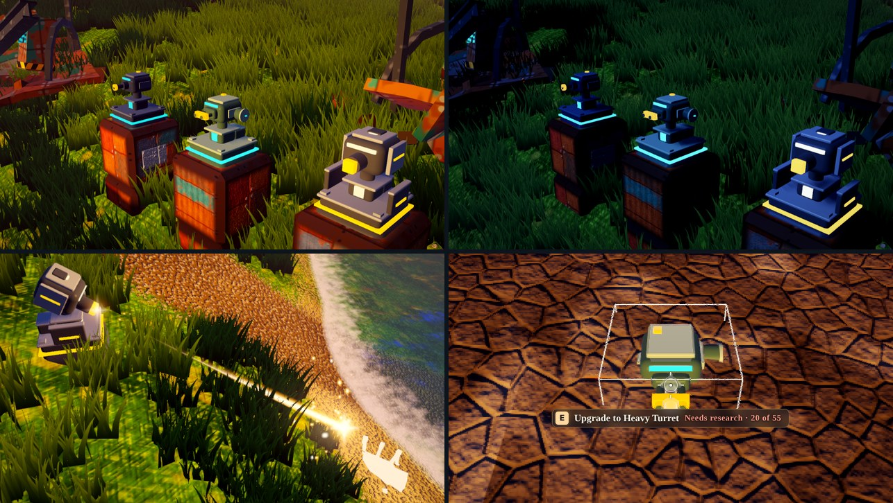

| Image                                                    | What to look at                                                                                                                                                                                                                                                                                                                                                                                                                                                                                                                                                                                                    |
| -------------------------------------------------------- | ------------------------------------------------------------------------------------------------------------------------------------------------------------------------------------------------------------------------------------------------------------------------------------------------------------------------------------------------------------------------------------------------------------------------------------------------------------------------------------------------------------------------------------------------------------------------------------------------------------------ |
| [turret-levels](phase-5/turret-levels.jpg)               | The three turrets side by side at golden hour, each on a column of Scrap so that they stand level, seen from above and in front. Left, the Basic Turret: blue-grey steel, one barrel and the cyan strip round its pad. In the middle the Auto Turret: grey-green panels with pale trim, a housing a little wider, a drum of ammunition on its flank and a cyan strip that glows harder. On the right the Heavy Turret: brushed steel, a big housing with an armoured cheek each side and a pale eye on top, a shield with an amber line along each side of the pad, and an amber strip where the others have cyan. |
| [turret-levels-front](phase-5/turret-levels-front.jpg)   | The same three from nearer the front. The Basic Turret's one barrel ends in its amber ring; the Auto Turret's two barrels lie side by side behind an amber clamp, with the cyan visor above them; the Heavy Turret's single thick barrel ends in a block of amber, the muzzle brake. The plate on the front of the Heavy Turret's column is pale where the other two are cyan.                                                                                                                                                                                                                                     |
| [turret-levels-close](phase-5/turret-levels-close.jpg)   | One close picture of each turret, with the one a level down standing behind it for scale: the Basic Turret on its own, the Auto Turret with the Basic Turret behind it at the left, and the Heavy Turret with the Auto Turret behind it. The wider housing and the drum on the Auto Turret's flank, the taller head and the cheeks of the Heavy Turret, and how the same pad and column carry all three.                                                                                                                                                                                                           |
| [turret-levels-night](phase-5/turret-levels-night.jpg)   | The row at night. The steel is navy at every level and what is seen is the lights: the cyan strips and visors of the first two (the Auto Turret's a little brighter) and, on the Heavy Turret, the amber strip round the pad, the amber lines on its cheeks and shields and the pale lamp.                                                                                                                                                                                                                                                                                                                         |
| [turret-levels-fire](phase-5/turret-levels-fire.jpg)     | Each turret's first shot at a crawler standing at the lake's edge, the same place for all three, photographed 2 frames (1/30 s, top row) and 4 frames (1/15 s, bottom row) after the host reported it, cropped to the turret, the bolt and the machine. Left to right: the Basic Turret, the Auto Turret and the Heavy Turret. The first two shoot the same thin amber streak; the Heavy Turret's is twice as wide and brighter, with a larger flash at the muzzle and a larger burst where it lands, and the crawler flashes white where it is hit.                                                               |
| [turret-raise-card](phase-5/turret-raise-card.jpg)       | A player's view, Build Mode on and the blaster in hand, of one turret raised twice. Left: the cursor on a Basic Turret, its outline and the card under the crosshair, "E Upgrade to Auto Turret" over "Cost 10 Reinforced Composite". Middle: the same cell after E, an Auto Turret in its grey-green, and the next step on the card, "Upgrade to Heavy Turret" with "Needs research · 20 of 55" in the red of a refusal. Right: the Heavy Turret after the second E, in its brushed steel with amber lines, and no card, because there is nothing better.                                                         |
| [turret-raise-states](phase-5/turret-raise-states.jpg)   | The card's six states, enlarged 1.6 times. For the Auto Turret: "Needs research · 0 of 20", "Not enough Reinforced Composite" and "Cost 10 Reinforced Composite". For the Heavy Turret: "Needs research · 20 of 55", "Not enough Advanced Alloy" and "Cost 10 Advanced Alloy". The four refusals are in the warm red and the two prices in the card's ordinary type.                                                                                                                                                                                                                                               |
| [turret-levels-states](phase-5/turret-levels-states.jpg) | Four of the pictures together: the three turrets by day, the three at night, the Heavy Turret's first shot and the card on an Auto Turret.                                                                                                                                                                                                                                                                                                                                                                                                                                                                         |

### Cost

A raised turret is made of the same kind of pieces as the first, and more of them. The Auto Turret is seven meshes, three that stand still and four that turn as the Basic Turret's do, and 1,964 triangles; the Heavy Turret is eight, four and four, and 2,640; the Basic Turret is seven and 1,460. The kit of a level is built the first time a turret of that level is drawn and shared by every turret at that level, and a raise swaps one cell's model for it, the work of placing a turret. Counted like the tables above (Balanced, every pass, software GL), from the crash clearing looking at open ground with one turret raised in place, a frame is 97 draws and 776.7 thousand triangles with nothing built. A turret in view adds 14 draws and 2,920 triangles at its first level, 14 and 3,928 at its second and 16 and 5,280 at its third, because each mesh is drawn twice, once in the main view and once in the shadow pass. Behind the camera the shadow pass still draws it: 7 draws and 1,460 triangles, 7 and 1,964, and 8 and 2,640. A Heavy Turret is four draws more than a Terminal. The triangles stay small (0.4, 0.5 and 0.7 percent of the frame for each), and the draws are the number to watch: a dozen Heavy Turrets in view would add 192, about twice what that frame has with nothing built. The lit material reads the model matrix, so these cannot be instanced as the heaps are. The heavier bolt costs what a player's does, the same streak drawn wider, and an Auto Turret makes at most four of them a second. Nothing here is measured on a real GPU.

### Known gaps in the turret levels

- **Sixteen draws for a Heavy Turret in view.** The Auto Turret is seven meshes and the Heavy Turret eight, each drawn twice (the main view and the shadow pass), so they add 14 and 16 draws where the Basic Turret added 14 ([Cost](#cost-6)). A base of a dozen Heavy Turrets in view adds 192 draws to a frame that has 97 with nothing built. The things to try first are the Terminal's and the Basic Turret's: letting the thin lit parts (the strips, the visor, the ring and the lamps) skip the shadow pass, and drawing each kind of module as one instanced batch, which three kinds of turret make more worth doing.
- **A raise has no moment.** The model changes on the next frame and nothing marks it: no flash at the cell and no sound, as with a block's upgrade ([Phase 5e](#phase-5e-upgrade-in-place)). Both are for Phase 6, when every screen can play them from the event.
- **The Heavy Turret's weight is drawn and no more.** Its bolt is wider and brighter with a larger flash at the muzzle, and its head is bigger, but the gun does not kick back and nothing shakes the screen. The heads still snap to the end of each shot and hold, as in [5f1](#known-gaps-in-the-turret).
- **The hotbar offers the Basic Turret alone.** A better turret is only ever raised, so there is no icon and no ghost for the Auto Turret or the Heavy Turret; the card under the crosshair is where a crew meets their names.
- **Steep dips are checked to 45 degrees at the new levels.** The unit test that keeps a head out of its column covers 45 degrees up and down for all three, and leaves them clear; the Basic Turret's rim still dips up to 6 cm into the column at 70 degrees ([5f1](#known-gaps-in-the-turret)), and the two bigger heads are not measured that far. It does not show from where a player stands.
- **The paint follows the paying material.** A level is dressed by the grade that pays for it, so there is no look that belongs to a turret alone, and a future level paid in another material would wear that material's dress.
- Seen only in software-rendered pictures. The amber of the Alloy (which the bloom and the tone mapper change), the cyan of the Composite and the heavier bolt's brightness are judged there; how they read on a real display is for the first look on a real GPU.

## Phase 5g1: the Generator

The Generator is the first module that gives: a field reactor drawn in code that stands in one cell and gives Energy back to a player who stands near it, and a ring of light on the ground that shows how far its reach goes. The hotbar slot, the line over it, the ghost and the outline are the Terminal's and the turret's; what is new is the thing they point at, the padlock the module slot wears until the Power research is read, a row in the Terminal's ladder, and the ring. The choices are in [decisions](decisions.md#phase-5g1-the-generator-2026-10-27).

### The Generator

- **Shape.** A reactor on a steel pad, 0.76 of a cell wide and a little under a cell tall (0.97 to the tip of its beacon). A foundation block and a flat pad with a raised corner at each corner carry an upright drum, 0.47 of a cell across, that stands a little toward the back with a lighter cap and a mast on top. A control box (0.16 deep, 0.3 tall) sits on the pad's front with a lit gauge on its face, and three amber lamps under it, and a short pipe links it to the drum. A radiator hugs each flank: a backing plate on two brackets ribbed with five slats. The mast ends in an amber beacon that blinks, the Terminal's blink, and a stub with a collar sticks out of the drum's back.
- **Steel and light.** The Terminal's palette: dark blue-grey steel with lighter trim, cyan on what is running (the broad band round the drum, the strip round the pad and the gauge's bars and screen) and amber on what is worked (two thin rings above and below the band, the lamps and the beacon). The golden sun gives the steel warm edges and the night makes it navy; at night what is seen of a Generator is its cyan band and strip, its gauge and its amber lamps and rings. The band means it is running, which it always is: it burns nothing, and there is no off.
- **It faces the player.** Placing a Generator turns its control box toward the player, so the gauge and the lamps are what they see; R turns it a quarter turn at a time, through four facings, and the ghost is the model in the same turn. From behind it is the drum and its band, the radiators, the stub on the drum's back and the beacon, with nothing on the pad's back.
- **It stands in the ground.** The pad stands on a foundation block under it, with the Terminal's rule ([Phase 5d1](#phase-5d1-the-research-terminal)): where the cell floats over the ground the foundation is the plinth it stands on (a pale grey slab in the pictures where the ground falls away below the cell), where the ground reaches a little into the cell the foundation is buried, and where the ground would cover more than a quarter of the cell the cursor puts the Generator in the cell above.
- **A Generator that is aimed at** is outlined by its body box (0.76 by 0.85 by 0.76 of a cell), which is also what movement stands against.

### What the crew sees

- **The slot.** Module slot 6 (key 6, then Q twice from the Terminal) shows the Generator's icon on the cyan grid: a steel drum with a lit band that has a bolt across it, a control box beside it and a bronze beacon on its mast. Until a Research Terminal has read the 10 points of the Power row, the slot is dim behind a padlock, as the slots of a material not yet researched are, and the line over the hotbar says "Needs research · 0 of 10" (with the points the crew has) or "Needs a Research Terminal" when the points are earned and unread. With the row open it says "Generator" over "Cost 40 Scrap".
- **The ghost.** The Generator itself, in cyan where the host would take it and in the warm red of any refusal where not, with the outline of its body box.
- **The ring.** In Build Mode a ring of light is drawn on the ground round a Generator: round the cell the ghost stands in while one is in hand, and round one that stands while the cursor is on it. It is a ribbon laid on the ground at the edge of the reach, with a curtain of light, 1.25 blocks tall and fading out toward its top, standing on the ribbon, and dashes of light that march slowly round it. The curtain is what makes it readable: the grass is as tall as a block here and hides a ribbon lying on the ground. The edge is where Energy stops, found by the host's own rule (`reachEdge`), so on level ground it is a circle a little inside 6 blocks (the body is measured from its middle, which is above the cell's floor) and on a hill it is pulled in where the ground climbs away or drops away from the cell: from the side it tilts and narrows with the slope. The ring is drawn even where the ghost is red, so a crew can plan a spot it cannot build on yet.
- **Charging.** A player within the reach sees the Energy meter's "Charging" label come on, with its arrow, and the bar fill, as at the Core; outside it the label goes and the bar drains again.
- **The ladder.** The Terminal's ladder has a row for the Power research, between Scrap and Reinforced Composite where 10 points puts it: the Generator's icon, "Power", "10 points · Generator" and "Open" once a Terminal has read the points, "Not read yet" in amber while they are earned and unread, and "n to go" before. The research pill counts toward the next row ("0/10", then "12/20" once Power is read), and the dawn that reads the row says "Power unlocked".

### Screenshots

Headless Chromium on software GL at 1280 by 720, Balanced, `freeze=1`, `?debug&waves=0&time=golden&stock=400`, with the Generators built through the page's debug hooks (`__ashbound.mp.place`: the host's own command path, after `mp.setResearch(10, true)` has the Terminal's reading in place) and the camera put where it can see them (`game.setPhoto`: 1.5 blocks above the Generator's middle and about 2.5 out, because the grass stands taller than a block and hides a low camera), the page's animation clock replaced by one that moves a set step a frame. The night picture is the same view with the clock set to night (`stage.setMoment`), and the back is the Generator placed facing away. The ring pictures lay the ring by hand round a Generator, the way Build Mode does (Build Mode needs the pointer taken), seen from 6 to 9 blocks above and 11 to 13 out; the level one is east of the Core with grass and bare ground under it, and the two hill pictures are at a Generator on a slope that climbs about ten blocks in fourteen toward the south-east, one seen from the side along the slope and one from below it. The first-person pictures are a player's own view with Build Mode on: the Generator chosen in slot 6 with no points read (the ghost red, the padlock on the slot), the points read (the ghost cyan), standing 3 blocks from a Generator with the blaster in hand and Energy low (the "Charging" label and the ring round the Generator under the cursor), and the Terminal's panel open at 12 points, read and unread.

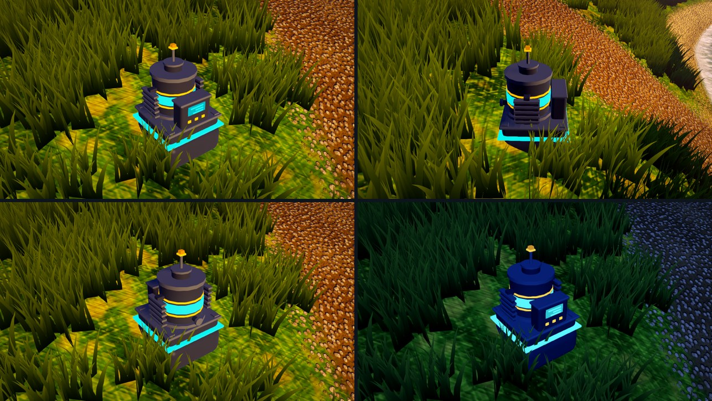

| Image                                                      | What to look at                                                                                                                                                                                                                                                                                                                                                                                              |
| ---------------------------------------------------------- | ------------------------------------------------------------------------------------------------------------------------------------------------------------------------------------------------------------------------------------------------------------------------------------------------------------------------------------------------------------------------------------------------------------ |
| [generator-front](phase-5/generator-front.jpg)             | The Generator from the front at golden hour, standing in the grass beside the gravel path: the control box on the pad's front with its lit gauge and three amber lamps, the radiator on the near flank, the drum with its cyan band between two amber rings, the cap and the mast with its amber beacon, and the cyan strip round the pad.                                                                   |
| [generator-side](phase-5/generator-side.jpg)               | From the side: the radiator in profile with its slats, the control box standing out from the pad at the right, the drum behind it, and the foundation under the pad, which is wider than the drum and goes down into the ground.                                                                                                                                                                             |
| [generator-back](phase-5/generator-back.jpg)               | The Generator turned to face away: the drum with its band and rings, a radiator on each flank, the stub with its collar on the drum's back and the beacon, and nothing on the back of the pad. The control box is on the far side, out of sight.                                                                                                                                                             |
| [generator-night](phase-5/generator-night.jpg)             | The front view at night. The steel is navy and what is seen of the Generator is its lights: the cyan band and strip, the gauge's screen and its amber lamps and rings.                                                                                                                                                                                                                                       |
| [generator-ring](phase-5/generator-ring.jpg)               | The ring round a Generator east of the Core, from above: the Core's frame at the upper left and a heap of debris at the upper right. The ribbon and its curtain run round the Generator on bare ground (left) and through the grass (right), where the curtain is what shows; the dashes of light are the pattern that marches round it.                                                                     |
| [generator-ring-hill](phase-5/generator-ring-hill.jpg)     | The ring on a slope, seen from the side along it. The ground climbs away to the right and the ring follows it up, tilted and narrowed: it is the edge of a ball and not a circle, so ground that rises away from the Generator is out of reach sooner.                                                                                                                                                       |
| [generator-ring-low](phase-5/generator-ring-low.jpg)       | The same Generator seen from below the slope and above it. The ring is pulled in toward the Generator on the uphill side and runs close to its full size along the level.                                                                                                                                                                                                                                    |
| [generator-ghost](phase-5/generator-ghost.jpg)             | A player's view with the Power points read: the cyan ghost with its outline, "Generator" and "Cost 40 Scrap", slot 6 chosen with the Generator's icon, the research pill at "12/20" and the curtain of the ring across the clearing behind the ghost.                                                                                                                                                        |
| [generator-locked](phase-5/generator-locked.jpg)           | The same view with no points: the ghost is the red of a refusal, the line over the hotbar says "Needs research · 0 of 10", the slot is dim behind a padlock and the pill says "0/10". The ring is still drawn round the ghost.                                                                                                                                                                               |
| [generator-hotbar](phase-5/generator-hotbar.jpg)           | The two views above with the hotbar and the line over it enlarged underneath: the Generator's icon on the cyan grid with "Cost 40 Scrap", and the dim slot with its padlock and "Needs research · 0 of 10".                                                                                                                                                                                                  |
| [generator-charging](phase-5/generator-charging.jpg)       | A player three blocks from a standing Generator with Energy low, the blaster in hand and Build Mode on: the "Charging" label and its arrow under the meters at the top left, the white outline of the Generator the cursor is on, and the curtain of its ring across the clearing. The plinth under the pad is the foundation, where the ground falls away below the cell.                                   |
| [terminal-ladder-power](phase-5/terminal-ladder-power.jpg) | The Terminal's panel at 12 points. Left: the Power row, "10 points · Generator" (from 5g2 it names the Node too, [terminal-ladder-node](phase-5/terminal-ladder-node.jpg)), reads "Open", and the next row, Reinforced Composite, is "8 to go". Right: the same points earned and not yet read by a Terminal, and the Power row says "Not read yet" in amber and the pill's label turns to "Needs Terminal". |
| [generator-ring-states](phase-5/generator-ring-states.jpg) | The three ring pictures together: level ground, the hill from the side and from below.                                                                                                                                                                                                                                                                                                                       |
| [generator-overview](phase-5/generator-overview.jpg)       | Four of the pictures together: the Generator by day, its ring, charging beside one and the Terminal's ladder with the Power row.                                                                                                                                                                                                                                                                             |

### Cost

A Generator is six meshes (steel, trim, amber, cyan lights, screen glass and the beacon) and 1,704 triangles, built once and shared by every Generator. Counted like the tables above (Balanced, every pass, software GL), from the crash clearing looking at open ground, a frame is 97 draws and 776.7 thousand triangles with nothing built. One Generator in view takes it to 109 draws and 780.1 thousand triangles, two to 121 and 783.5 thousand and three to 133 and 786.9 thousand: each adds 12 draws and 3,408 triangles, because it is drawn twice, once in the main view and once in the shadow pass. With the three behind the camera the shadow pass still draws them, 18 more draws and 5.1 thousand triangles, 6 draws and 1,704 triangles each. A Generator is the Terminal's 12 draws and two fewer than a turret's 14. The ring is two meshes, the ribbon and the curtain, 384 triangles between them, and with it on screen a frame has 4 more draws and 768 more triangles across its passes; it is drawn in Build Mode only. The things to try first if a real machine needs the draws back are the ones the Terminal's notes name: letting the thin lit parts (the strips, the gauge and the beacon) skip the shadow pass, and drawing each kind of module as one instanced batch, which three kinds of module make more worth doing.

### Known gaps in the Generator

- **Twelve draws a Generator in view.** Six meshes, each drawn twice, as the Terminal's: a crew with a dozen Generators in view adds 144 draws to a frame that has 97 with nothing built ([Cost](#cost-7)). A Generator's field is six blocks, so a crew builds one or two beside a wall and not a field of them, which keeps this smaller than the turrets' ([5f1](#known-gaps-in-the-turret)).
- **The curtain is big near the edge.** From a player's eyes, standing inside the ring near its edge, the curtain is a translucent fence about as high as the player's chest running across the view (see the ghost and charging pictures). It is at most half opaque and fades out toward its top, but how strongly it reads, and whether the bloom on a real display makes it too bright, is a call for the first look on a real GPU. Its two numbers are the height `CURTAIN` and the opacity in the curtain's shader in `src/world/render/reach-ring.ts`.
- **The ring is Build Mode's.** It is drawn with the pointer taken and Build Mode on, round a Generator in hand or under the cursor. Nothing shows the reach in play, and the Core's own field has no ring: the "Charging" label is how a player in play learns they are in a field. A ring for the Core and one that comes on when a Generator is walked up to are both small changes.
- **The ring is drawn for a refused ghost too.** A crew short of Scrap or still behind the Power row, or aiming out of reach, sees the ring round a red ghost, so it can plan a spot it cannot build on yet.
- **No power state and no sound.** The band and the strip are always lit, and the Generator makes no sound and the ring none as it comes on: sound is Phase 6, and lights that dim without power are 5g2, which is the Node's work, since a Generator is the source and is never short of power.
- **A plinth where the ground falls away.** The foundation under the pad is a plain pale slab, as the Terminal's and the turret's are; where the ground falls away below the cell it shows as a grey block under the pad (the charging picture).
- Seen only in software-rendered pictures. The cyan band and strip, the amber rings and lamps (which the bloom and the tone mapper change) and the curtain's brightness are judged there; how they read on a real display is for the first look on a real GPU.

## Phase 5g2: the Power Node and power for turrets

The Power Node is the fourth module and the first one whose job is to pass something on: a relay pylon drawn in code that stands in one cell, takes the reach of a Generator (or of another Node) and carries it eight blocks farther. What is new to the eye is the pylon and one change to every machine that takes power: a turret or a Node with no power burns its lights low, so a base shows at a glance which of its machines are on, and a small tag under the crosshair says so in words. The hotbar slot, the line over it, the ghost, the outline and the ring are the Generator's ([Phase 5g1](#phase-5g1-the-generator)). The choices are in [decisions](decisions.md#phase-5g2-the-power-node-and-power-for-turrets-2026-10-27).

### The Node

- **Shape.** A relay pylon on a small steel pad, 0.6 of a cell wide and 0.95 of a cell tall to the tip of its needle. A foundation block and a flat pad with a raised corner at each corner carry a collar and a slender column. Three disks that shrink toward the top (0.32, 0.26 and 0.2 of a cell across) sit on the column like the coils of a relay, with a band of amber insulator between each pair, a band of cyan over the top one and another over the collar. A bright cyan crystal, an octahedron stretched upward and turned to stand on a corner, rests in a small cradle on the top, and an amber needle above it blinks, the Terminal's blink. A console (0.14 deep, 0.18 tall) stands on the front of the pad with a lit screen and three amber lamps under it.
- **Steel and light.** The Terminal's and the Generator's palette: dark blue-grey steel with lighter trim, cyan on what carries power (the strip round the pad, the bands, the crystal and the screen) and amber on what is worked (the insulators, the lamps and the needle). The golden sun gives the steel warm edges and the night makes it navy; at night what is seen of a Node is its strip, its crystal and bands, its screen and its amber insulators.
- **It faces the player.** Placing a Node turns its console toward the player, so the screen and the lamps are what they see; R turns it a quarter turn at a time through four facings, and the ghost is the model in the same turn. From behind it is the column and its disks with the crystal on top, and nothing on the pad's back.
- **It stands in the ground.** The pad stands on a foundation block under it, with the Terminal's rule ([Phase 5d1](#phase-5d1-the-research-terminal)): where the cell floats over the ground the foundation is the plinth it stands on, where the ground reaches a little into the cell the foundation is buried, and where the ground would cover more than a quarter of the cell the cursor puts the Node in the cell above.
- **A Node that is aimed at** is outlined by its body box (0.64 by 0.95 by 0.64 of a cell), which is also what movement stands against.

### What the crew sees

- **The slot.** Module slot 6 (key 6, then Q three times from the Terminal) shows the Node's icon on the cyan grid: a mast of disks with a crystal on top. Until a Research Terminal has read the 10 points of the Power row, the slot is dim behind a padlock, as the Generator's is, and the line over the hotbar says "Needs research · 0 of 10" (or "Needs a Research Terminal" when the points are earned and unread). With the row open it says "Power Node" over "Cost 12 Scrap".
- **The ghost and the ring.** The Node itself, in cyan where the host would take it and in the warm red of any refusal where not, with the outline of its body box. The ring round it is the Generator's ring at 8 blocks, with the same curtain: round the cell the ghost stands in while a Node is in hand, and round a Node that stands while the cursor is on it.
- **Lights.** A Node or a turret that has power burns as the Terminal does: the strips beat slowly, the screens breathe and the needle blinks. One that has none keeps its shape and its plates, and its cyan and amber go to about a twelfth of their light, held still: the strips and the crystal are a dull teal, the lamps and insulators a brown, the screen is dark and the needle does not blink. It is still plainly the same machine, at rest. The Generator and the Terminal never dim (the Generator is its own power, and the Terminal takes none). Which machines have power is worked out on every screen from the world's own blocks, so when the Generator is broken the Node and the turrets go down together on every screen.
- **The tag.** In Build Mode, with the cursor on a turret or a Node, a small tag under the crosshair (below the card where a turret's `E` card is up) says which it is: a cyan dot with "Powered" and "Fires 1.5× faster" for a turret or "Passes power on" for a Node, or a grey dot with "No power" and "A Generator or Node in reach boosts it" or "Needs a Generator or Node in reach". The cursor reaches 8 blocks, so a base can be read from a little way off. A Generator and a Terminal get no tag.
- **The ladder.** The Power row of the Terminal's ladder now names both modules it opens, "10 points · Generator, Power Node", with the Generator's icon still on it. Where the row is narrow (the amber "Not read yet" takes more room than "Open") the words wrap after the comma, and a no-break space keeps "Power Node" together on the second line.

### Screenshots

Headless Chromium on software GL at 1280 by 720, Balanced, `freeze=1`, `?debug&waves=0&time=golden&stock=400`, with the machines built through the page's debug hooks (`__ashbound.mp.place`: the host's own command path) and the camera put where it can see them (`game.setPhoto`: 1.5 blocks above the Node's middle and about 3 out), the page's animation clock replaced by one that moves a set step a frame. The pictures of a machine without power are the same view taken again after the Generator is broken (`mp.breakBlock`), so the only change between a pair is the power. The night pictures are the same views with the clock set to night (`stage.setMoment`). The chain is a Generator, a Node 5 blocks from it and a turret 5 blocks on the other side of the Node (10 from the Generator, past its 6), seen from 8 blocks off and 3.5 up, with the ring of the Node laid by hand the way Build Mode does. The first-person pictures are a player's own view with Build Mode on: the Node chosen in slot 6 with no points read (the ghost red, the padlock on the slot), with the points read (the ghost cyan), and the cursor on a Node and on a turret beside a Node with a Generator standing and with none, and the Terminal's panel at 12 points, read and not yet read.

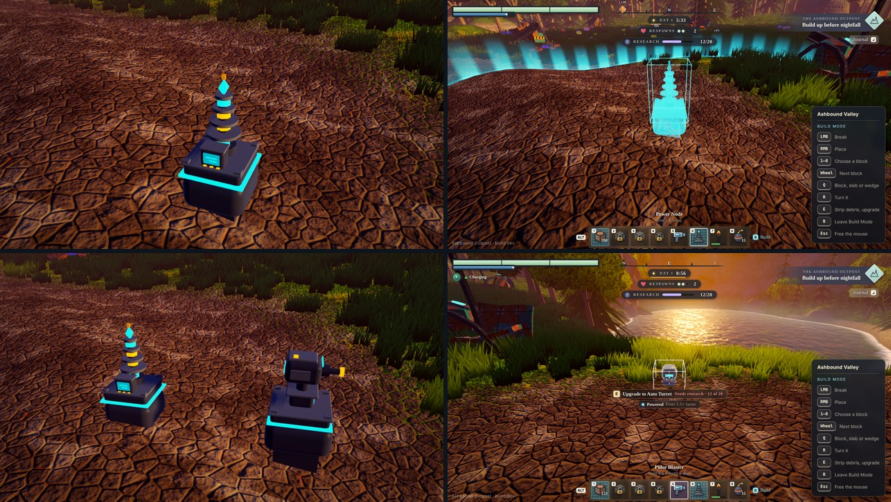

| Image                                                    | What to look at                                                                                                                                                                                                                                                                                                                             |
| -------------------------------------------------------- | ------------------------------------------------------------------------------------------------------------------------------------------------------------------------------------------------------------------------------------------------------------------------------------------------------------------------------------------- |
| [node-front](phase-5/node-front.jpg)                     | The Node from the front at golden hour, on the gravel path: the console on the pad's front with its lit screen and three amber lamps, the three disks with their amber and cyan bands, the cyan crystal and the amber needle above it, and the cyan strip round the pad.                                                                    |
| [node-lineup](phase-5/node-lineup.jpg)                   | Three Nodes at three facings: turned to the east (the console at the right of the column), toward the camera, and away (nothing on the pad's near side, and the foundation going down into the ground where the cell floats over it). A Generator out of frame gives them power.                                                            |
| [node-night](phase-5/node-night.jpg)                     | The front view at night. The steel is navy and what is seen of the Node is its lights: the strip, the crystal, the cyan bands, the screen and the amber lamps and insulators.                                                                                                                                                               |
| [node-lit-dim](phase-5/node-lit-dim.jpg)                 | The same Node twice. Left: with power, the strip and crystal bright cyan, the insulators and lamps amber. Right: after the Generator is broken, the strip and the crystal a dull teal, the insulators and lamps a brown, the screen dark.                                                                                                   |
| [power-lights](phase-5/power-lights.jpg)                 | A Node and a turret, with power (left) and without (right), by day (top) and by night (bottom). The turret's cyan strip and visor and its amber lamp are the lights that go down, and the Node's.                                                                                                                                           |
| [power-chain](phase-5/power-chain.jpg)                   | A turret (left), a Node (middle) and a Generator (right, in the grass), lit above and below with the Generator gone. The turret is 10 blocks from the Generator and has its power from the Node alone; broken, the Generator takes the Node and the turret down with it.                                                                    |
| [node-ghost](phase-5/node-ghost.jpg)                     | A player's view with the Power points read: the cyan ghost with its outline, "Power Node" and "Cost 12 Scrap", slot 6 chosen with the Node's icon, the research pill at "12/20" and the curtain of the ring across the clearing behind the ghost.                                                                                           |
| [node-locked](phase-5/node-locked.jpg)                   | The same view with no points: the ghost is the red of a refusal, the line over the hotbar says "Needs research · 0 of 10", the slot is dim behind a padlock and the pill says "0/10".                                                                                                                                                       |
| [node-hotbar](phase-5/node-hotbar.jpg)                   | The two views above with the hotbar and the line over it enlarged underneath: the Node's icon on the cyan grid with "Cost 12 Scrap", and the dim slot with its padlock and "Needs research · 0 of 10".                                                                                                                                      |
| [power-tags](phase-5/power-tags.jpg)                     | The four tags under the crosshair. Top: a Node with no power ("No power", "Needs a Generator or Node in reach") and with power ("Powered", "Passes power on"). Bottom: a turret with no power ("No power", "A Generator or Node in reach boosts it") and with power ("Powered", "Fires 1.5× faster"), each under the turret's upgrade card. |
| [turret-tag-on](phase-5/turret-tag-on.jpg)               | The whole of a turret's view with the tag: a Basic Turret with power from a Node about five blocks away, the white outline of the turret the cursor is on, the `E` card for the upgrade above and the "Powered" tag below it.                                                                                                               |
| [terminal-ladder-node](phase-5/terminal-ladder-node.jpg) | The Terminal's panel at 12 points, as in [5g1](#phase-5g1-the-generator), with the Power row now reading "10 points · Generator, Power Node". Left: read, "Open". Right: earned and not yet read, "Not read yet" in amber, where the words wrap after the comma and "Power Node" stays together.                                            |
| [node-overview](phase-5/node-overview.jpg)               | Four of the pictures together: the Node by day, its ghost with the ring behind it, a Node beside a turret with power, and the tag under a turret's crosshair.                                                                                                                                                                               |

### Cost

A Power Node is six meshes (steel, trim, amber, cyan lights, screen glass and the needle) and 1,304 triangles, built once and shared by every Node. Counted like the tables above (Balanced, every pass, software GL), from the crash clearing looking at open ground, a frame is 97 draws and 776.7 thousand triangles with nothing built. One Node in view takes it to 109 draws and 779.3 thousand triangles, two to 121 and 781.9 thousand and three to 133 and 784.5 thousand: each adds 12 draws and 2,608 triangles, because it is drawn twice, once in the main view and once in the shadow pass. With the three behind the camera the shadow pass still draws them, 18 more draws and 3.9 thousand triangles, 6 draws and 1,304 triangles each. A Node is the Generator's 12 draws, with fewer triangles (1,304 against 1,704). The ring of its reach is the Generator's two meshes, 384 triangles between them, and with it on screen a frame has 4 more draws and 768 more triangles across its passes; it is drawn in Build Mode only. A module without power costs no more than one with it: its glowing looks (the strips, the lamps, the screens and the needle) are swapped for dim copies made the first time one is needed, up to four more materials for each paint, shared by every module of that paint, and a power change touches the modules' materials and nothing else. The things to try first if a real machine needs the draws back are the ones the Terminal's notes name: letting the thin lit parts skip the shadow pass, and drawing each kind of module as one instanced batch, which four kinds of module make more worth doing.

### Known gaps in the Node and the lights

- **Twelve draws a Node in view.** Six meshes, each drawn twice, as the Generator's: a crew with a dozen Nodes in view adds 144 draws to a frame that has 97 with nothing built ([Cost](#cost-8)). A Node reaches eight blocks, so a crew builds one or two along a wall and not a field of them.
- **Every turret burns low until the crew has a Generator.** The dim look is the default for a turret and a Node with no power, so before the Power row is read and a Generator stands, each turret a crew builds shows low lights though it works as it always did. The tag says why when the cursor is on it ("A Generator or Node in reach boosts it"). The other way, dimming only a module that had power and lost it, would make the loss the thing that reads at the cost of a plain turret never looking powered; it is flagged in [decisions](decisions.md#phase-5g2-the-power-node-and-power-for-turrets-2026-10-27).
- **The dim level is judged in software pictures.** `DIM_GLOW` in `src/world/render/module-render.ts` is 0.08 of the glow, chosen by looking at a powered and an unpowered machine side by side by day and by night: at 0.16 the strips and the lamps still read as lit from a few blocks away, and at 0.04 and below the strips are lost. How it reads on a real display, where the bloom lifts a light, is for the first look on a real GPU.
- **Far off, a machine's lights are small.** The strip round a pad is two hundredths of a block thick and the lamps and the needle are a few hundredths wide, so from across a clearing most of what shows power is the crystal and the bands. Every picture here is taken within about ten blocks; how the two states read at a long range is for the first look on a real GPU.
- **The ring is laid for a player's body.** A module's reach is measured from cell middle to cell middle, and the ring is laid for the reach of a player's body, which is a little different: a turret on level ground is in reach where the ring ends, and on a slope within about half a block of it. The tag is what settles a close call.
- **Nothing marks power coming on or going out.** The lights change on the next frame, with no flash and no sound, and nothing is drawn between a Node and what it feeds (SPEC section 14 bans automation chains, and the ring and the tag are the display). Both are for Phase 6.
- **The tag is Build Mode's.** It is shown with the pointer taken and Build Mode on, for the machine the cursor is on; in play a turret's lights are the only sign of its power.
- Seen only in software-rendered pictures. The cyan strips and crystal, the amber insulators and lamps (which the bloom and the tone mapper change) and the dim level are judged there; how they read on a real display is for the first look on a real GPU.

## Phase 5h1: the Storage

The Storage is the fifth module and the first of the base's comforts: a supply container drawn in code that stands in one cell, and for every one that stands the crew's pool holds 100 more of each material. What is new to the eye is the container itself, the amber count on a hotbar slot when the pool is full, and a message when the room changes. The hotbar slot, the line over it, the ghost and the outline are the Terminal's and the Generator's ([Phase 5d1](#phase-5d1-the-research-terminal), [Phase 5g1](#phase-5g1-the-generator)). The choices are in [decisions](decisions.md#phase-5h1-storage-and-the-camp-row-2026-10-27).

### The Storage

- **Shape.** A supply container on a small steel pad, 0.86 of a cell deep and 0.8 across at the pad and 0.72 tall to the top of its beacon. A foundation block and a flat pad carry a boxy shell (0.8 deep, 0.7 across and 0.5 tall) with six ribs on each side, a roof plate with a low vent hood toward the back, and four slim corner posts that rise to the roof and hold it square. The front is a double door: a recessed panel in each leaf and a bar handle in amber at the seam, a cyan status strip above them and a small cyan lamp at each end of it. A row of five amber hazard dashes runs along the pad below the door, and a small amber beacon on the back of the roof blinks, the Terminal's blink.
- **Steel and light.** The Terminal's, the Generator's and the Node's palette: dark blue-grey steel with lighter trim, cyan on what shows it is live (the strip round the pad, the status strip and the two lamps) and amber on what is worked (the handles, the dashes and the beacon). The golden sun gives the steel warm edges and the night makes it navy; at night what is seen of a Storage is its cyan strip, the lamps and the status strip over the door, and its amber handles, dashes and beacon.
- **It faces the player.** Placing a Storage turns its door toward the player, so the door and the dashes are what they see; R turns it a quarter turn at a time through four facings, and the ghost is the model in the same turn. From behind it is a plain steel back with the ribs on both sides.
- **It stands in the ground.** The pad stands on a foundation block under it, with the Terminal's rule ([Phase 5d1](#phase-5d1-the-research-terminal)): where the cell floats over the ground the foundation is the plinth it stands on, where the ground reaches a little into the cell the foundation is buried, and where the ground would cover more than a quarter of the cell the cursor puts the Storage in the cell above.
- **A Storage that is aimed at** is outlined by its body box (0.86 by 0.72 by 0.8 of a cell), which is also what movement stands against.
- **It never dims.** A Storage takes no part in power, so its lights burn as the Terminal's do, whatever stands near it.

### What the crew sees

- **The slot.** Module slot 6 (key 6, then Q four times from the Terminal) shows the Storage's icon on the cyan grid: a steel container with a ribbed side, a centre door lit cyan with a bronze handle and a bronze cap at each lower corner. Until a Research Terminal has read the 40 points of the Camp row the slot is dim behind a padlock, as the Generator's is, and the line over the hotbar says "Needs research · 12 of 40" (or "Needs a Research Terminal" when the points are earned and unread). With the row open it says "Storage" over "Cost 30 Scrap".
- **The ghost.** The Storage itself, in cyan where the host would take it and in the warm red of any refusal where not, with the outline of its body box. There is no ring: a Storage reaches nowhere.
- **The count.** The number on a material's hotbar slot is white until the pool holds all it can of that material, and amber while it does (the stock is at the ceiling or over it). It is what shows a crew that what it strips from a heap is going to waste, and what shows a Storage was worth building.
- **The messages.** When a Storage is built or lost, the toast at the top of the screen says how much the pool holds now: "Storage built · the pool holds 500 of each" and "A Storage is gone · the pool holds 400 of each". The row that opens the Storage is announced as any row is, "Camp unlocked". A screen says nothing when it has only just heard from the host, or when a run starts over.
- **The ladder.** The Terminal's ladder gains the Camp row between Composite and Alloy, "40 points · Storage", with the Storage's icon, open, waiting for a Terminal to read it, or shut, as the other rows are.

### Screenshots

Headless Chromium on software GL at 1280 by 720, Balanced, `freeze=1`, `?debug&waves=0&time=golden&stock=400`, with the Storages built through the page's debug hooks (`__ashbound.mp.place`: the host's own command path, after `mp.setResearch(40, true)` has the Terminal's reading in place) and the camera put where it can see them (`game.setPhoto`: 1.3 blocks above the Storage's middle and about 3 out), the page's animation clock replaced by one that moves a set step a frame. The night picture is the same view with the clock set to night (`stage.setMoment`). The first-person pictures are a player's own view with Build Mode on: the Storage chosen in slot 6 with no points read (the ghost red, the padlock on the slot) and with the points read (the ghost cyan); the message after the first Storage is built (its timer held so that it stays up for the picture); the hotbar's counts at 499 and at the ceiling of 500 (the pool set with `mp.setPool`); and the Terminal's panel at 40 points, read and not yet read.

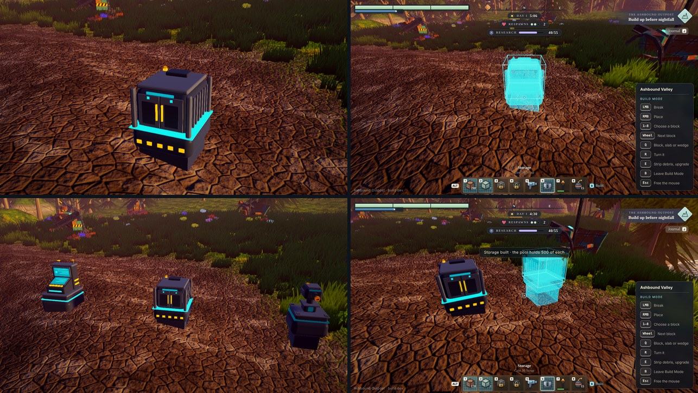

| Image                                                    | What to look at                                                                                                                                                                                                                                                                                   |
| -------------------------------------------------------- | ------------------------------------------------------------------------------------------------------------------------------------------------------------------------------------------------------------------------------------------------------------------------------------------------- |
| [storage-front](phase-5/storage-front.jpg)               | The Storage from the front at golden hour, on the ground it was built on. The steel is dark with warm edges, the door and its amber handles face the viewer, the cyan strip runs round the pad and the amber dashes along the front of it.                                                        |
| [storage-lineup](phase-5/storage-lineup.jpg)             | Three Storages at three facings: turned to the east (left, its door on the right side, the ribs and one end plain), facing the viewer (middle) and turned away (right, a plain back and ribs on both sides). The right one stands higher because the ground rises there and its foundation shows. |
| [storage-night](phase-5/storage-night.jpg)               | The front view at night. The steel is navy; what is seen is the cyan strip, the status strip and the lamps over the door, the amber handles and dashes, and the beacon.                                                                                                                           |
| [storage-base](phase-5/storage-base.jpg)                 | A Research Terminal, a Storage and a turret side by side, for size and for the family likeness: the same steel, cyan and amber. The turret's lights are low because no Generator stands ([Phase 5g2](#phase-5g2-the-power-node-and-power-for-turrets)).                                           |
| [storage-ghost](phase-5/storage-ghost.jpg)               | A player's view with the Camp points read: the ghost is the Storage in cyan with its outline, no ring, the slot lit and "Cost 30 Scrap" under it.                                                                                                                                                 |
| [storage-locked](phase-5/storage-locked.jpg)             | The same view with no points: the ghost is the warm red of a refusal, the slot is behind its padlock and the line says "Needs research · 0 of 40".                                                                                                                                                |
| [storage-hotbar](phase-5/storage-hotbar.jpg)             | The two views above with the hotbar and the line over it enlarged below each.                                                                                                                                                                                                                     |
| [storage-toast](phase-5/storage-toast.jpg)               | The view just after the first Storage is built: the message "Storage built · the pool holds 500 of each" over it, the Storage at the left and the ghost of a second at the right.                                                                                                                 |
| [storage-count](phase-5/storage-count.jpg)               | The hotbar's counts enlarged twice. Top: Scrap at 499 of 500, white. Bottom: at the ceiling, 500, amber. The Composite count (120) is white in both.                                                                                                                                              |
| [terminal-ladder-camp](phase-5/terminal-ladder-camp.jpg) | The Terminal's panel at 40 points. Left: read, with the Camp row open between Composite and Alloy. Right: the points earned and not yet read, with the amber "Not read yet".                                                                                                                      |
| [storage-overview](phase-5/storage-overview.jpg)         | Four of the pictures together: the Storage by day, its ghost, the Terminal, Storage and turret side by side, and the message after one is built.                                                                                                                                                  |

### Cost

A Storage is six meshes (steel, trim, amber, cyan lights, the status strip over the door and the beacon) and 1,608 triangles, built once and shared by every Storage. Counted like the tables above (Balanced, every pass, software GL), from the crash clearing looking at open ground, a frame is 97 draws and 776.7 thousand triangles with nothing built. One Storage in view takes it to 109 draws and 779.9 thousand triangles, two to 121 and 783.1 thousand and three to 133 and 786.3 thousand: each adds 12 draws and 3,216 triangles, because it is drawn twice, once in the main view and once in the shadow pass. With the three behind the camera the shadow pass still draws them, 18 more draws and 4.8 thousand triangles, 6 draws and 1,608 triangles each. A Storage is the Node's 12 draws, with a few more triangles (1,608 against 1,304) and a few fewer than the Generator's (1,704). It has no ring and takes no part in power, so nothing is swapped for it when the power changes; the amber count is a flag on a hotbar slot and the message is the toast that every row and every night already uses. The things to try first if a real machine needs the draws back are the ones the Terminal's notes name: letting the thin lit parts (the strips, the lamps and the beacon) skip the shadow pass, and drawing each kind of module as one instanced batch, which five kinds of module make more worth doing.

### Known gaps in the Storage

- **Twelve draws a Storage in view.** Six meshes, each drawn twice, as the Node's: a crew with a dozen Storages in view adds 144 draws to a frame that has 97 with nothing built ([Cost](#cost-9)). A Storage is worth 100 more of each material and a crew builds a few, not a field of them, which keeps this smaller than the turrets' ([5f1](#known-gaps-in-the-turret)).
- **The container does not show how full the pool is.** Its lights are always the same; the amber count on the hotbar is the only sign. A status strip that fills with the pool, or a door lamp that goes amber, is a Phase 6 polish.
- **One ceiling for every material.** A Storage raises all four by the same amount, so the count that turns amber first is the one the crew strips most; nothing shows which Storage holds what, because none does.
- **The messages are the HUD's.** The toast is shown with the pointer taken or not, and waits its turn behind the others of a dawn (three at most), so a crew that builds three Storages in one breath sees the last two.
- **Nothing marks the room coming or going.** The ceiling changes on the next step, with no flash and no sound; a click for the door and a hum belong to Phase 6.
- Seen only in software-rendered pictures. The cyan strips and the lamps, the amber dashes and handles (which the bloom and the tone mapper change) are judged there; how they read on a real display is for the first look on a real GPU.

## Phase 5h2: the Bed

The Bed is the sixth module and the second of the base's comforts: a steel cot drawn in code that stands in one cell, and the place the Core brings a fallen player back to. What is new to the eye is the cot itself and the way a player comes back to it. The hotbar slot, the line over it, the ghost and the outline are the Terminal's, the Generator's and the Storage's ([Phase 5d1](#phase-5d1-the-research-terminal), [Phase 5g1](#phase-5g1-the-generator), [Phase 5h1](#phase-5h1-the-storage)). The choices are in [decisions](decisions.md#phase-5h2-the-bed-2026-10-27).

### The Bed

- **Shape.** A cot lying along its cell, 0.72 of a cell wide, 0.94 long and 0.46 high to the top of its headboard and its beacon. A foundation block and a steel frame (0.72 by 0.94, 0.3 deep, its top edge at 0.1 of a cell above the floor) carry a mattress (0.64 by 0.86 and 0.14 thick) between a headboard at the head (0.32 high, a slim cyan strip across it) and a low footboard (0.14 high). A pillow lies at the head and an amber blanket across the foot, and a small amber beacon on the headboard blinks, the Terminal's blink. A cyan strip runs round the top edge of the frame and a short status strip along its long side, the side a player sees.
- **Steel and light.** The Terminal's, the Generator's, the Node's and the Storage's palette: dark blue-grey steel for the frame and the boards, lighter trim for the mattress and the pillow, cyan on what shows it is live (the strip round the frame, the strip on the headboard and the status strip) and amber on what is worked (the blanket and the beacon). The blanket is the one warm patch of any size on a module, so a Bed reads at a distance. The golden sun gives the steel warm edges and the night makes it navy; at night what is seen of a Bed is its cyan rim and strips, the blanket, and the beacon.
- **It faces the player.** Placing a Bed turns its long side, the one with the status strip, toward the player, so the cot lies across their view with the pillow at one end; R turns it a quarter turn at a time through four facings, and the ghost is the model in the same turn. The side it faces is where a player is put when the Core brings them back.
- **It stands in the ground.** The frame stands on a foundation block under it, with the Terminal's rule ([Phase 5d1](#phase-5d1-the-research-terminal)): where the cell floats over the ground the foundation is the plinth it stands on, where the ground reaches a little into the cell the foundation is buried, and where the ground would cover more than a quarter of the cell the cursor puts the Bed in the cell above.
- **A Bed that is aimed at** is outlined by its body box (0.72 by 0.46 by 0.94 of a cell), which is also what movement stands against. At 0.46 it is lower than the 0.6 a player steps up, so a player walks onto a Bed on level ground, and a player put on top of one (when it is walled in) stands on it, a cot's height above its cell's floor.
- **It never dims.** A Bed takes no part in power, so its lights burn as the Terminal's do, whatever stands near it.

### What the crew sees

- **The slot.** Module slot 6 (key 6, then Q five times from the Terminal) shows the Bed's icon on the cyan grid: a steel cot with a tall headboard that carries a small cyan lamp, a pale pillow, a bronze blanket across the foot and two bronze feet. Until a Research Terminal has read the 40 points of the Camp row the slot is dim behind a padlock, as the Storage's is, and the line over the hotbar says "Needs research · 0 of 40" (or "Needs a Research Terminal" when the points are earned and unread). With the row open it says "Bed" over "Cost 20 Scrap".
- **The ghost.** The Bed itself, in cyan where the host would take it and in the warm red of any refusal where not, with the outline of its body box. There is no ring: a Bed reaches nowhere.
- **Coming back.** Nothing is drawn for the rule. A player who is felled sees what they always did: the "You are down" panel with the Core's countdown. When the Core brings them back they are standing on the ground in front of the nearest Bed, shaken, with the message "The Core brought you back, shaken · 2 respawns left" at the top of the screen, and the other screens see the avatar jump there with "Ada is back, shaken · 2 respawns left". With no Bed standing, or none with room, it is the seat beside the spawn point, as before.
- **The ladder.** The Camp row now reads "40 points · Storage, Bed", open, waiting for a Terminal to read it, or shut, as the other rows are.

### Screenshots

Headless Chromium on software GL at 1280 by 720, Balanced, `freeze=1`, `?debug&waves=0&time=golden&stock=400`, with the Beds built through the page's debug hooks (`__ashbound.mp.place`: the host's own command path, after `mp.setResearch(40, true)` has the Terminal's reading in place) and the camera put where it can see them (`game.setPhoto`: 1.3 to 2.2 blocks above the Bed's middle and 2 to 5 out), the page's animation clock replaced by one that moves a set step a frame. The night pictures are the same views with the clock set to night (`stage.setMoment`). The first-person pictures are a player's own view: the Bed chosen in slot 6 in Build Mode with no points read (the ghost red, the padlock on the slot) and with the points read (the ghost cyan); a player felled eight blocks from a Bed they built and the Core bringing them back in front of it (a run played alone is paused by letting go of the pointer, because its clock keeps real time and a software-rendered frame takes seconds, and is moved on with `mp.warp`; the message's timer is held so that it stays up for the picture); and the Terminal's panel at 40 points, read and not yet read.

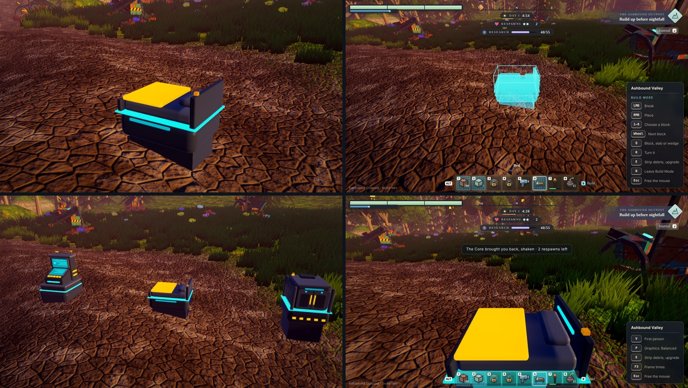

| Image                                        | What to look at                                                                                                                                                                                                                                                                                                      |
| -------------------------------------------- | -------------------------------------------------------------------------------------------------------------------------------------------------------------------------------------------------------------------------------------------------------------------------------------------------------------------- |
| [bed-front](phase-5/bed-front.jpg)           | The Bed from its long side at golden hour, on the ground it was built on. The steel is dark with warm edges, a cyan rim runs round the frame with a short status strip below it, the amber blanket lies across the foot of the mattress and the pillow at the head, and the beacon sits on the headboard.            |
| [bed-top](phase-5/bed-top.jpg)               | The Bed from above: the blanket and the pillow on the mattress between the footboard (left) and the headboard (right) with the cyan strip on it, all inside the rim, on the foundation block.                                                                                                                        |
| [bed-lineup](phase-5/bed-lineup.jpg)         | Three Beds at three facings: turned to the east (left: its foot toward the viewer, the pillow and the headboard's strip at the far end), facing the viewer (middle) and turned away (right: a plain back with no status strip). The right one stands higher because the ground rises there and its foundation shows. |
| [bed-scale](phase-5/bed-scale.jpg)           | A Bed beside a column of two Scrap blocks, for size: the cot is lower than half of one block, which is why a player walks up onto it.                                                                                                                                                                                |
| [bed-night](phase-5/bed-night.jpg)           | The front view at night. The steel is navy; what is seen is the cyan rim and the status strip, the blanket, and the beacon.                                                                                                                                                                                          |
| [bed-camp](phase-5/bed-camp.jpg)             | A Research Terminal, a Bed and a Storage side by side, for size and for the family likeness: the same steel, cyan and amber. The Bed is the lowest of the three and the one with the most amber.                                                                                                                     |
| [bed-camp-night](phase-5/bed-camp-night.jpg) | The same three at night.                                                                                                                                                                                                                                                                                             |
| [bed-ghost](phase-5/bed-ghost.jpg)           | A player's view with the Camp points read: the ghost is the Bed in cyan with its outline, no ring, the slot lit and "Cost 20 Scrap" under it.                                                                                                                                                                        |
| [bed-locked](phase-5/bed-locked.jpg)         | The same view with no points: the ghost is the warm red of a refusal, the slot is behind its padlock and the line says "Needs research · 0 of 40".                                                                                                                                                                   |
| [bed-hotbar](phase-5/bed-hotbar.jpg)         | The two views above with the hotbar and the line over it enlarged below each.                                                                                                                                                                                                                                        |
| [bed-down](phase-5/bed-down.jpg)             | A player felled in the grass about ten blocks from the Bed they built (the small dark cot at the far left): the "You are down" panel and the Core's countdown of 6, as in Phase 4g.                                                                                                                                  |
| [bed-returned](phase-5/bed-returned.jpg)     | The Core has brought the player back: they stand on the ground in front of the Bed they built, a step from it and looking down on it, shaken, with "The Core brought you back, shaken · 2 respawns left" at the top of the screen and the respawn pill at 2.                                                         |
| [bed-return](phase-5/bed-return.jpg)         | The two above side by side: where they fell, and where the Core put them.                                                                                                                                                                                                                                            |
| [bed-ladder](phase-5/bed-ladder.jpg)         | The Terminal's panel at 40 points. Left: read, with the Camp row open and reading "Storage, Bed". Right: the points earned and not yet read, with the amber "Not read yet".                                                                                                                                          |
| [bed-overview](phase-5/bed-overview.jpg)     | Four of the pictures together: the Bed by day, its ghost, the Terminal, Bed and Storage side by side, and a player the Core has just brought back.                                                                                                                                                                   |

### Cost

A Bed is six meshes (steel, trim, amber, cyan lights, the status strip along its side and the beacon) and 900 triangles, built once and shared by every Bed. Counted like the tables above (Balanced, every pass, software GL), from the crash clearing looking at open ground, a frame is 97 draws and 776.7 thousand triangles with nothing built. One Bed in view takes it to 109 draws and 778.5 thousand triangles, two to 121 and 780.3 thousand and three to 133 and 782.1 thousand: each adds 12 draws and 1,800 triangles, because it is drawn twice, once in the main view and once in the shadow pass. With the three behind the camera the shadow pass still draws them, 18 more draws and 2.7 thousand triangles, 6 draws and 900 triangles each. A Bed is the Node's and the Storage's 12 draws with fewer triangles (900 against the Node's 1,304 and the Storage's 1,608), the lightest module to draw. It has no ring and takes no part in power, so nothing is swapped for it when the power changes. The rule that puts a player back at it is a walk of the module list when the Core brings someone back, once and on the host, so it adds nothing to a frame. The things to try first if a real machine needs the draws back are the ones the Terminal's notes name: letting the thin lit parts (the strips and the beacon) skip the shadow pass, and drawing each kind of module as one instanced batch, which six kinds of module make more worth doing.

### Known gaps in the Bed

- **Twelve draws a Bed in view.** Six meshes, each drawn twice, as the Node's and the Storage's: a crew with a dozen Beds in view adds 144 draws to a frame that has 97 with nothing built ([Cost](#cost-10)). A crew builds a few, one at the base and one where it fights, not a field of them.
- **Nothing marks where a player will come back.** A Bed looks the same whether it is the nearest to anyone or not: there is no marker on it, no line on the compass, and the message does not say where. A crew learns it by being felled once. A waypoint for the Bed the Core would choose is Phase 6 polish.
- **A player does not get up.** They stand, shaken, in front of the Bed the moment the Core brings them back, as they stood at the seat; there is no rising from the cot, no fade and no sound, which belong to Phase 6.
- **The Bed cannot be used.** Aimed at, it is outlined and nothing more: there is no prompt, no click, no resting in it, no healing and no skipping the night.
- **Two players brought back at one Bed in the same step are put on one spot.** The movement rules push them apart, as they do for two seats that touch; nothing sets them side by side.
- Seen only in software-rendered pictures. The cyan strips, the amber blanket and the beacon (which the bloom and the tone mapper change) are judged there; how they read on a real display is for the first look on a real GPU.

## Phase 5h3a: the Light

The Light is the seventh module and the third that takes power: a floodlight on a mast, drawn in code, that stands in one cell. What is new to the eye is the lamp itself, a seventh look for its lens, and that it is the one module whose light neither beats nor blinks. What a Light throws on the ground and on what stands round it is the next part ([5h3b](#phase-5h3b-the-light-a-light-throws)): here the lens glows and the world is as it was. The hotbar slot, the line over it, the ghost, the outline and the tag are the Terminal's, the Generator's, the Node's and the Storage's ([Phase 5d1](#phase-5d1-the-research-terminal), [Phase 5g1](#phase-5g1-the-generator), [Phase 5g2](#phase-5g2-the-power-node-and-power-for-turrets), [Phase 5h1](#phase-5h1-the-storage)). The choices are in [decisions](decisions.md#phase-5h3a-the-light-2026-10-27).

### The Light

- **Shape.** A floodlight on a mast on a small steel pad, the slimmest of the modules: 0.5 of a cell across at the pad and 0.95 tall to the top of its head. A foundation block and a pad (0.5 across, 0.3 deep) carry a lower step, a plate of lighter steel and a collar (0.14 across) with a ring of amber round its top. A slender mast (0.056 across, 0.56 long) rises from the collar, with two small clamps on it and a cyan strip up its front. At the top, on a short bracket, the head leans about 14 degrees toward the ground in front of it: a shallow housing (0.34 by 0.34 and 0.15 deep, rounded) with a short visor over a lens in a frame. The lens, a pane 0.22 wide and 0.09 high on the front of the housing, is the lamp.
- **Steel and light.** The Terminal's palette: dark blue-grey steel for the pad, mast and housing, lighter trim for the plate, clamps and frame, cyan on what shows it is live (the strip round the pad's top edge and the strip up the mast) and amber on the ring. The lamp is a seventh look, `lamp`: a warm gold-white (`#ffc778`) at twice the base light, brighter than the cyan strips (1.4) and a little under the beacon's blink (2.2), which is enough for the bloom to take it. The golden sun gives the steel warm edges and the night makes it navy; at night what is seen of a Light is the lamp, the strips and the amber ring.
- **The lamp is steady.** The screens breathe, the strips beat slowly and the beacon blinks, all from the stage's clock; the lamp does none of it. A lamp that flickered would read as a fault, and a module that shows its power should not be doing something else with its light.
- **It faces the player.** Placing a Light turns its lens toward the player, so the pane is what they see; R turns it a quarter turn at a time through four facings, and the ghost is the model in the same turn. From behind it is the back of the housing on its bracket, with the mast's strip on the far side and nothing else. The lean is fixed: there is no aiming a Light up or down.
- **It stands in the ground.** The pad stands on a foundation block under it, with the Terminal's rule ([Phase 5d1](#phase-5d1-the-research-terminal)): where the cell floats over the ground the foundation is the plinth it stands on, where the ground reaches a little into the cell the foundation is buried, and where the ground would cover more than a quarter of the cell the cursor puts the Light in the cell above.
- **A Light that is aimed at** is outlined by its body box (0.5 by 0.95 by 0.5 of a cell: the footprint of the pad and the height of the mast), which is also what movement stands against. The visor reaches about 0.07 of a cell past the box on the side the lens faces.
- **It takes power and gives none.** A Generator within 6 blocks, or a Power Node that has power within 8, lights it ([Phase 5g1](#phase-5g1-the-generator), [Phase 5g2](#phase-5g2-the-power-node-and-power-for-turrets)); it carries nothing on, so it has no ring. Without power it keeps its shape and its plates and burns low: the lamp is a dull amber pane (0.08 of its light, held still), the strip a dull teal and the ring a brown, as in a Node or a turret that has none.

### What the crew sees

- **The slot.** Module slot 6 (key 6, then Q six times from the Terminal) shows the Light's icon on the cyan grid: a steel mast on a dark pad with two bronze bands, a domed hood over a sun-coloured lens and four short golden rays falling from it. Until a Research Terminal has read the 40 points of the Camp row the slot is dim behind a padlock, as the Storage's and the Bed's are, and the line over the hotbar says "Needs research · 0 of 40" (or "Needs a Research Terminal" when the points are earned and unread). With the row open it says "Light" over "Cost 10 Scrap".
- **The ghost.** The Light itself, in cyan where the host would take it and in the warm red of any refusal where not, with the outline of its body box. There is no ring: a Light reaches nowhere.
- **Lights.** A Light with power has a steady pale-gold lens and cyan strips that beat as the Terminal's do. One without has a dull amber pane and low strips; at night the pane is the darkest thing on it. Which Lights have power is worked out on every screen from the world's own blocks, so when a Generator is broken the Lights it fed go down together on every screen.
- **The tag.** In Build Mode, with the cursor on a Light, the tag under the crosshair says which: a cyan dot with "Powered" and "Burns bright", or a grey dot with "No power" and "Burns low · a Generator or Node in reach lights it". The cursor reaches 8 blocks, so a base can be read from a little way off.
- **The ladder.** The Camp row of the Terminal's ladder now reads "40 points · Storage, Bed, Light", open, waiting for a Terminal to read it, or shut, as the other rows are. Where the row is narrow (the amber "Not read yet" takes more room than "Open") the words wrap after the second comma and "Light" stands alone on the second line.

### Screenshots

Headless Chromium on software GL at 1280 by 720, Balanced, `freeze=1`, `?debug&waves=0&time=golden&stock=400`, with the Lights built through the page's debug hooks (`__ashbound.mp.place`: the host's own command path) and the camera put where it can see them (`game.setPhoto`: 0.7 to 2.2 blocks above the Light's middle and 1.9 to 4.2 out, the camp from 9), the page's animation clock replaced by one that moves a set step a frame. The pair of a Light with power and without is the same view taken twice, the second after the Generator is broken (`mp.breakBlock`), so the only change between the two is the power. The night pictures are the same views with the clock set to night (`stage.setMoment`). The first-person pictures are a player's own view with Build Mode on: the Light chosen in slot 6 with no points read (the ghost red, the padlock on the slot) and with the points read (the ghost cyan), the cursor on a Light with nothing near it and with a Generator standing five blocks from it, and the Terminal's panel at 40 points, read and not yet read.

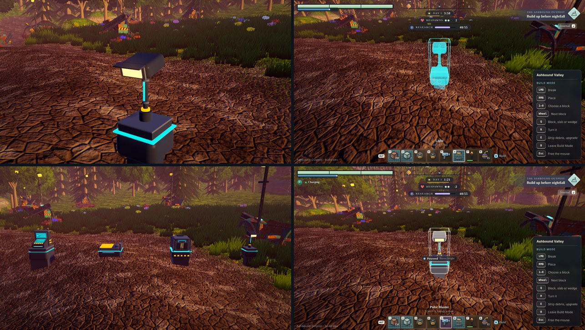

| Image                                                  | What to look at                                                                                                                                                                                                                                                                                       |
| ------------------------------------------------------ | ----------------------------------------------------------------------------------------------------------------------------------------------------------------------------------------------------------------------------------------------------------------------------------------------------- |
| [light-front](phase-5/light-front.jpg)                 | The Light from the front at golden hour, on the gravel path, with a Generator out of frame giving it power: the lens a pale gold in its frame under the visor, the head leaning toward the ground, the cyan strip up the mast, the amber ring on the collar and the cyan rim round the pad.           |
| [light-lineup](phase-5/light-lineup.jpg)               | Three Lights at three facings: turned to the east (left: the lens on the right, the visor in profile), toward the camera (middle) and away (right: a plain back to the housing). The right one's foundation goes deeper into the ground, where its cell floats over a dip.                            |
| [light-top](phase-5/light-top.jpg)                     | The Light from above: the housing on its bracket, the ring and the collar on the stepped pad, and the cyan rim all round the pad's top edge.                                                                                                                                                          |
| [light-scale](phase-5/light-scale.jpg)                 | A Light beside a column of two Scrap blocks, for size: the head sits level with the top of the first block and the pad is about half a block across.                                                                                                                                                  |
| [light-powered](phase-5/light-powered.jpg)             | The same Light twice, by day. Left: with a Generator in reach, the lens a pale gold and the strip and rim bright cyan. Right: after the Generator is broken, the lens a dull amber pane and the strip and rim a dull teal; the shape, the plates and the ring are as they were.                       |
| [light-night](phase-5/light-night.jpg)                 | The front view at night. The steel is navy and what is seen is the lamp, a warm white pane, the cyan strip up the mast and the rim round the pad, and the amber ring.                                                                                                                                 |
| [light-powered-night](phase-5/light-powered-night.jpg) | The same pair at night. The lamp is the biggest difference between them: a bright pane on the left, a brown one on the right. The strips go from bright cyan to a dull teal.                                                                                                                          |
| [light-camp](phase-5/light-camp.jpg)                   | A Research Terminal, a Bed, a Storage and a Light side by side, for size and for the family likeness: the same steel, cyan and amber. The Light is the slimmest of the four and the only one with a pane of white-gold in it.                                                                         |
| [light-camp-night](phase-5/light-camp-night.jpg)       | The same four at night. The Light's lamp is the brightest point of the row after the Terminal's screen.                                                                                                                                                                                               |
| [light-ghost](phase-5/light-ghost.jpg)                 | A player's view with the Camp points read: the ghost is the Light in cyan with its outline, no ring, slot 6 chosen with the Light's icon and "Cost 10 Scrap" under the name.                                                                                                                          |
| [light-locked](phase-5/light-locked.jpg)               | The same view with no points: the ghost is the warm red of a refusal, the slot is behind its padlock and the line says "Needs research · 0 of 40".                                                                                                                                                    |
| [light-hotbar](phase-5/light-hotbar.jpg)               | The two views above with the hotbar and the line over it enlarged below each.                                                                                                                                                                                                                         |
| [light-tag](phase-5/light-tag.jpg)                     | The tag under the crosshair for a Light the cursor is on, with the white outline of its body box. Left: nothing near it has power ("No power", "Burns low · a Generator or Node in reach lights it"), the lens a brown pane. Right: a Generator stands within six blocks ("Powered", "Burns bright"). |
| [light-ladder](phase-5/light-ladder.jpg)               | The Terminal's panel at 40 points. Left: read, with the Camp row open and reading "Storage, Bed, Light". Right: the points earned and not yet read, with the amber "Not read yet" and the words wrapping after the comma.                                                                             |
| [light-overview](phase-5/light-overview.jpg)           | Four of the pictures together: the Light by day, its ghost, the four camp modules in a row, and the tag under the crosshair for a Light with power.                                                                                                                                                   |

### Cost

A Light is five meshes (steel, trim, amber, cyan lights and the lamp) and 800 triangles, built once and shared by every Light. Counted like the tables above (Balanced, every pass, software GL), from the crash clearing looking at open ground, a frame is 97 draws and 776.7 thousand triangles with nothing built. One Light in view takes it to 107 draws and 778.3 thousand triangles, two to 117 and 779.9 thousand and three to 127 and 781.5 thousand: each adds 10 draws and 1,600 triangles, because it is drawn twice, once in the main view and once in the shadow pass. With the three behind the camera the shadow pass still draws them, 15 more draws and 2.4 thousand triangles, 5 draws and 800 triangles each. A Light is the lightest module to draw by both counts (the Bed's 12 draws and 1,800 triangles are the next lowest). It has no ring and carries no power on, so nothing else is drawn for it. A module without power costs no more than one with it: its glowing looks are swapped for dim copies made the first time one is needed, now up to five more materials for each paint (the lamp's is the fifth), shared by every module of that paint, and every paint makes a lamp material whether or not a Light stands. The things to try first if a real machine needs the draws back are the ones the Terminal's notes name: letting the thin lit parts skip the shadow pass, and drawing each kind of module as one instanced batch. A Light is the module a crew is likeliest to build in dozens (it is the cheapest of all), so it is where instancing would pay first.

### Known gaps in the Light

- **It lit nothing in this part.** The lamp glowed and the ground, the blocks and the machines round it were as they were, by day and by night, so a Light was not worth its 10 Scrap until the next part ([Phase 5h3b](#phase-5h3b-the-light-a-light-throws)), which throws the light it burns. That was deliberate: this part is the module, and the light it throws, which touches every lit material, is reviewed on its own.
- **Ten draws a Light in view.** Five meshes, each drawn twice: a crew with a dozen Lights in view adds 120 draws to a frame that has 97 with nothing built ([Cost](#cost-11)). The Light is the module a crew will build the most of, so it is the first one the notes above would act on.
- **Dim, not out.** Without power the lamp is a dull amber pane, not dark: it reads as a lamp at rest, and by day the difference between a lit Light and an unlit one is the lens alone (the strips are small at a distance). The tag settles a close call, and `DIM_GLOW` is the one number that sets the level ([Phase 5g2](#known-gaps-in-the-node-and-the-lights)).
- **The lamp is not animated.** It does not flicker, warm up or come on over a moment: the lens changes on the next frame after the power does, with no sound, like the Node's and the turret's lights.
- **The lean is fixed.** The head leans 14 degrees toward the ground and turns only with the whole Light by R; a Light cannot be aimed at a particular spot.
- **The visor leaves its box.** The body box is the pad's footprint, so the visor reaches about 0.07 of a cell past it on the lens side and a player standing against the box can have the visor in them. Nothing is blocked by it and nothing is lost; it is only seen.
- Seen only in software-rendered pictures. The lamp, the cyan strips and the amber ring (which the bloom and the tone mapper change) are judged there; how they read on a real display is for the first look on a real GPU.

## Phase 5h3b: the light a Light throws

A Light with power throws light. By night a warm cone falls from its lens on the ground, the blocks, the modules, the grass and trees, the machines and the fragments of a broken block in front of it, in the colour of the lens, so the glow on the mast and the pool on the ground are one light; by day it is a tenth of itself, a faint warmth. It is drawn by the shaders every lit thing already has, with no mesh, pass or draw call of its own, and it is a look and not a rule: nothing in the game reads it. The model, the slot, the ghost and the tag are 5h3a's ([Phase 5h3a](#phase-5h3a-the-light)). The choices are in [decisions](decisions.md#phase-5h3b-the-light-a-light-throws-2026-10-27).

### The light

- **A cone from the lens.** The light leaves a few hundredths of a block in front of the middle of the lens and is aimed along its face, 14 degrees below level (the lean of the head), from about three quarters of a block above the cell's floor. Inside 43 degrees of that axis it is at full strength, and it fades over the next 20 degrees to a tenth of that, the spill, which is what lights the ground behind and beside a Light a little. On level ground the pool starts about half a block in front of the mast, is brightest two to four blocks out and has faded by eight to ten.
- **How bright.** The lamp's own colour, `#ffc778`, at a brightness of 7 at the lens, half of that 2.6 blocks out (the falloff is the plain inverse square with a soft core) and nothing past 15 blocks, ending smoothly from 8. The first guess, 9, burned the crates out (the brightness pictures below); 7 keeps the wall's tiles readable and still lights a pool that shows the cracks of the ground.
- **What a surface does with it.** Diffuse light with a half-wrap: a surface square to the lamp takes all of it, one at right angles a third and one facing more than 120 degrees away none, so a pool on flat ground reads as a pool and the back of a crate stays dark. It is the surface's own colour times the light, before the haze, so the lake's mist and the fog still lie over it, and in the terrain and the blocks the ambient occlusion that darkens a corner darkens the lamp's light in it by half as much.
- **By day.** The lamp's strength is a tenth of itself plus nine tenths of how dark the sky is (0 until the sun is within 2 degrees of the horizon, 1 once it is 14 below), so by day a Light is a faint warm patch on the ground in front of it and the sun is not fought.
- **Many Lights.** Pools add: three Lights in a row make one wash. The shaders take the nearest few lamps to the camera, 2 on Low, 6 on Balanced and 8 on Ultra, so the count in view is bounded however many a crew builds.

### What the crew sees

- **The Generator comes first.** A Light's pool comes up in the same frame as its lens when a Generator stands within reach, and goes out in the frame the Generator is broken, on every screen: the lens and the light are one thing, worked out from the same list of modules.
- **The Light does not light itself.** The mast, the pad and the housing are behind the lens and in the spill, so they stay dark navy and the lens reads as the source. The light falls on what is in front.
- **Everything lit takes it.** The ground, Scrap blocks and the other modules, the grass and the trees (a trunk goes the warm orange of its own bark, the tips of the grass a yellow-green), the machines and the fragments of a broken block (the same line is in their shader and draws without error, but the fragments are too small and quick to show in a still, so no picture of them is offered). The water, the distant hills and the intro film do not.
- **No shadows.** The light goes through what is in the way: the ground behind a wall of blocks is lit as though the wall were not there.

### Screenshots

Headless Chromium on software GL at 1280 by 720, Balanced, `freeze=1`, `?debug&waves=0&stock=400&time=night`, with the Lights, Generators and blocks built through the page's debug hooks (`__ashbound.mp.place`: the host's own command path) and the camera put where it can see them (`game.setPhoto`), the page's animation clock replaced by one that moves a set step a frame. Each pair is the same view taken twice, the second after the Generator is broken (`mp.breakBlock`), so the only change is the power. The machines are three crawlers stood where the picture needs them (`mp.spawnCrawlerAt`). The pictures of brightness are the same wall view with the lamps' colour multiplied live (0.5, 0.7, 1 and 1.4 of the first guess of 9). The day pair is the front view at golden hour with the lamp as it is and with its light turned off.

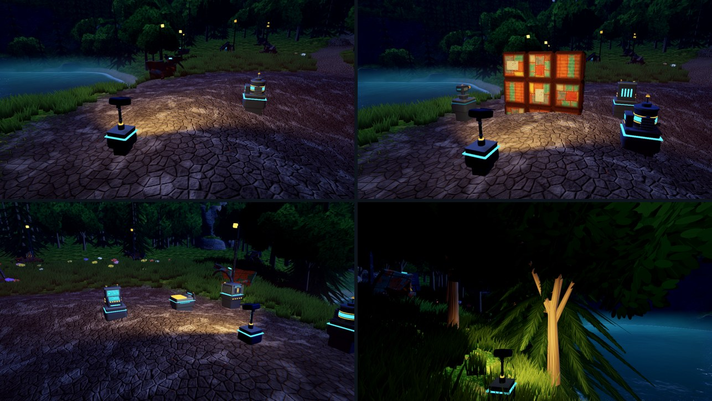

| Image                                          | What to look at                                                                                                                                                                                                                                                                                                                                                     |
| ---------------------------------------------- | ------------------------------------------------------------------------------------------------------------------------------------------------------------------------------------------------------------------------------------------------------------------------------------------------------------------------------------------------------------------- |
| [lamp-front](phase-5/lamp-front.jpg)           | A Light at night from behind and to one side, on the cracked ground of the crash clearing, with a Generator beyond it: a pool of warm light falls in front of the lens, brightest a few blocks out and gone by eight or ten, the cracks of the ground lit from the side. The Light's own pad and mast stay dark navy, and the lens is the one bright thing on them. |
| [lamp-powered](phase-5/lamp-powered.jpg)       | The same view twice. Left: with the Generator. Right: after it is broken, with no pool, the ground back to the cool navy of the night and the lens a dull amber pane.                                                                                                                                                                                               |
| [lamp-face](phase-5/lamp-face.jpg)             | The same Light from the front and to one side, looking back along its beam: the fan of light on the ground widens toward the camera, with a clear edge where the cone ends (left) and a softer one against the grass (right).                                                                                                                                       |
| [lamp-top](phase-5/lamp-top.jpg)               | From straight above: the Light at the top of the picture, the cone opening away from it and fading toward the bottom, the spill faintly lighting the ground behind and beside it. The Generator is the small square at the left of the fan. The grass at the right, outside the cone, stays dark.                                                                   |
| [lamp-wall](phase-5/lamp-wall.jpg)             | A wall of six Scrap blocks, a turret, a Terminal and a Generator, in front of a Light. Left: the faces of the wall take the light square on and show their tiles in orange, cream and green, and the ground in front of it is lit. Right: the Generator broken, and the wall is nearly black.                                                                       |
| [lamp-camp](phase-5/lamp-camp.jpg)             | A Terminal, a Bed and a Storage in a row, four blocks in front of a Light that looks toward them. Left: the Bed, nearest the axis of the beam, takes the most, and the Terminal and Storage a warm edge, because the steel is dark and takes the lamp as an edge rather than a wash. Right: the Generator broken.                                                   |
| [lamp-row](phase-5/lamp-row.jpg)               | Three Lights in a row, four blocks apart, powered by one Generator behind the middle one: their pools add into one wash from wall to wall, and the grass at the right takes the light as a yellow-green on its tips.                                                                                                                                                |
| [lamp-forest](phase-5/lamp-forest.jpg)         | A Light at the foot of a tree at the lake's edge, looking east. Left: the trunk goes the warm orange of its own bark, the grass at its foot a yellow-green and the fronds a deeper green. Right: the Generator broken, and it is black but for the lake.                                                                                                            |
| [lamp-machines](phase-5/lamp-machines.jpg)     | Three crawlers stood in the pool: the one in the middle takes the light on its back and legs, in a warm grey, and the two beyond it a little less. The gold of their lights is their own.                                                                                                                                                                           |
| [lamp-day](phase-5/lamp-day.jpg)               | The front view at golden hour. Left: the lamp as it is, a faint warm patch on the ground in front of the Light. Right: with its light turned off. By day the difference is the lens and a patch you have to look for, which is meant.                                                                                                                               |
| [lamp-brightness](phase-5/lamp-brightness.jpg) | The wall view at four brightnesses, left to right and top to bottom: 4.5, 6.3, 9 (the first guess) and 12.6. At 4.5 the pool is dim, at 9 the crates are bright orange and the ground near the lens is close to white, and at 12.6 the tiles of the blocks have flattened. 7 was chosen.                                                                            |
| [lamp-overview](phase-5/lamp-overview.jpg)     | Four of the pictures together: the pool on the ground, the wall, the camp and the tree at the lake.                                                                                                                                                                                                                                                                 |

### Cost

The lamps add no mesh, pass or draw call. Counted as in the tables above (Balanced, every pass, software GL, at night, from the crash clearing looking at open ground), a frame with ten modules in view, eight of them Lights, all burning, is 184 draws and 798.0 thousand triangles, against 97 and 776.7 thousand with nothing built, and it is the same 184 and 798.0 thousand with the lamp limit at 0, 1, 2, 6 and 8: nothing is drawn for a lamp. What they add is in the shaders. Every lit fragment loops over the lamps in use (the loop ends at once when none burn, and a lamp past 15 blocks costs one distance test), so the work grows with the lamps in view and the pixels they reach. Software GL runs the shaders on the CPU and a frame takes seconds, so it can only say whether the work is large: alternating no lamps and all eight so that the machine's drift touched both alike, eight rounds of six frames at 640 by 360, a frame took 2.72 seconds with eight lamps against 2.63 with none (standard deviations 0.08 and 0.06), about 3 percent more, and at 1280 by 720 the frame times (4.7 to 5.3 seconds) did not order by the number of lamps at all. What a GPU feels is unmeasured: the owner's `?bench=1` on a real machine is the number to trust. If the lamps cost too much there, the knobs are the preset's lamp count (2, 6 and 8), the range (15 blocks), and skipping the loop for fragments farther than every lamp's range with one test against a sphere round the lamps.

### Known gaps in the lamp light

- **No shadows.** The light goes through blocks, walls and trees: the ground and what stands behind a wall of blocks takes it as though the wall were not there, and a Light behind a wall lights the room on the other side. A shadow per lamp would be a shadow map or a distance field each, which is the cost the lamps are made not to have; the sun's shadow is the world's only one.
- **Eight lamps at most, the nearest to the camera.** A base with a dozen Lights in view lights its nearest few (2, 6 or 8 by preset) and the rest are lens only until the camera comes nearer. Which lamps are nearest changes as the camera moves, so at the edge of the count a pool can switch on or off as the camera passes; at a few Lights it is never seen.
- **Diffuse only.** The lamp adds no highlight: the sun's shine on steel and gloss is unchanged, so the metal of a module takes the lamp as a flat warm tint.
- **Not everything takes it.** The lake, the backdrop of far hills and the intro film have shaders of their own and are not lit by lamps; a Light by the water does not light it.
- **No coming on.** The pool is on in the frame the power is, with no ramp or flicker and no sound, like the lens.
- **One colour and one size.** Every Light throws the same warm cone; nothing tints or widens it.
- **Nothing reads it.** The machines are neither drawn to a lit patch nor shy of it, and a player in the dark is not any worse off: it is what the base looks like, and the question of whether it should matter is for a later part.
- **A tenth by day.** The faint warmth at golden hour is deliberate (a floodlight does not fight the sun) and is one number, `day` in `LAMP_LIGHT`.
- **Brightness is a guess by eye.** 7 was chosen in software-rendered pictures, with a tone mapper and bloom that differ from a real display's, so its look on a real GPU and monitor is for the first run there to judge; it is one number in one table.
- Seen only in software-rendered pictures: the pictures are correct but there is no frame rate from them, and the cost of the lamp loop on a real GPU is unmeasured.

## Phase 5i1: the armored crawler

The first special machine is the crawler built heavier: a bigger hull under plates of rust-brown steel, with amber ribs across its back and hotter amber at the knees, so that in a wave at dusk it can be told from the pack by its shape before it is told by what it does. It is drawn from code like the crawler, in the crawler's palette made darker and warmer (no assets, so `CREDITS.md` is unchanged). Felled, it leaves Tier 4 cells in the pool, and the crew is told so in a message. The choices are in [decisions](decisions.md#phase-5i1-the-armored-crawler-and-the-cells-it-leaves-2026-10-27).

### The armored crawler

- **Shape.** The crawler's build bulked out. The hull is deeper and wider (0.78 blocks across and 0.38 deep, against 0.64 and 0.3) under two decks of plate with three amber ribs across the top, where the crawler has one plate and a thin spine. A plate runs down each flank over a skirt of steel, there is a plate over the engine behind and a brow plate over the head with a ram plate under it, the eye is a strip with a small lamp each side of it, the jaws are heavier, and the six legs are thicker, with amber knees. It is drawn 1.2 times its model, so it stands about a block high and spreads to 2.2 blocks across the legs, against the crawler's 0.7 and 1.7: the one machine in a wave that is the size of a player.
- **Steel and lights.** Its shell is a darker steel than the crawler's (`#1f252c` against `#262d35`) and its plate is a rust brown (`#5b4838`, where the crawler's is a blue-grey), so at golden hour the plates read orange-brown against the crawlers' grey and at night they go nearly black. The amber is brighter and glows more (0.9 against 0.7) and the eye is hotter (3.2 against 2.6), so what is left of it at night is the amber: three ribs across its back, the knees and the eye strip, larger and brighter than a crawler's.
- **Movement.** It walks 2 blocks a second against the crawler's 2.6, so the crawlers of its wave reach the base first and it arrives behind them. The legs swing in the same two tripods with a shorter stride for the ground covered (4 radians of gait to a block against 5) and full swing at a slower walk (1.3 blocks a second against 1.6), which makes a slow, heavy step. It climbs out of the ground in 0.6 seconds, lunges to bite and chews through walls as a crawler does, and a hit lights it white-hot as it does a crawler.
- **When it falls.** The same burst as any machine, then a message at the top of the screen, "A machine left 3 Energy-Infused in the pool", and the pool holds three more of Tier 4. While the 100-point row of the ladder is shut the hotbar's Tier 4 slot is padlocked and shows no count, so the message is the only sign of the cells until it opens.
- **How long it takes.** Thirteen blaster shots on the first night against a crawler's three, and fourteen against four on the fourth night, when the night's extra health is on it: 60 percent of every hit gets through, and nothing in the picture shows the rest being turned, so a crew learns the plating from how many shots it takes.
- **Cost.** A second instanced mesh, of 1,032 triangles a machine against the crawler's 720, drawn once in each of the three passes that draw it, as the heaps are in [Phase 5a](#phase-5a-salvage) (a module is drawn in two). A kind's mesh is drawn only while there is a machine of that kind, so a night of crawlers alone costs what it did and a night with both adds three draws. Counted like the tables above (Balanced, every pass, software GL), from beside the road looking out over the forest with the run held, a frame is 117 draws and 844.0 thousand triangles with no machine. One crawler takes it to 120 and 846.2 thousand, one armored crawler to 120 and 847.1 thousand and one of each to 123 and 849.3 thousand. The machines are not culled (one bounding sphere would have to cover the valley), so a field costs the same wherever the camera looks: 100 crawlers are 120 draws and 1,060.0 thousand triangles, 100 armored crawlers 120 and 1,153.6 thousand and 80 crawlers with 20 armored 123 and 1,078.7 thousand, which is 216, 310 and 235 thousand triangles more than the empty frame, or 26, 37 and 28 percent. The waves never send that many armored crawlers (the plan has one on night 4, two on night 7 and three on night 10), so what one costs in practice is 3,096 triangles, 0.4 percent of the frame. The crawler's own count in [Phase 4d](#phase-4d-the-crawler) took two passes for it; it is three, and that text is corrected. Nothing here is measured on a real GPU.

### Screenshots

Headless Chromium on software GL at 1280 by 720, Balanced, `freeze=1`, `?debug&waves=0`, with the machines put where they stand by `__ashbound.mp.spawnCrawlerAt(x, z, kind)` while the run is held (the page never takes the pointer), so each picture is exact. A machine climbs out of the ground over 0.6 seconds of the page's own clock, which a still stops, so the clock is run for a few frames before the picture is taken. The first four pictures hold the camera off the player with `game.setPhoto` and have the HUD hidden. The last two are the player's own view with the HUD on, the blaster fired with `mp.fireAtMachine()` and the host's clock played between shots with `mp.warp`. The pack is walked in hops of the host's clock and photographed on the first frame after the last, with the legs mid-stride.

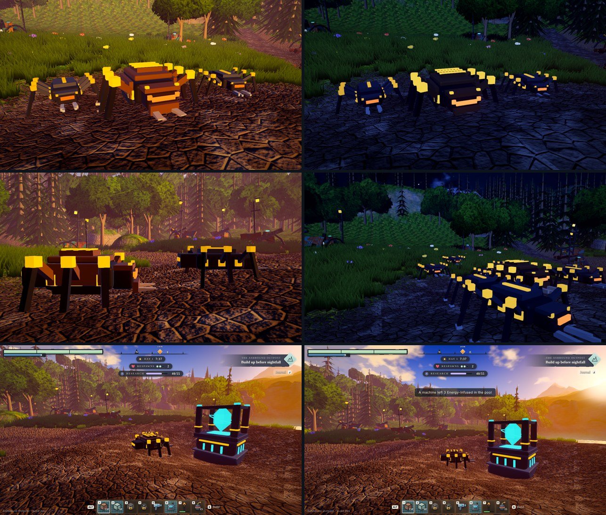

| Image                                            | What to look at                                                                                                                                                                                                                                                         |
| ------------------------------------------------ | ----------------------------------------------------------------------------------------------------------------------------------------------------------------------------------------------------------------------------------------------------------------------- |
| [armored-closeup](phase-5/armored-closeup.jpg)   | An armored crawler between two crawlers at golden hour, a few steps off and facing the camera: it is bigger and much bulkier, the plates read orange-brown against the crawlers' grey-blue, and the amber is the brightest thing on it.                                 |
| [armored-night](phase-5/armored-night.jpg)       | The same three at night: the plates are nearly black, and what is left of the armored crawler is its ribs, its knees and the strip of its eye, all larger than a crawler's.                                                                                             |
| [armored-side](phase-5/armored-side.jpg)         | The two in profile at golden hour, the armored crawler on the left, deeper in the hull with plate over the flank and the head, and a crawler on the right, about two thirds as high.                                                                                    |
| [armored-march](phase-5/armored-march.jpg)       | Eight on the road to the Core at night, seven crawlers and an armored one among them, the legs mid-stride. A crawler nearer the camera hides part of the armored one, and farther off what tells them apart is the size and the three amber ribs.                       |
| [armored-shots](phase-5/armored-shots.jpg)       | First person, twelve blaster shots in: the armored crawler is seven blocks off and still coming, with about 3 of its 75 points left, where a crawler would have been gone at the third shot. Nothing on the screen says so, because a machine has no health bar.        |
| [armored-felled](phase-5/armored-felled.jpg)     | The thirteenth shot: the message "A machine left 3 Energy-Infused in the pool", and in the hotbar the Tier 4 slot (the fourth) still behind its padlock with no count, because the 100-point row is shut. The second armored crawler of the scene walks on to the Core. |
| [armored-overview](phase-5/armored-overview.jpg) | The six together.                                                                                                                                                                                                                                                       |

### Known gaps in the armored crawler

- **The plating shows nothing.** A hit that the plates turn lights the machine white-hot exactly as a crawler's does, with no spark, glint or sound to say that most of it was turned, so a crew learns the plating from how many shots it takes. A deflect spark is the first thing to add; the sound is Phase 6.
- **No health bar.** The only sign of how an armored crawler is doing is the flicker of its lights as its health fails. With thirteen shots to a kill that is a long time to go on without a sign, and a small bar over a hurt machine is the thing to try if play shows it matters.
- **The cells are behind a padlock.** While the 100-point row is shut the hotbar's Tier 4 slot shows a padlock and no count, so the message is the only sign of the cells and it is gone in a moment. Whether the slot should show what is in the pool while it is locked is for the first play to say.
- **The colour is judged in software.** The plates read orange-brown at golden hour (a rust was meant) and the amber knees read a pure yellow, louder than the crawler's. At night the plates go nearly black, so the form of the plating is lost and only the amber is seen. How the glow sits with the bloom of a real display is for the first look on a real GPU.
- **One message for each kill.** A night with several armored crawlers, felled quickly, may make this loud.
- **The body stays level on a slope**, as the crawler's does, so the feet of the larger machine can sink into a steep slope or hover over it by a few tenths of a block.
- **The breacher** has a body of its own since [Phase 5i3](#phase-5i3-the-breacher), as the flying skimmer has since [Phase 5i2](#phase-5i2-the-flying-skimmer).
- Seen only in software-rendered pictures, which have no frame rate: the cost of the second mesh on a real GPU is unmeasured, and a full field of armored crawlers is the number to watch.

## Phase 5i2: the flying skimmer

The second special machine is the first that does not walk: a drone of blue-grey steel that hangs 2.6 blocks over the ground on four spinning rotors, comes straight at the crew over water, walls and cliffs, and zaps from above. It is drawn from code like the others, in a cooler palette than the walkers' so that it reads against the sky as they read against the ground (no assets, so `CREDITS.md` is unchanged). Felled, it leaves Energy-Infused cells in the pool and the crew is told, as for the armored crawler. The choices are in [decisions](decisions.md#phase-5i2-the-flying-skimmer-2026-10-27).

### The skimmer

- **Shape.** A flat hull 0.64 blocks across and 0.86 long, with a deck of plate and an amber spine along the top, a nose with a red eye strip across its face, a fin behind and an amber strip down each flank. Four pods on short arms carry the rotors, each a pair of crossed blades that never stops (34 radians a second, about a tenth of a turn from one frame to the next at 60 a second, so they flicker rather than blur, and a still shows them wherever they were), the two on a diagonal turning the same way and the crosses set a little apart so that the four do not flash in step. Under the belly is the emitter: a lens in a bezel of plate. It is drawn 1.25 times its model, so it is 1.5 blocks long, 1.8 across the rotors and half a block tall, and it hangs 2.6 blocks over what is under it, which puts its belly just over the head of a player standing below it (1.8 blocks).
- **Steel and lights.** The shell is a cooler, bluer steel than the walkers' (`#2b3644`) with a lighter plate on its deck (`#53657a`), the amber is the crawler's yellowed a little further (`#b97b22`, glowing at 0.8 against the crawler's 0.7), the eye is the same red as theirs, and the blades are a pale steel (`#b9c3cf`). At night the hull is nearly black and what is left of the skimmer is its amber strips, the orange of the eye, the hubs of the rotors and the lens under the belly.
- **Movement.** It leans into a flight as far as its speed takes it (0.3 radians at full speed), bobs by a few hundredths of a block on a beat of two seconds and dips its nose by up to 0.35 radians to zap, all of it in the vertex shader from the machine's speed and phase, so a hundred of them are still one draw. The rotors turn at one rate however fast it flies, and a hover is not a stop: the height eases as it passes over the rises of the ground and over a wall of the crew's.
- **The zap.** In the 0.4 seconds before it, the lens glows nearly seven times brighter than it does at rest and a thin beam grows out of it toward the ground (2.4 blocks long at its fullest, so over level ground its tip stops a little short of the grass), to be gone again when the zap lands. The beam hangs straight down whatever the zap is aimed at: it is the sign that a skimmer has begun, not a line to the player.
- **When it falls.** The same burst as any machine, then a message at the top of the screen, "A machine left 2 Energy-Infused in the pool", and the pool holds two more of Tier 4. Two blaster shots on the first night against a crawler's three: it takes every point of a hit, and has twenty points to a crawler's thirty.
- **Cost.** A third instanced mesh, of 1,248 triangles a machine against the crawler's 720 and the armored crawler's 1,032, drawn once in each of the three passes that draw it (a module is drawn in two). A kind's mesh is drawn only while there is a machine of that kind, so a night without skimmers costs what it did, and a night with all three kinds adds nine draws. Counted like the tables above (Balanced, every pass, software GL), from beside the road looking out over the forest with the run held, a frame is 117 draws and 844.0 thousand triangles with no machine. One skimmer takes it to 120 and 847.7 thousand, and one machine of each kind to 126 and 853.0 thousand. The machines are not culled (one bounding sphere would have to cover the valley), so a field costs the same wherever the camera looks: 100 skimmers are 120 draws and 1,218.4 thousand triangles, which is 374 thousand more than the empty frame, or 44 percent, and 70 crawlers with 15 armored crawlers and 15 skimmers are 126 and 1,097.8 thousand, 254 thousand more, or 30 percent. The waves never send that many skimmers (the plan has one on night 5, two on night 9 and three on night 13), so what one costs in practice is 3,744 triangles, 0.4 percent of the frame. Nothing here is measured on a real GPU.

### Screenshots

Headless Chromium on software GL at 1280 by 720, Balanced, `freeze=1`, `?debug&waves=0`, with the machines put where they stand by `__ashbound.mp.spawnCrawlerAt(x, z, kind)` while the run is held, so each picture is exact. A machine rises into being over 0.6 seconds of the page's own clock, which a still stops, so the clock is run for a few frames before the picture is taken. The first six pictures hold the camera off the player with `game.setPhoto` and have the HUD hidden. The flight over the wall is three frames of one flight: the wall is put up with `mp.place`, the skimmer is walked along it in hops of the host's clock and each frame is the first after a hop, with the rotors mid-turn. For the charge the page takes the pointer for a few frames and lets it go again, because a held run does not look at the player and a machine would not know they were there, and the host's clock is played a fifth of a second into the wind-up. The last two are the player's own view with the HUD on.

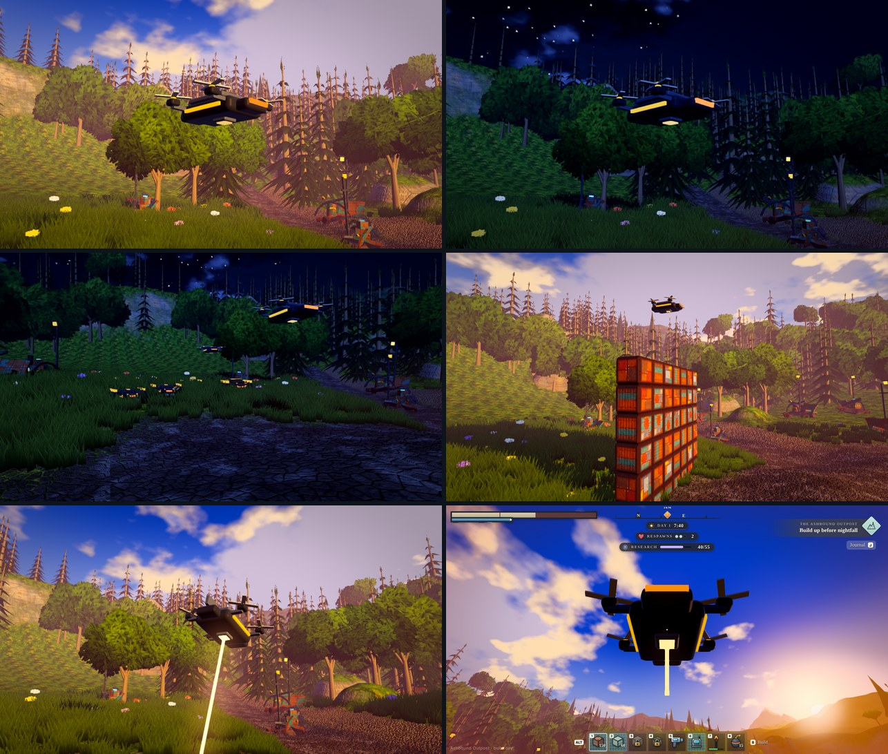

| Image                                                    | What to look at                                                                                                                                                                                                                                                                                         |
| -------------------------------------------------------- | ------------------------------------------------------------------------------------------------------------------------------------------------------------------------------------------------------------------------------------------------------------------------------------------------------- |
| [skimmer-closeup](phase-5/skimmer-closeup.jpg)           | A skimmer a few steps off at golden hour, hanging over the grass in front of the trees: a flat hull of dark blue steel with an amber strip along its flank, the orange of its eye strip at the nose, a pod with crossed blades at each corner and the pale lens under its belly.                        |
| [skimmer-night](phase-5/skimmer-night.jpg)               | The same at night: the hull is a dark blue shape against the sky, and what shows of it is its amber strips, the orange of its eye, the hubs of its rotors and the lens under its belly.                                                                                                                 |
| [skimmer-side](phase-5/skimmer-side.jpg)                 | A skimmer and a crawler side by side at the same distance from the camera, in profile at golden hour: the crawler stands on the ground, and the skimmer hangs clear over where its back would be, two pods and their blades on top of the hull and the lens under it.                                   |
| [skimmer-wall](phase-5/skimmer-wall.jpg)                 | Three frames of one flight along the road, left to right, past a wall of seven columns of Scrap cubes, six high: the skimmer low and far off at the left of the wall, up above the top of it, and past it and back at its hover on the other side. Not a block of the wall has been touched.            |
| [skimmer-march](phase-5/skimmer-march.jpg)               | A wave at night on the western road, walked four seconds on from where it was put: crawlers in the grass with their amber legs lit, and two skimmers in the air over them, one near the top of the frame and one far off.                                                                               |
| [skimmer-charge](phase-5/skimmer-charge.jpg)             | A skimmer a fifth of a second into a zap, a few blocks off at golden hour: its nose is dipped, the lens is lit and a thin pale beam hangs from it toward the grass. The beam hangs straight down whatever the zap is aimed at.                                                                          |
| [skimmer-charge-night](phase-5/skimmer-charge-night.jpg) | The same at night: the beam and the lit lens are the brightest things in the picture, so a skimmer winding up is easy to see in the dark.                                                                                                                                                               |
| [skimmer-zapped](phase-5/skimmer-zapped.jpg)             | First person, the zap landing: the player looks up at the skimmer hanging overhead, with the lens lit and the beam out under it, and the Health bar flashing pale as it drops to 58 of 100.                                                                                                             |
| [skimmer-felled](phase-5/skimmer-felled.jpg)             | The second blaster shot: the message "A machine left 2 Energy-Infused in the pool", the Tier 4 slot of the hotbar still behind its padlock with no count because the 100-point row is shut, and the second skimmer of the scene hanging over the grass in the distance, near the middle of the picture. |
| [skimmer-overview](phase-5/skimmer-overview.jpg)         | The six together: by day and by night, on the march, over the wall, charging and zapping.                                                                                                                                                                                                               |

### Known gaps in the skimmer

- **The beam says nothing about where the zap goes.** It hangs straight down from the lens whatever the zap is aimed at, grows over the 0.4 seconds of the wind-up and is gone when the zap lands. It is the sign that a skimmer has begun, not a line to the player, and there is no bolt, no hit effect beyond the wound flash every hit has, and no sound (that is Phase 6). A line from the lens to the player is the first thing to try.
- **A roof makes a player safe from it, and it from them.** With any cover over the player's head the hull hangs 2.6 blocks over the cover, out of the 4.2 blocks of height its zap reaches, and the bolts cannot get through the cover to it. A skimmer over a roof just hangs there until the roof is gone. Whether a roof should be that safe is for play to say. It does not shelter the Core, whose zap has no height limit.
- **Zaps are not blocked by anything.** The host checks the reach (1.8 blocks across and 4.2 up for a player, 2.4 from the Core's footprint) and not the line to the target, so a zap passes through a wall of the crew's that stands between the two.
- **Tall walls and sheer cliffs are brushed past.** It climbs 8 blocks a second and looks 3.5 blocks ahead of itself, so it clears a wall of about 10 blocks, and over a taller one or a cliff its hull goes through the top for a moment before it has risen.
- **The colour and the blades are judged in software.** The amber reads a pure yellow, as the crawler's knees do, the pale blades are lost against a pale sky, and the rotors flicker at 34 radians a second where a real display at 60 frames a second may show them differently. All of this is seen only in stills rendered in software at a fixed frame step, so how it sits with the bloom of a real display is for the first look on a real GPU.
- **It arrives the way the walkers do.** It grows in over 0.6 seconds from 0.6 of its size where it is put on the ring (over the lake too) and does not fly in from beyond the valley, so a skimmer can appear over the lake, where no walker could be.
- **The numbers are first guesses.** Twenty points, 3.6 blocks a second, five points to a player and four to the Core every 1.3 seconds, and two cells dropped, all in one table, for the balance simulator (5j) to tune.
- **No health bar**, as for the others. With two shots to a kill it matters least here.
- **The breacher** has a body of its own since [Phase 5i3](#phase-5i3-the-breacher).
- Seen only in software-rendered pictures, which have no frame rate: the cost of the third mesh on a real GPU is unmeasured, and a full field of skimmers is the number to watch.

## Phase 5i3: the breacher

The last special machine is the first whose job is the base and not the crew: a ram of dark iron under dull yellow plate, with a cell in a cage on its back, that walks the crawlers' way to the first wall of the crew's on its road (or to the Core), stands facing it, shudders and charges for 1.2 seconds, and goes off, once: a flash and a fan of fire, a hole of about three blocks wide and two high in the wall, a wound for whoever is standing near and a bite out of the Core. It is drawn from code like the others, in a palette of its own (no assets, so `CREDITS.md` is unchanged), and it is the machine whose picture is built up most by its charge. Felled before it goes off, it leaves Energy-Infused cells in the pool and the crew is told, as for the other two. The choices are in [decisions](decisions.md#phase-5i3-the-breacher-2026-10-27).

### The breacher

- **Shape.** A broad, low hull of near-black iron 0.84 blocks across and 0.86 long, a deck of plate over it, plate down each flank with an amber strip of light, a lower engine behind it carrying two stacks capped with plate, and a blunt head with a brow over it. The head's face is a ram plate across its whole width, with wings of plate running back along its sides, a red eye strip across it, a grille of four amber bars below the strip and three pale teeth at its foot. On its back, over the deck, is the cell: a small orb in a cage of four posts on a base of plate with a frame over them. It stands on four stout legs, two rows of two, with a block of plate at each hip and each knee. It is drawn 1.3 times its model, so it is 1.3 blocks tall to the top of its cage, about 2.2 long, 1.1 across its hull and 1.7 across its feet, and its hitbox is 1.7 across and 1.3 tall.
- **Steel and lights.** The shell is a near-black iron (`#201e1c`) and the plate a dull demolition yellow (`#6e5b2e`), well off the crawler's yellow joints so that it reads as another trade; the grille and the flank strips are a dull orange (`#c4701a`) that glows at 0.45, the lowest of the machines, so that it has room to burn up; the eye is the red of the others and the teeth a pale steel (`#a9a398`). The cell is a dark ember (`#4a1a07`) glowing at 0.04 of its full rating at rest. At night the hull is nearly black and what is left of the breacher is the plate catching the sky down its flanks, the orange of its grille and the dull ember on its back.
- **Movement.** It walks slowly: 1.8 blocks a second against a crawler's 2.6, on legs that swing through a short stride (3.2 radians a block, at their fullest at 1.4 blocks a second), rocking a little as it goes. It has no lunge and no jaws.
- **The charge.** Over the 1.2 seconds the host calls it charging (the flag a bite has, so a guest builds it up on its own clock with nothing new on the wire), all of it shudders (by about 0.04 blocks, off the beat of its own phase so that a line of them does not shake in step) and sinks about 0.16 blocks on its legs, the orange of its grille and strips burns up to four times as bright, and the cell swells by 30 percent about its middle, until it strains its cage, burning from the dull ember to white (fifty times as bright as at rest). The charge is the only warning a crew has that a wall is about to go: there is no sound or message for it.
- **The blast.** It is an event with a flash and no words: a warm flash 3.4 blocks across that lasts 0.4 seconds, a white core in it 1.9 across for 0.2 seconds, and a fan of 64 sparks thrown every way, where the host says it went off (to a tenth of a block, 0.9 blocks ahead of the machine). Every screen draws it, in the same two meshes as the blaster's light, so it costs no draw call of its own.
- **When it falls.** Felled before it goes off, it is the same burst as any machine, then a message at the top of the screen, "A machine left 4 Energy-Infused in the pool", and the pool holds four more of Tier 4: the most of any machine, because it is the one a good crew should kill. Nine blaster shots on the first night against a crawler's three: it has ninety points and takes every point of a hit. Felled in the middle of its charge it bursts like any machine, with nothing blown away.
- **Cost.** A fourth instanced mesh, of 1,208 triangles a machine against the crawler's 720, the armored crawler's 1,032 and the skimmer's 1,248, drawn once in each of the three passes that draw it (a module is drawn in two). A kind's mesh is drawn only while there is a machine of that kind, so a night without breachers costs what it did, and a night with all four kinds adds twelve draws. Counted like the tables above (Balanced, every pass, software GL), from beside the road looking out over the forest with the run held, a frame is 117 draws and 844.0 thousand triangles with no machine. One breacher takes it to 120 and 847.6 thousand, and one machine of each kind to 129 and 856.6 thousand. The machines are not culled (one bounding sphere would have to cover the valley), so a field costs the same wherever the camera looks: 100 breachers are 120 draws and 1,206.4 thousand triangles, which is 362 thousand more than the empty frame, or 43 percent, and 55 crawlers with 15 armored crawlers, 15 skimmers and 15 breachers are 129 and 1,119.8 thousand, 276 thousand more, or 33 percent. The waves never send that many breachers (the plan has one on night 9, two on night 13 and three on night 17), so what one costs in practice is 3,624 triangles, 0.4 percent of the frame. Nothing here is measured on a real GPU.

### Screenshots

Headless Chromium on software GL at 1280 by 720, Balanced, `freeze=1`, `?debug&waves=0`, with the machines put where they stand by `__ashbound.mp.spawnCrawlerAt(x, z, kind)` while the run is held (the page never takes the pointer), so each picture is exact. A machine rises into being over 0.6 seconds of the page's own clock, which a still stops, so the clock is run for a few frames before a picture is taken. The first nine pictures hold the camera off the player with `game.setPhoto` and have the HUD hidden. The charge is photographed with the host's clock played in hops (`mp.warp`) and the page's clock stepped on beside it, so that the build-up on the page is where the host's charge has got to. The ring is a closed square of Scrap cubes three blocks out from the Core's walls and three high, put up with `mp.place`: a closed one, because a wall with a way round it is walked round. For the blast and the hole the page takes the pointer for the last moment (the host breaks blocks only while it is running) and the flash is then played on the page's clock in steps of 70, 120 and 200 milliseconds. The last two pictures are the player's own view with the HUD on.

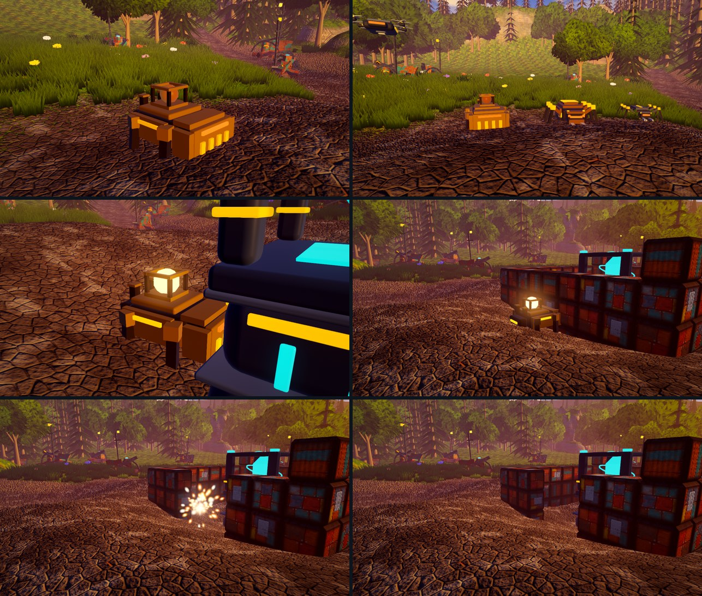

| Image                                                      | What to look at                                                                                                                                                                                                                                                                                                      |
| ---------------------------------------------------------- | -------------------------------------------------------------------------------------------------------------------------------------------------------------------------------------------------------------------------------------------------------------------------------------------------------------------- |
| [breacher-closeup](phase-5/breacher-closeup.jpg)           | A breacher a few steps off at golden hour on bare ground: a broad low hull of plate over dark iron, a strip of amber down its near flank, four amber bars in the grille of its ram plate, and on its back the cell, a dull orange orb in its cage of four posts.                                                     |
| [breacher-night](phase-5/breacher-night.jpg)               | The same at night: the hull is nearly black, and what is left of the breacher is the amber of its grille and its flank strips and the dull ember of the cell.                                                                                                                                                        |
| [breacher-family](phase-5/breacher-family.jpg)             | The four kinds in a row at golden hour, from the front: a breacher on the left, an armored crawler in the middle and a crawler on the right, and a skimmer hanging in the air at the top left. The breacher is the broadest and the only one with a cage on its back.                                                |
| [breacher-charge](phase-5/breacher-charge.jpg)             | Three frames of one charge at the Core's west wall, left to right: as it stops, with the cell an orange orb; half way, with the cell gone nearly white and the amber brighter; and at full charge, with the cell burning white and straining its cage and a glow round it.                                           |
| [breacher-charge-night](phase-5/breacher-charge-night.jpg) | The full charge at night: the cell is the brightest thing in the picture, a white orb in a black cage over a black hull, and the Core's own strips look dim beside it.                                                                                                                                               |
| [breacher-ring](phase-5/breacher-ring.jpg)                 | Three frames of a breacher at the ring, each a window of the frame round the machine and the wall, left to right: it has walked up to the wall of Scrap cubes and stopped; it is charging, the cell nearly white; and at full charge, the orb white with a glow over the plates, a fifth of a second from going off. |
| [breacher-blast](phase-5/breacher-blast.jpg)               | The blast at the ring in four frames from a camera a few blocks off, left to right and top to bottom: the flash as it is born, the white core and a fan of sparks thrown every way, the sparks thinned and still falling, and the last embers. The machine is gone from the first frame, and so are the blocks.      |
| [breacher-hole](phase-5/breacher-hole.jpg)                 | The wall a second later: a gap in the wall of Scrap cubes with the ground and the grass beyond it, and the rest of the wall standing on either side. The ground under the gap is untouched.                                                                                                                          |
| [breacher-core](phase-5/breacher-core.jpg)                 | A breacher going off at the Core's west wall in four frames, left to right and top to bottom: the last moment of the charge, the flash at the foot of the Core, the fan of sparks, and the embers dying away. The Core stands as it was and loses 150 of its 1000 Health.                                            |
| [breacher-wounded](phase-5/breacher-wounded.jpg)           | First person at the Core's west wall a quarter of a second after the blast: the fan of sparks over the foot of the wall, the Health bar down to two thirds after the wound of 35 (65 of 100), and the Core's gauge, which shows only while the Core is hurt, at 851 of 1000 after its 150 (and a point of mending).  |
| [breacher-felled](phase-5/breacher-felled.jpg)             | First person, the ninth blaster shot: the message "A machine left 4 Energy-Infused in the pool", the Tier 4 slot of the hotbar still behind its padlock with no count because the 100-point row is shut, and no breacher: it did not go off.                                                                         |
| [breacher-overview](phase-5/breacher-overview.jpg)         | The six together: by day, with the others, charging, at the ring, going off and the hole.                                                                                                                                                                                                                            |

### Known gaps in the breacher

- **The charge is the only warning.** A crew learns that a wall is about to go from the build-up on the machine (the shudder, the sinking, the amber burning up, the cell swelling and going white) and from nothing else: no sound, no message, no shake of the screen and no mark on the wall it is facing. Whether it should be named or sounded is for play to say, and the sound is Phase 6.
- **The blast is a flash and nothing else.** No scorch on the blocks left standing, no debris thrown from the broken ones (they go as chewed blocks do), no shake and no sound. The flash is drawn in the same two meshes as the blaster's light, so the size it can reach on the screen is capped as theirs is: a breacher going off beside the camera is no bigger on the screen than one a few blocks off.
- **It wounds through walls and breaks modules as freely as blocks.** The host checks the distance to the blast and not the line to it, so a player behind a wall is wounded, and a Turret, a Light or a Bed in the cells it clears goes with its block.
- **It goes off at the first wall its route meets.** It takes the crawlers' route, so a wall with a way round it is walked round, and where the way is closed it goes off at whatever wall it reaches first, not at the weakest.
- **No health bar**, as for the others. With nine shots to a kill it matters most here, and a small bar over a hurt machine is the thing to try if play shows it does.
- **The colour is judged in software.** The plate reads orange-brown at golden hour where a dull yellow was meant (as the armored crawler's rust does), the iron reads dark brown in the light, and at night the hull is nearly black. At full charge the cell is a flat white disc in a software frame, which the bloom of a real display may spread or tame.
- **The numbers are first guesses.** Ninety points, 1.8 blocks a second, a 1.2 second charge, a radius of 1.8 blocks, 35 off a player within 3 blocks, 150 off the Core within 2 and four cells dropped are all in one table, for the balance simulator (5j) to tune.
- Seen only in software-rendered pictures, which have no frame rate: the cost of the fourth mesh on a real GPU is unmeasured, and a full field of breachers is the number to watch.

## Phase 6c1: the sound of the valley

The valley has sound. The wind and the Core's hum run all day, the low note of the night comes up with the dark, a sparse music plays over them, a heartbeat and drums join it when the machines draw near, and ten seconds before each wave a stinger climbs toward it. SPEC section 11 asks for this ("soft industrial hum + wind/debris during day; lower, tenser drone at night", "a short rising stinger approximately 10 seconds before a wave", "sparse music that shifts from calmer (day) to more urgent (night)", from "free CC0 sources or simple synthesis"), and it is all synthesis, made of the film's own voices and beds, so there is still no audio file to license or ship and `CREDITS.md` does not change. The effects the spec lists next to it (place and break sounds, turret fire, enemy hits, power) are Phase 6c2, in two parts: building came first ([the sound of building](#phase-6c2a-the-sound-of-building)) and the fight is 6c2b. The choices are in [decisions](decisions.md#phase-6c1-the-sound-of-the-valley-2026-10-27). **None of it has been heard**: the sandbox the game is built in has no sound device, so what follows is measured from a night drawn to samples by the page's own code, and how it sounds as music is for Austin's first listen.

### What the valley sounds like

The sound follows the run the way the sky does: once a frame it reads the clock, the nearest machine and the Core, and it listens for what the host announces (nightfall, a wave coming, the dawn), so a guest hears the same words the host's player hears, with the tension of their own corner of the valley. The music is in D, as the film's is: a D major pentatonic by day and the minor one by night.

- **By day.** The wind, a band of noise at 620 Hz that swells and sways, and the Core's hum, the film's chord of pure tones with its third at F sharp, which is in full within 10 blocks of the Core and falls to under a third of itself beyond 70. Every 7 to 15 seconds a bell note is struck (D4 to F sharp 5), now and then answered a step up or down, 3 dB softer, a breath later; every 55 to 85 seconds a D major chord swells over four seconds and fades over five. The first note comes six seconds into play and the first chord at twenty-four, so that the film's last chord has died.
- **Night falls.** At the host's word the hull groans (a saw sliding from 95 Hz down to 52 over four and a half seconds) and 0.6 seconds later a D minor chord swells. The sound follows the sky through its forty seconds of dusk: the wind drops to half its level and to 360 Hz, the third of the Core's chord turns from F sharp to F, and under everything comes the low note of the night (the film's D and A with two sawtooth D's through a lowpass), which is nothing by day and grows with the square of the dark. The bells move to the minor (D3 to F4), a little quieter and slower, every 10 to 20 seconds.
- **A wave, ten seconds out.** A rising noise starts 0.2 seconds after the host's word and climbs from 240 Hz to 3.6 kHz over 3.6 seconds, and a drum at 62 Hz is struck at the top of the climb. The wave comes out of the ground about six seconds after that. Each wave of a night hits a little harder than the one before, by up to 3 dB from the first to the last.
- **The machines close in.** With any machine alive a heartbeat starts under the night (once the sky is more dark than light, twenty seconds into the dusk, whatever came out of the ground before): two beats, the second 4 dB softer, a pair every 1.5 seconds at -18 dB with the machines far off and every 0.72 seconds at -9 dB at the walls. The low note brightens (its filter opens from 180 to 420 Hz) and swells by about a third. Within about 42 blocks drums join, one every 3.2 to 5.5 seconds, from -22 dB to -12. The tension follows a machine coming out of the ground over about 0.8 seconds and lets go over about 4 when the last is felled, as a pulse does.
- **The dawn.** The sky has been lightening, and the sound with it, for the forty seconds before; the host's word is a glass note (D5) and, 0.4 seconds later, a D major chord.
- **Held and over.** While the mouse is free and the run's clock waits (the pause card), and once the run is over, the music stops where it is: no new bell, chord, heartbeat or drum, while the wind, the hum and the low note go on.
- **With the film.** The film has its own score. While it plays the valley is silent; a film that begins over a sounding valley takes it away in 0.6 seconds, and the valley comes up under the film's last chord when it ends.

### How it is made

- **A plan with nothing of the browser in it.** `src/shared/game-sound.ts` holds the levels of the long sounds (`MIX`), the music (its notes, its pace and its levels: `MUSIC` and `Composer`), the stinger and the three words of the hours (`waveStinger`, `nightfallCues`, `dawnCues`, and `cuesForEvent`, which turns one of the host's events into the sound it makes) and the scene the sound follows each frame (`SceneTracker`: how far into the night the sky is, how tense it is, how near the Core). The music is a function of its seed and of the scenes it is shown, so a unit test listens to a whole night in a moment, and the words are seeded by the world, so every screen of a room plays the same groan and the same drums.
- **The film's voices, steered by the clock.** `src/engine/audio/live.ts` runs the film's wind, Core hum and drone beds all the while, each eased toward the level and tone the scene asks for (a level follows a change over 2.2 seconds and a tone over 4; the targets are rewritten ten times a second, and only once they have moved), and strikes the film's `pluck`, `pad`, `heart`, `timp`, `riser`, `groan` and `ping` voices as the music and the host's words call for them, a twentieth of a second ahead of the audio clock. It has its own noise and room, goes through the same output chain as the film (the limiter, then the master volume the player set) and comes up over three seconds when it starts.
- **Wired to the game.** `src/app/attach-sound.ts` loads on its own once the game is up, as a lazy chunk. A browser keeps a page silent until it has been clicked, so the first click or key press on the page makes the audio context, whatever it was for: the valley is silent on the title, and the wind comes up with the first click. A page told to be silent (`?sound=off`) or a volume at nothing makes no context; turn the slider up and click again, and it builds.
- **Behind the film.** The sound's room and noise take about a tenth of a second to make, so it is built as soon as there is an audio context, behind the film when there is one, and starts nothing until the film is over. Building it on the frame that hands the run over was a hitch of that size.
- **It never needs to work.** A browser that cannot make something the sound needs plays the game in silence and says so once in the console, and a recipe that fails is counted, told once and passed over.
- **Drawn as well as played.** `window.__ashbound.audio.renderValley({ night, seed, leadIn, seconds, ... })` on a `?debug` page (`src/app/render-valley-sound.ts`) draws a night to samples with no one listening: the same plan, voices and output chain on an offline context, with a script for the player and the crew. The player stands 8 blocks from the Core; the night's own waves (`planNight`) come out of the ring the game spawns them on, walk in at a crawler's pace to 13 blocks of the player and are fought there for 22 seconds; and the host's words fall due when the plan says. It is how the mix below was set and measured, and what the next sounds can be measured against.

### The mix, measured

Night 4, which has three waves, drawn by `renderValley` at full volume and 44.1 kHz: 45 seconds of day, the 240 seconds of the night (nightfall at 45 seconds, the host's words for the waves at 49, 119 and 189, the machines at the walls from about 72, 142 and 212, the dawn at 285) and 30 seconds of morning. Measured with ffmpeg's loudness meter and a few lines of numpy.

| Window          | Render seconds | Level (RMS, dBFS) | Loudest (peak, dBFS) | What carries it                                                                                                                             |
| --------------- | -------------- | ----------------- | -------------------- | ------------------------------------------------------------------------------------------------------------------------------------------- |
| Day             | 5 to 45        | -33.5             | -14.8                | the wind, the Core's hum, a bell note now and then and a chord                                                                              |
| The first wave  | 45 to 105      | -25.5             | -7.5                 | nightfall's groan and minor chord, the night coming in, the low note, then the riser and the drum, and the heartbeat and drums at the walls |
| The second wave | 115 to 175     | -24.3             | -6.4                 | the low note, the riser and a harder drum, the heartbeat and the drums at the walls                                                         |
| The third wave  | 185 to 245     | -24.3             | -5.5                 | the same again, with the hardest drum of the night at 192.9 seconds                                                                         |
| Late night      | 245 to 285     | -31.4             | -17.9                | the low note and the wind easing off as the sky lightens, a bell now and then                                                               |
| The dawn        | 285 to 315     | -31.1             | -15.3                | the glass note, a major chord and the wind                                                                                                  |

Each sound on its own, as mean momentary loudness (LUFS) and loudest sample (dBFS) in each window (a dash is silence):

| Sound                       | Day 5 to 45   | First wave 45 to 105 | Second wave 115 to 175 | Third wave 185 to 245 | Late night 245 to 285 | Dawn 285 to 315 |
| --------------------------- | ------------- | -------------------- | ---------------------- | --------------------- | --------------------- | --------------- |
| The wind                    | -34.6 / -22.2 | -37.4 / -21.5        | -40.8 / -26.9          | -40.8 / -26.9         | -37.4 / -22.3         | -34.4 / -21.9   |
| The Core's hum              | -36.7 / -29.9 | -37.1 / -29.4        | -37.3 / -30.4          | -37.3 / -30.4         | -37.1 / -29.4         | -37.6 / -30.6   |
| The low note                | -             | -31.8 / -23.2        | -29.5 / -23.2          | -29.5 / -23.2         | -36.2 / -26.0         | -89.5 / -83.7   |
| Bell notes and chords       | -34.2 / -16.1 | -33.4 / -19.0        | -35.4 / -21.4          | -35.0 / -20.4         | -36.5 / -20.7         | -31.2 / -15.7   |
| The heartbeat               | -             | -28.7 / -10.1        | -29.2 / -10.1          | -29.2 / -10.1         | -86.8 / -78.0         | -               |
| The drums                   | -             | -31.0 / -8.7         | -30.5 / -7.4           | -30.5 / -6.2          | -                     | -               |
| The risers, groan and glass | -             | -34.4 / -16.5        | -32.2 / -14.9          | -30.8 / -13.2         | -                     | -35.2 / -21.6   |
| All together                | -30.9 / -14.8 | -25.7 / -7.5         | -25.4 / -6.4           | -25.3 / -5.5          | -31.7 / -17.9         | -28.8 / -15.3   |

- **The whole night.** Integrated loudness is -27.0 LUFS with a loudness range of 9.8 LU. The loudest sample is -5.5 dBFS and the true peak -5.5 dBTP, so the mix has about 5 dB of room at full volume (the film's has 2). Both are the third wave's drum, at 192.9 seconds, which is also the loudest 50 milliseconds of the night (-11 dB RMS).
- **Against the film.** The film is the loudest thing in the game (-20.8 LUFS integrated) and the valley is what is heard for hours, so the wind and the hum sit about 10 dB under the film by day (-30.9 LUFS against -20.8) and the siege about 5 dB under it (-25.3). The low note, the heartbeat and the drums carry the siege.
- **The warnings.** In the half second of each drum the level is 7.6, 9.2 and 10.3 dB above the five seconds before it (-20.3, -18.6 and -17.4 dB RMS against -27.9, -27.8 and -27.7), each higher than the last. The riser is as loud as the night under it in the middle of its climb (-28.3, -27.8 and -27.9 dB RMS) and is told apart by its high band, which nothing else in the valley uses.
- **The words of the hours.** Nightfall's groan is 5.3 dB over the five seconds before it, and the dawn's glass note 5.6.
- **A beginning and an end.** The first quarter second is at -75 dB (the sound comes up over three seconds), and the render is cut at 315 seconds with the wind going, as a session would be.
- **Stereo.** The two ears have a correlation of 0.94: the wind, the hum and the low note are in the middle and only the bell notes are panned (up to 0.3 to either side), where the film's correlation is 0.62. The offset from zero is 0.00066.

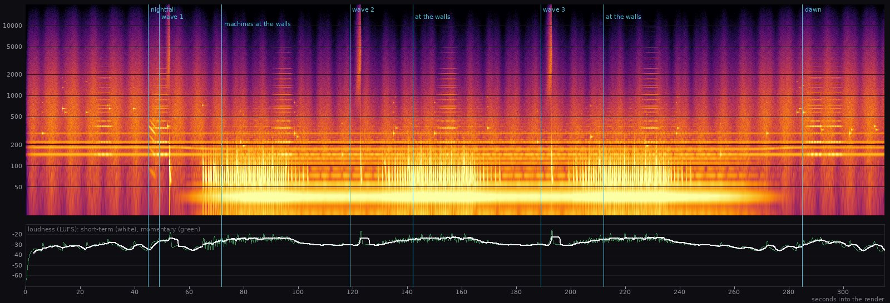

The chart has frequency up the side on a log scale and the loudness under it. The low note fills in at nightfall around 37 Hz, the three risers are the streaks that climb past 5 kHz, and the heartbeat and the drums are the ticks below 200 Hz while the machines are at the walls.

### What the sound costs

The page's first load carries none of it: the first-load script is 4.8 kB smaller than main's (663.8 kB against 668.5, 192.9 against 194.8 gzipped), since the code the film and the valley share now lives in chunks of its own. The valley's sound arrives on its own once the game is up, as four small chunks: `attach-sound` (1.6 kB), `live` (6.3 kB), `reverb` (11.7 kB, the room, which the film shares) and `audio` (0.45 kB), 20.0 kB in all (7.9 kB gzipped). The film's own chunk fell from 21.4 kB to 9.9 kB. The tool that draws a night to a file is 1.4 kB and loads only on a `?debug` page when asked. No audio file is fetched, and no audio context is made before a click.

Played in real time in the sandbox's headless Chromium (44.1 kHz, a four-core machine with no sound device, a page with nothing else running), with the valley as busy as it gets, a siege at midnight (a machine at 18 blocks, the player 12 from the Core, a wave's stinger every 20 seconds, 182 sounds started in 60 seconds): setting the sound up, which makes the noise banks and the room's impulse response, takes 123 ms on the main thread, once, behind the film when there is one; telling it where the valley stands, once a frame, takes 0.018 ms on average (0.3 ms at the 99th percentile and 4.2 ms at the worst call). The browser as a whole used 0.134 of a core against 0.029 with an empty audio context running, so the synthesis costs about a tenth of one core at the walls (the offline render that draws a night takes 24.4 seconds for its 315, a little under that). This browser does not report the audio thread's own load, so the figure is the whole browser's, with the page idle: the picture is not in it.

The noise banks (three four-second buffers) and the room (3.2 seconds in each ear) are about 3.3 MB of samples, made when the sound is built and freed when it is let go. The valley builds its own, so for the length of the film, behind which it waits, two sets are alive. A tab that is hidden puts the sound to sleep.

### Known gaps in the valley's sound

- **It has not been heard.** The sandbox has no sound device. The mix is measured and the plan is checked in tests, but whether the bells are pleasant, the heartbeat too much, the riser too shy or the low note too heavy is for Austin's first listen, which is why a listening copy of night 4 came with the pull request. The low note's root is a D at 37 Hz, under what a laptop's speakers play, so on them it is heard through its upper parts.
- **The music is mine.** The spec gives no music direction, so the scales, the chords, the bell notes and their pace are my reading of "sparse music that shifts from calmer to more urgent". It is one place to change: `SCALES`, `CHORDS` and `MUSIC` in `src/shared/game-sound.ts`.
- **The title is silent.** A browser allows no sound before a click, so the valley is silent until the first click on the page, and the wind comes up with it.
- **Only the ambience, the music and the three words.** Building and breaking and power came with Phase 6c2a ([the sound of building](#phase-6c2a-the-sound-of-building)). Steps, shots, hits, the machines themselves, the Core's hits, a player going down and coming back, a drop, a breacher's charge and its blast, and the loss are Phase 6c2b. The host's events for them (`down`, `back`, `drop`, `blast`, `overrun`) have no sound yet.
- **One volume.** No separate music and effects, no mute key (both want the menus of Phase 6a), and the music is on by default for every player.
- **In the head, not in the world.** The sound is in the middle with only the bell notes panned, nearly the same in both ears. A machine's drum does not come from where it stands, and the heartbeat does not pan.
- **The tension is the player's own.** Each screen steers the sound by its own player's distance to the machines and the Core, and by its own clock; the words are the host's. Two players hear one night, each with their own tension.
- **The measured night is a script.** One player who stands still, one wave at a time. A real night has several machines at once from several sides and a player who runs, which the tension does not tell apart.
- **The numbers are first guesses.** Every level, gap and range is in `MIX` and `MUSIC`, for the first listen to move.

## Phase 6c2a: the sound of building

What the crew does with its hands now makes a sound. A block set down knocks, a block broken crackles and falls, a piece raised whirs and chimes, a module set down says what it is, a module that comes on winds up, a heap stripped snaps and rings, and a click the game turned away is answered in the player's head. SPEC section 11 lists "place/break sounds" and "power" among the effects, "from free CC0 sources or simple synthesis", and all of it is synthesis, made of the film's own voices, so there is still no audio file to license or ship and `CREDITS.md` does not change. The sounds of the fight (turret and blaster fire, hits, the machines, the Core's hits) are Phase 6c2b. The choices are in [decisions](decisions.md#phase-6c2a-the-sound-of-building-2026-10-27). **None of it has been heard**: the sandbox the game is built in has no sound device, so what follows is measured from effects drawn to samples by the page's own code, and how it sounds as sound design is for Austin's first listen.

### What building sounds like

Every screen works out the same sound for the same word of the host and plays it from where its own player stands, so a crew hears one base being built, each from where they are. The voices are the film's (`step` a dull knock, `thud` a collapse, `crackle` a snap of noise, `tick` a woody tap, `blip` a rising chirp, `pluck` a bell, `servo` a motor sliding between two pitches, `whoom`, `steam`, `rumble`), at levels set against the valley's own sound.

| What happens                    | What you hear                                                                                                                                                                                                       | Made of                                                                                                                                                                                                                                                                            |
| ------------------------------- | ------------------------------------------------------------------------------------------------------------------------------------------------------------------------------------------------------------------- | ---------------------------------------------------------------------------------------------------------------------------------------------------------------------------------------------------------------------------------------------------------------------------------- |
| A block set down                | A dull knock with a woody tick on it. Scrap has a snap of debris, Composite and Alloy the tap of their material, Energy-Infused a glassy note. A better grade rings higher; a wedge is a little higher, a slab more | a `step` at -20 dB from 170 Hz (Scrap) to 260 (Energy-Infused), a wedge 8% higher and a slab 16%; for Scrap a `tick` at -15 (560 Hz) and a `crackle` at -6, above Scrap a higher `tick` (1400 to 2100 Hz at -17 to -14) in their place, and for Energy-Infused a G6 `pluck` at -30 |
| A block broken                  | Four quick crackles over a low collapse; from Composite up the ring of its pieces; a machine's bite adds a rumble of earth                                                                                          | four `crackle`s at -3, -5, -7 and -9 dB over 85 ms (about 1.9 kHz), a `thud` at -22 dB (142 Hz for Scrap down to 118), a `tick` at -17 from Composite up, and for a bite a `rumble` at -27                                                                                         |
| A piece raised in place         | A motor's whirr and a chime that gains a note at each level: D5 and A5 at Composite, D6 added at Alloy, A4 added below at Energy-Infused. A module's whirr is heavier                                               | a `servo` from 200 to 520 Hz over 0.16 s at -13 dB, then `pluck`s at -18 dB, 75 ms apart from 110 ms in; a module's has a `servo` to 450 Hz at -11 and a `step` at -17 under it                                                                                                    |
| A module set down               | A heavy knock and what the module is: see below                                                                                                                                                                     | a `step` of 100 to 200 Hz at -14 to -20 dB and the module's own sounds                                                                                                                                                                                                             |
| The Terminal                    | Three rising chirps                                                                                                                                                                                                 | `blip`s at 1.0, 1.25 and 1.5 kHz at -18, 70 ms apart                                                                                                                                                                                                                               |
| The Turret                      | A motor and a lock                                                                                                                                                                                                  | a `servo` from 130 to 300 Hz over 0.3 s at -11, a `tick` at 1.1 kHz at -12 as it ends                                                                                                                                                                                              |
| The Generator                   | A long winding up under a low swell                                                                                                                                                                                 | a `whoom` at 70 Hz at -25 and a `servo` from 110 to 380 Hz over 0.6 s at -8                                                                                                                                                                                                        |
| The Power Node                  | Two high blips                                                                                                                                                                                                      | `blip`s at 1.7 and 2.2 kHz at -17 and -19                                                                                                                                                                                                                                          |
| The Storage                     | Two knocks and a tick                                                                                                                                                                                               | a `tick` at 650 Hz at -11 and a second `step` at 190 Hz at -20, 0.12 s after                                                                                                                                                                                                       |
| The Bed                         | A puff of steam                                                                                                                                                                                                     | `steam` at 1.8 kHz over 0.35 s at -12                                                                                                                                                                                                                                              |
| The Light                       | A tick and a blip                                                                                                                                                                                                   | a `tick` at 2.4 kHz at -14 and a `blip` at 1.9 kHz at -21                                                                                                                                                                                                                          |
| A module taken apart            | The collapse, a snap of what was inside and a motor running down                                                                                                                                                    | a `thud` at -20 dB (110 Hz), three `crackle`s at -5, -7 and -9 (2.2 kHz), a `servo` from 400 down to 90 Hz over 0.3 s at -13                                                                                                                                                       |
| A module comes on, or goes dark | A motor winding up that ends in a ready blip; or winding down                                                                                                                                                       | on: a `servo` from 160 to 520 Hz over 0.4 s at -6 dB and a `blip` at 1320 Hz at -12; off: a `servo` from 480 down to 140 Hz over 0.45 s at -7                                                                                                                                      |
| A heap stripped                 | A snap of scrap coming away and a ring that rises with the grade it gave (1.8, 2.2, 2.7 and 3.3 kHz). The last strip adds the heap's fall; a pool with no room answers with a dull knock where the ring would be    | three `crackle`s at -5, -6 and -7 (2.4 kHz), a `step` at 200 Hz at -23, a `tick` at -17 at the grade's pitch (or a `step` at 130 Hz at -22 where the pool is full); the last strip adds a `thud` at 130 Hz at -22 and a `rumble` at -30                                            |
| A click the game turned away    | Two dull knocks, the second lower, and a tick, in the head and not in the valley                                                                                                                                    | a `step` at 170 Hz at -20, another at 130 Hz at -22 70 ms later, and a `tick` at 700 Hz at -8                                                                                                                                                                                      |

A cell that did not change makes no sound, and neither does a world being loaded (it is a snapshot, not a list of events). Of the modules that come on or go dark together (a Generator set down lights a whole base) only the nearest of each is heard.

### Where it is heard from

Each sound is placed against the player's eyes and the way the view faces, from the middle of its cell (a heap's middle for a strip; nowhere, in the head, for a refusal).

| Blocks away | Within 3 | 8   | 16    | 32  | 48  | Beyond 48 |
| ----------- | -------- | --- | ----- | --- | --- | --------- |
| Loss (dB)   | 0        | -6  | -12.5 | -21 | -29 | not made  |

- **The sides.** Panned up to 0.85 of the way to one ear, and drawn toward the middle within 3 blocks of the player, so that a block set at the feet is not in one ear. A sound dead ahead or behind is in both ears alike, each 3 dB under what the near ear of a sound hard to one side gets (the panner keeps the total power), which is why ahead and behind read lower in the tables below.
- **Far and behind are dull.** A lowpass from 16 kHz (open) to 600 Hz (shut) on a log scale: up to 0.8 of the way at 48 blocks (1.2 kHz there) beginning at 8 blocks, and 0.3 of the way for a sound directly behind the player. The two add and are held at 1.
- **Far is roomy.** Up to 0.3 is added to the share of a far sound that goes to the reverb, since the echo of the valley is most of what is left of it.
- **The same word, a different sound.** The seed of an effect is the cell and what is in it, so every screen makes the same knock; where it is, how loud and on which side, is each screen's own.

### How many may sound

Every kind of effect has a gap (the least time between two from one source), a priority and a life (how long its voices keep the budget busy):

| Kind                       | Priority | Gap (s) | Life (s) | Share of the 28 it may fill |
| -------------------------- | -------- | ------- | -------- | --------------------------- |
| A block set down or broken | 1        | 0.045   | 0.45     | 65%                         |
| A heap stripped            | 1        | 0.07    | 0.4      | 65%                         |
| A piece raised, a module   | 2        | 0.12    | 1.2, 0.9 | 80%                         |
| A module's power           | 2        | 0.2     | 0.9      | 80%                         |
| A click turned away        | 3        | 0.2     | 0.3      | all                         |

A source is a cell and what was done to it, a heap, or a turret. The budget is 28 voices, each costing what it works for (a held note 1, a knock 0.7, a tick or a blip 0.4, a snap of crackle 0.2), and 4 more are kept for priority 4, which the fight will use. A crowd turns away the least important first. In practice a held click, a wall being gnawed and a flurry of refusals all sound, and a thousand blocks that appear in one frame sound as thirteen.

### How it is made

- **A plan with nothing of the browser in it.** `src/shared/effect-sound.ts` holds where a sound is heard from (`hearAt`, `EARSHOT`, `dropFor` and `SPOT`), how many may sound (`KINDS`, `BUDGET` and the `Governor`) and the effects themselves (`effectForEdit`, `effectsForPower`, `effectForRefusal` and `effectForHarvest`), each a list of the film's cues. A unit test can listen to a whole wall being built in a moment.
- **The film's voices, placed.** `src/engine/audio/live.ts` has `listen(pose)`, which each frame says where the player's head is, and `effect(made)`, which places an effect against it, asks the governor, and strikes the voices a moment ahead of the audio clock through a bus of its own into the same room, so one place sets how loud all of it is next to the valley. A cue may now be dull (`muffle`) or roomy (`room`), and the voices' last stage (`output` in `voices.ts`) does it with a lowpass and more of the reverb send. The trace the tests read says which kind of effect each cue belongs to, where it was placed and at what level.
- **Wired to the game.** `src/app/attach-sound.ts` listens to what the host's world does: `session.onEvent(listener(event, previous))` for the cells, `economy.debris.onHarvest` for the heaps, `PowerWatcher.onFlips` for the power and `BuildControls.onRefused` for the clicks that were turned away, and tells the sound where the player's head is (eye height, the camera's yaw) before the effects of each frame. It makes no effect while the film plays.
- **What a cell held before.** `onEvent` on a session (`HostSession`, `GuestSession` and the hub that joins them) now hands its listeners what the cell held until the event, read from the screen's own copy of the world just before the event is applied. It never travels: nothing on the wire changed.
- **Which modules came on.** `PowerFlips` (`src/systems/survival/power-flips.ts`) compares the host's own `PowerGrid`, which every screen runs over its copy of the world, from one look to the next. Only a module that stood at both looks counts, so one just set down is not a module that came on.
- **A turned-away click.** The hands' one `setNotice` (which has the toast) calls a new `refused` port, which `createBuildControls` offers as `onRefused`; a refusal that the host sent back is a notice too.
- **Drawn as well as played.** `window.__ashbound.audio.renderEffects({ script, seconds, scene, volume, seed })` on a `?debug` page (`src/app/render-effect-sound.ts`) draws a script of effects and moves of the listener to samples over the valley's quiet morning, on an offline context stopped every six audio blocks the way the game calls the sound once a frame. It is how every level below was set, and how a listening copy was made.

### The levels, measured

The first levels were set from how loud each voice is called. They were wrong in a way that only a measurement showed: the voices differ by 15 to 30 dB in how much a nominal level says (a crackle at a nominal -10 dB came out 20 dB under the wind of a quiet morning, and a 100 Hz knock 13 dB over it), and the knocks live under 200 Hz, where a laptop's speakers have nothing, and where loudness as the ear weighs it (A-weighted) says they are no louder than the wind. So each effect was drawn alone and with the quiet morning (the wind and the Core's hum, -34.8 LUFS integrated) under it, and its loudest 100 ms (Hann window, centred on its energy, the louder ear) was read in each octave against the morning's own power in that octave. Two numbers say whether it is heard: `body`, the most it stands over the wind anywhere from 180 Hz to 5.6 kHz, and `small`, the most from 355 Hz to 2.8 kHz, where even a tiny speaker is not short of power. The targets were 13 to 20 dB for `body` and 6 to 16 for `small`, and each effect came to:

| Effect (alone; a block or module 4.4 blocks off, a heap 3, a module's power 5.8, a refusal in the head) | `body` (dB over the wind) | `small` (dB over the wind) | Where it is strongest                                                                             |
| ------------------------------------------------------------------------------------------------------- | ------------------------- | -------------------------- | ------------------------------------------------------------------------------------------------- |
| A block set down (six pieces)                                                                           | 16.7 to 18.0              | 6.6 to 14.5                | the knock at 250 Hz, then the tick and snap                                                       |
| A block broken (six pieces, and a bite)                                                                 | 19.1 to 20.3              | 6.2 to 12.1                | the collapse at 250 Hz, the crackles from 2 kHz up                                                |
| A piece raised (to Composite, Alloy, Energy-Infused)                                                    | 13.9 to 14.8              | 13.9 to 14.8               | the chime, between 500 Hz and 2 kHz                                                               |
| A module set down (seven)                                                                               | 12.5 to 19.8              | 5.7 to 13.3                | the knock, and its own sound (the Generator's is the lowest)                                      |
| A module taken apart (seven, and a bite)                                                                | 17.6 to 18.7              | 5.7 to 6.1                 | the collapse                                                                                      |
| A Turret raised                                                                                         | 13.8                      | 13.8                       | the chime                                                                                         |
| A module comes on, goes dark                                                                            | 14.3, 16.7                | 14.3, 16.7                 | the motor, between 1 and 2 kHz                                                                    |
| A click turned away                                                                                     | 13.2 to 14.2              | 10.1 to 10.6               | the knocks, 125 Hz to 1 kHz                                                                       |
| A heap stripped (four grades, the last strip, a full pool)                                              | 15.2 to 20.8              | 1.1 to 13.2                | the snap above 2 kHz, the ring (grade 4's is at 3.3 kHz, 18.0 over there, which is above `small`) |

A module taken apart and the Bed set down have the least in the middle bands (5.7 to 6.1 dB), and a heap's top grade has nothing in them. Both are carried by what is above and below, and they are the first levels to move if the first listen says they are shy.

How far off a block can be and still be heard, the same Alloy cube set down at growing distances on the right, in the louder ear:

| Blocks away (to the middle of the cell) | 2.8  | 3.7  | 6.6  | 10.6 | 16.6 | 24.5 | 32.5 | 48.5     |
| --------------------------------------- | ---- | ---- | ---- | ---- | ---- | ---- | ---- | -------- |
| `body` (dB over the wind)               | 19.2 | 18.0 | 14.8 | 11.4 | 7.0  | 2.9  | -1.1 | not made |
| `small` (dB over the wind)              | 15.8 | 14.9 | 11.3 | 7.3  | 2.3  | -1.6 | -4.6 | not made |

A block set down about 32 blocks off is as loud as the wind of a quiet morning, so the reach is 48 and not more. All round the player at 7.6 to 8.6 blocks (ahead, to the right, behind, to the left) the `body` is 8.5, 13.1, 8.3 and 13.4: a side is heard in its ear more than an ahead or a behind is in either.

The valley's other hours are easier for the effects than the morning in the bands that carry them, since the wind falls to half at night, and the same effects stand further over it: an Alloy cube set down has 22.6 dB over a night's bed and 22.6 over a siege's in its 2 kHz octave (against 12.8 by day), and a Generator set down has 16.5 and 16.2 over them in its 1 kHz one (against 7.9). In a siege the heartbeat and the drums (-26.6 and -28.7 dB in the 63 and 125 Hz octaves, against -59.3 and -49.9 in the morning) take the bottom of a knock, which leaves its body at 250 Hz 13.3 dB over the siege.

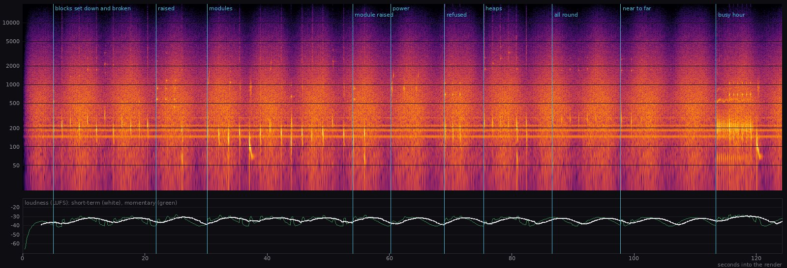

The chart is the listening copy: ten parts one after another over one quiet morning, from a block set down to a busy hour, with frequency up the side on a log scale and the loudness under it. The effects are the vertical streaks, the knocks under 300 Hz and the snaps and chimes above 1 kHz. The bands across at 150 to 200 Hz are the Core's hum, and the loudness that swells and falls every 15 seconds or so is the wind's sway.

Each scene drawn with the valley's beds under it, at full volume and 44.1 kHz, measured with ffmpeg's loudness meter:

| Scene                                                                             | Seconds | Integrated (LUFS) | Peak (dBFS) |
| --------------------------------------------------------------------------------- | ------- | ----------------- | ----------- |
| The quiet morning alone                                                           | 25      | -34.8             | -22.2       |
| Blocks set down, broken and raised                                                | 30      | -33.8             | -14.0       |
| Modules set down and taken apart                                                  | 35      | -33.3             | -12.3       |
| A module comes on, goes dark, comes on                                            | 14      | -34.9             | -18.3       |
| Three clicks turned away                                                          | 11      | -34.5             | -15.3       |
| A heap stripped six ways                                                          | 16      | -34.8             | -14.0       |
| A block set down all round the player                                             | 16      | -35.3             | -18.9       |
| The same block at ten distances                                                   | 23      | -34.8             | -15.2       |
| A busy hour: the click held at six a second, a wall gnawed, refusals, a Generator | 16      | -32.8             | -10.0       |
| The listening copy, all of the above one after another                            | 124     | -33.3             | -10.2       |

The effects add at most 2 LUFS to a quiet morning (the busy hour does; the others add 1 or less). The busy hour peaks at -10 dBFS, 10 dB under the top and 4.5 dB under the third wave's drum (-5.5), so building never reaches the limiter. The siege (-23.9 LUFS on its own) is 11 dB louder than the morning; the effects were not set against it, because that is when the fight's own sounds come in (6c2b).

The busy hour was also run through the governor alone: 61 effects in 6.5 seconds (the click at six a second, a wall at three, six refusals and a Generator), none turned away, the load of the sounds alive peaking at 11.3 against the 18.2 that building may fill and the 28 in all. Run in a browser for 30 seconds in real time there were 262 effects and none dropped.

### What the sound costs

The first-load script is 4.0 kB larger than main's (667.7 kB against 663.8; 194.3 against 192.9 gzipped), and the multiplayer chunk is 2.0 kB smaller (148.5 kB against 150.5), since code that only the multiplayer chunk carried is now shared with the sound and so lives in the first-load script. The page downloads 2.0 kB more in all (0.6 gzipped) before a click. The sound's own chunks arrive once the game is up and grew from 20.0 kB to 27.6 kB (7.9 to 11.0 gzipped): `live` from 6.3 to 13.1 kB (the effects, the governor and the placement), `attach-sound` from 1.6 to 2.2 kB, `reverb` from 11.65 to 11.81, `audio` as it was. The tool that draws effects to a file is 0.7 kB and loads only on a `?debug` page when asked. No audio file is fetched.

Played in real time in the sandbox's headless Chromium (44.1 kHz, a four-core machine with no sound device, a page with nothing else running) with a busy hour on a loop (the click at six a second, a machine gnawing a wall at three, a refusal every 1.5 seconds: 262 effects and 1032 voices in 30 seconds), the browser as a whole used 0.33 of a core against 0.14 for the valley's own sound alone, so building costs about 0.19 of a core at its busiest. Almost all of it is the audio thread, which makes the sounds: starting an effect on the main thread (placing it, asking the governor, making and connecting its voices) took 0.63 ms on average (1.5 ms at the 99th percentile, 1.7 at worst), and the once-a-frame update 0.013 ms on average, so the main thread spends about half of one percent of a core on it. A burst the budget lets through (thirteen blocks in one frame) is about 8 ms of that frame; more than that is turned away.

The sound's memory is the valley's (the noise banks and the room) and nothing besides: a voice's nodes are let go as it ends, and the governor, once it holds more than 512 sources, forgets those older than five seconds.

### Known gaps in the sound of building

- **It has not been heard.** The sandbox has no sound device. The levels are measured against the wind and the plan is checked in tests, but whether a block set down feels set down, whether the break's crackle is too sharp, whether the chimes of a raise and the chirps of the modules are pleasant, and whether the held click at six blocks a second tires, are for Austin's first listen, which is why a listening copy came with the pull request.
- **The sounds are mine.** The spec gives no direction beyond "place/break sounds" and "power", so the knocks, the signature of each module, the chimes (fifths and octaves of D, so that they sit in the day's major and the night's minor) and the power chirps are my reading of it. They are one place to change: the cue lists in `src/shared/effect-sound.ts`.
- **Only the building.** The fight (shots, turret fire, hits, kills, a machine rising and biting, the Core hit, a player down and back, the breacher's blast, a drop, the loss) is 6c2b. The player's own steps, jumps and landings, the clicks of the hotbar and the menus, a research row opening, a Storage used and a Bed slept in have no sound yet, and a base is built in silence between the knocks.
- **A guest hears its own block one round trip late.** Every sound follows the host's word, as the block does: a guest sees and hears its block together, when the host's word for it comes back. There is no prediction of an edit.
- **Placed by distance and side only.** A wall between a block and the player does not dull it, nothing is higher or lower than anything else, and the room is the same however much is built.
- **One reach.** Every effect carries 48 blocks. A turret across a base and a blast want a longer one, which 6c2b will give each kind.
- **A burst.** A thousand blocks that change in one frame sound as thirteen, which is the aim, and cost about 8 ms of that frame.
- **The measured hour is the morning.** One listener who stands still, one cell at a time, over the quiet morning. A siege covers the lowest octaves of a knock, and the effects stand far enough over it in the middle bands, but a heavy night's sounds against them is for the play to say.
- **The numbers are first guesses.** Every level is in the cue lists, and the loss, the pan, the dullness, the room, the gaps and the budget are `FALL`, `SPOT`, `KINDS` and `BUDGET` in `src/shared/effect-sound.ts`, for the first listen to move.
