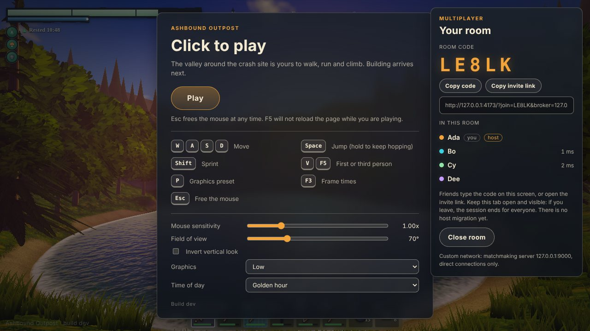
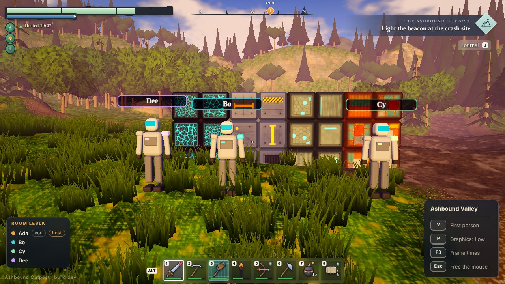
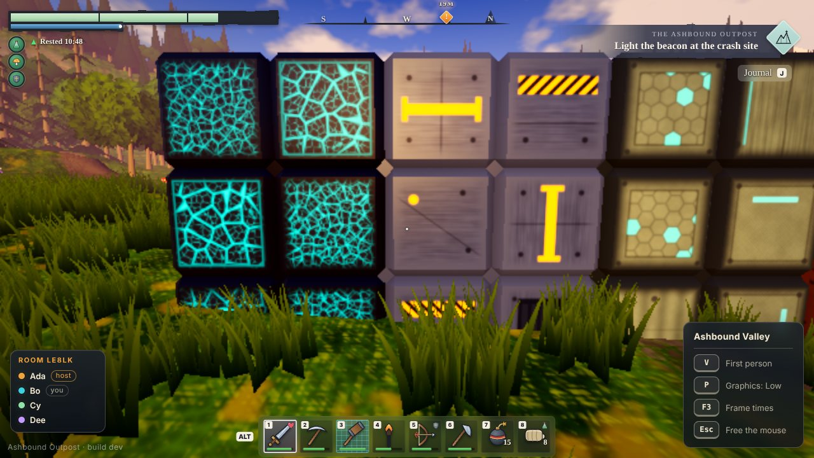
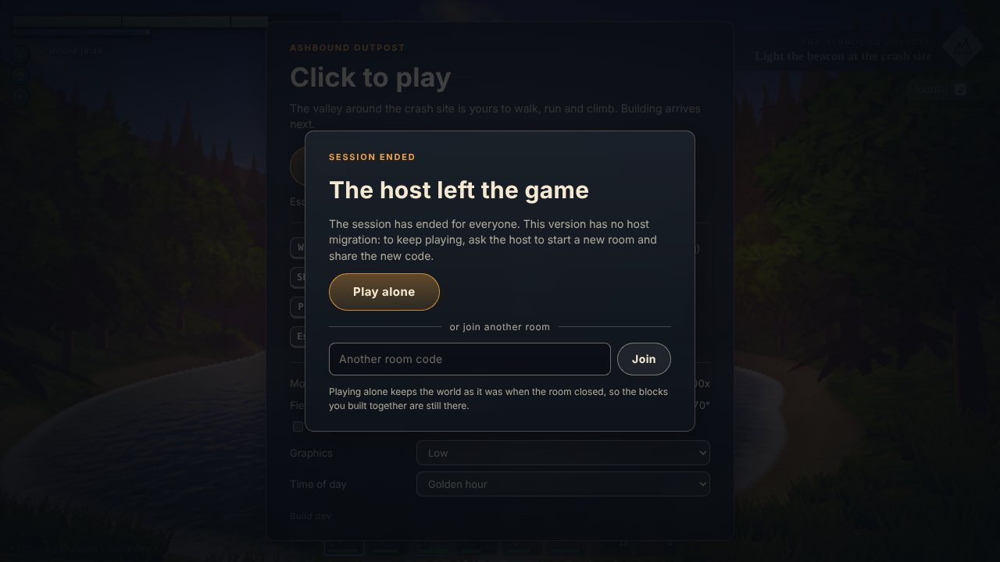

# Multiplayer

Up to four players share one world. One of them hosts: their browser is the authority for everything that changes the world, and the other three connect to it over WebRTC. This page says how that works, what the player sees, how to try it, and what the tests do and do not prove. The spec's rules are in [section 6](spec/SPEC.md); the owner's decisions are in [decisions](decisions.md#phase-3-multiplayer-foundation-2026-10-21).

## What a player does

1. Open the game. The start screen has a **Play together** card.
2. **Host a room** asks the matchmaking server for a five-character code (letters and digits, no `I`, `O`, `0` or `1`), for example `K7M2Q`. The card then shows the code, an invite link, and who is in the room.
3. Friends either type the code into the card's **Room code** field and press **Join**, or open the invite link, which joins on load.
4. Everyone clicks **Play** and builds together. The host's **Close room** ends the session for everyone (it asks first when others are in).

**If the host leaves, the session ends for everyone.** There is no host migration and no automatic reconnection in this version (spec sections 6 and 14). Guests see a full-screen notice, **The host left the game** (the host closed the room or the tab) or **Lost the connection to the host** (the host's browser stopped answering for ten seconds), with two choices: **Play alone**, which keeps the world exactly as it was when the room closed, or join another room. The start card, the room card and the README all say this up front. When saves arrive (Phase 6) the host will be offered a save at this point, and a resumed save starts a new room with a new code.

**What you can see together today.** Each other (a suit in the seat's colour with a name tag, walking and turning as its owner does), the room list with pings, the host-left screen, and the blocks: the host validates each edit, everyone applies it, and every world draws it (Phase 2c). Since Phase 2d the game has build controls: right click places the selected block and left click breaks one, through the same `sendCommand` the tests use, so a block anyone builds appears for everyone. The tests still place blocks through the `?debug` hook (`window.__ashbound.mp.placeNear(0, 3, 257)` asks for a scrap cube three cells along +z from where you stand), which needs no mouse, and compare a fingerprint of every world.









The screenshots are four real pages talking through a local PeerJS server in headless Chromium on software rendering, so they show the layout and the look, not the frame rate. The wall is 24 blocks, six placed by each player through the `?debug` hook, in each player's own material (Scrap, Composite, Alloy and Energy-Infused from right to left in the second picture); all four pages draw it and a fingerprint of their worlds is identical.

A page that reloads goes back into its room by itself: while a player is in a room the address carries `?join=CODE`, and the host gives the same seat back to the same browser tab (see [tokens](#tokens-and-seats)).

## How it fits together

```
        game page (src/app/multiplayer.ts)
        ┌────────────────────────────────────────────────────────────────────┐
 input ─┤ SessionHub ── Lobby ── HostSession ──┐        room panel (src/ui)    │
        │      │          │      GuestSession ─┤        draws Lobby.state      │
        │      │          └─ PeerTransport ────┼── PeerJS ── WebRTC ── others  │
        │  PlayerSync, remote avatars          │                               │
        └──────────────────────────────────────┴───────────────────────────────┘
```

| Piece                                | Where                                                           | Job                                                                                                                                                                                         |
| ------------------------------------ | --------------------------------------------------------------- | ------------------------------------------------------------------------------------------------------------------------------------------------------------------------------------------- |
| Protocol, wire codec, tuning table   | `src/shared/protocol.ts`, `wire.ts`, `net-config.ts`            | Message shapes, bytes on the wire, and every number in one table (`NET`).                                                                                                                   |
| Clock, interpolation, movement check | `src/shared/clock-sync.ts`, `interpolation.ts`, `move-guard.ts` | Pure code, tested on virtual time.                                                                                                                                                          |
| `HostSession`                        | `src/net/host-session.ts`                                       | The authority. Also plays single-player with no room open, and runs the survival simulation.                                                                                                |
| `GuestSession`                       | `src/net/guest-session.ts`                                      | Dials a room, builds the host's world from the snapshot, requests edits, applies events.                                                                                                    |
| `Transport`                          | `src/net/transport.ts`, `loopback.ts`, `peer-transport.ts`      | What the sessions need from a network. The loopback runs rooms in memory for tests; `PeerTransport` is the real one.                                                                        |
| `Lobby`, `SessionHub`                | `src/net/lobby.ts`, `hub.ts`                                    | Alone, hosting or visiting, and the buttons between them. The hub is the one `GameSession` the rest of the game holds, whichever session is behind it.                                      |
| Room panel                           | `src/ui/room-panel.ts`                                          | The card, the in-game roster and the host-left screen. It draws `Lobby.state` and calls the lobby; it has no network code.                                                                  |
| Game glue                            | `src/app/multiplayer.ts`, `player-sync.ts`, `seat-spawn.ts`     | Sends the player's movement, applies the host's corrections, draws the other players (`src/engine/remote-players.ts`), says where each seat starts, and leaves the room when the page goes. |
| Hook into the game                   | `src/app/attach-multiplayer.ts`                                 | The one file that knows `Game`: hands the glue the player, the world, the scene and the mouse, and runs it once a frame. Loaded on demand by `create-app.ts`.                               |

The layer rules hold: `src/shared`, `src/net`, `src/world` and `src/systems` import no three.js and touch no DOM. `src/net` reaches PeerJS only through a small structural interface (`PeerLike`). Nothing multiplayer is in the first download: the game page loads the glue (`attach-multiplayer`, about 20 kB compressed) after the game has started, PeerJS (about 31 kB compressed) only when a room is first opened, and `?bench=1` loads neither, so the benchmark measures the game alone.

## Rooms and connections

- **Codes.** The host registers the PeerJS id `ashbound-` plus the code. If the matchmaking server says the id is taken, another code is drawn, up to eight times. The prefix keeps ids from other apps on a shared server from clashing. Guests connect under random ids of their own.
- **Two lanes per guest.** `ctl` is reliable and ordered and carries JSON control frames (hello, welcome, snapshot, commands, events, refusals, pings, goodbyes). `fast` is unordered and carries the small binary state packets, so one late packet never holds up the newer ones behind it. Until `fast` opens, state rides on `ctl`. Both use PeerJS's `raw` serialization, so every control frame stays under 20,000 characters (`NET.maxFrameLength`); snapshots are split into frames of at most 1,000 edits.
- **Matchmaking and relays.** The public PeerJS server only introduces peers; after that, players talk directly. By default PeerJS's own list of ICE servers is used (a public STUN server and a free shared TURN relay). The URL can point the game at another server or other relays (see [URL switches](#url-switches)).
- **Heartbeat.** Guests ping the host every two seconds, and the pings carry each guest's measured round trip back out so the room list can show everyone's ping. Ten seconds of silence ends a link: a guest then shows **Lost the connection to the host**, and the host drops the guest and tells the others. A link that closes cleanly, or a goodbye frame, ends the session at once. A page that was itself blocked (a long script, a suspended tab) does not blame the other side: a session tick that runs more than two seconds late (`NET.stallMs`) forgives the silence that overlapped it, because the packets that arrived meanwhile are only read afterwards. A background tab whose timer ticks once a second is late by less than that, so a link that really died is still dropped on time (`tests/unit/session-stall.test.ts`).

## One command path

Placing and breaking go through one path for everyone, the host included, and single-player is the same path with nobody else in the room:

1. Input calls `sendCommand({ type: 'place' | 'break' | 'upgrade' | 'harvest', x, y, z, ... })` on the session (`place` and `upgrade` carry the piece's `state`).
2. The host validates it: a guest's rate (12 a second, a burst of 24), reach (6 blocks from the eyes plus 3 of slack for the host's slightly old idea of where the player is), the world's own rules (`BlockWorld.checkPlace` and `checkBreak`: inside the build area, empty, not buried, resting on the ground or a block, a known piece), no block inside any player's body, and, for a block to be placed, the economy's: no heap of debris keeps the cell clear and the crew's pool holds what the piece costs.
3. If it passes, the host takes the piece's cost from the pool (or, for a break, puts the broken piece's cost back), applies `setBlock` and sends the same numbered `set` event to every guest, the sender included. Events are state, not deltas, so applying one twice is harmless. A refusal goes back to the sender alone, with a short reason (`occupied`, `unsupported`, `out of reach`, `too fast`, `a player is in the way`, `debris is in the way`, `not enough Scrap`, `that block has changed`).
4. Guests apply the event to their own world and only then tell listeners, so listeners (the renderer, sounds) only react.

Content and balance live in data tables (`src/shared/blocks.ts` for shapes and materials, `NET` for network numbers). Cell states are opaque to the network layer, so new shapes and tiers change no message.

## Joining late

A guest that says hello gets a `welcome` with the world seed, its seat, the room list, the event counter and where to start, then the player-made blocks as `snap` frames. The guest builds the same terrain from the seed (terrain never travels over the wire), places the edits, applies any events that arrived meanwhile, and only then becomes `open`. The host's own copy is the source: the snapshot is whatever `forEachEdit` visits, in a fixed order. A test places 2,600 blocks and checks that a late joiner ends with an identical world (same count, same fingerprint).

## The survival clock

Since Phase 4a the host also plays the day and night clock (`src/systems/survival/`), and the room sees the same time. Since 4b it plays the Outpost Core's health too, and since 4c every player's Health and Energy.

- **The host plays it, the guests mirror it.** The host steps a pure simulation in fixed 20 Hz steps from its session timer and tells the guests with an `sv` control frame (its step count, whether the clock is running, the Core's health out of its maximum, and whether the run is over) about twice a second, at once when the clock starts or stops, and straight after the world snapshot for a newcomer. A guest carries the last word forward on its own timer (for three seconds at most) and never lets the countdown tick backwards. An `se` frame announces a change of light (nightfall, dawn), a wave ten seconds before it comes (`wave`: the night, which wave of the night it is, how many waves the night has and how many machines this one holds) a player going down or coming back (`down`, `back`: see below) or the run ending (`overrun`, with the day or night it ended in and why: the Core fell, or the whole crew is down) as it happens; a late joiner is not told the past, the snapshot says where things stand.
- **The Core's health rides `sv`.** A change in it is sent when 200 milliseconds (`NET.coreIntervalMs`) have passed since the last frame, so a hit shows on every screen within a fifth of a second and a night of hits is five frames a second at most, never one per blow. The Core itself is not an edit and not in the snapshot: its cells come from the seed's ground (`src/world/outpost.ts`), so every peer already has it, and the host refuses a block in its cells with `reserved`. When it falls the host stops the clock for the whole room (a run that is over does not wait for anyone), and `sv` says `over` until the room is closed.
- **Alone, the run waits for the player.** With nobody else in the room the clock runs only while the mouse is captured, so a menu, a hidden tab or a forgotten page costs no night. With a guest in the room it never waits, because the others are playing.
- **A blocked host loses time instead of replaying it.** A tick that finds more than two seconds to catch up plays two and drops the rest, so a tab that comes back after a minute does not skip a night.
- **Each guest hears only its own Health and Energy.** The host keeps a pair of meters for every player in its simulation (a seat joins them when the player does and takes them when it leaves). A `vt` control frame, `{ hp: [points, max], en: [points, max], chg, rt, sk }`, tells one guest about its own meters in whole points, whether it stands in the Core's charge field, and the two countdowns of going down (see below): at once to a newcomer, after the snapshot, and then whenever a point, the field or a countdown has changed and 250 milliseconds (`NET.vitalsIntervalMs`) have passed since the last word to that guest, so a night of wounds is four frames a second at most and an idle guest sends none. The host's own player reads the same meters straight from the simulation. The slow-down that low Energy brings is worked out on each machine from the points by the same rule (`VitalsMirror`, `speedScaleFor`), so no speed travels, and a guest that is slower than the host's movement check allows is never corrected for it. What a guest builds is paid for from its own Energy when the host accepts the edit; a refused command costs nothing.
- **Protocol versions 2, 3 and 4.** Version 2 added the frames above; version 3 (4b) put the Core's health and `over` into `sv` and added `overrun` to `se`; version 4 (4c) added `vt`. A host and a guest on different versions refuse each other and say why.

## The machines

Since Phase 4d the host also fields the crawlers (`src/systems/survival/enemies.ts`, how they walk is in [decisions](decisions.md#phase-4d-the-crawler-2026-10-23)), and every screen draws them. They are host state like the Core's health: the guests see where they are and never decide anything about them.

- **One packet, ten times a second, on the fast lane.** Kind byte 3, a count, a sequence number and the host's clock in milliseconds make the 8-byte header, and each machine adds 12 bytes: its id (16 bits), its kind and flags (a wind-up for a bite, a flash for a hit), its feet at 1/16 of a block, its heading at 1/256 of a turn, and its Health in parts of 255 (never 0 for a machine that is alive). The packet names every machine, not what changed, so a lost packet costs a tenth of a second of motion and nothing else, and a hundred machines weigh 1,208 bytes (`NET.maxEnemies` is 128, 1,544 bytes, which is the most one packet carries). Guests drop a packet that arrives behind a newer one by its sequence number, like a player's.
- **Quiet when there is nothing to say.** The host sends nothing while it is alone in the room. When the last machine falls it sends one empty packet at once so the guests clear their screens, and after that an empty one only every second (`NET.enemyKeepAliveMs`), because the lane drops packets and a guest that missed the empty one would otherwise keep drawing machines that are gone until the next night.
- **Drawn behind, from a short history.** `EnemyMirror` (`src/net/enemy-mirror.ts`) keeps the last eight reports. A guest draws 150 milliseconds behind its estimate of the host's clock (`NET.enemyDelayMs`), so two reports usually bracket the draw time; the host draws its own screen from the same mirror, 70 milliseconds behind its newest step, so its picture goes through the same code. A late stream is carried on for 250 milliseconds at most; a jump of more than six blocks is drawn as a jump; a machine appears from the second report that names it, not gliding in from nowhere, and is gone as soon as the newer report leaves it out.
- **What they do to the room travels as it always did.** A bite on the Core is the `sv` frame's health, a bite on a player is that player's `vt`, and a block they chew through is an ordinary `ev` frame with the player id 0 (nobody), so a guest's world loses it like any other block.
- **Protocol version 5.** The packet is new and the `ev` frame accepts a block set by nobody. A host and a guest on different versions refuse each other and say why.

## Shots

Since Phase 4e the players can hurt the machines with the pulse blaster (`src/shared/shot.ts` for the geometry, `HostSession.runShot` for the decision, what it does is in [decisions](decisions.md#phase-4e-the-pulse-blaster-2026-10-23)). A shot is a command like a block, and the host is the only one who decides it.

- **Two frames, both on the reliable lane.** A guest sends `fire`: where its camera is, the unit vector it looks along and the moment of the host's clock, in milliseconds, that its screen was drawing the machines at (its estimate of the host's clock less `NET.enemyDelayMs`). The host answers everyone, the shooter and its own page included, with one `sh` frame: who fired, where the bolt ended (a hundredth of a block), `SHOT_FLAG` bits (struck a machine, felled it, stopped by a block, the ground or the Core) and the machine's id. A shot is a few dozen bytes either way and a player cannot fire faster than the blaster, so a firefight is a handful of frames a second.
- **The shooter's eyes win.** The host takes the machines from `EnemyMirror.sample` at the moment the guest says, never more than half a second back (`NET.maxRewindMs`) and never ahead of its newest step, and judges the bolt against them: a shot aimed at what the guest saw hits, whatever its ping. The blow lands on the machine as it is now, by id. The host's own player is judged against the host's own screen, 70 milliseconds back (`NET.enemyHostDelayMs`).
- **What the host does not trust.** A guest's camera counts only within 6 blocks of where the host has the guest standing (`NET.shotOriginSlack`); from farther, the bolt starts at the guest's eyes. A shot with no direction, or from a guest the host has not heard a position from, is dropped, and so is one the blaster is not ready for (a bank of two shots that fills at one every 0.35 seconds, `PlayerVitals.takeShot`). The shot costs the player who fired it Energy, 0.6.
- **What every screen does with `sh`.** Everyone but the shooter draws the bolt from the shooter's avatar to the place the host says, and what it did there when it lands. The shooter drew their own bolt at the click, so the report adds only what the click could not know: the burst of a machine that fell and the hit marker. `Hub.onShot` hands the report to the screens; `createShotEffects` (`src/app/shot-effects.ts`) decides what it looks like.
- **Protocol version 6.** The two frames are new. A host and a guest on different versions refuse each other and say why.
- **Protocol version 7.** `se` carries a new event, `wave`, and the codec refuses one whose place is not inside its night. A host and a guest on different versions refuse each other and say why.

## Going down and coming back

Since Phase 4g a player at no Health is down until the Core brings them back (the rules and the numbers are in [decisions](decisions.md#phase-4g-going-down-and-coming-back-2026-10-23)). The host keeps the crew's respawn charges and the queue of the fallen with the rest of the run, and tells the room.

- **The pool rides `sv`.** `rc: [charges, most]` gives the charges the crew holds and the most it can (three for each player in the room, or what the pool holds if a player left with more), and `why` says what ended the run once it has (`over`): `core` or `crew`. The codec refuses a run that has ended with no `why`, a `why` on one that has not, a `why` that is neither, a pool above its most, and any number outside 0 to 65,535.
- **Two events.** `down` is `{ n, p }`: the day or night, and the player who has no Health left. `back` is `{ n, p, c }`: the player the Core has brought back, and the charges left. Each screen turns them into a message by the player's name, "you" for its own. They are sent once and a newcomer does not hear the past: it learns who is down from the state (`vt` for itself) and the charges from `sv`.
- **Each guest hears how long it waits.** `vt` carries `rt`, the whole seconds until the Core brings that guest back (6 down to 1; 0 for a guest that is up, and for one that is down with no charge to spend, who waits for the dawn), and `sk`, the whole seconds it stays shaken after coming back. A countdown is news when its whole number changes, so a guest that is down or shaken hears about once a second, and never more often than every `NET.vitalsIntervalMs` (250 milliseconds). Nobody else's countdown is drawn.
- **The hands of a player who is down.** The host refuses a block command from them with "you are down" and ignores their shots, whatever their screen says; the screen has already stopped them (`followVitals`). Their meters do not move while they lie there, and the machines choose their prey among players who are standing.
- **Being brought back moves them.** The host puts the player at their seat's spawn point with the same `fix` frame as a failed movement check (a new epoch, so what the guest sent from where it fell is dropped, and `MoveGuard.place` at the seat), sets the room's idea of their avatar there at once as a jump, and moves the host's own player the same way with a correction on its own screen. A guest's own screen teleports on `fix` and the avatar on the other screens jumps.
- **The run ends for the room.** When every player in the room is down and the pool is empty the host announces `overrun` with `why: 'crew'`, stops the clock and says `over` in `sv`, as for the Core. A player who leaves is no longer waited for (the others may all be down by then), and the charges they brought stay in the pool.
- **Protocol version 8.** `down`, `back` and `why` on `overrun` are new in `se`; `rc` and `why` are new in `sv`; `rt` and `sk` are new in `vt`. A host and a guest on different versions refuse each other and say why.

## Starting a lost run over

Since Phase 4h the host (or a player alone) starts a lost run over from the results card: **Retry** plays the same valley again and **New Run** draws another (the rules and the numbers are in [decisions](decisions.md#phase-4h-the-outpost-overrun-card-with-retry-and-new-run-2026-10-24)). For a room it is one new frame and a rebuild.

- **Only the host decides, and only when the run is over.** `restartRun(kind)` does nothing on a guest, while the run goes on, while a start-over is already under way, or where the game gave the host no way to build the next run. Otherwise the host rebuilds its own world for the seed (the same one for Retry, a drawn one that is not the current one for New Run), with nothing on it, and only then asks the game for the next run's simulation, because the Core's place and the ground the machines walk are the new world's.
- **One frame for the guests.** `run` is `{ n, seed, seq, spawn, epoch }`: the number of the run (the first start-over says 2), the valley to build, the host's event counter, where this guest starts, and its new epoch. A guest forgets the old run (the events still queued from its world, the machines, its mirror of the clock, the Core, the charges and its own Health and Energy), goes back to `loading`, builds the valley for the seed with no edits, applies what the host said meanwhile, stands at `spawn` and opens again. Nothing is sent from a screen that is building, as when it joined. A `run` frame for a run it has already played or an older one is ignored, and one that arrives while it is still building its first world waits until that world is up and is played then.
- **Everyone is seated again.** The host starts a new simulation and puts every player in it at their seat as if they had just joined: meters full, the charges they bring (a new simulation, so they bring them again), the movement check placed at the seat, the host's idea of their avatar there at once, a new epoch so that what a guest sent from the old world is dropped, and the guest's last report forgotten until it speaks from the new world. The machines, the blocks they were chewing, the events not yet announced and the memory of players who left in the old run are dropped, so a guest who returns after a start-over is a newcomer and stands at its seat, not where it left off.
- **What the run came to rides `sv`.** `st: [felled, placed, revived]` is the machines the crew's blasters have felled, the blocks the host accepted from the crew's `place` commands, and the charges the Core has spent bringing players back, counted by the host's simulation until the run is over. The results card of every screen, guests' included, shows them.
- **A newcomer joins the run the room is in.** `welcome` carries `run`, and the world it builds is the host's current valley with the host's blocks, as ever.
- **Protocol version 9.** `run` is a new frame, `sv` gains `st` and `welcome` gains `run`. A host and a guest on different versions refuse each other and say why.

## Movement

Each client owns its own movement, as decided: the controller runs locally with no lag and the host sanity-checks it.

- **Sending.** The game reports the player every frame; the session sends about 20 times a second. A state packet is 31 bytes: a sequence number, an epoch, the feet position (1/256 block), velocity, yaw, pitch and flags (on the ground, reset).
- **Relaying.** The host sends everyone's latest state to every guest about 20 times a second, with each entry's age, so guests can place samples on the right moment of the timeline.
- **Drawing.** Other players are drawn 100 milliseconds behind their newest sample, so two samples nearly always bracket the draw time and motion is smooth. A late stream is carried forward on its velocity for at most 250 milliseconds. A jump of more than six blocks with no reset flag, or any reset flag, is drawn as a teleport. A clock-offset estimate keeps the host's and each guest's timelines together.
- **The host's check (`MoveGuard`).** A guest may move at the controller's top speed times 1.35 horizontally, jump speed times 1.35 upward and the terminal fall speed times 1.35 downward, with up to 1.5 seconds of unspent movement banked so a burst of late packets passes. A guest that breaks the limit, or whose body sits inside a solid block for 600 milliseconds, is moved back to its last accepted position: the host sends a `fix` frame and bumps the guest's epoch so stale packets are ignored, and the guest teleports there. This is a sanity check against glitches and honest mistakes, not anti-cheat. A determined player can still, for example, dive below the world and then claim a respawn anywhere. Version 1 plays with friends, so that is accepted.
- **Respawns and spawn points.** Falling out of the world or being placed at a spawn is reported with the reset flag, so everyone draws a jump instead of a glide. Each seat has a colour and a starting spot. The Core bringing a player back to their seat (4g) is the host's own `fix`.

## Tokens and seats

Each browser tab keeps a random token in session storage and sends it with its hello. The host remembers the last sixteen guests that left, by token: the same tab that returns (a reload, or a brief loss followed by joining again) gets its old seat, with the same player id, colour and last safe position. A second tab of the same browser has its own token, so it is a second player. If a live member with that token was heard from in the last three seconds, the newcomer is a new player instead. The name is kept in local storage. Persistent tokens across browser restarts arrive with saves in Phase 6.

## Salvage and the crew's pool

Since Phase 5a the crew has one pool of materials and the valley has heaps of wreckage to strip for it (the rules and the numbers are in [decisions](decisions.md#phase-5a-salvage-2026-10-24)). The host keeps both with the rest of the run (`Economy` in `src/systems/economy`) and tells the room; a guest holds only a mirror (`src/net/economy-sync.ts`).

- **A command and three frames.** A strip is a `harvest` command, `{ x, y, z }`: the cell a heap's middle lies in (the floor of its coordinates), so a heap is named without a new kind of id and a guest cannot name one that is not there. It goes the reliable way a block command does. The host answers the room with `hd`, `{ p, i, m, g, l, f }`: who stripped it, which heap (its place in the run's list), the material, what went into the pool, the strips the heap has left and whether the pool had no room for all of it. `ec` is the pool, `{ pl, cap }`: the count of each material in tier order and the most the pool holds of any one. `nl` is the list of heaps.
- **What the host checks, in this order.** The player is not down (`you are down`); for a guest, it has not used up the edit rate that block commands share (`too fast`) and the host has heard where it stands (`not ready yet`); the cell is within reach (`out of reach`, the same check as a block); the run is not over (`the run is over`); there is a heap in the cell (`nothing to salvage there`) with a strip left (`nothing left there`); the heap's middle is within `DEBRIS.reach` of the player's eyes (`out of reach`); and the player's last strip was at least `DEBRIS.cooldown` ago (`too fast`). The pool is looked at last, when the strip is taken: a pool with no room refuses it (`the pool is full`), and one with some room takes what fits. A refusal costs nothing, as ever, and the player's screen shows the reason in the caption over the hotbar.
- **The heaps are the host's list.** The host works the field out from the seed and its own ground when the run starts, and sends the whole list: `[x, y, z, yaw, scale, harvests, grade, from, left]` for each heap, the numbers written to a hundredth, in list order (the index is the heap's name). The seeds are the same everywhere but the arithmetic of the ground is not guaranteed to be, so nobody works the field out but the host. It is sent to every newcomer with the welcome, to everyone at each dawn (which uncovers some heaps) and when a run starts over; between those a strip is the small `hd`. `left` is 0 for a heap that is gone or not uncovered yet. The list is at most `NET.maxDebris` heaps and the codec refuses a longer one, a heap with no strips, a `left` above its strips and a position outside the valley.
- **The pool is sent when it changes,** within `NET.poolIntervalMs` (200 milliseconds) of the last send, and to every newcomer, so a strip that fills the pool and a night's building that spends it (from 5b) are a few frames a second at most. The codec refuses a pool that does not list every material.
- **Everyone draws the strip.** `hd` reaches every screen, the one who stripped included (their own screen has nothing to predict: the sparks and the heap's layer wait for the host's word, which in a room is a round trip). The heap's picture loses a layer, scrap is thrown off it, and the player who stripped it is told what they got in a toast ("+9 Scrap"); the others are not, because they did not get it, they only see the pool grow.
- **What the run came to.** `sv.st` is now `[felled, placed, revived, gathered]`: the materials the crew has gathered, all kinds together, counted until the run is over. The results card shows it.
- **Protocol version 10.** `harvest`, `hd`, `ec` and `nl` are new, and `st` gains `gathered`. A host and a guest on different versions refuse each other and say why.

### What building costs (Phase 5b)

From 5b the pool pays for the crew's building (the numbers and the reasons are in [decisions](decisions.md#phase-5b-costs-2026-10-24)). Nothing new travels: a place and a break are the commands they were, the pool is the `ec` frame it was, and the protocol stays at version 10. What changes is what the host does with them.

- **Who pays.** The pool, whoever places: a guest's block and the host's come out of the same count, and a break gives the piece's cost back to the same count, whoever placed it. The host charges after the world has accepted the block and refunds after it has accepted the break, in the same step as the event, so a block that is refused costs nothing and a block that is in the world has been paid for. The block the machines chew through is a loss, not a break: nobody is refunded for it.
- **What the host adds to its checks.** Last, after reach, the world's own rules and the bodies in the way: a heap of debris that lies there with strips left keeps a round column of ground clear (`debris is in the way`), and then the pool must hold the piece's cost (`not enough Scrap`, with the name of the material that is short: `not enough Reinforced Composite`). The words go back to the sender as any refusal's do, and the sender's screen shows them in red in the caption over the hotbar.
- **The ghost asks the same questions.** The functions the host asks (`src/systems/economy/build-rules.ts`) are the ones a screen asks before it shows a block as placeable, of its own copy of the pool and the heaps: a host's own is the live one, a guest's is the mirror, so a ghost that is not red is a block the host will accept. The mirror is at most 200 milliseconds old, so for a moment after another player spends the last Scrap a guest's ghost can still look green; the host's word wins, and the guest is told "Not enough Scrap" as for any refusal. Where a screen has no pool to read (the pool's ceiling is 0: before a host has spoken, or a host with no run) nothing is charged, as the host charges nothing there.
- **The dawn waits for a built-over heap.** A heap due at a dawn that has a block standing in its column of ground does not come up that dawn; the host tries again at each later dawn until the ground is free. Heaps are the host's list, so the guests are told when the heap rises, as for any heap (`nl` at dawn).

### Research (Phase 5c)

From 5c the crew has research points, and the points open the better materials (the numbers and the reasons are in [decisions](decisions.md#phase-5c-research-2026-10-24)). One number is new on the wire and the protocol moves to version 11.

- **One new field.** `ec`, the pool's frame, is now `{ pl, cap, rp }`: `rp` is the crew's research points, a whole number of 0 or more (the codec refuses a negative or a fractional one). The tier the points have opened is not sent: both sides work it out with the same function (`tierAt` in `src/systems/economy/research.ts`) from the same table, so a guest's padlocks cannot disagree with the host about what the points are worth. The frame is sent when the research changes as well as when the pool does, within the same 200 milliseconds (`NET.poolIntervalMs`), and to every newcomer.
- **Who earns, and when.** The crew, once, at the dawn that ends each night: 10 points, and 2 more when nothing hurt the Outpost Core that night. The host credits them in the same step that uncovers that dawn's heaps and before it chooses which heaps rise, so a tier the points have just opened can have its heap come up at once. Nothing spends the points, so there is no command for them and nothing for a guest to ask.
- **What the host adds to its checks.** One question between the heap and the pool: a piece whose material the points have not opened is refused (`Reinforced Composite needs research`). The order is now reach, the world's rules and the bodies in the way, a heap's ground, the lock, and then the pool, so a crew that has neither the points nor the material is told the lock first. Where there is no pool (a ceiling of 0) nothing is locked, as nothing is charged. A screen asks the same function of its own copy of the points, so a ghost that is not red is still a block the host will accept.
- **A heap's grade is in the list it was already in.** `nl` has carried each heap's `grade` since 5a; from 5c it is not always Scrap: the 4th heap of every dawn's batch from the second dawn is Reinforced Composite, and the 3rd of every batch from the fifth is Advanced Alloy. A heap whose tier the crew has not researched is not uncovered at its dawn (its `left` stays 0 in the list) and comes up at a later dawn once the points are there, as a heap with a block on its ground does. A strip of a better heap is the `harvest` command and the `hd` frame it always was, and the toast names the material it gave.
- **The results card** reads the research earned from the pool's frame, not from `sv`: it is the points the crew holds when the run ends, and every point of them was earned, since none is spent.
- **Protocol version 11.** `ec` gains `rp`. A host and a guest on different versions refuse each other and say why.

### Modules (Phase 5d1)

From 5d1 the crew can build the Research Terminal, the first functional module (the rules and the reasons are in [decisions](decisions.md#phase-5d1-modules-and-the-research-terminal-2026-10-26)). A module is a cell of the block world, so nothing new travels and the protocol stays at version 11.

- **The same commands and the same events.** A guest asks for a Terminal with the `place` command and takes one down with `break`, as for a block. The state is the cell's 16 bits, a module's shape id in the low byte and its level in the high one (`moduleShape` in `src/shared/blocks.ts`), so one number says what it is and which way it faces, and a state naming a level the module lacks is refused as any unknown piece is (`unknown-block`). The host answers the room with the numbered, idempotent `set` event every block change uses, and the late-join snapshot is the edit list, so a latecomer is shown the Terminals with the blocks.
- **What the host checks.** The order is the one blocks have: the player is not down, the edit rate, the host has heard where the player stands, reach, the world's rules, a player in the way (the whole cell, as for a block), a heap's ground, the lock and then the pool. A module differs in two places. The world's rule is that it must stand: on the ground (a cell the ground cuts is accepted, as for a block, unless it lies wholly under it, which is `buried`, and so is a cell floating no more than `MODULE_FOOT` over the ground at its middle), or on a block or the upper half of a slab, and anything else is `unsupported`. And the price is the module's own (40 Scrap for the Terminal), taken from the pool in the same step that applies the event, so a refusal costs nothing. The research lock does not apply: a module's material byte is a level, not a material. A break gives the price back to the pool, whoever placed it.
- **The screen asks the same questions.** The ghost goes red for the world's rule, a heap's ground and a short pool before a click is sent. Where a module stands on a slope the cursor chooses the cell (`MODULE_SINK`, in `src/shared/build-aim.ts`), and the host's rule is the same file's neighbor `MODULE_FOOT`, so a click that passes one passes the other.
- **Every screen draws it from its own world.** A screen draws a module from its copy of the world's cells (`ModuleRenderer`), so a Terminal a guest placed appears on the host's screen when the host's event applies and on each guest's when it arrives, as a block does, and a run started over rebuilds the world and the renderer with it.

### Research read by a Terminal (Phase 5d2)

From 5d2 the points the crew earns open nothing until a standing Research Terminal has read them (the rule and the reasons are in [decisions](decisions.md#phase-5d2-an-unlock-needs-a-terminal-2026-10-26)).

- **One new field.** `ec`, the pool's frame, is now `{ pl, cap, rp, cl }`: `cl` is the part of `rp` that a Terminal has read, a whole number from 0 up to `rp` (the codec refuses a `cl` past `rp`). The tier is still not sent: both sides work it out from `cl` with `tierAt`, so a guest's padlocks cannot disagree with the host about what the points are worth. The frame is sent when `cl` changes as it is when `rp` does, within the same 200 milliseconds, and to every newcomer.
- **Who reads, and when.** Only the host. A Terminal placed reads every point earned so far, in the step that applies the event (`Economy.placed`, called by the session once the pool has paid). A dawn credits the night's points and, when a Terminal stands in the host's world then (`moduleStands`, a scan of the edit list), reads them in the same step, before it picks which heaps rise. What was read stays read: breaking the Terminal refunds its price and takes nothing away, and points earned after that wait for the next one. A run that opens at a later night (`?night=N`) has read the nights behind it, and `?research=` and the `setResearch` hook read what they set unless asked not to.
- **No new command.** A guest cannot ask for a reading and a Terminal is not "used": the standing of one in the host's world is what counts. The ladder a player opens with E is drawn from the pool's frame and asks the host for nothing.
- **What the host's words are.** Unchanged: a piece of a material the points have not opened is still refused with `<Material> needs research`. A screen says more (`Needs a Research Terminal`) because it knows the points are there and the reading is not.
- **Protocol version 12.** `ec` gains `cl`. A host and a guest on different versions refuse each other and say why.

### Upgrading a block (Phase 5e)

From 5e a player can ask the host to make the block in a cell one material better (the rule and the reasons are in [decisions](decisions.md#phase-5e-upgrade-in-place-2026-10-26)). The change itself is a block changing state, so it rides the events every block change does.

- **A new command, no new event.** `{ type: 'upgrade', x, y, z, state }`: `state` is the better piece the sender's screen offered. The host answers the room with the numbered, idempotent `set` event the block's new state needs, the sender included, and the late-join snapshot is the edit list, so a latecomer is shown the better block. Nothing but the command is new on the way in.
- **Compare and swap.** The host works out the better piece from the cell as it stands (`upgradeStep`) and refuses the command if it is not the one named: `that block has changed`. So a press made on a screen that is a moment behind (another player upgraded the block, a machine chewed it, it was broken and rebuilt) is turned away instead of taking a second tier or paying for a piece nobody saw. A cell with nothing in it is `nothing to upgrade there`; a block with no better self (Energy-Infused, or a module) is `already fully upgraded`.
- **What the host checks.** The order is the one blocks have: the player is not down, the edit rate, the host has heard where the player stands, reach, then the cell (above), the lock on the better material (`<Material> needs research`, the same words a placement gets) and the pool (`not enough <Material>`). There is no check for a player in the way: the cell is full already and the shape does not change.
- **What it does.** In one step the host applies the event, takes the better piece's price from the pool (and gives nothing back for the old block, which is used up), takes the Energy an edit costs from the player and counts the upgrade. A refused command costs nothing and spends no Energy. A machine chewing the cell starts over on the better block.
- **A fifth number on the results card.** `sv`'s `st` is now `[felled, placed, revived, gathered, upgraded]`; the codec refuses any other length. Every screen reads the count from the host's last word, so the Outpost Overrun card's `Upgrades completed` is the same on all of them.
- **The screen asks the same questions.** The card under the crosshair reads the lock and the pool from this screen's copy of the economy (`upgradeRefusalOnScreen`), so an upgrade the host would turn away for those reasons is shown in red and not sent. It cannot know about a change that has not reached it yet, which is what the compare is for.
- **Protocol version 13.** The command and the fifth number are new. A host and a guest on different versions refuse each other and say why.

### The Basic Turret (Phase 5f1)

From 5f1 the crew can build a Basic Turret, which shoots the machines by itself (the rule and the reasons are in [decisions](decisions.md#phase-5f1-the-basic-turret-2026-10-26)). A turret is a module, so placing one and breaking one are the `place` and `break` commands of 5d1 and nothing new travels for that. What is new is its shot.

- **A turret's shot is a blaster shot with a cell.** The host announces it with the `sh` frame a player's shot gets, to everyone and to its own page: where the bolt ended (`e`), `SHOT_FLAG` bits (`f`: struck a machine, felled it) and the machine's id (`h`), and now an optional `c`, the cell the turret stands in, with `p` zero (`NO_PLAYER`) for there is no player. The codec takes a frame with a `c` only when `p` is 0, and a frame without one only when `p` is a player (1 and up), so neither can pass for the other and no frame an older build would have sent changes meaning; a cell outside the range a cell can have is refused. A turret fires at most twice a second and a shot is a few dozen bytes, so a base of turrets in the middle of a night adds a handful of reliable frames a second.
- **Nothing is asked of the host.** A turret is never told to fire, and a guest has no command for it: each step the host reads its own world for the modules that stand (`VoxelWorld.forEachModule`) and lets the turrets among them that are ready shoot, so a turret a guest built shoots as soon as the host's world has it, and nobody can make one fire or stop one.
- **Everyone draws it from the report.** Nobody clicked, so no screen draws a turret's bolt ahead of the host's word, as a player's own is. Every screen, the host's included, works out where the bolt starts from the turret's cell and the end of the bolt (`turretMuzzle`, `src/shared/turret.ts`), so the host's trace, the bolt drawn and the barrel the model's head is turned to agree without a muzzle or an angle travelling. The bolt is amber (`FX_COLOR.turret`), a kill bursts as a player's does, and there is no hit marker: that is the shooter's alone.
- **Only while the run goes.** The turrets fire inside the host's survival step, so they wait while the run is held (alone in the world with the mouse free) and stop when the Core has fallen. A host with a guest in the room never holds the run.
- **What stays on the host.** The wait between one turret's shots is the host simulation's, kept by cell in memory and started over with a run. It is not in the snapshot, and neither is a head's turn, so a player who joins later sees the turrets standing at rest until each next fires.
- **Protocol version 14.** `sh` gains `c`. A host and a guest on different versions refuse each other and say why.

## URL switches

None are needed to play. They exist for tests, for a private server, and for a host on a strict network.

| Switch                               | Meaning                                                                                                                                     |
| ------------------------------------ | ------------------------------------------------------------------------------------------------------------------------------------------- |
| `?join=K7M2Q`                        | Join this room on load. A pasted invite link works in the code field too.                                                                   |
| `?name=Ada`                          | The name for this page.                                                                                                                     |
| `?broker=localhost:9000`             | Use another PeerJS-compatible server: `host[:port][/path]`, or with a scheme (`https://peers.example.com/app`). `&brokerKey=` sets its key. |
| `?ice=none`                          | Direct connections only (no STUN or TURN): for tests on one machine.                                                                        |
| `?ice=stun:host:3478,turn:host:3478` | Use these relays. `&iceUser=` and `&iceCred=` give TURN credentials. `?ice=default` restores PeerJS's list.                                 |

The invite link the card builds keeps these network switches, so a room on a private server is found on the same one, and leaves out the rest (your name, debug switches). When the network is not the usual one, the card says so, because a link can point the game at another server.

## What is tested, and what is not

**Proven in this repository's tests:**

- The whole protocol on virtual time over an in-memory network with latency, jitter, packet loss, reordering and links that die silently: hosts, guests, rooms of two to four, late joins, the movement check, interpolation under bad networks, returning seats, the host leaving or vanishing, and the lobby's states.
- The PeerJS transport against a fake PeerJS that behaves like the real library (lanes opening at different times, the matchmaking server dropping out, a code collision, a missing room).
- The sessions against the real voxel world: the placement rules, and a 2,600-block snapshot arriving identical.
- The host's movement check against the real controller on the real valley: a scripted sprint-and-hop tour over hills, lake floor and edge wall, delivered smoothly and in late bursts, and a 60-block fall, with every report accepted (and refused when the check is made stricter than the controller, so the test can fail).
- **Real browsers:** Playwright opens a local PeerServer and four Chromium pages of the real game. One hosts, three join by typing the code, they see each other's avatars and room list, place and break blocks until all four worlds carry the same fingerprint, a fifth is refused, a reload gets its seat back, a latecomer receives the whole world, and closing the host's tab shows the host-left message to the three guests, who can play on alone. A host wounds one guest and drains its Energy to nothing: that guest's bar, screen edges, walking pace and hands change, and the host's do not; what the guest builds comes off its own bar. A guest shoots the host's crawler three times: both screens log the bolts, the shots cost the guest's Energy and not the host's, the third fells it on every screen, and the hit marker is the guest's alone. A guest walks up to a heap of debris, strips it with the interact key, and the host's pool, both screens' pictures of the heap and the guest's toast follow, while the host is told nothing it did not get; a heap out of reach is refused, and a player who joins later is told the heap's state and the pool. A guest and the host build from the one pool: each block comes off the same count on both screens and in both hotbars, a break gives it back to whoever placed it, and when the host empties the pool the guest's next block is refused with "not enough Scrap" (the host's own screen records no refusal) while the guest's cursor, which reads its copy of the pool, goes red by itself and clears when the host puts some back. A guest builds a Research Terminal: it stands in both worlds and is drawn on both screens, its price comes off the one pool, a player who joins later is shown it, and when the host breaks it, it is gone from every screen and the price is back in the pool. A guest builds a Basic Turret and the host sends a crawler within its range: every screen, the guest's and the host's, draws an amber bolt named for the turret's cell and no player, the head of the turret on each is turned so that its barrel is where the bolt leaves it, the crawler falls on every screen to one killing shot and the kill is counted once, and when the host breaks the turret the price is back and a second crawler is left alone. A host loses the run: its card offers Retry and New Run and the guest's says who it waits for, then the host plays Retry and both worlds are the same valley, empty, with a fresh clock and everyone seated, and New Run does it again on another seed. Other tests cover a host whose page hangs (**Lost the connection to the host** after ten seconds), a missing room code, and an unreachable matchmaking server. Software WebGL draws about two frames a second and five pages starve each other, so each page here draws one frame every 1.5 seconds at a small size (the game, the network and the timers run as they always do), and the tests wait on state, never on time. They are a Playwright project of their own (`multiplayer` in `playwright.config.ts`) that runs after the other browser tests: next to them, a slow page load on a four-core machine silenced a guest for ten seconds, and the host rightly dropped it. To run only these, use `npx playwright test --project=multiplayer --no-deps`.

**Not proven here, because the sandbox cannot reach them:**

- The public PeerJS server and PeerJS's STUN and TURN servers. The tests use a local server and no ICE servers, so connections are direct on one machine.
- Real network paths: two machines, home routers, strict or carrier-grade NATs, VPNs. A connection that needs a relay depends on a free, shared TURN service that can be slow or full. If a room does not connect across the internet, the player sees "Could not connect to the host" with the likely reason.
- Frame rate. Headless software WebGL says nothing about it; `?bench=1` on a real machine does, and it never loads the multiplayer code.

## Known limits

- **A hidden host tab slows the room.** Browsers throttle timers in tabs that are hidden or covered, and the host's tab does the relaying. The card tells the host to keep the tab visible. The survival clock itself keeps real time (it catches up in steps), but the relay of players drops to about once a second. Moving the host's loop into a Worker is a natural follow-up (Phase 4's decision about it is in [decisions](decisions.md#phase-4a-the-day-and-night-clock-2026-10-21), with the measure of the machines' cost in [4d](decisions.md#phase-4d-the-crawler-2026-10-23)).
- **A wrong code takes about five seconds to report.** The matchmaking server holds the introduction for five seconds before it answers that there is no such room. A broker that is down is reported at once.
- **No kick, no spectators, no chat.** Not in the spec's Phase 3.
- **The movement check is a sanity check** (see above).
- **Everyone must run the same build.** A host and a guest on different protocol versions refuse each other and say why.

## For later phases

- New commands (upgrade a block, place a module, set a hotbar) are new `BlockCommand` shapes validated in `HostSession.refusal`; new world changes are new event types with the same numbered, idempotent delivery.
- The pool and the heaps (5a) are host state with frames of their own (`ec`, `nl`, `hd`); costs (5b) spend from the same pool and need no new frame but a refusal, research (5c) adds one number to the pool's frame, modules (5d1) are cells that ride the place and break commands and the edit list, an unlock that needs a standing Terminal (5d2) adds one more field to the pool's frame, upgrades (5e) are one command and the `set` event every change uses, with a fifth number on the results card's `st`, a turret's shot (5f1) is the blaster's `sh` frame with the turret's cell, and a module's power will ride the machines' and the pool's frames.
- Enemies, waves, health and resources become host state that rides the same frames: `sv` and `se` carry the survival state and its events, the nights' waves among them (Phase 4a and 4f), `vt` the player's own meters (4c), and the machines' positions have a fast-lane packet of their own (4d). The blaster (4e) is two reliable frames, `fire` and `sh`. The waves (4f) add what they need: a kind of machine is a new kind in that packet, and a new run is a new frame (`run`, 4h).
- Saves (Phase 6) hook the same moments the host-left screen does: the **Close room** button and `pagehide`. The spec asks the host to attempt an auto-save before the session ends when it can.
